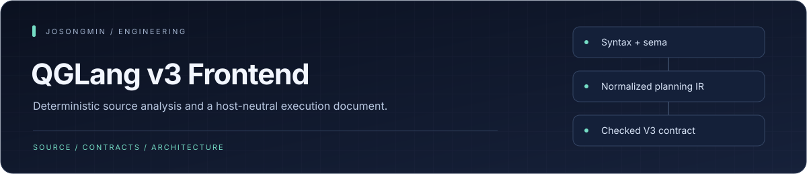
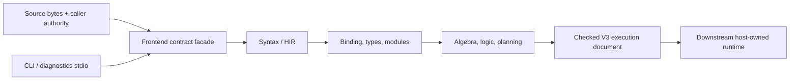

<p align="center"></p>

# Quanta GQLang

The Rust owner repository for the **QGLang v3 language frontend**. It turns source text and explicitly supplied authority into checked syntax, semantic analysis, and a host-independent V3 execution document.

[Language guide](docs/language/README.md) · [Frontend contract](docs/contracts/frontend-execution-v3.md) · [Examples](docs/language/examples_index.md) · [Remaining work](docs/work/remaining.md)


## Engineering highlights

| Mechanism | Engineering purpose |
| :--- | :--- |
| **Deterministic frontend stages** | Source syntax, semantic analysis, and normalized IR have separate owning crates and conformance boundaries. |
| **Checked closed-source compilation** | Caller-sealed authority and original source bytes produce a source-bound V3 execution document. |
| **Explicit incomplete analysis** | Open analysis reports missing authority as typed incomplete state instead of fabricating a host catalog or executed result. |
| **Host-neutral public facade** | Downstream consumers use the frontend-contract crate rather than importing internal surface, sema, HIR, or pipeline crates. |
| **Bounded diagnostic transport** | Read-only NDJSON diagnostics validates exact request fields and rejects unknown or mutating methods. |


## Architecture at a glance



## Scope

| Owned here | Owned downstream |
| --- | --- |
| Syntax, formatting, HIR, binding, types, and modules | Runtime substrate and host DTOs |
| Normalized algebra/logic and frontend planning IR | Physical planning and provider routing |
| Checked source compilation and V3 execution documents | Provider/generation admission and result materialization |
| Read-only CLI and diagnostics stdio | Backend/SDK runtime wiring and `quanta-index-sdk` |

Sibling consumers depend only on `quanta-gqlang-v2-frontend-contract`. Internal owner crates such as `surface`, `sema`, `hir`, and `pipeline` are not the external API.

## Execution model

```text
source + caller authority
    → syntax / HIR
    → binding / types / modules
    → algebra / logic / frontend planning
    → checked frontend contract
```

Both CLI/diagnostics and host compilation pass through the frontend contract. Open analysis produces diagnostics; it does not invent a host catalog or authorize execution. Closed source compilation can produce `CompiledSourceDocumentV3` and immutable `ExecutionDocumentV3` from caller-sealed authority and original bytes.

## Try the CLI

```sh
cargo run -p quanta-gqlang-v2-cli -- fmt --file examples/show/capabilities.qglang
cargo run -p quanta-gqlang-v2-cli -- query --file examples/show/capabilities.qglang
```

Supported read-only commands are `query` and `fmt`, with `v3-query` and `v3-fmt` aliases. `query` performs open analysis rather than plan execution: unresolved authority reports `analysis.status=incomplete` and exits 1.

Malformed arguments, unreadable input, and command errors fail with non-zero exits. `--file` requires a regular file, including a symlink resolving to one. Untrusted diagnostic/error values use one-line escaping for control characters, backslashes, and Unicode line separators.

## Diagnostics over stdio

```sh
cargo run -p quanta-gqlang-v2-diagnostics-stdio
```

The protocol is bounded newline-delimited UTF-8 JSON. Supported methods are declared by this exact-set block:

<!-- supported-diagnostics-methods:start -->
- `v3_diagnostics`
<!-- supported-diagnostics-methods:end -->

Request fields are exactly `id`, `method`, `source_id`, and `source`. Duplicate/unknown fields and mutating/unknown methods are rejected. This private NDJSON transport is not JSON-RPC or LSP and does not implement `initialize` or document lifecycle methods.

## Verification

| Rail | What it checks |
| --- | --- |
| Owner API tests | Semantic contracts and checked document production |
| CLI process tests | Examples, stdout/stderr, exit codes, malformed argv, and deterministic formatting |
| Diagnostics process tests | Read-only behavior, bounded input, malformed JSON, and session recovery |
| External consumer probes | Facade-only consumption and privacy boundaries |
| Family conformance | Root-family disposition, composition, and refusal boundaries |

The [test contract ledger](docs/language/test_hellgate_ledger.md) maps the surface to its rails. [V3 digest vectors](crates/quanta-gqlang-v2-pipeline/tests/fixtures/execution-v3-vectors.tsv) pin execution-document digests. Frontend checks do not establish runtime admission, provider availability, result counts, or backend materialization.

## Development environment

`rust-toolchain.toml` pins the default Rust 1.81 toolchain. Full verification additionally uses Rust 1.95 Clippy, a dated public-API nightly, Just, nextest, taplo, typos, cargo-deny, cargo-public-api, Python, and Semgrep. Exact tool versions are recorded in [toolchain.lock.toml](tools/ci/toolchain.lock.toml).

```sh
just doctor
just ci
```

`just ci` is the repository-wide local gate and already includes the focused rails; avoid running the same suite twice. It checks locked dependency caches offline before compilation and rejects source drift during its waterfall. Fill the required workspace, external-consumer, and pinned-nightly caches only when the preflight identifies missing inputs.

Use `just static`, `just test`, or `just policy` for focused diagnosis. `just qualify-local` separately issues a receipt for a clean committed source. The repository uses no GitHub Actions workflows; neither local command proves downstream deployment.

## Status

This is a pre-release, read-only v3 frontend. Catalog/presentation families describe checked semantics, not executed services. There is no separate shipped AI exploration API. Qualification-cache timing is build/verification timing, not query throughput or latency.

- [Documentation index](docs/README.md)
- [Architecture decisions](docs/adr/README.md)
- [Release discipline](docs/language/release_discipline.md)
- [Qualification tools](tools/qualification/README.md)
