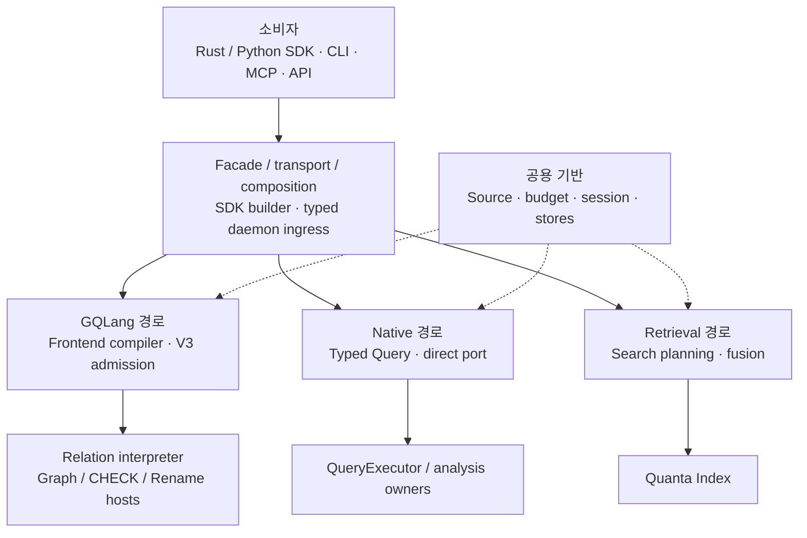
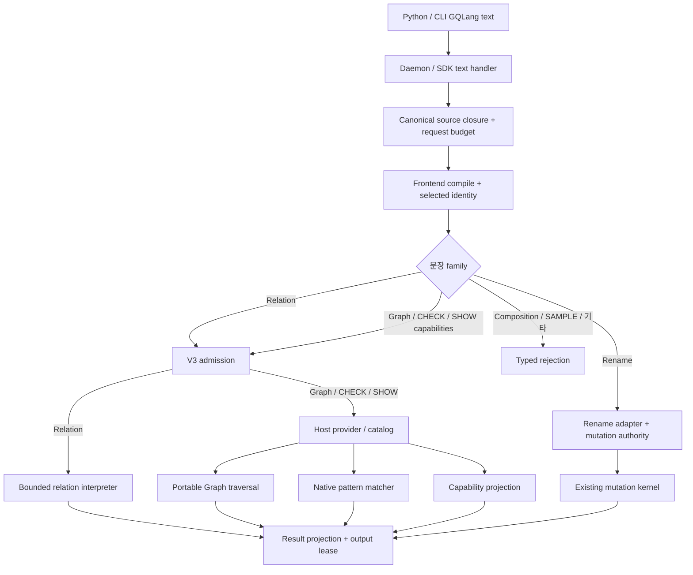
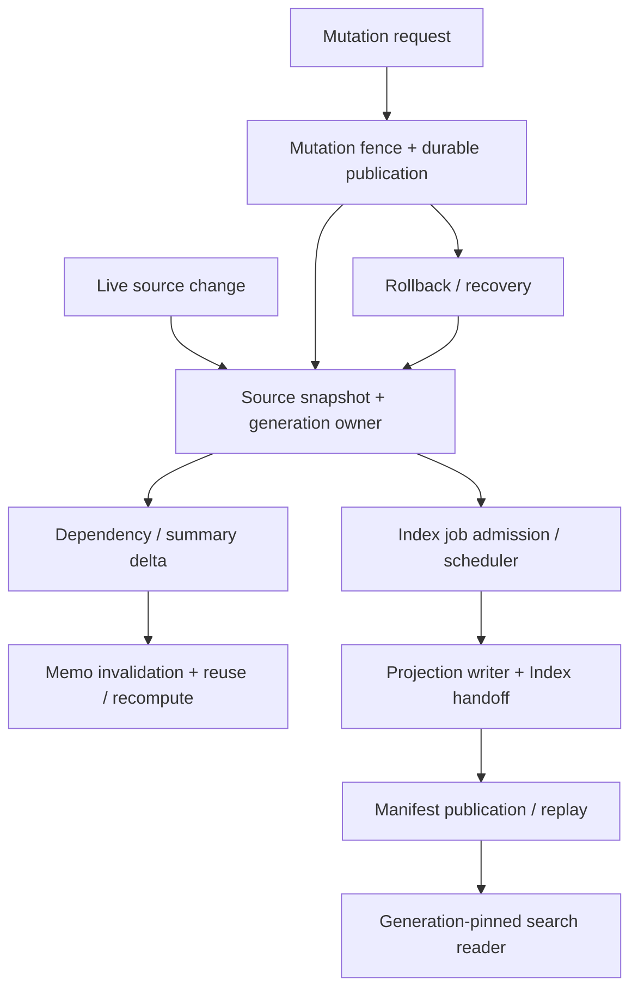
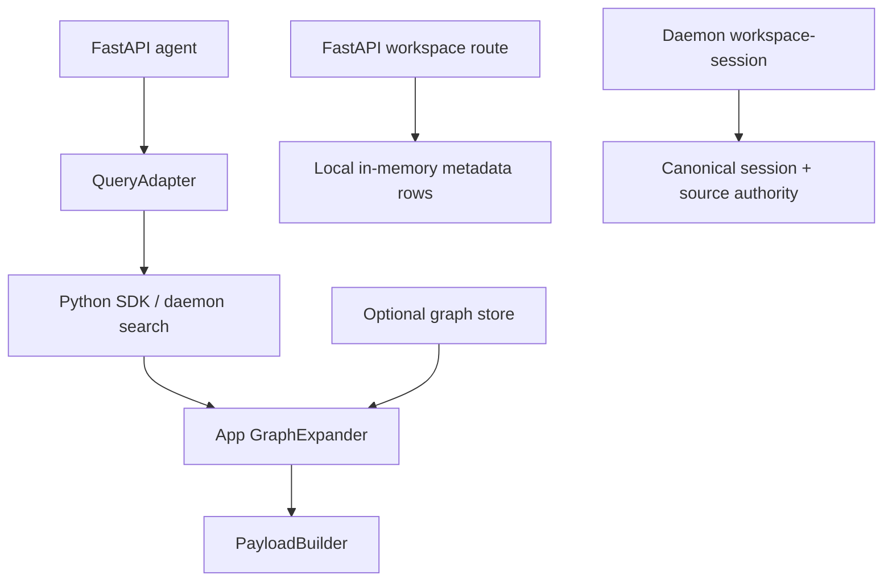
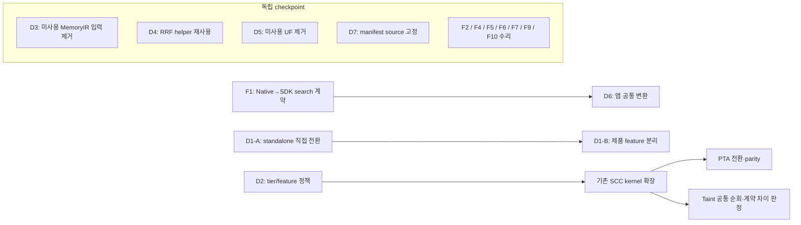
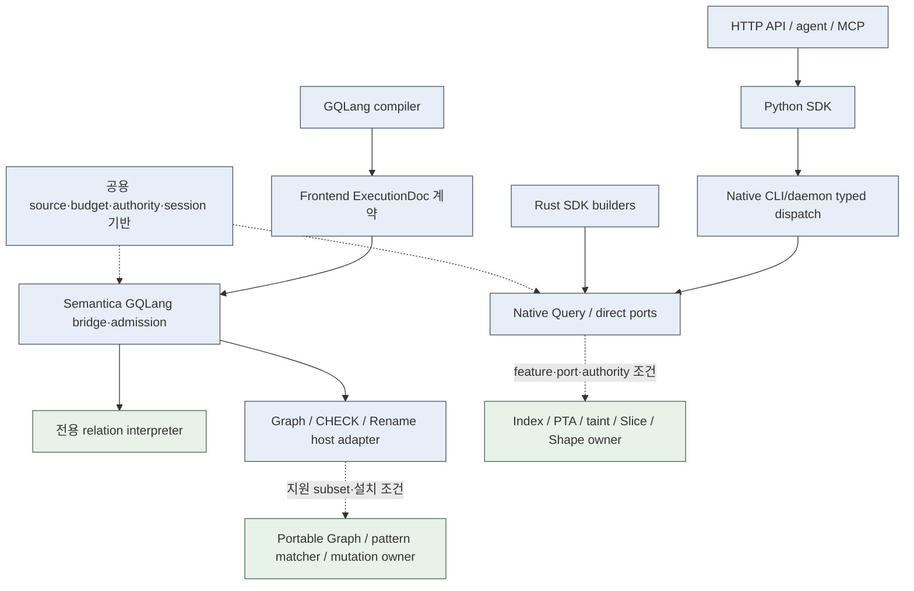
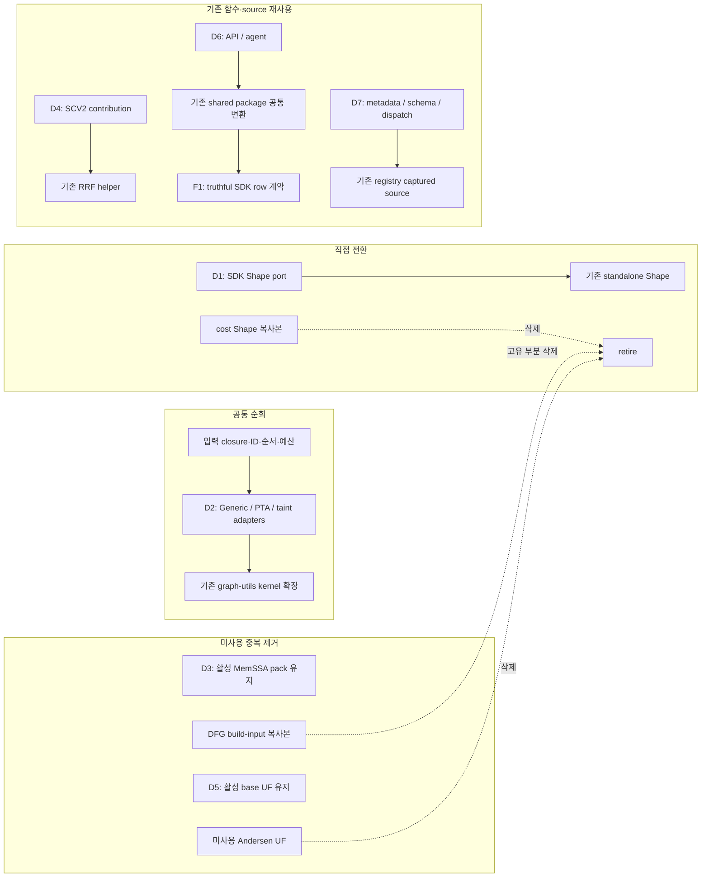

# GQLang · Semantica substrate 아키텍처 감사

## 1. 기준과 판정

| 항목 | 기준 |
|---|---|
| 날짜 | 2026-10-06 |
| 초기 GQLang frontend | `0bdef2ad45b4aab1965ed7ca0e14a2e43a927769` |
| 초기 Semantica runtime | `d801f15fe11feb08586190070957fa470294e8b4` |
| Quanta Index selected provider | `66f92d210bbb9641a2f091d6e6ab42330b0a5ffb`; sibling path dependency, selected search/cache/cursor owner 추가 확인 |
| 범위 | GQLang 실행, Rust/Python SDK, native CLI/daemon, MCP, FastAPI, native 분석, 공용 상태·권한·검색·mutation |
| 증거 | 소스 caller→contract→owner, registry census, Python component. 초기·심층·설계 감사 이력 보존; 최신 재반증은 §9.9·second_wide_final_audit, 현재 액션은 §9.1 |
| 제외 | 진행 중인 foreign dirty의 완성도 판정, 모든 함수의 실행 증명, installed product qualification |

- **Facade:** 기존 API/type 재노출. **Adapter:** wire·입력·결과 변환. **Policy:** 권한·예산·지원 범위 검사. **Orchestration:** owner 호출 순서. **Calculation:** 결과 의미 계산. **State:** 저장·cache·session·publication 관리.
- **연결:** production caller가 소스에 존재. **조건부:** feature·port·authority·설치 조건이 필요. **준비:** 구현은 있으나 조사한 공개 경로에서 거절되거나 production caller가 미확인. **거절:** 명시적인 failure 경로. **Mock:** 고정/가공 응답.
- 연결과 조건부는 설치된 제품의 실행 성공을 뜻하지 않는다. 같은 owner 구현과 같은 instance 공유를 구분한다.
- 최종 재감사는 위 committed tuple을 고정하고 관련 live dirty를 별도 대조했다. Python·manifest·search producer 입력 35 hash 항목(29개 unique file)은 이전 component 실행 입력과 동일했다. 과거 component의 실제 실행 reference는 유지하고 현재 source 일치만 확인했다. Rust/daemon 실행 receipt로 확대하지 않는다.
- 이전 넓은 감사 기준은 GQLang `262f3933`·Semantica `73c8f40b`이며 관찰 중 Semantica가 `28182d02`로 이동했다. 이전 직접 owner 40개 입력은 동일했다. 신규 Chop/Dice edge 구성(F9)·HTTP agent 요청 범위(F10)를 추가해 **수리 8건 + 중복 제거 7건**으로 갱신한다. 당시 13건·실행 source cut은 이력이다. 현재 수용 조건은 §9.1·9.9를 따른다.
- 2차 넓은 감사는 GQLang `9326edf2`·Semantica `a3e72f7e`를 고정했다. F9의 PDG/CFG 출력 경계·직접 Q3 criterion 거절, F10의 startup root 고정·budget 입력 검증, D7의 canonical name 중복 검증을 보완한다. **수리 8건·중복 제거 7건, 15건**은 유지한다. 신규 독립 engine 작업은 추가하지 않는다. 상세 현재 source/foreign overlay는 §9.9와 second_wide_final_audit를 따른다.
- 기능·수명·설정 결함과 확인된 계산/계약 코드 중복을 해결 목록에 함께 유지한다. 중복 구현의 존재를 wrong-result로 표현하지 않으며, 서로 다른 계약·단계·state instance를 중복 engine으로 세지 않는다. §9.1이 최종 해결 목록이고 §9.2는 제외·하향·수리 상태다.
- 2차 반증 감사는 이전 해결 15건을 세 갈래로 대조했다. 당시 owner가 발행하지 않는 cursor와 소켓 연결 전 MCP 구성 실패를 독립 수리 목록에서 제외해 **당시 수리 6건 + 중복 제거 7건**을 남겼다. 항목 ID는 이력을 위해 유지한다. 중복 제거는 결과 오류의 재현 여부와 별개로 유지한다.
- 이전 최종 재확인은 Semantica `5fa85198`→`d801f15f`의 committed 변경 33개를 대조했다. 인용 소스의 committed 변경은 없고 기존 component 입력 29개도 동일했다. 당시 Python owner component로 F1/F5/F6을 추가 실행해 아래의 좁은 범위를 재확인했다. 당시 해결 목록 13건을 보존하며 이전 component receipt의 source reference는 변경하지 않는다.
- 이전 해결 13건의 직접 owner·ingress 소스는 component JSON의 `current_resolution_input_review`에 별도로 묶었다. 이 입력은 이전 committed source·현재 frozen source·live bytes가 모두 같고 다른 작업의 관련 dirty와 구분된다. 기록한 소스 범위의 판정이며 전체 upstream/downstream dependency의 실행 검증은 아니다.
- 중복 owner 선택은 추가 병렬 감사에서 구현 전체·feature·outer ingress를 대조했다. Shape의 향후 lean owner, SCC의 core/analysis 계층, dormant export와 조건부 제품 경로를 정정했다. 계약 비교는 §7.1.1–7.1.2·`deep_duplicate_audit`, 당시 전환 설계는 §7.1.3·`architecture_decision_review`에 보존한다. 최신 판정·범위·순서는 §9.1·9.5·9.9 및 second_wide_final_audit가 우선한다.
- 이전 독립 감사는 GQLang `d95e7ba5`·Semantica `79919b90` 기준이다. Root D6/D7 추가 관찰은 `0d3dbeb4`에서 19개 clean 입력을 기록했다. 직접 owner 40개와 추가 입력의 연속성은 최종 validation에 별도 기록한다. 아래의 과거 source cut·receipt를 최신 HEAD 실행으로 바꾸지 않는다. 당시 §9.6의 보완은 이력이며 최신 판정은 §9.9를 따른다.
- 아래 링크는 live 작업 파일을 열므로 frozen 증거와 다를 수 있다. 관련 dirty·source delta·최신 HEAD는 component JSON에 기록한다. Registered search control 누락은 현재 기준의 ancestor인 `bc8e2d66`에서 수리돼 재수리 목록에서 제외했다. 실행 검증이 남은 것은 별도 표시한다.

## 2. 전체 구조

- Frontend compiler는 GQLang 저장소 소유다. Semantica [ingress bridge](/Users/songmin/Documents/code-new/semantica-codegraph-v2/packages/analysis/quanta-v2/crates/quanta-gqlang-v2-ingress-bridge/src/source_execution_v3.rs:7)는 [frontend contract](/Users/songmin/Documents/code-new/quanta-gqlang-v2/crates/quanta-gqlang-v2-frontend-contract/src/lib.rs:15)를 호출한다.
- SDK public export는 facade다. Builder와 composition은 admission·orchestration을 포함한다. `boundary_gqlang_runtime_v1`은 [공용 SDK owner surface](/Users/songmin/Documents/code-new/semantica-codegraph-v2/packages/analysis/quanta-v2/crates/quanta-runtime/src/boundary_gqlang_runtime_v1.rs:1)이며 analysis/PTA/search/executor도 재노출한다.
- GQLang V3 relation은 전용 interpreter를 사용한다. Native QueryExecutor의 memo/singleflight/session이 V3 최종 relation 결과에 자동 연결됐다는 증거는 없다.
- 모든 native family가 QueryExecutor를 거치는 것은 아니다. Shape/heap/abstract interpretation 등에는 direct port 호출도 있다.

## 3. GQLang 실행과 지원 범위

### 3.1 소스 실행

호출 근거: [Python GQLang 분기](/Users/songmin/Documents/code-new/semantica-codegraph-v2/packages/sdk/python/codegraph_sdk/client.py:2322) → [daemon budget root 전달](/Users/songmin/Documents/code-new/semantica-codegraph-v2/packages/analysis/quanta-v2/crates/quanta-sdk-runtime-executor/src/client/query_api.rs:4622) → [SDK handler](/Users/songmin/Documents/code-new/semantica-codegraph-v2/packages/analysis/quanta-v2/crates/quanta-sdk-runtime-executor/src/client/query_handlers/gqlang_handler.rs:1990) → [public admission](/Users/songmin/Documents/code-new/semantica-codegraph-v2/packages/analysis/quanta-v2/crates/quanta-runtime-public-ingress-surface/src/lib.rs:170). Rename은 [별도 adapter](/Users/songmin/Documents/code-new/semantica-codegraph-v2/packages/analysis/quanta-v2/crates/quanta-sdk-runtime-executor/src/client/query_handlers/gqlang_handler/rename_v3.rs:612)에서 기존 mutation owner를 사용한다.

| Family / 유즈케이스 | 실제 역할 | 현재 상태 |
|---|---|---|
| Parse/sema/algebra/logic/planning | Frontend 컴파일 계산 | Host-agnostic IR/ExecutionDoc 생성. Frontend planning은 분류·논리 provenance이며 runtime 물리 최적화가 아니다. |
| Scan/Filter/Project, EXISTS/SemiJoin/AntiJoin | [relation interpreter](/Users/songmin/Documents/code-new/semantica-codegraph-v2/packages/analysis/quanta-v2/crates/quanta-runtime-execution/src/gqlang/relation_exec_v3.rs:174) 계산 | 연결. RepoPath 중심의 제한된 typed 연산. 스칼라 Relation 내부 EXISTS는 Composition 거절과 별개. |
| FIND reachability/path | Host adapter + [portable traversal](/Users/songmin/Documents/code-new/semantica-codegraph-v2/crates/quanta-cli-server/src/production_analysis_host_portable_graph.rs:925) 계산 | 조건부. Linux installed parser, 제한된 Python top-level graph, forward·witness 1개 subset. |
| CHECK | Signed rule admission + [native pattern matcher](/Users/songmin/Documents/code-new/semantica-codegraph-v2/packages/analysis/quanta-v2/crates/quanta-runtime-command-owner-surface/src/pattern_execution_v2/check_execution_v3.rs:95) | 조건부. PatternOnly/Skip/Findings, unscoped subset. Signed catalog·matcher 필요. |
| SHOW capabilities | [host catalog projection](/Users/songmin/Documents/code-new/semantica-codegraph-v2/packages/analysis/quanta-v2/crates/quanta-runtime-public-ingress-surface/src/gqlang_execution_v3.rs:2007) | 연결. 다른 SHOW/EXPLAIN 문장의 실행 지원과 별개. |
| Rename preview/apply | Adapter + existing mutation kernel/publication | 조건부. Source-target authority와 mutation feature 필요. |
| LET/WITH Composition | Composition plan·producer executor | 준비. [Source-first root 거절](/Users/songmin/Documents/code-new/semantica-codegraph-v2/packages/analysis/quanta-v2/crates/quanta-runtime-public-ingress-surface/src/lib.rs:498). |
| Text/Semantic/Hybrid SAMPLE | 자체 text scan/scoring 또는 Index provider | 준비. Public Composition 거절. Hybrid는 prepared classifier에서도 거절. |
| EXPLAIN/DESCRIBE/COMPARE/EXPORT 등 | Frontend vocabulary와 일부 helper | [V3 classifier](/Users/songmin/Documents/code-new/semantica-codegraph-v2/packages/analysis/quanta-v2/crates/quanta-runtime-public-ingress-surface/src/admitted_execution_request_v3.rs:135)의 공개 runtime family로 지원하지 않는다. |

### 3.2 부속·대체 경계

| 경계 | 소유권과 현재 상태 |
|---|---|
| Typed precompiled V3 | [generic selection](/Users/songmin/Documents/code-new/semantica-codegraph-v2/packages/analysis/quanta-v2/crates/quanta-gqlang-v2-exec-contract/src/frontend_execution_selection_v3.rs:263)은 Relation/Composition을 거절. 별도 admitted scalar selector는 Relation만 허용. Export 존재만으로 Composition을 호출할 수 없다. |
| Rust Fluent GQLang V1 | [execute_v1](/Users/songmin/Documents/code-new/semantica-codegraph-v2/packages/analysis/quanta-v2/crates/quanta-runtime/src/sdk/gqlang_builder.rs:288)는 retired 오류. |
| SDK doctor/explain/autocomplete | [SDK 관측 API](/Users/songmin/Documents/code-new/semantica-codegraph-v2/packages/analysis/quanta-v2/crates/quanta-sdk-runtime-executor/src/client/query_api.rs:5863)와 [bound-plan explain](/Users/songmin/Documents/code-new/semantica-codegraph-v2/packages/analysis/quanta-v2/crates/quanta-runtime/src/boundary_gqlang_runtime_v1/public_explain_v1.rs:55), [catalog autocomplete](/Users/songmin/Documents/code-new/semantica-codegraph-v2/packages/analysis/quanta-v2/crates/quanta-runtime/src/boundary_gqlang_runtime_v1/public_autocomplete_v1.rs:24). V3 문장 실행과 다른 경계. Legacy text/AST 입력은 거절. |
| Frontend logical explain | [ExplainNoteV2](/Users/songmin/Documents/code-new/quanta-gqlang-v2/crates/quanta-gqlang-v2-planning/src/explain.rs:19): checked algebra·provenance. Runtime binding/physical explain과 다른 계약. |
| Module/lockfile | Frontend module authority·검증. [SDK lockfile admin](/Users/songmin/Documents/code-new/semantica-codegraph-v2/packages/analysis/quanta-v2/crates/quanta-sdk-runtime-executor/src/client/query_api.rs:5718)의 blob read/write/validate/replay는 별도 관리 경로. |
| ProofPack | [4행 정적 registry](/Users/songmin/Documents/code-new/semantica-codegraph-v2/packages/analysis/quanta-v2/crates/quanta-gqlang-v2-exec-contract/src/proof_pack.rs:171). Serving proof 계산 engine으로 세지 않는다. |
| Natural/structured retrieval DSL | [정해진 canonical redirect](/Users/songmin/Documents/code-new/semantica-codegraph-v2/packages/analysis/quanta-v2/crates/quanta-runtime-retrieval-kernel/src/query_intent_v2/canonical.rs:29)만 별도 feature 경로로 처리. [Natural query lowering](/Users/songmin/Documents/code-new/semantica-codegraph-v2/packages/analysis/quanta-v2/crates/quanta-runtime-retrieval-kernel/src/query_intent_v2/lowering.rs:76)은 거절. V3 compiler 실행과 구분. |

## 4. 외부 소비자와 공개 경로

### 4.1 진입별 상태

| 소비자 | 실행 흐름·유즈케이스 | 성격·제한 |
|---|---|---|
| Rust SDK `Code` | Builder/selector → native Query 또는 direct port | [public export](/Users/songmin/Documents/code-new/semantica-codegraph-v2/packages/analysis/quanta-v2/crates/quanta-sdk/src/code.rs:1)는 facade. [from_path](/Users/songmin/Documents/code-new/semantica-codegraph-v2/packages/analysis/quanta-v2/crates/quanta-runtime/src/sdk/code/mod.rs:858)는 caller-provided OrchestratorPort 필요. `from_source`는 disabled. |
| Python registered query | Catalog/lossless lowering → typed ProductRequest → Unix socket → daemon | [21-name map](/Users/songmin/Documents/code-new/semantica-codegraph-v2/packages/sdk/python/codegraph_sdk/_product_request_adapter_v1.py:27). Response projection·input admission 필요. ImportGraph/clone/cost wrapper는 현재 lowering 밖. |
| Python/Native CLI GQLang | Source binding + attached workspace session → V3 source-first handler | [CLI request](/Users/songmin/Documents/code-new/semantica-codegraph-v2/crates/quanta-cli/src/request_build.rs:281). Relation/Graph/CHECK/SHOW/Rename subset. |
| CLI/daemon typed operation | Family/provider admission → SDK/backend owner | [registry](/Users/songmin/Documents/code-new/semantica-codegraph-v2/crates/quanta-cli-ingress-runtime/src/dispatch/operation_binding_registry_v1.rs:90). Feature-off 및 RuntimeNotExpressible는 거절. |
| MCP | Generated daemon SDK adapter → Python SDK | [공개 도구 등록/dispatch](/Users/songmin/Documents/code-new/semantica-codegraph-v2/apps/mcp/mcp/main.py:111): canonical manifest 경로를 명시하면 query 8개 + local `hello` 1개 구성. Repo-root 기본 discovery는 실패(§8). Job/admin/index/context/preview handler 파일은 미등록. Resources/prompts는 빈 목록. |
| LSP stdio | Typed IDE ingress → Fluent IDE → semantic/query owner | [semantic request](/Users/songmin/Documents/code-new/semantica-codegraph-v2/crates/quanta-cli-server/src/lsp_stdio_v3/semantic_v3.rs:60). Snapshot/source/position authority 필요. |
| FastAPI search/IDE/mutation | Python SDK → daemon | [mounted routers](/Users/songmin/Documents/code-new/semantica-codegraph-v2/apps/api/api/main.py:208). IDE HTTP는 definition 한 개. GQLang·files/repos/context HTTP route는 이 app에 없다. Indexing lifecycle route는 retired. |
| FastAPI agent | SDK search → 앱 GraphRAG → payload → issue/recommendation 계산 | [agent 호출](/Users/songmin/Documents/code-new/semantica-codegraph-v2/apps/api/api/routes/agent.py:174). 검색 hit 기반 heuristic이며 canonical code-agent/native solver finding을 반환하는 경로가 아니다. |
| FastAPI graph | Legacy container graph authority/index 조회 | [route dependency](/Users/songmin/Documents/code-new/semantica-codegraph-v2/apps/api/api/routes/graph.py:102). Default symbol index 없음·graph authority install 미확인 → 503. 외부 injection은 별도. Native CallGraph SDK 연결로 계산하지 않는다. |
| FastAPI workspace | CRUD/branch → 프로세스 내부 dict | [local repository](/Users/songmin/Documents/code-new/semantica-codegraph-v2/apps/api/api/routes/workspace.py:54). 실제 source snapshot·patch 적용 없음. Daemon workspace-session 및 shared SQLite/Postgres repository와 별개. |
| Legacy Python CLI | [Typer 명령](/Users/songmin/Documents/code-new/semantica-codegraph-v2/apps/cli/cli/main.py:22): index/search/tool/query/analyze | 설치 선언 미확인. Index/Cypher import 대상 없음, analyze는 mock. SQL 분기는 store.fetch(raw SQL)를 직접 호출하는 조건부 경로이며 native CLI/daemon 밖. |
| TypeScript engine API | Memory session + mock index/engine/event bus | [bootstrap](/Users/songmin/Documents/code-new/semantica-codegraph-v2/apps/quanta-engine-api/src/index.ts:22). Demo/mock 경로. |
| Kotlin | DTO/fixture compatibility pilot, 내부 semantic mutation oracle | 공개 transport의 production 계산 SDK로 확인되지 않았다. [Semantic mutation oracle](/Users/songmin/Documents/code-new/semantica-codegraph-v2/packages/analysis/quanta-v2/crates/quanta-kotlin-semantic-platform/src/mutation.rs:1)은 fact differential 정책이며 source edit/rename owner가 아니다. |

### 4.2 Registry census

| 범위 | 수 | 의미 |
|---|---:|---|
| Canonical ProductRequest operation | 53 | Query 27 / Mutation 8 / WorkspaceSession 4 / Meta 8 / DaemonControl 6. 거절 항목 포함. |
| Runtime operation binding | 52 | `mutation.refactor-rename` 누락. |
| Python registered lowering | 21개 이름 / 18개 operation ID | GQLang 별도 spec 분기 및 lifecycle 명령과 구분. |
| MCP query registry | 8 | find_symbol, goto_definition, find_references, search_code, document_symbols, folding_ranges, hover, ide_semantic_tokens. |
| MCP 명시적 manifest 구성 | 9 | 위 8개 + local hello. 기본 discovery 실패와 구분. |

정적 literal inventory: [frontdoor JSON](/Users/songmin/Documents/code-new/quanta-gqlang-v2/docs/audits/2026-10-06-substrate-frontdoor-inventory.json). 등록 수는 실행 성공 수가 아니다. `code-agent.triage/evidence`, mutation preview/PTA cutover, graceful-stop 등은 명시 거절이다. `dist-interactive`와 `dist-full`의 [feature 범위](/Users/songmin/Documents/code-new/semantica-codegraph-v2/crates/quanta-cli-ingress-runtime/Cargo.toml:143)도 다르다.

## 5. 공용 substrate와 state instance

| Substrate | 실제 역할 | 공유·소비자 |
|---|---|---|
| Source/generation authority | [identity/membership/digest/seal 검사·발급](/Users/songmin/Documents/code-new/semantica-codegraph-v2/packages/analysis/quanta-v2/crates/quanta-runtime-source-authority-wire/src/lib.rs:564) | GQLang, native query, parser, pinned session. |
| Request budget/output session | [charge/work/permit 구현](/Users/songmin/Documents/code-new/semantica-codegraph-v2/packages/analysis/quanta-v2/crates/quanta-runtime-execution/src/budget_handle.rs:537), [동일 admitter 검사](/Users/songmin/Documents/code-new/semantica-codegraph-v2/packages/analysis/quanta-v2/crates/quanta-runtime-context-shared/src/runtime_execution_session_v1.rs:40) | 공용 정책 구현. Daemon GQLang은 발급된 동일 root 사용. Direct SDK 호출은 자체 root 생성. |
| Durable payload materialization | [원래 session에 예약된 byte carrier](/Users/songmin/Documents/code-new/semantica-codegraph-v2/packages/analysis/quanta-v2/crates/quanta-runtime-context-shared/src/runtime_execution_session_v1.rs:165) | Durable read backing을 첫 할당 전에 예약하고 session/permit 수명을 보유. 별도 저장 engine이 아니라 policy·allocation owner. |
| Error/wire projection | [borrowed error projection](/Users/songmin/Documents/code-new/semantica-codegraph-v2/packages/analysis/quanta-v2/crates/quanta-contract-error-shared/src/contract_error_v2.rs:163), [borrowed byte matcher](/Users/songmin/Documents/code-new/semantica-codegraph-v2/packages/analysis/quanta-v2/crates/quanta-runtime-source-authority-wire/src/borrowed_byte_match_v1.rs:1) | Error payload demand·변환, canonical byte equality의 공용 계산 helper. Domain solver·authority 발급·저장 engine이 아니다. |
| QueryExecutor/memo/singleflight | [native query execution](/Users/songmin/Documents/code-new/semantica-codegraph-v2/packages/analysis/quanta-v2/crates/quanta-runtime-query-executor-owner/src/query_executor/mod.rs:366) | Native Query 재사용·trace·artifact/evidence persistence. Domain solver는 별도. |
| Runtime ingress planner | [request-driven ExecuteQuery plan](/Users/songmin/Documents/code-new/semantica-codegraph-v2/packages/analysis/quanta-v2/crates/quanta-runtime/src/orchestration/ingress_planner.rs:11) | [default bootstrap](/Users/songmin/Documents/code-new/semantica-codegraph-v2/packages/analysis/quanta-v2/crates/quanta-sdk-session-backend-owner/src/orchestrator_bootstrap.rs:16). Default가 물리 optimizer를 호출한다는 증거는 없다. |
| InputCellStore/SnapshotHistory | [foundation owner](/Users/songmin/Documents/code-new/semantica-codegraph-v2/packages/analysis/quanta-v2/crates/quanta-adapters-foundation/src/in_memory/core/input_cell_store.rs:148) | Source read/history/lease/prepared mutation commit. In-memory adapter 경로는 재노출. |
| Memory compose/host/platform | [composition delegation](/Users/songmin/Documents/code-new/semantica-codegraph-v2/packages/analysis/quanta-v2/crates/quanta-runtime-memory-compose/src/lib.rs:380) → [memory host](/Users/songmin/Documents/code-new/semantica-codegraph-v2/packages/analysis/quanta-v2/crates/quanta-memory-host/src/lib.rs:30) → pinned memory platform | Evidence/artifact/PTA/reopen/retention/quota. Wrapper마다 broker engine이 생기는 구조가 아니다. |
| SemanticSubstrate/DependencyGraph | [generic delta/graph carrier](/Users/songmin/Documents/code-new/semantica-codegraph-v2/packages/analysis/quanta-v2/crates/quanta-runtime-context-shared/src/semantic_substrate_v1.rs:36), [dependency owner](/Users/songmin/Documents/code-new/semantica-codegraph-v2/packages/analysis/quanta-v2/crates/quanta-contract-semantic-dependency-shared/src/semantic_dependency_graph_v1.rs:79) | PTA/MemSSA/IFDS lineage·DerivedFrom·invalidation. FIND 대상 call graph와 다름. |
| SummaryDependency/Incremental protocol | [lookup index 계산](/Users/songmin/Documents/code-new/semantica-codegraph-v2/packages/analysis/quanta-v2/crates/quanta-contract-summary-deps-shared/src/summary_dependency_substrate/queries.rs:93), [reuse/delta/full dispatch](/Users/songmin/Documents/code-new/semantica-codegraph-v2/packages/analysis/quanta-v2/crates/quanta-runtime-incremental-protocol/src/dispatcher.rs:145) | Native 함수 요약 영향과 resume/recompute. 새 IFDS solver가 아니다. |
| Index control-plane/manifest | [job admission/supersession](/Users/songmin/Documents/code-new/semantica-codegraph-v2/packages/analysis/quanta-v2/crates/quanta-indexing-control-plane/src/coordinator.rs:409), [RCU publication/pin/replay](/Users/songmin/Documents/code-new/semantica-codegraph-v2/packages/analysis/quanta-v2/crates/quanta-indexing-control-plane/src/lib.rs:28) | Index projection·repair·generation reader. Runtime manifest 경로는 동일 owner 재노출. |
| Taskmesh | [governed execution adapter](/Users/songmin/Documents/code-new/semantica-codegraph-v2/packages/analysis/quanta-v2/crates/quanta-runtime/src/governance/runtime_adapter.rs:47) → pinned Taskmesh | Worker/class/queue/stack/deadline. Index job DAG/admission과 다른 책임. |
| Mutation/code-agent | [family execution substrate](/Users/songmin/Documents/code-new/semantica-codegraph-v2/packages/analysis/quanta-v2/crates/quanta-code-agent-runtime-bridge/src/substrates/execution.rs:91) → planner/applier → validation/publication/compensation | Rename/safe-delete/move/signature/extract-method. 전체 family가 public daemon에 노출된 것은 아니다. |

### 5.1 변경·검색·복구 흐름

- [Ingress packet 조립](/Users/songmin/Documents/code-new/semantica-codegraph-v2/packages/analysis/quanta-v2/crates/quanta-sdk-runtime-composition-owner/src/bootstrap_inputs_v1/runtime_executor_ingress_packet.rs:211)은 memo table을 새 Arc로 만든다. Evidence/artifact는 주어진 memory deps의 Arc clone을 전달한다. 공유 범위는 configured packet/orchestrator이며 전역 동일 cache가 아니다.
- Native [CallGraph admitted resume owner](/Users/songmin/Documents/code-new/semantica-codegraph-v2/packages/analysis/quanta-v2/crates/quanta-runtime-analysis/src/queries/interprocedural/incremental/snapshot_admitted_owner_v1.rs:94)는 [production delta caller](/Users/songmin/Documents/code-new/semantica-codegraph-v2/packages/analysis/quanta-v2/crates/quanta-runtime-analysis/src/queries/interprocedural/run_execution.rs:4324)에 연결된다. Source lease·원래 execution session·derived permit를 [output lifetime까지 보유](/Users/songmin/Documents/code-new/semantica-codegraph-v2/packages/analysis/quanta-v2/crates/quanta-runtime-analysis/src/queries/interprocedural/output_call_graph/full_output_source_custody_v1.rs:34)한다. Final refresh/rebind도 재승인한다. Admission·수명 경로는 소스로 확인됐고 runtime/QBC proof는 미실행이다.
- SDK 재시작의 [RecoveredTransition](/Users/songmin/Documents/code-new/semantica-codegraph-v2/packages/analysis/quanta-v2/crates/quanta-sdk-runtime-executor/src/client/indexing_api.rs:3348)은 `mutation-backend-runtime` 조건에서 composition을 RepoState에 보관한다. [Registered query capture](/Users/songmin/Documents/code-new/semantica-codegraph-v2/packages/analysis/quanta-v2/crates/quanta-sdk-runtime-executor/src/client/query_handlers/registered_query_runtime_admission_v1.rs:602)가 원래 execution session을 전달해 [pending composition 설치](/Users/songmin/Documents/code-new/semantica-codegraph-v2/packages/analysis/quanta-v2/crates/quanta-sdk-runtime-executor/src/client/repo_state/analysis_epoch_receipt_v1.rs:267)를 호출한다. Published epoch와 PTA/MayAlias authority를 복구·설치한 뒤 pending을 소비한다. 소스 연결은 확인했고 실제 재시작 proof는 미실행이다. Native CallGraph resume owner와 별개다.
- [SQL shadow memory helper](/Users/songmin/Documents/code-new/semantica-codegraph-v2/packages/analysis/quanta-v2/crates/quanta-runtime-memory-compose/src/lib.rs:1094)는 process budget + isolated leg stores를 정의한다. 조사한 analysis crate caller는 테스트뿐이다. Active SQL 실행 substrate로 분류하지 않는다.
- Workspace session, source revision snapshot, 앱 workspace metadata row는 서로 다른 상태다. 이름이 같아도 동일 owner/instance로 합치지 않는다.
- Python shared kernel의 [SQLite/Postgres workspace repository factory](/Users/songmin/Documents/code-new/semantica-codegraph-v2/packages/analysis/codegraph-shared/codegraph_shared/kernel/infrastructure/workspace_repository.py:678)도 별도 저장 구현이다. FastAPI workspace route는 이 factory를 사용하지 않고 자체 in-memory factory를 사용한다. Public daemon session owner와도 다르다.

### 5.2 Planner라는 이름의 서로 다른 계산

| 경로 | 실제 계산·소비자 | 경계 |
|---|---|---|
| Frontend planning | Checked algebra·logic provenance → ExecutionDoc | GQLang 컴파일 stage. 실행 순서 비용 탐색과 다른 책임. |
| Runtime ingress planner | [단일 request-driven ExecuteQuery plan](/Users/songmin/Documents/code-new/semantica-codegraph-v2/packages/analysis/quanta-v2/crates/quanta-runtime/src/orchestration/ingress_planner.rs:46) | Default SDK bootstrap. Optimizer 호출 증거 없음. |
| Native costed candidate planner | [Sequential + optional parallel 후보](/Users/songmin/Documents/code-new/semantica-codegraph-v2/packages/analysis/quanta-v2/crates/quanta-planner/src/enumerate.rs:59), [budget/rail selector](/Users/songmin/Documents/code-new/semantica-codegraph-v2/packages/analysis/quanta-v2/crates/quanta-planner/src/select/core.rs:84) | Callable 구현은 존재하나 조사 범위의 default SDK/daemon production 연결은 미확인. [PlannerFacade](/Users/songmin/Documents/code-new/semantica-codegraph-v2/packages/analysis/quanta-v2/crates/quanta-planner/src/ports.rs:86)는 `cfg(test)`. Capability carrier만으로 실행 지원을 증명하지 않는다. |
| Retrieval lane planner | [Intent/reliability/budget 기반 lane 선택](/Users/songmin/Documents/code-new/semantica-codegraph-v2/packages/analysis/quanta-v2/crates/quanta-adapters-query-planner/src/lib.rs:66) | [Aggregator constructor](/Users/songmin/Documents/code-new/semantica-codegraph-v2/packages/analysis/quanta-v2/crates/quanta-runtime/src/retrieval/aggregator_impl/wiring.rs:155)에 설치되고 [orchestration](/Users/songmin/Documents/code-new/semantica-codegraph-v2/packages/analysis/quanta-v2/crates/quanta-runtime/src/retrieval/aggregator_impl_flow/mod.rs:559)이 호출. Source-first V3 relation의 물리 optimizer가 아니다. |
| V1 universal physical lowering | BoundPlan→physical IR→operator 실행 | §7.2의 준비된 저수준 실행 경로. V3 relation interpreter와 분리. |

이 다섯 경로를 같은 planner의 복제로 세지 않는다. 공통 정책을 추출하려면 입력·후보·선택·failure 계약이 먼저 같아야 한다.

### 5.3 증분·cache의 owner와 현재 전환 경계

- [Runtime incremental namespace](/Users/songmin/Documents/code-new/semantica-codegraph-v2/packages/analysis/quanta-v2/crates/quanta-runtime/src/orchestration/incremental_protocol/mod.rs:6)는 shared protocol 재노출이다. [Runtime singleflight namespace](/Users/songmin/Documents/code-new/semantica-codegraph-v2/packages/analysis/quanta-v2/crates/quanta-runtime/src/executor/singleflight.rs:1)도 execution owner 재노출이다. Namespace 개수를 engine 개수로 세지 않는다.
- [PTA generation singleflight slot](/Users/songmin/Documents/code-new/semantica-codegraph-v2/packages/analysis/quanta-v2/crates/quanta-runtime-analysis/src/queries/pta/precise_query/extraction_solve/file_generation_single_flight_v1.rs:5)은 sync generation-owned·fallible retry 계약, [bounded async singleflight](/Users/songmin/Documents/code-new/semantica-codegraph-v2/packages/analysis/quanta-v2/crates/quanta-runtime-execution/src/singleflight.rs:24)는 per-key capacity/coalescing 계약이다. 실패·수명·동시성 정책이 달라 즉시 한 구현으로 치환하지 않는다.
- **PTA summary graph 전환 미완료:** [생산 caller](/Users/songmin/Documents/code-new/semantica-codegraph-v2/packages/analysis/quanta-v2/crates/quanta-runtime-analysis/src/queries/pta/precise_query/extraction_solve/helpers.rs:377)는 legacy consumer map을 만들고 [canonical graph materializer](/Users/songmin/Documents/code-new/semantica-codegraph-v2/packages/analysis/quanta-v2/crates/quanta-runtime-analysis/src/queries/pta/precise_query_summary_catalog/validation.rs:415)는 그 map으로 graph를 만든다. [계약 목표](/Users/songmin/Documents/code-new/semantica-codegraph-v2/packages/analysis/quanta-v2/crates/quanta-contract-summary-deps-shared/src/summary_dependency_substrate/mod.rs:3)의 `PTA event → graph → compatibility index`와 입력 authority 방향이 다르다. [Shared projection](/Users/songmin/Documents/code-new/semantica-codegraph-v2/packages/analysis/quanta-v2/crates/quanta-contract-summary-deps-shared/src/summary_dependency_substrate/projection.rs:249)도 map→synthetic event→graph 경로를 보유한다. Parity 검사는 fail closed하므로 현재 결과 오류로 단정하지 않는다.
- **DFG 동일 key의 동시 중복 계산 가능성:** [File cache](/Users/songmin/Documents/code-new/semantica-codegraph-v2/packages/analysis/quanta-v2/crates/quanta-adapters-dfg/src/multi_lang_dfg_adapter/build_pipeline/file_execution_owner_v1.rs:120)는 miss 뒤 mutex를 풀고 parse/CFG/DFG를 계산한 다음 insert-or-get한다. [Adapter production caller](/Users/songmin/Documents/code-new/semantica-codegraph-v2/packages/analysis/quanta-v2/crates/quanta-adapters-dfg/src/multi_lang_dfg_adapter/adapter.rs:169) 존재. 두 엔진 구현이 아니라 concurrent miss의 중복 실행 가능성이다. Contention·계산 비용을 측정하기 전 별도 singleflight 계층을 필수 과제로 추가하지 않는다.
- [DFG FIFO cache](/Users/songmin/Documents/code-new/semantica-codegraph-v2/packages/analysis/quanta-v2/crates/quanta-adapters-dfg/src/multi_lang_dfg_adapter/build_pipeline/file_results_cache_storage_v1.rs:7)는 source/context authority key·32 entry·Arc borrower를 가진다. [UIO snapshot store](/Users/songmin/Documents/code-new/semantica-codegraph-v2/packages/analysis/quanta-v2/crates/quanta-runtime/src/invalidation/user_impact_snapshot_store.rs:40)는 domain snapshot port다. Memo/CAS artifact store/source MVCC와 자료·수명이 다르며, 같은 저장 engine의 복제로 확인되지 않았다.

### 5.4 Mutation의 디스크 변경·복구·publication 단계

- Exact edit의 [canonical 범위 검사](/Users/songmin/Documents/code-new/semantica-codegraph-v2/packages/analysis/quanta-v2/crates/quanta-sdk-exact-edit-preparation-owner/src/canonical_edit_state_v1.rs:33)는 수정 대상이 정확히 한 파일인지 디스크 변경 전에 확인한다. Generic per-file persist loop를 근거로 공개 exact-rename의 다중 파일 부분 적용 결함을 주장할 수 없다.
- GQLang V3 Rename은 [durable fence 발급→pre-disk recovery 결합](/Users/songmin/Documents/code-new/semantica-codegraph-v2/packages/analysis/quanta-v2/crates/quanta-sdk-runtime-executor/src/client/query_handlers/gqlang_handler/rename_v3/apply.rs:228)을 실행 전에 수행한다. [Native SDK Rename](/Users/songmin/Documents/code-new/semantica-codegraph-v2/packages/analysis/quanta-v2/crates/quanta-sdk-runtime-executor/src/client/query_handlers/rename_handler/impl_execute.rs:540)과 [cached-preview command](/Users/songmin/Documents/code-new/semantica-codegraph-v2/packages/analysis/quanta-v2/crates/quanta-sdk-runtime-executor/src/client/query_handlers/gqlang_command_handler/runtime_flow.rs:127)도 같은 경계에 연결된다. [Recovery 자료·provisional journal owner](/Users/songmin/Documents/code-new/semantica-codegraph-v2/packages/analysis/quanta-v2/crates/quanta-sdk-runtime-executor/src/client/code_agent_exact_publication_v1/quarantine_effect_v1.rs:415)가 별도로 존재한다.
- 이후 [단일 파일 disk apply](/Users/songmin/Documents/code-new/semantica-codegraph-v2/packages/analysis/quanta-v2/crates/quanta-sdk-exact-edit-preparation-owner/src/repo_workspace_v1/apply_checked_v3.rs:138) → [consume-once in-memory outbox](/Users/songmin/Documents/code-new/semantica-codegraph-v2/packages/analysis/quanta-v2/crates/quanta-sdk-exact-edit-preparation-owner/src/post_apply_publication_v1.rs:92) → [durable source intent/publication](/Users/songmin/Documents/code-new/semantica-codegraph-v2/packages/analysis/quanta-v2/crates/quanta-sdk-runtime-executor/src/client/exact_edit_mutation_ingress_v1.rs:127)으로 진행한다. [Source journal 설명](/Users/songmin/Documents/code-new/semantica-codegraph-v2/packages/analysis/quanta-v2/crates/quanta-sdk-runtime-executor/src/client/exact_edit_mutation_ingress_v1/pre_source_journal_v1.rs:1)의 “disk postimage already visible”은 후속 source journal 단계의 설명이다. Pre-disk recovery가 없다는 근거가 아니다.
- [Mutation feature closure](/Users/songmin/Documents/code-new/semantica-codegraph-v2/packages/analysis/quanta-v2/crates/quanta-sdk-runtime-executor/Cargo.toml:249)와 [production bridge 설치](/Users/songmin/Documents/code-new/semantica-codegraph-v2/packages/analysis/quanta-v2/crates/quanta-sdk-runtime-composition-owner/src/code_agent_bridge/install.rs:62)도 추적했다. 위 단계는 다른 책임의 owner이며 동일 저장·복구 engine의 중복 구현으로 확인되지 않았다.
- [Rollback port 설치](/Users/songmin/Documents/code-new/semantica-codegraph-v2/packages/analysis/quanta-v2/crates/quanta-code-agent-runtime-bridge/src/install.rs:208)는 coordinator·compensation·rollback substrate에 같은 port를 전달하고 이중 보상 위험을 명시한다. Concrete port가 lifecycle/snapshot 불일치로 이중 호출을 거절한다. 실제 이중 rollback 오류는 입증되지 않았으며 동시 실패·crash/restart 검증 공백으로 남긴다. 재현 없이 새 idempotency guard를 필수 액션으로 올리지 않는다.
- [Retired low-level daemon rename apply](/Users/songmin/Documents/code-new/semantica-codegraph-v2/packages/analysis/quanta-v2/crates/quanta-sdk-runtime-executor/src/daemon_gqlang_execution_port_v1.rs:1213)의 typed unavailable은 위 public V3 apply 경로와 다르다. 한 경로의 거절을 전체 Rename 미지원으로 확대하지 않는다.

### 5.5 외부 client lifetime과 transport 재시도 정책

- API [startup-owned client lifetime](/Users/songmin/Documents/code-new/semantica-codegraph-v2/apps/api/api/dependencies.py:35)과 MCP [composition lifetime](/Users/songmin/Documents/code-new/semantica-codegraph-v2/apps/mcp/mcp/composition.py:51)은 앱의 factory/cache/종료 owner다. Python SDK [daemon transport](/Users/songmin/Documents/code-new/semantica-codegraph-v2/packages/sdk/python/codegraph_sdk/daemon_facade.py:515) 위의 orchestration이며 별도 query solver가 아니다. API의 획득·종료 경합은 §8.5의 실제 결함이다.
- Daemon transport는 전송 후 결과가 모호하면 연결을 닫고 요청을 자동 replay하지 않는다. [Session owner](/Users/songmin/Documents/code-new/semantica-codegraph-v2/packages/sdk/python/codegraph_sdk/daemon_facade.py:798)는 닫힌 client를 보유하고, [명시적 reset](/Users/songmin/Documents/code-new/semantica-codegraph-v2/packages/sdk/python/codegraph_sdk/daemon_facade.py:1121) 전까지 다음 요청도 connection_closed로 실패한다. [기존 테스트](/Users/songmin/Documents/code-new/semantica-codegraph-v2/packages/sdk/python/codegraph_sdk/tests/test_daemon_facade.py:923)가 no reconnect/replay를 고정한다. 현재의 fail-closed 가용성 정책이며 중복 재시도 engine이나 새로운 결함으로 분류하지 않는다.
- 새 요청용 reconnect와 이미 전송한 mutation의 replay는 서로 다른 계약이다. 가용성 요구가 생기면 전자를 검토하되 ambiguous mutation 재실행을 함께 도입하지 않는다. 실제 disconnect/reconnect 제품 실행은 이번 감사에서 하지 않았다.

### 5.6 Mutation의 공용 filesystem authority

- [Exact path owner](/Users/songmin/Documents/code-new/semantica-codegraph-v2/packages/analysis/quanta-v2/crates/quanta-sdk-exact-path-write-owner/src/exact_path_write_authority_v1.rs:36)는 canonical root containment·regular file·final symlink 거절·lock 이후 target identity 재검사를 수행한다. 실제 파일 쓰기 authority이며 facade만은 아니다. Non-Unix에서는 directory-handle authority가 없다는 이유로 typed failure를 반환한다.
- Exact Rename과 public `apply_changes`는 같은 [pinned parent primitive](/Users/songmin/Documents/code-new/semantica-codegraph-v2/packages/analysis/quanta-v2/crates/quanta-sdk-exact-path-write-owner/src/exact_path_write_authority_v1/repo_relative_publish_v1.rs:1191)를 소비한다. [Public apply caller](/Users/songmin/Documents/code-new/semantica-codegraph-v2/packages/analysis/quanta-v2/crates/quanta-sdk-runtime-executor/src/client/mutation_apply.rs:155)는 [batch authority](/Users/songmin/Documents/code-new/semantica-codegraph-v2/packages/analysis/quanta-v2/crates/quanta-sdk-exact-path-write-owner/src/exact_path_write_authority_v1/repo_relative_publish_v1.rs:314)에 위임한다. Exact Rename의 한 파일 제한과 달리 public apply는 여러 Set/Delete의 baseline/postimage·정렬·복구 prefix를 관리한다. 두 계약을 같은 single-file 제약이나 별도 filesystem engine으로 설명하지 않는다.
- [Pinned root/parent 획득](/Users/songmin/Documents/code-new/semantica-codegraph-v2/packages/analysis/quanta-v2/crates/quanta-sdk-exact-path-write-owner/src/exact_path_write_authority_v1/repo_relative_publish_v1.rs:1227)은 root lock부터 취득한다. 따라서 같은 owner를 쓰는 동일 repo writer는 서로 다른 directory라도 root 수준에서 직렬화된다. [Root open](/Users/songmin/Documents/code-new/semantica-codegraph-v2/packages/analysis/quanta-v2/crates/quanta-sdk-exact-path-write-owner/src/exact_path_write_authority_v1/repo_relative_publish_v1.rs:1639)·child traversal는 directory handle과 NOFOLLOW를 사용하며 [write](/Users/songmin/Documents/code-new/semantica-codegraph-v2/packages/analysis/quanta-v2/crates/quanta-sdk-exact-path-write-owner/src/exact_path_write_authority_v1/repo_relative_publish_v1.rs:1391)는 pinned-parent temp→renameat→directory fsync다. 파일마다 문자열 경로로 독립 쓰기 engine을 만드는 구조가 아니다.
- [Batch 실패 복구](/Users/songmin/Documents/code-new/semantica-codegraph-v2/packages/analysis/quanta-v2/crates/quanta-sdk-exact-path-write-owner/src/exact_path_write_authority_v1/repo_relative_publish_v1.rs:879)는 적용 prefix를 역순으로 compare-and-restore하고 baseline·생성 directory를 확인한다. [Exact rollback](/Users/songmin/Documents/code-new/semantica-codegraph-v2/packages/analysis/quanta-v2/crates/quanta-sdk-exact-edit-preparation-owner/src/repo_workspace_v1.rs:1264)도 예상 postimage를 확인한 뒤 복원한다. 관찰된 foreign bytes를 무조건 덮어쓰는 rollback으로 확인되지 않았다.
- Advisory lock은 이 owner를 우회하는 editor/process를 막지 않는다. [Owner의 명시된 전제](/Users/songmin/Documents/code-new/semantica-codegraph-v2/packages/analysis/quanta-v2/crates/quanta-sdk-exact-path-write-owner/src/exact_path_write_authority_v1.rs:1)는 cooperative serialization과 post-write 검증·quarantine이다. 완전한 외부 filesystem writer 격리나 전체 batch의 단일 OS atomic commit을 주장하지 않는다. Lock 대기시간·외부 writer 경합·crash durability는 이번에 실행 측정하지 않았다.

### 5.7 Native search와 Index provider의 generation 경계

- [Semantica path dependency](/Users/songmin/Documents/code-new/semantica-codegraph-v2/packages/analysis/quanta-v2/crates/quanta-runtime-retrieval-kernel/Cargo.toml:91)는 sibling Quanta Index contract/IPC/SDK를 소비한다. Index의 위 selected HEAD에는 조사 당시 tracked dirty가 없었다. 이 provider 소스 확인은 해당 저장소 내부 전체 엔진 감사나 설치 artifact 실행 증명이 아니다.
- [Native daemon search](/Users/songmin/Documents/code-new/semantica-codegraph-v2/packages/analysis/quanta-v2/crates/quanta-sdk-runtime-executor/src/client/daemon_search_execution.rs:50)는 original control과 aggregate reader를 실행·projection까지 유지한다. [Published aggregate owner](/Users/songmin/Documents/code-new/semantica-codegraph-v2/packages/analysis/quanta-v2/crates/quanta-sdk-runtime-executor/src/client/daemon_search_execution_aggregate_owner_v2.rs:77)는 visible manifest와 snapshot/generation을 대조한 뒤 Code에 결합한다. [Fluent capture](/Users/songmin/Documents/code-new/semantica-codegraph-v2/packages/analysis/quanta-v2/crates/quanta-runtime/src/sdk/search_builder/index_owner.rs:324)는 required generation과 active composite를 대조한다.
- [GenerationBoundSearchIndex](/Users/songmin/Documents/code-new/semantica-codegraph-v2/packages/analysis/quanta-v2/crates/quanta-runtime-retrieval-kernel/src/index_sdk_ingress/generation_bound_search_index_v1.rs:48)는 lane request를 pin하고 response/candidate generation과 hybrid digest를 검증한다. 실제 Index [lexical route](/Users/songmin/Documents/code-new/quanta-index/crates/quanta-index-search-plane/src/query_dispatcher/routes/lexical.rs:290), [semantic route](/Users/songmin/Documents/code-new/quanta-index/crates/quanta-index-search-plane/src/query_dispatcher/routes/semantic.rs:80), [hybrid seed route](/Users/songmin/Documents/code-new/quanta-index/crates/quanta-index-search-plane/src/query_dispatcher/routes/hybrid_seed.rs:41)도 selected pin에서 read view를 얻는다. 이 경로에서 generation mismatch를 정상 empty result로 바꾸는 반례는 확인되지 않았다.
- Index lane scoring/fusion과 Semantica Fluent hybrid의 stage3는 위치·계약이 다르다. Generation wrapper는 admission/검증 owner이며 별도 lexical/vector 저장 engine이 아니다. Source-first prepared SAMPLE과 native public search의 지원 범위도 구분한다. Registered Rust SDK handler의 original control 누락은 이 정상 daemon 경로와 별도로 §8.9에 기록한다.

### 5.8 Mutation restart의 원본 transaction·결과 custody

| 재시작 경로 | 실제 owner·실패 동작 |
|---|---|
| Retained Prepared source transaction | [Cold bootstrap caller](/Users/songmin/Documents/code-new/semantica-codegraph-v2/packages/analysis/quanta-v2/crates/quanta-sdk-runtime-executor/src/client/indexing_api/workspace_publication_commit.rs:103)와 [retained owner](/Users/songmin/Documents/code-new/semantica-codegraph-v2/packages/analysis/quanta-v2/crates/quanta-sdk-runtime-executor/src/client/indexing_api/workspace_publication_commit/retained_prepared_restart_v1.rs:31)가 원본 journal request/model-pack/transaction identity를 검증한다. Reprepare 이후에도 원본 request/intent를 대조한다. 새 요청으로 재해석하는 resume가 아니다. |
| Disk progress / lost ACK | [Batch continuation](/Users/songmin/Documents/code-new/semantica-codegraph-v2/packages/analysis/quanta-v2/crates/quanta-sdk-exact-path-write-owner/src/exact_path_write_authority_v1/repo_relative_publish_v1.rs:451)는 ACK된 prefix의 exact postimage, ACK가 없는 member의 baseline 또는 postimage만 허용한다. [Recovery admission](/Users/songmin/Documents/code-new/semantica-codegraph-v2/packages/analysis/quanta-v2/crates/quanta-sdk-exact-path-write-owner/src/exact_path_write_authority_v1/repo_relative_publish_v1.rs:188)은 foreign bytes·필요한 baseline parent 소실을 거절한다. |
| First source CAS | [Recovered transaction owner](/Users/songmin/Documents/code-new/semantica-codegraph-v2/packages/analysis/quanta-v2/crates/quanta-runtime/src/coordination/incremental_publication_runtime_v1/recovered_prepared_source_transaction_v1.rs:218)가 fresh pinned postimage/manifest digest를 확인한 상태에서 CAS한다. Durable commit, visible but durability uncertain, not committed를 구분하며 uncertain을 fabricated success로 바꾸는 반례는 확인되지 않았다. |
| Public apply committed retry | [Retry caller](/Users/songmin/Documents/code-new/semantica-codegraph-v2/packages/analysis/quanta-v2/crates/quanta-sdk-runtime-executor/src/client/mutation_api.rs:1057) → [committed recovery](/Users/songmin/Documents/code-new/semantica-codegraph-v2/packages/analysis/quanta-v2/crates/quanta-sdk-runtime-executor/src/client/apply_changes_restart_committed_recovery_v3.rs:40)는 원본 Product resume/idempotency terminal을 완결한 뒤 journal을 retire한다. 필요한 feature가 없으면 typed failure다. |
| Public apply precommit retry | [Precommit recovery](/Users/songmin/Documents/code-new/semantica-codegraph-v2/packages/analysis/quanta-v2/crates/quanta-sdk-runtime-executor/src/client/apply_changes_restart_precommit_recovery_v2.rs:30)는 source baseline·durable disk attempt를 확인하고 pinned compare/restore와 durable resolution 뒤 journal retire·slot reclaim 순으로 진행한다. |

Public apply retry, Prepared transaction replay, filesystem prefix continuation은 서로 다른 복구 단계다. 이 caller 범위에서 독립된 복구 engine 중복이나 새 reachable contradiction은 확인하지 못했다. Crash/restart 실행은 미실행이므로 아래 순서가 source에 있다는 것과 재시작 qualification을 구분한다.

### 5.9 Index cache·memo·IPC·continuation의 identity

| 경계 | 확인한 guard·계산 owner |
|---|---|
| Resident snapshot cache | [Cache key](/Users/songmin/Documents/code-new/quanta-index/crates/quanta-index-search-plane/src/snapshot_registry.rs:64)는 repo/revision/generation이다. Digest가 key에 없지만 [read-view 조립](/Users/songmin/Documents/code-new/quanta-index/crates/quanta-index-search-plane/src/query_dispatcher/read_view/view.rs:276)이 acquired lexical/semantic handle digest를 ledger seal과 대조한다. Resident hit가 이 검사를 우회하는 경로는 확인되지 않았다. |
| Structural memo | [Route](/Users/songmin/Documents/code-new/quanta-index/crates/quanta-index-search-plane/src/query_dispatcher/routes/structural/route.rs:195)는 요청마다 context를 만든다. [Memo identity](/Users/songmin/Documents/code-new/quanta-index/crates/quanta-index-search-plane/src/query_dispatcher/routes/structural/eval.rs:25)에 pattern/language/filter/candidate scope/options를 포함한다. 조사한 경로에서 요청 간 불충분한 key의 결과 재사용은 확인되지 않았다. |
| SDK IPC | [Query response](/Users/songmin/Documents/code-new/quanta-index/crates/quanta-index-sdk/src/client.rs:250), [control](/Users/songmin/Documents/code-new/quanta-index/crates/quanta-index-sdk/src/client.rs:359), [ingest](/Users/songmin/Documents/code-new/quanta-index/crates/quanta-index-sdk/src/client.rs:406)는 request ID를 대조한다. [Request codec](/Users/songmin/Documents/code-new/quanta-index/crates/quanta-index-ipc/src/codec.rs:16)에 다중 frame의 논리 request body 128MiB 상한이 있다. |
| Provider cursor | [Continuation authority](/Users/songmin/Documents/code-new/quanta-index/crates/quanta-index-search-plane/src/query_dispatcher/continuation.rs:74)는 서명·expiry를 검증하고 [request binding](/Users/songmin/Documents/code-new/quanta-index/crates/quanta-index-search-plane/src/query_dispatcher/continuation.rs:125)은 route/full pin/query·constraint digest/order/cap/auxiliary epoch를 묶는다. Active selector를 재해석하는 continuation은 거절한다. Provider capability와 §8.11의 현재 Semantica public pagination 미지원은 별개다. |
| Hybrid scoring | [Index core service](/Users/songmin/Documents/code-new/quanta-index/crates/quanta-index-core/src/domains/hybrid/service.rs:242)가 RRF 계산을 소유하고 [search-plane route](/Users/songmin/Documents/code-new/quanta-index/crates/quanta-index-search-plane/src/query_dispatcher/routes/hybrid.rs:79)는 lane을 조합한다. Semantica stage3 owner-evidence ranking과 같은 계산의 이중 구현으로 확인되지 않았다. |

**SDK malformed-response 증명 공백:** [Hybrid/HybridSeed binding](/Users/songmin/Documents/code-new/quanta-index/crates/quanta-index-sdk/src/binding.rs:973)은 page pin/window/cap을 검사하지만 Text/Semantic과 달리 Hybrid 각 candidate의 generation을 대조하지 않고 HybridSeed manifest digest도 SDK 자체에서 bind하지 않는다. 다만 production [lexical](/Users/songmin/Documents/code-new/quanta-index/crates/quanta-index-lexical/src/searcher/candidates.rs:491)·[semantic](/Users/songmin/Documents/code-new/quanta-index/crates/quanta-index-semantic/src/search.rs:574) adapter는 열린 generation으로 candidate를 만들고, [seed producer](/Users/songmin/Documents/code-new/quanta-index/crates/quanta-index-search-plane/src/query_dispatcher/routes/hybrid_seed.rs:48)는 read view의 digest를 발행한다. Semantica [bound wrapper](/Users/songmin/Documents/code-new/semantica-codegraph-v2/packages/analysis/quanta-v2/crates/quanta-runtime-retrieval-kernel/src/index_sdk_ingress/generation_bound_search_index_v1.rs:210)도 seed digest를 대조한다. Faulty typed transport의 경계 강화 후보이며 일반 production query의 foreign-generation 결과 결함은 입증하지 않았다. Selected owner 정적 확인이고 Rust fixture는 미실행이다.

## 6. Native 계산·전문 분석

아래는 Rust/owner 경로 기준이다. Python/MCP/GQLang 전체 노출을 뜻하지 않는다. Registered daemon operation은 §4의 별도 union에 한정한다.

| Family / 유즈케이스 | 계산 owner·흐름 | 상태·경계 |
|---|---|---|
| Semantic module | [SemanticModuleV3Query](/Users/songmin/Documents/code-new/semantica-codegraph-v2/packages/analysis/quanta-v2/crates/quanta-runtime-analysis/src/queries/semantic_module_v3_query/query_impl.rs:10) | IDE/CallGraph가 소비하는 분석 대상 언어 의미. GQLang 문법 sema와 다른 책임. |
| Type inference | [assignment/callsite fixpoint](/Users/songmin/Documents/code-new/semantica-codegraph-v2/packages/analysis/quanta-v2/crates/quanta-adapters-analysis-facade/src/type_inference_adapter/engine_v2/flow_solver/fixpoint_driver.rs:21) | analysis-facade라는 crate 이름 안에 실제 solver가 있다. Runtime file/symbol/callsite Query는 shell·import-closure bridge이며 두 번째 solver가 아니다. |
| CFG/DFG/SSA/receiver | Native query + parser/DFG adapters, [SSA owner](/Users/songmin/Documents/code-new/semantica-codegraph-v2/packages/analysis/quanta-v2/crates/quanta-runtime-ssa-owner/src/lib.rs:624), [receiver recovery](/Users/songmin/Documents/code-new/semantica-codegraph-v2/packages/analysis/quanta-v2/crates/quanta-runtime-analysis/src/queries/receiver_recovery_substrate.rs:368) | 실제 control/data/def-use/reaching-def/PTA 계산. Source authority 필요. Runtime SSA와 DFG builder는 같은 Braun exporter를 호출한다(§7.3). |
| CallGraph/ICFG | [interprocedural queries](/Users/songmin/Documents/code-new/semantica-codegraph-v2/packages/analysis/quanta-v2/crates/quanta-runtime-analysis/src/queries/interprocedural/query.rs:295) | Native callable. Portable GQLang Graph와 다른 범위. |
| PTA/function summary | [precise query](/Users/songmin/Documents/code-new/semantica-codegraph-v2/packages/analysis/quanta-v2/crates/quanta-runtime-analysis/src/queries/pta/precise_query/query_impl/query_contract.rs:500), summary/extraction owners | Alias/receiver/summary 계산. Missing authority는 failure. |
| MemSSA/taint/IFDS | Port-DFG → canonical MemoryIR promotion → MemSSA/IFDS/taint owners | 실제 solver. MemSSA solver는 하나지만 같은 build-input→MemoryIR ingress가 두 곳에서 독립 구현됐다(§7.1). Taint solver variant와 ingress 복제를 구분한다. |
| Slice/PDG | [CFG dominance + DFG PDG 구성](/Users/songmin/Documents/code-new/semantica-codegraph-v2/packages/analysis/quanta-v2/crates/quanta-runtime-analysis/src/queries/advanced/slice_query_helpers/pdg_construction.rs:26) | Native slice 연결. 별도 statement-PDG adapter의 production instantiation은 조사 범위에서 미확인. |
| Heap/shape | [heap adapter](/Users/songmin/Documents/code-new/semantica-codegraph-v2/packages/analysis/quanta-v2/crates/quanta-adapters-cost/src/heap_domain_adapter.rs:43), [shape builder](/Users/songmin/Documents/code-new/semantica-codegraph-v2/packages/analysis/quanta-v2/crates/quanta-runtime/src/sdk/shape_analysis_builder.rs:367), [heap builder](/Users/songmin/Documents/code-new/semantica-codegraph-v2/packages/analysis/quanta-v2/crates/quanta-runtime/src/sdk/heap_analysis_builder.rs:743) | Direct input 또는 PTA 결과에서 reachability/escape/Tree-DAG-Cyclic 계산. Rust SDK 연결. Shape 알고리즘 중복은 §7. |
| Cost/recurrence/termination | [Rust Fluent cost builder](/Users/songmin/Documents/code-new/semantica-codegraph-v2/packages/analysis/quanta-v2/crates/quanta-runtime/src/sdk/cost_analysis_builder.rs:255) → [cost adapter owner](/Users/songmin/Documents/code-new/semantica-codegraph-v2/packages/analysis/quanta-v2/crates/quanta-adapters-cost/src/lib.rs:25)·cost-algebra | Bounds/classification/proof 계산. Source가 없으면 analyze_complexity 경로를 사용하므로 모든 결과를 source-backed로 설명하지 않는다. Raw `cost_analysis` query ingress는 [compat 거절](/Users/songmin/Documents/code-new/semantica-codegraph-v2/packages/analysis/quanta-v2/crates/quanta-runtime-sdk-surface/src/compat.rs:102). |
| Abstract interpretation | [Fluent builder](/Users/songmin/Documents/code-new/semantica-codegraph-v2/packages/analysis/quanta-v2/crates/quanta-runtime/src/sdk/abstract_interpret_builder.rs:246) → CFG/DFG → adapter → abstract engine worklist | `abstract-interp` + `cfg-dfg-surface`, port 필요. Raw registered query는 거절. 실제 worklist 계산이며 `timeout_ms` 지원 누락은 §8.7. |
| Symbolic execution | [Fluent entry](/Users/songmin/Documents/code-new/semantica-codegraph-v2/packages/analysis/quanta-v2/crates/quanta-runtime/src/sdk/symbolic_execution_builder.rs:119) → [typed Query](/Users/songmin/Documents/code-new/semantica-codegraph-v2/packages/analysis/quanta-v2/crates/quanta-runtime/src/queries/symbolic_execution/mod.rs:232) → [bounded kernel](/Users/songmin/Documents/code-new/semantica-codegraph-v2/packages/analysis/quanta-v2/crates/quanta-runtime/src/queries/symbolic_execution/kernel.rs:78) | Specialist feature, entry/path/depth/authority/checker 조건. Missing checker/authority는 degraded. Public ProductRequest/Python/GQLang 연결 미확인. |
| SMT | [path predicate lowering](/Users/songmin/Documents/code-new/semantica-codegraph-v2/packages/analysis/quanta-v2/crates/quanta-adapters-taint/src/path_smt_bridge.rs:29) → shared lightweight solver 또는 feature Z3 | Native path pruning. 미지원 predicate Unknown. Recurrence symbolic이나 cost의 class-order 비교를 범용 SMT로 세지 않는다. |
| ImportGraph/clone | [native import query](/Users/songmin/Documents/code-new/semantica-codegraph-v2/packages/analysis/quanta-v2/crates/quanta-runtime-query-import-graph/src/graph/import_graph.rs:255)·[core SCC/BFS substrate](/Users/songmin/Documents/code-new/semantica-codegraph-v2/packages/core/codegraph-import-graph/src/substrate.rs:141), [clone query](/Users/songmin/Documents/code-new/semantica-codegraph-v2/packages/analysis/quanta-v2/crates/quanta-runtime-analysis/src/clone/query/execution.rs:4) → detector | Rust conditional. Python wrapper는 lowering 밖. |
| Concurrency | [race event 계산](/Users/songmin/Documents/code-new/semantica-codegraph-v2/packages/analysis/quanta-v2/crates/quanta-runtime/src/sdk/concurrency/race_detection.rs:473), Eraser/FastTrack/Hybrid·deadlock/HB | Event/graph 입력 또는 parser-python source lowering 필요. `LocalNoRuntimeProofResult`는 runtime proof unavailable을 명시한다. Python main-thread 접근의 손실 후보는 §8.8. |
| ServiceGraph/BoundaryGraph | [Q5 service query](/Users/songmin/Documents/code-new/semantica-codegraph-v2/packages/analysis/quanta-v2/crates/quanta-query-execution/src/queries/q5/service/query.rs:44), [Q6 deterministic graph builder](/Users/songmin/Documents/code-new/semantica-codegraph-v2/packages/analysis/quanta-v2/crates/quanta-runtime-boundary-graph/src/graph_builder.rs:1) | Service links/cycles와 fact/join/Merkle 경계 분석. 입력·계약 다른 family. Rust conditional, Python/GQLang 연결 미확인. |
| Effect | [summary/CallGraph 기반 owner](/Users/songmin/Documents/code-new/semantica-codegraph-v2/packages/analysis/quanta-v2/crates/quanta-runtime/src/queries/effect_owner.rs:223) | Read/write/heap 계산. Specialist conditional, IO degraded, feature-off failure. |
| Source trace/spec/typestate | [DFG event merge/dedup lowering](/Users/songmin/Documents/code-new/semantica-codegraph-v2/packages/analysis/quanta-v2/crates/quanta-source-trace-lowering/src/lib.rs:189), spec verification/mining builders | 조건부 trace authority/port. GQLang relation owner로 자동 연결되지 않는다. |
| Security/SCA | [security query](/Users/songmin/Documents/code-new/semantica-codegraph-v2/packages/analysis/quanta-v2/crates/quanta-query-execution/src/queries/q3/security/query.rs:100), [typed SCA owner](/Users/songmin/Documents/code-new/semantica-codegraph-v2/packages/analysis/quanta-v2/crates/quanta-runtime/src/sdk/sca_runtime_owner.rs:116) | Heap issue/vulnerability, license/SBOM/advisory 계산·orchestration. Build/advisory/DB port 필요. CHECK matcher와 다른 계약. |
| User impact/RootCause | Query facade → [trace/reopen 기반 projection adapter](/Users/songmin/Documents/code-new/semantica-codegraph-v2/packages/analysis/quanta-v2/crates/quanta-runtime/src/invalidation/user_impact_adapter/mod.rs:144) | [production port install](/Users/songmin/Documents/code-new/semantica-codegraph-v2/packages/analysis/quanta-v2/crates/quanta-runtime/src/orchestration/ingress_session_real.rs:4517). 실제 state/projection 계산. Missing port failure. Cache stats는 별도 type-only telemetry. |
| IaC | [schema-only package](/Users/songmin/Documents/code-new/semantica-codegraph-v2/packages/core/iac/schema/src/lib.rs:1) | 준비 DTO. 조사한 runtime/SDK Rust 경로에서 engine caller 없음. |

## 7. 중복·재사용 판정

### 7.1 계산·계약 중복

| 대상 | 소스 판정 | 처리 기준 |
|---|---|---|
| Shape cost/standalone adapters | [cost analyze/Tarjan](/Users/songmin/Documents/code-new/semantica-codegraph-v2/packages/analysis/quanta-v2/crates/quanta-adapters-cost/src/shape_analyzer_adapter.rs:202)와 [standalone analyze/Tarjan](/Users/songmin/Documents/code-new/semantica-codegraph-v2/packages/analysis/quanta-v2/crates/quanta-adapters-shape/src/shape_analyzer_adapter.rs:205)가 각각 같은 port·SCC·Tree/DAG/Cyclic 알고리즘 구현. 서로 위임하지 않음. | **계산 코드 중복.** Cost 구현은 Rust SDK factory에 연결. Standalone의 non-test Rust caller는 조사한 Rust repository 범위에서 미확인. 공용 계산 owner로 합칠 후보이며 regex-free feature 경계를 보존해야 한다. |
| Generic SCC | [graph-utils SCC](/Users/songmin/Documents/code-new/semantica-codegraph-v2/packages/analysis/quanta-v2/crates/quanta-graph-utils-v1/src/scc.rs:1)는 [PTA SCC](/Users/songmin/Documents/code-new/semantica-codegraph-v2/packages/analysis/quanta-v2/crates/quanta-runtime-analysis/src/queries/pta/precise_query_scc.rs:56)를 복사했다고 명시하며 현재도 독립 구현이다. [Taint recursion SCC](/Users/songmin/Documents/code-new/semantica-codegraph-v2/packages/analysis/quanta-v2/crates/quanta-taint-solver/src/analysis/taint/interproc/wire_recursion.rs:65)도 별도 iterative Tarjan. | **Analysis 세 구현의 계산 중복.** Core Andersen SCC·조건부 CallGraph SCC도 별도 확인했고 query-HIR는 outer caller 미확인이다. §7.1.2에서 입력·순서·취소·계층 조건을 구분한다. Shared는 undeclared neighbor를 typed error, PTA는 무시하고 checkpoint 취소 지원, taint는 입력 node closure를 만든 뒤 cycle budget 검사. 알고리즘 kernel과 domain policy를 분리해야 한다. |
| CallGraph metrics/Zipper SCC | [CallGraph::compute_sccs](/Users/songmin/Documents/code-new/semantica-codegraph-v2/packages/core/cfg/schema/src/domain/call_graph/record.rs:255)는 독립 recursive Kosaraju. [Metrics caller](/Users/songmin/Documents/code-new/semantica-codegraph-v2/packages/core/cfg/schema/src/domain/call_graph/stats.rs:101)와 Zipper criticality의 조건부 소비자 존재. | 같은 SCC partition을 다른 알고리즘으로 계산. DFS recursion depth guard 없음; 스택 위험은 소스상 위험이며 crash 재현은 미실행. Core에서 사용할 수 있는 iterative owner 후보. 의존 허용 여부는 디렉터리 위치보다 실제 tier 정책으로 판단한다. §7.1.3에서 기존 graph-utils의 분류 수정을 선택한다. |
| SDK search 결과 projection | [API parser](/Users/songmin/Documents/code-new/semantica-codegraph-v2/apps/api/api/routes/search.py:199)와 [agent QueryAdapter parser](/Users/songmin/Documents/code-new/semantica-codegraph-v2/apps/mcp/mcp/adapters/search/query_adapter.py:645)의 canonical symbol-row→hit 필드 변환이 겹친다. API는 strict symbols/total/truncated, agent는 hits·nested legacy wrapper·기본값도 허용한다. | **공통 필드 변환 중복.** F1 현재 계약을 확정한 뒤 공통 변환을 공유한다. 앱별 요청·출력 정책을 보존하되 근거 없는 legacy reader는 제거한다. 전체 parser가 같은 계약이라는 주장은 철회한다. 실제 component 차이는 §8. |
| MCP manifest resolver | [introspection](/Users/songmin/Documents/code-new/semantica-codegraph-v2/apps/mcp/mcp/handlers/introspection.py:55)와 [query registry](/Users/songmin/Documents/code-new/semantica-codegraph-v2/apps/mcp/mcp/domain/query_surface_registry.py:43)가 같은 manifest 경로를 별도 결정한다. Introspection은 soft fallback, registry는 fail closed다. | **경로·독립 read/cache 중복.** 공통 canonical 경로·explicit override authority와 captured source를 한 owner로 모으고 metadata·진단·schema projection 정책은 각 caller에 보존한다. 현재 fallback 선택 차이와 변경 조건은 §7.1.2, 무환경 discovery와 packaged 구성은 §8에서 구분한다. |
| Canonical MemoryIR build-input ingress | [DFG adapter](/Users/songmin/Documents/code-new/semantica-codegraph-v2/packages/analysis/quanta-v2/crates/quanta-adapters-dfg/src/memssa_adapter/canonical_ir.rs:132)와 [runtime MemSSA pack](/Users/songmin/Documents/code-new/semantica-codegraph-v2/packages/analysis/quanta-v2/crates/quanta-runtime-memssa-pack/src/canonical_memory_ir_ingress.rs:390)이 같은 typed 입력·출력을 독립 구현. Runtime pack은 synthetic LoadOpId surrogate와 explicit load-value mapping을 지원하고, adapter는 별도 lowering/error projection을 보유. | **서로 다른 public build-input 구현.** 실제 taint [promotion](/Users/songmin/Documents/code-new/semantica-codegraph-v2/packages/analysis/quanta-v2/crates/quanta-taint-solver/src/analysis/taint/adapter_solver_solve_v2_with_dfg/memssa_input_promotion.rs:693)과 [summary inventory](/Users/songmin/Documents/code-new/semantica-codegraph-v2/packages/analysis/quanta-v2/crates/quanta-taint-solver/src/analysis/taint/adapter_solver_solve_interproc/memssa_summaries_builder/complete_inventory_v1.rs:590)는 pack을 호출한다. Adapter built-input branch의 production caller는 미확인. 두 구현이 동시에 production에서 소비되거나 결과가 틀린 증거는 없다. Public export·feature 소비자를 확인하고 미사용 build-input 복사본을 제거할 구조 개선 대상이다. PortDFG 직접 변환은 별도 계약으로 보존 여부를 판단. |
| Core PTA UnionFind | [Andersen 공개 구현](/Users/songmin/Documents/code-new/semantica-codegraph-v2/packages/core/pta/engine/src/solver/andersen/union_find.rs:60)과 [base 구현](/Users/songmin/Documents/code-new/semantica-codegraph-v2/packages/core/pta/engine/src/solver/union_find_base.rs:53)이 path compression·union by rank를 각각 구현. Base에는 set-size metadata도 있고 union 반환값도 root/bool로 다르다. | **자료구조 코드 중복.** [Steensgaard](/Users/songmin/Documents/code-new/semantica-codegraph-v2/packages/core/pta/engine/src/solver/steensgaard.rs:27)는 base를 사용한다. Andersen 구현은 root/module export와 자체 tests 외 production caller가 조사 범위에서 미확인. Public export와 알려진 소비자를 함께 확인해 pre-release 단일 cutover로 unused copy를 제거한다. 호환 alias/wrapper는 추가하지 않는다. [Mahjong min-root invariant](/Users/songmin/Documents/code-new/semantica-codegraph-v2/packages/analysis/quanta-v2/crates/quanta-adapters-pta/src/mahjong/equivalence.rs:30)는 별도 대표 신원 계약. |
| SCV2 RRF contribution | [SCV2 inline 계산](/Users/songmin/Documents/code-new/semantica-codegraph-v2/packages/analysis/quanta-v2/crates/quanta-runtime-retrieval-kernel/src/scv2_exact_fusion.rs:471)과 [공용 RRF helper](/Users/songmin/Documents/code-new/semantica-codegraph-v2/packages/analysis/quanta-v2/crates/quanta-retrieval-algo-v1/src/rrf.rs:24)가 모두 `1 / (60 + max(rank, 1))`. [실제 SDK 검색](/Users/songmin/Documents/code-new/semantica-codegraph-v2/packages/analysis/quanta-v2/crates/quanta-runtime/src/sdk/search_builder/index_owner.rs:781)은 SCV2 사용. | **활성 scoring 계산 중복.** 기존 dependency를 SCV2 feature에서도 활성화하고 helper를 사용하면 된다. Contribution 집계 순서와 identity tie-break는 기존 owner에 남긴다. 새 검색 engine/library가 필요하지 않다. |

Generic SCC의 대표 소비자는 [Index community clustering](/Users/songmin/Documents/code-new/semantica-codegraph-v2/packages/analysis/quanta-v2/crates/quanta-runtime/src/retrieval/port_impls/index_projection_writer/scv2_orchestration/generation_index/community_cluster.rs:488), [PTA recursive call census](/Users/songmin/Documents/code-new/semantica-codegraph-v2/packages/analysis/quanta-v2/crates/quanta-runtime-analysis/src/queries/pta/precise_query/extraction_solve/recursive_call_graph_census_v1.rs:67), [taint interprocedural cycle policy](/Users/songmin/Documents/code-new/semantica-codegraph-v2/packages/analysis/quanta-v2/crates/quanta-taint-solver/src/analysis/taint/interproc/wire/mod.rs:2582)다. 알고리즘이 같아도 입력 closure·정렬·오류·취소·예산 계약까지 등가인 것은 아니다.

### 7.1.1 구현 선택·진입점 재감사

세 갈래 병렬 감사와 root의 RRF 감사를 수행했다. 기준은 GQLang `ddcaa191`, Semantica `39540598`이며 이후 HEAD 이동과 관련 파일 hash는 component JSON의 `deep_duplicate_audit`에 따로 기록한다. Export·내부 caller·기본 제품 경로·조건부 경로를 구분했다. 현재 표의 선택은 §7.1.3 추가 설계 감사로 보정했다. Caller 판정은 입력 hash 연속성을 재확인하며, 성능 측정이나 설치된 제품 실행 증명이 아니다.

| 항목 | 실제 연결 | 남길 기준·중복 제거 범위 |
|---|---|---|
| D1 Shape | Rust SDK shape builder → configured port → **cost adapter factory**. Standalone은 공개 export·runtime dev-dependency 테스트 외 non-test caller 미확인. | 기존 standalone 계산 owner로 모든 factory·concrete import를 직접 전환하고 cost Shape module/export를 삭제. 기존 port·결과·PTA authority 변환 유지, 새 wrapper/trait/crate 없음. Shape-only 제품 feature 분리는 D1-B에서 cfg·overlay까지 검증. |
| D2 SCC | graph-utils는 Index community build; runtime PTA는 census·summary·whole-program·worker uniqueness; taint는 recursion 정책 활성화 시. Core Andersen SCC와 조건부 CallGraph SCC도 별도 사용. | 기존 graph-utils의 tier 분류·빈 default feature·dependency default 설정을 먼저 수정. Borrowed indexed iterative kernel과 Compute/Stop을 구분하는 checkpoint 함수 API를 확장. PTA부터 순서/ID·closure·typed 실패·취소 parity 후 소비자별 전환; 새 universal crate 없음. |
| D3 MemoryIR | Taint promotion·summary reissue가 **runtime MemSSA pack** 사용. DFG build-input 복사본은 export·테스트 외 non-test caller 미확인. | 활성 runtime pack 유지, 미사용 DFG build-input entry·고유 helper/export/tests 제거. DFG→pack wrapper를 추가해 runtime dependency closure를 넓히지 않음. Synthetic load ID·explicit map·authority·digest·typed 실패는 pack 회귀로 보존. PortDFG는 별도 판정. |
| D4 RRF | Native search → SDK SearchBuilder → **Hybrid Index owner stage3** → SCV2 inline. 공용 helper는 별도 entity-collapse accumulator가 사용. | 활성 SCV2 contribution 수식만 기존 rrf_contribution_v1에 위임하고 SCV2 leaf dependency를 활성화. K/clamp·합산 순서·identity/tie-break·top-k·duplicate refusal 보존. Complete fusion owner는 각각 유지. |
| D5 UnionFind | **base UF**가 Steensgaard main solver·retained pair session에서 사용됨. Andersen UF 복사본은 export·테스트 외 non-test caller 미확인. | 현재 base와 실제 Steensgaard/pair session 유지. 새 consumer census 후 dormant Andersen UF module·공개 export·자체 tests 제거. Bool/root 호환 wrapper·새 UF trait 없음. Mahjong min-root·활성 Andersen solver는 유지. |
| D6 App projection | HTTP search는 API strict parser, HTTP agent는 `apps/mcp`의 QueryAdapter. **공개 MCP는 GeneratedDaemonSdkQueryAdapter** 사용. 세 번째 SymbolRetriever 복사본은 composition root 미확인. | F1의 truthful current SDK row 계약 확정 후 기존 shared Python package에서 data→app 공통 변환 추출, API·agent 동시 전환. Non-symbol/optional location을 왜곡하지 않음. Legacy readers 제거, 앱별 request·typed failure·GraphRAG presentation 유지. Dormant third copy도 consumer 확인 후 retire. |
| D7 MCP manifest | MCP tool schema 구성은 registry, 공개 tool 목록·dispatch 허가는 SurfaceConfig/introspection 사용. **두 resolver 모두 startup 경로**에 존재. | 기존 registry에서 경로·bounded read·검증을 한 번 수행하고 private immutable source record에 path/digest/entries를 보존. Mapping·schema·목록·introspection·dispatch는 같은 source 사용. Invalid override 거절·packaged artifact 유지, process restart lifecycle. 경로 helper만 공유하는 안은 제외. |

Repository 밖 소비자 부재는 증명하지 못했다. 다만 공개 export만으로 호환 shim 유지 의무를 가정하지 않는다. 알려진 소비자를 재확인해 현재 producer·consumer·fixture를 함께 cutover하며, 실제 안정화 계약이 확인되면 범위를 조정한다. 중복 제거 7건은 유지하며 아래 계약 차이를 작업 acceptance에 반영한다.

### 7.1.2 항목별 계약·유즈케이스·치환 조건

#### D1 — Heap shape 분석

- **유즈케이스:** [Rust SDK domain modeling selector](/Users/songmin/Documents/code-new/semantica-codegraph-v2/packages/analysis/quanta-v2/crates/quanta-runtime/src/sdk/code/domain_modeling_selector.rs:100) → [shape builder port 실행](/Users/songmin/Documents/code-new/semantica-codegraph-v2/packages/analysis/quanta-v2/crates/quanta-runtime/src/sdk/shape_analysis_builder.rs:568)으로 heap의 Tree/DAG/Cyclic 분류를 얻는다. [Runtime factory](/Users/songmin/Documents/code-new/semantica-codegraph-v2/packages/analysis/quanta-v2/crates/quanta-adapters-runtime-surface/src/analysis/mod.rs:119)와 [analyzer overlay](/Users/songmin/Documents/code-new/semantica-codegraph-v2/packages/analysis/quanta-v2/crates/quanta-runtime/src/orchestration/ingress_session_source_sink.rs:274)는 cost adapter를 설치한다.
- **동일 계산:** 두 구현 모두 declared node 밖 edge를 필터링하고 BTree 순회·recursive Tarjan·self-loop cycle·in-degree 기반 Tree/DAG 분류를 수행한다. [Cost](/Users/songmin/Documents/code-new/semantica-codegraph-v2/packages/analysis/quanta-v2/crates/quanta-adapters-cost/src/shape_analyzer_adapter.rs:203)와 [standalone](/Users/songmin/Documents/code-new/semantica-codegraph-v2/packages/analysis/quanta-v2/crates/quanta-adapters-shape/src/shape_analyzer_adapter.rs:206)의 차이는 주로 오류 문자열과 PTA 변환 cfg다. V2 flattened authority 우선·checked ID 변환도 같다. Cost 테스트 범위는 더 넓지만 계산 우열의 증거는 아니다.
- **의존성 차이:** Runtime `shape-analyzer`는 [cost-analyzer feature](/Users/songmin/Documents/code-new/semantica-codegraph-v2/packages/analysis/quanta-v2/crates/quanta-runtime/Cargo.toml:3008)를 활성화한다. Standalone의 regex-free 추출 목적이 이 제품 factory에는 반영되지 않았다. 따라서 현재 연결만 보고 cost를 영구 owner로 고정할 이유가 없다.
- **치환 조건:** Port/result/error와 지원 cfg 조합·Tree/DAG/cycle/self-loop/중복 edge·V2 authority parity를 고정한다. Concrete cost path/export 소비자는 standalone으로 동시 전환하며 obsolete alias는 남기지 않는다. Standalone의 size>1 cycle·expect panic 설명은 실제 구현과 맞지 않는 stale 주석이다. 두 구현의 recursion·입력 예산 공백은 공통 위험이며 재현된 장애나 한쪽의 우열로 세지 않는다.

#### D2 — SCC 순회와 domain projection

| 구현 | 입력·실패·순서·제어 차이 | 현재 소비자 |
|---|---|---|
| [graph-utils](/Users/songmin/Documents/code-new/semantica-codegraph-v2/packages/analysis/quanta-v2/crates/quanta-graph-utils-v1/src/scc.rs:65) | Iterative Tarjan, undeclared neighbor typed error. Indexed wrapper는 BTreeMap/Set을 다시 구성하며 dense component ID를 부여한다. 순회 checkpoint 없음. | [SCV2 community build](/Users/songmin/Documents/code-new/semantica-codegraph-v2/packages/analysis/quanta-v2/crates/quanta-runtime/src/retrieval/port_impls/index_projection_writer/scv2_orchestration/generation_index/community_cluster.rs:488). Semantica query-HIR stratify 내부 호출도 있으나 outer non-test caller 미확인. |
| [Runtime PTA SCC](/Users/songmin/Documents/code-new/semantica-codegraph-v2/packages/analysis/quanta-v2/crates/quanta-runtime-analysis/src/queries/pta/precise_query_scc.rs:56) | Indexing·순회·projection checkpoint. Missing neighbor 무시, internal invariant expect. Tarjan emission order와 derived SCC ID 보존 필요. | [Recursive census](/Users/songmin/Documents/code-new/semantica-codegraph-v2/packages/analysis/quanta-v2/crates/quanta-runtime-analysis/src/queries/pta/precise_query/extraction_solve/recursive_call_graph_census_v1.rs:79), [summary scheduling](/Users/songmin/Documents/code-new/semantica-codegraph-v2/packages/analysis/quanta-v2/crates/quanta-runtime-analysis/src/queries/pta/precise_query_summary_catalog/recursive_scc.rs:515), [whole-program](/Users/songmin/Documents/code-new/semantica-codegraph-v2/packages/analysis/quanta-v2/crates/quanta-runtime-analysis/src/queries/pta/precise_query/whole_program.rs:76), [worker uniqueness](/Users/songmin/Documents/code-new/semantica-codegraph-v2/packages/analysis/quanta-v2/crates/quanta-runtime-analysis/src/queries/pta/precise_query/extraction_solve/solve_worker_uniqueness.rs:482). |
| [Taint recursion SCC](/Users/songmin/Documents/code-new/semantica-codegraph-v2/packages/analysis/quanta-v2/crates/quanta-taint-solver/src/analysis/taint/interproc/wire_recursion.rs:65) | Caller가 node closure 구성. Component/member 정렬. Invariant 이상을 log/continue 또는 sentinel로 처리. Cycle size/edge budget은 traversal 뒤 검사, checkpoint 없음. | [Interproc recursion policy](/Users/songmin/Documents/code-new/semantica-codegraph-v2/packages/analysis/quanta-v2/crates/quanta-taint-solver/src/analysis/taint/interproc/wire/mod.rs:2582), `fail_closed_on_recursion_cycle` 기본 false인 opt-in. |
| [Core Andersen SCC](/Users/songmin/Documents/code-new/semantica-codegraph-v2/packages/core/pta/engine/src/solver/andersen/scc.rs:72) | Edge-list closure, iterative Tarjan·cancel, cycle-only projection·self-loop·min-member representative. | [Andersen edge build](/Users/songmin/Documents/code-new/semantica-codegraph-v2/packages/core/pta/engine/src/solver/andersen/solver/edge_building.rs:72). Core solver의 실제 경로이며 현재 graph-utils tier0-shared 의존은 정책에서 허용되지 않는다. 분류 수정과 domain parity가 전환의 선행 조건이다. |
| [Core CallGraph SCC](/Users/songmin/Documents/code-new/semantica-codegraph-v2/packages/core/cfg/schema/src/domain/call_graph/record.rs:255) | Recursive Kosaraju. 순서·depth 특성이 Tarjan과 다르며 동일 복사 코드가 아니다. | [Zipper criticality](/Users/songmin/Documents/code-new/semantica-codegraph-v2/packages/core/engine-taint/src/zipper_preanalysis/criticality_propagator.rs:108). `scc_propagation` 기본 false, auto-tuned/explicit config에서 켜진다. |

- **Index 실행 조건:** source-bound Full snapshot → aggregate publication authority → community build 경로다. Runtime 기본 feature는 비어 있지만 제품 `search-runtime-python-min`은 Index/retrieval authority를 활성화한다. Aggregate authority와 complete graph/ownership coverage가 있어야 SCC까지 도달하며 incomplete coverage는 먼저 Degraded를 반환한다. 기본 무조건 실행이나 test-only 경로로 설명하지 않는다.
- **GQLang 경계 정정:** [Semantica query-HIR stratify](/Users/songmin/Documents/code-new/semantica-codegraph-v2/packages/analysis/quanta-v2/crates/quanta-runtime-query-hir-wire/src/stratification.rs:862)는 공개 함수 안에서 graph-utils를 사용하지만 저장소 non-test outer caller를 찾지 못했다. GQLang frontend는 [자체 logic stratify](/Users/songmin/Documents/code-new/quanta-gqlang-v2/crates/quanta-gqlang-v2-logic/src/source.rs:142)를 사용한다. 이 두 경로를 같은 제품 연결로 설명하지 않는다.
- **치환 조건:** 먼저 기존 graph-utils의 tier/feature 정책을 정합화하고 borrowed traversal·typed checkpoint API를 확장한다. Domain node closure, typed refusal mapping, component/member ordering과 ID를 adapter에 보존한다. Cycle/self-loop/disconnected/unknown neighbor partition 및 취소 위치별 회귀가 필요하다. Core Andersen/Kosaraju의 의존은 graph-utils 분류 정합화 후 허용되지만 입력·순서·취소·자원 parity는 각각 증명해야 한다. 알고리즘 변경·recursive stack 위험은 측정·재현 없이 새 기능 결함으로 올리지 않는다.

#### D3 — Canonical MemoryIR ingress

- **유즈케이스:** [Taint graph authority](/Users/songmin/Documents/code-new/semantica-codegraph-v2/packages/analysis/quanta-v2/crates/quanta-taint-solver/src/analysis/taint/adapter_solver_solve_v2_with_dfg/memssa_build_solver/core/graph_execution/graph_authority.rs:242) → [MemSSA promotion](/Users/songmin/Documents/code-new/semantica-codegraph-v2/packages/analysis/quanta-v2/crates/quanta-taint-solver/src/analysis/taint/adapter_solver_solve_v2_with_dfg/memssa_input_promotion.rs:644) → pack; interproc의 [nonempty summary reissue](/Users/songmin/Documents/code-new/semantica-codegraph-v2/packages/analysis/quanta-v2/crates/quanta-taint-solver/src/analysis/taint/adapter_solver_solve_interproc/memssa_summaries_builder/complete_inventory_v1.rs:550)도 pack을 사용한다. 공개 native `taint_flow` → `code.analysis().taint()` → configured IfdsTaintAdapter → MemSSA가 선택된 Forward/interproc 경로에서 promotion까지 연결된다. `taint-transport`만으로는 부족하며 Product V4의 `taint-solver`·`memssa-runtime` 설치와 explicit MemSSA mode 또는 DFG heap ops가 필요하다. 모든 taint 요청이 이 ingress를 사용하는 것은 아니다. 실제 summary plan도 필요하다.
- **공통 부분:** [DFG adapter](/Users/songmin/Documents/code-new/semantica-codegraph-v2/packages/analysis/quanta-v2/crates/quanta-adapters-dfg/src/memssa_adapter/canonical_ir.rs:37)와 [pack](/Users/songmin/Documents/code-new/semantica-codegraph-v2/packages/analysis/quanta-v2/crates/quanta-runtime-memssa-pack/src/canonical_memory_ir_ingress.rs:144)은 Store/Kill/Load/CallBoundary lowering, deletion/alias authority, op 순서·policy/final digest·validation을 각각 구현한다.
- **Pack의 추가 기능:** [Synthetic load surrogate 발급](/Users/songmin/Documents/code-new/semantica-codegraph-v2/packages/analysis/quanta-v2/crates/quanta-runtime-memssa-pack/src/canonical_memory_ir_ingress.rs:390)과 explicit load value-def override, typed canonical validation error가 있다. DFG build-input은 raw load ID를 복사하며 override가 없다. DFG의 오류는 `Option<u32>` def ID와 별도 authority variant를 포함하므로 위임 시 비손실 오류 mapping이 필요하다.
- **치환 조건:** Public/feature 소비자와 dependency cycle·parser feature 확장을 먼저 확인한다. Runtime pack으로 단순 import할 수 없으면 기존 lower-level owner로 공통 lowering을 추출한다. [DFG PortDFG ingress](/Users/songmin/Documents/code-new/semantica-codegraph-v2/packages/analysis/quanta-v2/crates/quanta-adapters-dfg/src/memssa_adapter/canonical_ir.rs:343)는 definition-backed event·reflection branch의 별도 계약이다. Dormant build-input 차이를 현재 taint 결과 오류로 확대하거나 PortDFG까지 일괄 삭제하지 않는다.

#### D4 — RRF contribution

- **유즈케이스:** `provider-search` [native search dispatch](/Users/songmin/Documents/code-new/semantica-codegraph-v2/crates/quanta-cli-ingress-runtime/src/dispatch/surface_family_gates_v1/search.rs:81) → [daemon SDK builder](/Users/songmin/Documents/code-new/semantica-codegraph-v2/packages/analysis/quanta-v2/crates/quanta-sdk-runtime-executor/src/client/daemon_search_execution.rs:56) → [Hybrid Index stage3](/Users/songmin/Documents/code-new/semantica-codegraph-v2/packages/analysis/quanta-v2/crates/quanta-runtime/src/sdk/search_builder/index_owner.rs:715) → SCV2 fusion. 모든 search kind가 이 scorer를 쓰는 것은 아니다. Source/generation authority와 search feature가 필요하다.
- **동일 수식:** [SCV2 inline](/Users/songmin/Documents/code-new/semantica-codegraph-v2/packages/analysis/quanta-v2/crates/quanta-runtime-retrieval-kernel/src/scv2_exact_fusion.rs:471)과 [공용 helper](/Users/songmin/Documents/code-new/semantica-codegraph-v2/packages/analysis/quanta-v2/crates/quanta-retrieval-algo-v1/src/rrf.rs:24)는 기본 K=60에서 `1/(60+max(rank,1))`를 f64로 계산한다. Helper crate는 Cargo dependency가 없다. Custom K 실험 API는 SCV2 동등성 범위 밖이다.
- **보존할 계약:** SCV2는 contribution identity 중복을 canonicalize하고 conflicting raw-score를 거절한 뒤 동일 순서로 합산한다. [최종 정렬](/Users/songmin/Documents/code-new/semantica-codegraph-v2/packages/analysis/quanta-v2/crates/quanta-runtime-retrieval-kernel/src/scv2_exact_fusion.rs:440)은 score→SeedFusionIdentity, positive top-k와 checked rank다. Entity collapse의 lane 대표 선택·λ bonus는 다른 계약이다. 공용 helper의 현재 entity-collapse 사용은 [accumulator](/Users/songmin/Documents/code-new/semantica-codegraph-v2/packages/analysis/quanta-v2/crates/quanta-runtime-retrieval-kernel/src/entity_collapse/mod.rs:518)와 non-test aggregator wave caller까지 확인했다. 옛 q2 소비자는 현재 census에서 확인되지 않아 module 주석으로 연결을 주장하지 않는다.
- **치환 조건:** [SCV2 leaf feature](/Users/songmin/Documents/code-new/semantica-codegraph-v2/packages/analysis/quanta-v2/crates/quanta-runtime-retrieval-kernel/Cargo.toml:24)에도 기존 optional helper dependency를 켜야 한다. Rank 0/1/max, aggregation order, tie-break/top-k·duplicate refusal parity를 확인한다. 이번 QBC owner test 시도는 source hashing 중 다른 작업의 파일 변경으로 유효 receipt를 발행하지 못했다. Rust 통과/실패 verdict와 SCV2 parity 실행은 확보하지 못했다.

#### D5 — PTA UnionFind

- **유즈케이스:** [Fast PTA adapter](/Users/songmin/Documents/code-new/semantica-codegraph-v2/packages/analysis/quanta-v2/crates/quanta-adapters-pta/src/pta_solver_adapter.rs:67)가 non-heap constraints에 Steensgaard를 선택한다. [Main solver](/Users/songmin/Documents/code-new/semantica-codegraph-v2/packages/core/pta/engine/src/solver/steensgaard_solver_impl.rs:52)와 [retained pair session](/Users/songmin/Documents/code-new/semantica-codegraph-v2/packages/core/pta/engine/src/solver/steensgaard_retained_pairs.rs:20)은 base를 사용한다. Andersen SCC의 활성 연결과 Andersen UF의 사용 여부는 별개다.
- **공통·차이:** [Base](/Users/songmin/Documents/code-new/semantica-codegraph-v2/packages/core/pta/engine/src/solver/union_find_base.rs:53)와 [Andersen copy](/Users/songmin/Documents/code-new/semantica-codegraph-v2/packages/core/pta/engine/src/solver/andersen/union_find.rs:59)는 capacity 검사·dynamic growth·path compression·union by rank·left-root tie가 같다. Base는 size/count와 root 반환, copy는 component count·bool 반환과 다른 API 이름을 제공한다. Base의 size vector는 원소당 약 8 bytes를 더 쓴다.
- **치환 조건:** 공개 export·알려진 소비자를 재확인하고 unused copy·export·자체 tests를 함께 제거한다. Zero-caller bool API를 유지하려고 base의 size 메모리와 호환 wrapper를 추가하지 않는다. Mahjong min-root identity 계약과는 합치지 않는다. 사용되지 않는 UF를 정리하는 것은 Andersen solver 제거가 아니다.

#### D6 — App canonical symbol projection

- **유즈케이스:** Mounted [HTTP search](/Users/songmin/Documents/code-new/semantica-codegraph-v2/apps/api/api/main.py:211) → [strict parser](/Users/songmin/Documents/code-new/semantica-codegraph-v2/apps/api/api/routes/search.py:199), mounted [HTTP agent](/Users/songmin/Documents/code-new/semantica-codegraph-v2/apps/api/api/main.py:220) → [QueryAdapter 생성](/Users/songmin/Documents/code-new/semantica-codegraph-v2/apps/api/api/routes/agent.py:198) → [hit 추출](/Users/songmin/Documents/code-new/semantica-codegraph-v2/apps/mcp/mcp/adapters/search/query_adapter.py:667). [Public MCP startup](/Users/songmin/Documents/code-new/semantica-codegraph-v2/apps/mcp/mcp/main.py:55)은 다른 generated SDK adapter를 사용한다.
- **실제 경계 비교:** 정상 current symbol row는 같은 hit을 만든다. API는 exact envelope/row keys, `total >= len(symbols)`, bool `truncated`, non-bool line/score를 검사한다. QueryAdapter는 list/hits/payload/data wrapper·추가 key·bool line을 수용하고 total/truncated를 무시한다. Legacy hits에는 fake-test 증거가 있지만 현재 native producer 계약이라는 증거는 없다. 어느 parser 전체가 보편적으로 더 좋은 구현이라고 결론 내리지 않는다.
- **추가 발견:** [SymbolRetrieverAdapter](/Users/songmin/Documents/code-new/semantica-codegraph-v2/apps/mcp/mcp/adapters/search/symbol_retriever.py:110)에도 같은 필드 추출이 있으나 다른 symbol DTO를 만든다. Export·tests·MCPSearchService class 내부 caller 외 실제 composition root를 찾지 못했다. 세 번째 활성 MCP 엔진으로 세지 않고 D6의 정리 후보에 포함한다.
- **치환 조건:** F1의 true identity·row variants·optional location·summary 계약을 먼저 확정한 후 공통 current-row 변환을 공유한다. 앱별 요청·typed failure·GraphRAG presentation을 보존하고 obsolete readers는 제거한다. App DTO 확장은 F1에 종속된다. 직접 crafted projector 입력의 NaN을 양쪽이 수용했지만 generated envelope/wire 통과는 미검증이다. 이를 현재 제품 결함으로 추가하지 않는다.

#### D7 — MCP crosswalk 경로 authority

| 조건 | Registry | Introspection |
|---|---|---|
| 명시 경로 없음 | Checkout의 canonical generated crosswalk | Repo/cwd ancestors의 `.ai/generated`·`target/quanta-evidence` 탐색 |
| 존재하는 명시 경로 | 해당 경로, schema/deps/hash 검증 | 해당 경로, metadata projection |
| 존재하지 않는 명시 경로 | 해당 경로를 유지하고 fail closed | 다른 후보로 fallback 가능 |

- **유즈케이스:** [Tool schema 구성](/Users/songmin/Documents/code-new/semantica-codegraph-v2/apps/mcp/mcp/main.py:122) → registry, [공개 목록·dispatch 허가](/Users/songmin/Documents/code-new/semantica-codegraph-v2/apps/mcp/mcp/main.py:101) → SurfaceConfig → introspection. 같은 startup이 서로 다른 crosswalk를 선택할 수 있다.
- **실제 component:** 현재 repo root에서 env override 없이 registry는 canonical 파일을 찾지만 introspection은 못 찾아 `_build_tool_list`가 CrosswalkLoadError를 냈다. Canonical 명시 override로는 hello+8 public tools를 구성했다. [Packaged MCP process test](/Users/songmin/Documents/code-new/semantica-codegraph-v2/apps/mcp/tests/test_packaged_mcp_process_runtime.py:165)는 해당 override를 제공하므로 bare repo launch 관찰을 배포 제품 장애로 확대하지 않는다.
- **치환 조건:** Canonical default·명시 경로와 한 번 읽은 source를 기존 registry owner로 모은다. Metadata/진단·executable schema는 같은 validated source의 projection으로 유지한다. 제어한 두 read/독립 cache 스케줄 반례가 추가 확인됐으며 §7.1.3에 기록한다. 자연 writer race·packaged 장애로 확대하지 않는다.

**이전 심층 검증:** 관련 Python 기존 테스트 4파일 **60 passed**. 실제 API/adapter/resolver 함수에 정상·잘못된 key/count/bool·legacy·경로 입력을 넣는 독립 component도 실행했다. Script·raw 결과·owner/test SHA256은 component JSON에 보존했다. D1/D2/D3/D5 Rust cross-implementation parity와 installed daemon/package 실행은 미실행이며 D4는 유효 QBC receipt를 확보하지 못했다. 중복 제거 구현 착수 전 위의 좁은 owner rail을 acceptance에 적용한다.

### 7.1.3 통합·추출·인터페이스·재구현 결정

추가 설계 감사 기준은 GQLang `a14dd48f`, Semantica `e6a93afe` + 기록한 dirty overlay다. 세 병렬 reviewer와 root가 같은 역할의 기존 owner, Cargo 경로·tier 정책, feature closure, 실제 소비자와 실패·수명 계약을 대조했다. 구현 결과가 아닌 **착수 설계**이며 component JSON의 `architecture_decision_review`에 원문·입력 hash·제어한 component 실행을 보존했다.

[Semantica 변경 원칙](/Users/songmin/Documents/code-new/semantica-codegraph-v2/AGENT_RULE_CATALOG.md:17)은 existing-engine-first와 pre-release 단일 producer/consumer cutover다. 실제 안정화된 외부 계약의 근거 없이 공개 export만 보존하려고 source alias·compatibility shim을 추가하는 이전 권고는 철회한다. Domain 입력·권한·실패 계약이 다른 부분은 계속 분리한다.

| 항목 | 선택 | 인터페이스·신규 구현 판정 | 구체적 개선 |
|---|---|---|---|
| D1 Shape | **기존 standalone owner로 직접 전환**, cost 복사본 삭제 | 기존 `ShapeAnalyzerPort` 유지. 새 trait/crate/kernel 불필요. Cost→shape wrapper도 만들지 않음. | 같은 계산의 유지 지점을 하나로 줄임. Regex-free 제품 feature는 별도 D1-B 조건을 충족해야 함. |
| D2 SCC | **기존 graph-utils 확장** | Borrowed indexed kernel·typed checkpoint 함수 API 필요. 새 engine/trait object/crate 불필요. | 입력의 map/set 재구성을 줄이고 취소·typed 오류를 공통 순회에 연결. 실제 비용 개선은 측정해야 함. |
| D3 MemoryIR | **활성 pack 유지, 미사용 DFG build-input 복사본 제거** | 입력·IR·strict ingress가 이미 있음. 새 interface/kernel과 DFG→pack wrapper 불필요. | 중복 authority·오류·synthetic ID 경로와 compile closure 확장을 피함. |
| D4 RRF | **기존 pure helper 재사용** | 함수 signature가 이미 일치. 새 strategy/port/DTO 불필요. | K·rank clamp의 owner를 하나로 줄임. Fusion 전체는 각각 유지. |
| D5 UnionFind | **미사용 Andersen UF module/export 제거** | Base 유지. 호환 wrapper·UF trait·세 번째 구현 불필요. | 사용되지 않는 자료구조를 없애며 base의 추가 size 메모리를 다른 계약에 강요하지 않음. |
| D6 앱 projection | **기존 shared Python package에서 공통 변환 추출** | 새 SDK/engine/Protocol 불필요. App DTO 변경 여부는 F1 계약에 종속. | API와 agent가 한 현재 SDK 행 계약을 소비. Legacy fake reader를 실제 지원 계약으로 남기지 않음. |
| D7 MCP manifest | **기존 registry owner에 startup snapshot 확장** | 경로·digest·검증 entry의 private immutable value record 하나 필요. 공개 provider interface·hot reload engine 불필요. | Version·목록·schema·dispatch가 같은 captured source를 소비. |

#### D1 — 계산 단일화와 제품 feature 분리를 나눈다

- **D1-A:** [Runtime factory](/Users/songmin/Documents/code-new/semantica-codegraph-v2/packages/analysis/quanta-v2/crates/quanta-adapters-runtime-surface/src/analysis/mod.rs:113), analysis facade·adapters facade·SDK concrete imports를 standalone에 직접 연결한다. Cost의 Shape module/export를 삭제하고 고유 회귀를 standalone owner로 옮긴다. Cost crate에 forwarding module을 남기지 않는다. Port와 결과 계약·PTA authority 변환은 유지한다.
- **D1-B:** 실제 Shape-only 제품 경로를 가볍게 하려면 [runtime feature](/Users/songmin/Documents/code-new/semantica-codegraph-v2/packages/analysis/quanta-v2/crates/quanta-runtime/Cargo.toml:3008)의 `shape-analyzer -> cost-analyzer` 연결뿐 아니라 SDK selector/builder/capability cfg, cost·termination·shape·heap이 묶인 [overlay](/Users/songmin/Documents/code-new/semantica-codegraph-v2/packages/analysis/quanta-v2/crates/quanta-runtime/src/orchestration/ingress_session_source_sink.rs:262)도 분리해야 한다. Factory retarget만으로 regex-free를 완료했다고 주장하지 않는다. Pure input Shape와 PTA-derived Shape의 feature 의존도 구분한다.
- **Gate:** 기존 Shape port Tree/DAG/self-loop/cycle·unknown endpoint·V2 authority·overflow 회귀, configured SDK port 실행, cost-only/shape-only/combined feature closure. [Cost module에 묶인 gate selector](/Users/songmin/Documents/code-new/semantica-codegraph-v2/tools/ci/gates/gate-shape-analysis-ghiya-hendren.sh:1)를 새 owner로 함께 전환한다. D1에서 recursive Tarjan→새 알고리즘 전환까지 동시에 수행하지 않는다. [gate-shape-analysis-smoke.sh](/Users/songmin/Documents/code-new/semantica-codegraph-v2/tools/ci/gates/gate-shape-analysis-smoke.sh:44)도 cost selector를 사용하므로 두 gate를 전환한다. SDK [public_exports_head.rs](/Users/songmin/Documents/code-new/semantica-codegraph-v2/packages/analysis/quanta-v2/crates/quanta-runtime/src/sdk/public_exports_head.rs:224)의 concrete export cfg도 D1-B에 포함한다. Generated honesty baseline은 owner tooling으로 갱신하며 cost capability의 기존 요구를 약화하지 않는다.

#### D2 — 공용 owner의 의존 정책과 제어 API를 먼저 고친다

- **의존 경계 정정:** `packages/analysis`라는 위치가 금지 근거인 것은 아니다. [graph-utils의 tier0-shared](/Users/songmin/Documents/code-new/semantica-codegraph-v2/packages/analysis/quanta-v2/crates/quanta-graph-utils-v1/Cargo.toml:9)를 [루트 path tier](/Users/songmin/Documents/code-new/semantica-codegraph-v2/Cargo.toml:784)와 실제 [tier1/tier2 allowed edges](/Users/songmin/Documents/code-new/semantica-codegraph-v2/Cargo.toml:821)가 허용하지 않는다. [Policy checker](/Users/songmin/Documents/code-new/semantica-codegraph-v2/tools/ci/policy-checker/src/policy.rs:1113)가 이 edge를 검사한다. 이 판정은 소스 정책 해석이며 게이트 실행 결과는 아니다.
- **선택:** Zero-dependency pure algorithm owner인 graph-utils를 기존 dominance/retrieval algorithm owner와 같은 `tier1-adapter`로 정확히 분류한다. Crate metadata와 root path mapping을 함께 수정하고, tier1이 금지하는 빈 `default = []` feature 선언을 제거한다. [Checker는 빈 feature도 이름으로 금지](/Users/songmin/Documents/code-new/semantica-codegraph-v2/tools/ci/policy-checker/src/policy.rs:1033)하므로 이 조건을 빠뜨리면 분류만 바꿔도 통과하지 못한다. 이어 [query-HIR dependency](/Users/songmin/Documents/code-new/semantica-codegraph-v2/packages/analysis/quanta-v2/crates/quanta-runtime-query-hir-wire/Cargo.toml:36)의 `default-features=false`도 명시한다. Query-HIR 자체의 빈 default feature도 기존 정책 위반 후보이므로 변경 4지점만으로 전체 gate 통과를 단정하지 않는다. 모든 tier에서 shared 의존을 전역 허용하거나 새 universal crate를 만들 필요는 없다. 현재 foreign dirty Cargo hunk는 구현 시 조정한다. Frozen/current TOML의 layer-policy 내용은 동일함을 별도로 확인했지만 compile/gate 판정은 아니다. Policy authority는 root cargo metadata/root layer-policy이며 subworkspace 독립 layer-policy gate는 없다. Query-HIR 자체 빈 default 외 직접 serde/default-features 위반도 별도 baseline 후보다. Graph-utils 4개 hunk로 전체 policy gate가 통과한다고 약속하지 않는다.
- **필요한 API:** 현재 [indexed wrapper](/Users/songmin/Documents/code-new/semantica-codegraph-v2/packages/analysis/quanta-v2/crates/quanta-graph-utils-v1/src/scc.rs:249)는 Vec→BTreeMap/Set→Vec 변환을 한다. 기존 iterative Tarjan을 borrowed indexed kernel로 추출하고 generic entry는 한 번만 indexing한다. Checkpoint는 내부 generic callback으로 받되 **Compute 오류와 Stop 오류를 구분**한다. 새 plugin trait나 domain budget/ID를 kernel에 넣지 않는다. Callback만으로 byte budget이 성립하지 않는다. Caller size/admission과 graph-wide allocation/indexing 전 checkpoint를 두고 node/edge/traversal/projection 단계를 확인한다. 현재 PTA는 [precise_query_scc.rs](/Users/songmin/Documents/code-new/semantica-codegraph-v2/packages/analysis/quanta-v2/crates/quanta-runtime-analysis/src/queries/pta/precise_query_scc.rs:84)에서 첫 checkpoint 전 keys/maps를 만들므로 이 선행 작업도 포함한다.
- **PTA 전환:** 현재 PTA의 `Vec`/`Result<_, E>`와 공용 `SccComputeError`는 바로 호환되지 않는다. 모든 실제 caller의 closed adjacency와 typed error 경로를 먼저 고정한다. `expect`, empty success, silent skip으로 새 오류를 없애지 않는다. Component emission/member order·SCC ID·indexing/traversal/projection 취소 지점이 같아야 한다.
- **후속 소비자:** Taint closure·sorted result·opt-in cycle budget, Andersen cycle-only/min-root·cancel·memory bound, CallGraph Kosaraju의 결과 순서는 각 adapter 책임이다. 첫 공통 kernel 뒤 각각 전환하며, dominance의 private sink-SCC를 즉시 같은 작업에 포함하지 않는다. 같은 입력/authority로 중복 graph 구축이나 SCC 계산이 생기는지도 측정한다. Generic/PTA/taint의 확인된 순회 중복 제거는 계속 해결 범위다. PTA는 첫 checkpoint이며 taint 공통 순회 전환 또는 다른 계약·자원 제약에 근거한 분리 유지 판정까지 D2에 남긴다. Core Andersen/CallGraph/dominance는 별도 확장 후보로 구분한다.
- **추가 후보:** [Abstract Worklist private SCC](/Users/songmin/Documents/code-new/semantica-codegraph-v2/packages/core/abstract/engine/src/solver/worklist.rs:182)는 실제 F7 owner 경로에서 widening용 in-SCC feedback edge 집합을 계산한다. Generic component 출력과 projection·failure·제어·메모리 계약이 다르므로 D2 강제 전환이나 F7 선행 조건으로 만들지 않는다. F7 control은 이 precompute/SCC 구간도 포함한다.
- **다른 후보:** Core dominance private Tarjan은 no-exit sink projection에 묶여 있어 universal owner로 확장하지 않는다. Workspace에 petgraph 0.6 선언이 있지만 현재 작업에 교체할 근거는 없다. 공식 최신 API는 [Tarjan의 recursive 구현](https://docs.rs/petgraph/latest/petgraph/algo/scc/tarjan_scc/fn.tarjan_scc.html), [Kosaraju의 iterative 두 pass](https://docs.rs/petgraph/latest/petgraph/algo/scc/kosaraju_scc/fn.kosaraju_scc.html)를 구분한다. 이 설명을 workspace 0.6의 실행 검증으로 확대하지 않는다. 현재 kernel의 취소·typed 실패·정확한 순서 계약을 외부 라이브러리가 충족한다는 증거가 없으므로 dependency 교체를 선택하지 않는다.
- **Stop:** Tier gate 실패, typed 오류 전파 불가, ID/digest/order 변경, 취소·budget 약화, 대표 workload의 peak memory/latency 악화가 있으면 해당 consumer cutover를 보류하고 원인을 해결한다. 새로운 복사본을 만들지 않는다.

#### D3·D5 — 실제 소비자가 없는 중복은 제거한다

- **D3:** Pack과 DFG는 공통 MemSSA 계약에 의존하며 현재 직접 cycle은 없다. 그러나 DFG→pack forwarding은 기본 DFG MemSSA feature에 runtime-delta-authority 경로를 추가한다. 소비자가 없는 API를 위해 compile closure와 오류 mapping을 넓힐 이유가 없다. [DFG build-input entry·고유 helper·export](/Users/songmin/Documents/code-new/semantica-codegraph-v2/packages/analysis/quanta-v2/crates/quanta-adapters-dfg/src/memssa_adapter/canonical_ir.rs:132)를 제거하고 pack의 strict ingress를 유지한다. 별도 PortDFG event/reflection 변환은 다른 계약이며 명시적 dormant capability의 유지/retire 판단을 따로 한다. canonical_ir.rs 전체를 삭제하지 않는다. PortDFG가 공유하는 producer digest·shape policy descriptor·common IR·finalizer·op sort key를 보존하고 build-input 고유 lowering만 제거한다. [error.rs](/Users/songmin/Documents/code-new/semantica-codegraph-v2/packages/analysis/quanta-v2/crates/quanta-adapters-dfg/src/memssa_adapter/error.rs:31)의 DeletionAuthorityViolation은 삭제 후 orphan census로 함께 판정한다.
- **D3 gate:** 삭제 후 symbol/feature census, pack의 deletion·alias·synthetic/real load ID collision·explicit mapping·op order/digest·typed failure 회귀, DFG MemSSA target와 selected taint 경로. [Runtime ingress boundary 정책](/Users/songmin/Documents/code-new/semantica-codegraph-v2/tools/rust-crate-boundary-guard/policies/quanta-memssa-runtime-surface-ingress-boundary.toml:172)을 유지하며 core로 runtime authority를 옮기지 않는다.
- **D5:** Andersen UF module·public reexports·자체 tests를 소비자 census와 함께 단일 pre-release cutover로 삭제한다. Base와 실제 Steensgaard/pair session을 그대로 유지한다. 사용되지 않는 bool-return API를 유지하려고 base wrapper를 추가하지 않는다. Mahjong min-root 계약도 유지한다. 알려진 외부 소비자가 확인되면 함께 cutover할 범위를 먼저 확정한다.
- **D5 gate:** 공개 symbol inventory와 core PTA feature/target compile, 실제 Andersen solver·Steensgaard 회귀. 삭제한 복사본을 다시 구현하거나 변환을 검증하는 새 test framework는 만들지 않는다.

#### D4·D6 — 기존 함수·계약을 재사용한다

- **D4:** SCV2 leaf feature에 이미 존재하는 RRF helper dependency를 켜고 contribution 위치의 수식만 교체한다. K/clamp·합산 순서·conflicting duplicate 거절·identity tie-break·top-k를 보존한다. 기존 helper 테스트와 SCV2 owner 회귀, 독립 leaf feature compile이 충분한 첫 gate다. 새로운 scorer interface나 complete fusion engine을 만들지 않는다.
- **D6 선행:** 현재 SDK의 `{symbols,total,truncated}`는 관찰한 구현이며 F1의 최종 목표를 강제하지 않는다. F1에서 실제 native row kinds·true identity·optional location·summary를 단일 SDK 계약으로 확정해야 한다. 비 symbol 결과를 symbol로 바꾸거나 없는 ID/좌표를 만들지 않는다.
- **D6 owner:** SDK [raw wire projector](/Users/songmin/Documents/code-new/semantica-codegraph-v2/packages/sdk/python/codegraph_sdk/_product_search_projection_v1.py:69)는 그대로 producer authority다. API parser를 다른 앱에서 import하거나 generated SDK에 앱 DTO를 넣지 않는다. 기존 `codegraph_shared/infra/search/`에서 F1이 확정한 data→app row 변환을 추출하고 API search와 API agent를 같은 checkpoint에서 전환한다. 앱별 request 정책·error/GraphRAG presentation은 유지한다. Module 이름도 symbol-only 계약을 미리 강제하지 않는 current_search_projection 같은 중립 이름을 사용한다(제안 경로). GraphRAG의 file candidate identity/presentation은 native row identity와 다른 계약이며 일괄 symbol validator 적용 대상이 아니다. 기존 fluent-engine normalize는 Index/legacy/synthetic ID까지 수용하는 다른 계약이라 strict current projector로 재사용하지 않는다.
- **D6 제거·gate:** QueryAdapter의 list/hits/payload/data legacy readers를 제거하고 fake tests를 current-writer 결과로 바꾼다. Dormant SymbolRetriever도 알려진 소비자가 없으면 별도 export와 함께 제거할 수 있으나 현재 활성 MCP로 세지 않는다. App DTO의 optional/variant 확장은 F1 결정에 따라 수행한다. 실제 public SDK→API·agent 정상/empty/truncated/거절 회귀가 필요하다. `with_status=False` 이후 metadata 손실을 이 projection 추출만으로 복구한다고 약속하지 않는다.

#### D7 — 경로뿐 아니라 읽은 source를 하나로 고정한다

- **반증:** 제어한 동일 경로 교체 component에서 SurfaceConfig가 version A를 읽고 두 번째 read의 tools B를 합쳤다. 독립 cache에서는 registry names A와 SurfaceConfig/mapping B가 섞였다. Script·fixture A/B hash·raw 결과를 JSON에 보존했다. 실제 운영 writer race나 packaged 장애의 재현은 아니다. 경로 helper 공유만으로 이 스케줄을 제거할 수 없다.
- **선택:** 기존 `query_surface_registry`가 시작 시 경로를 선택하고 bounded read·decode·검증을 한 번 수행한다. 내부 frozen source record에 resolved path·byte digest·immutable validated entries를 묶는다. Registry mapping, executable schema/public subset, introspection metadata, SurfaceConfig, list_tools와 dispatch가 모두 같은 record를 사용한다. JSON을 다시 읽거나 각각 경로·cache를 소유하지 않는다. Metadata inventory·executable SDK subset·deferred MCP policy는 같은 source의 서로 다른 projection이다. Frozen class 안의 dict/list도 deep immutable로 고정하고 schema 구성은 get_all_tool_schemas를 사용해 public registry projection 재귀를 피한다.
- **수명:** Manifest preflight를 SDK construction/stdio 시작 전에 실행하고 import-time registry가 별도 source를 고정하지 않게 바꾼다. Explicit override는 authoritative이며 잘못된 파일은 거절한다. Source-checkout canonical default와 packaged explicit artifact를 유지한다. Fresh-process main import에서 registry/handler/adapter 미로드·SDK 미초기화를 확인했으므로 manifest preflight를 dependent imports 전에 둘 수 있다. 직접 module import 순서도 검증해야 한다. Manifest 예외와 caught SDK initialization 실패는 다르며 sdk_unavailable 재시도/typed 실패 동작을 이 통합에서 제거하지 않는다. `CODEGRAPH_REPO_PATH`는 분석 대상 repository이므로 MCP 계약 파일의 탐색 authority로 사용하지 않는다. 현재 MCP [capabilities](/Users/songmin/Documents/code-new/semantica-codegraph-v2/apps/mcp/mcp/main.py:243)는 tools listChanged를 선언하지 않고 watcher/변경 알림 caller도 없다. 변경은 process restart로 반영한다.
- **Immutable 경계:** Current list_usecases/public filtering은 entry의 dict 타입을 검사한다. Private record를 MappingProxyType/tuple로 만든 뒤 그대로 반환하면 기존 소비자가 entry를 조용히 버릴 수 있다. Frozen storage와 public dict/list projection을 분리하거나 checked consumers를 함께 바꾸고 metadata/executable/deferred count를 검증한다. 새 저장 구조가 현재 결함이라는 뜻은 아니다.
- **Gate:** Startup 기본/명시 경로, missing/corrupt/duplicate/stub schema 거절, cwd/repo/import-order 변형, file replacement 후 version/names/mapping/schema/dispatch가 한 captured digest를 유지, restart 후 새 source 사용. Snapshot digest는 bytes identity이며 `commit_unavailable` generator provenance를 source qualification으로 바꾸지 않는다.
- **Duplicate gate 구체화:** Canonical tool name을 decoded entries에서 중복 검사한다. Same-usecase duplicate와 현재 search_symbol→find_symbol normalization collision도 거절한다. Current generated 54 entries는 중복이 없지만 제어한 주입에서 mapping 1개/public names 2개가 된다. Raw JSON duplicate key나 현재 manifest 장애를 재현한 것은 아니다. Adapter module의 import-time 목록 계산도 preflight 이후 같은 captured record를 사용한다.

### 7.2 독립 구현과 다른 계약

| 대상 | 소스 판정 | 처리 기준 |
|---|---|---|
| Portable/native Graph | 별도 graph extraction/traversal 계산 | Provider subset·identity·completeness·resource contract가 다름. 의미를 맞춘 부분만 재사용. 즉시 correctness defect로 판정하지 않는다. |
| Text SAMPLE/Index text search | 별도 substring scan·scoring/top-k | SAMPLE는 준비 상태. 활성화 요구가 생기면 matching/ranking contract를 먼저 고정. |
| 앱 GraphRAG/retrieval | SDK 검색 뒤 neighbor 확장·scoring 추가 | App policy 계산. 동일 검색 engine의 복제로 보지 않는다. |
| GQLang V1 universal/V3 relation | [V1 executor](/Users/songmin/Documents/code-new/semantica-codegraph-v2/packages/analysis/quanta-v2/crates/quanta-runtime-execution/src/gqlang/universal_executor_v1/entry.rs:504)는 BoundPlan→physical IR→source/join/aggregate/rule 계산. [V3 executor](/Users/songmin/Documents/code-new/semantica-codegraph-v2/packages/analysis/quanta-v2/crates/quanta-runtime-execution/src/gqlang/relation_exec_v3.rs:174)는 compiled V3 scalar plan을 직접 실행. | **독립 실행 구현 존재.** Source-first V3의 호출자가 V1 실행에 위임하지 않는다. V1 source-context entry의 공개 SDK/daemon 연결은 조사 범위에서 미확인; 준비된 저수준 API와 활성 V3를 구분한다. 제거 전 low-level 소비자 census 필요. |
| GQLang recursive rule executor | [rule adapter](/Users/songmin/Documents/code-new/semantica-codegraph-v2/packages/analysis/quanta-v2/crates/quanta-runtime-execution/src/gqlang/rule_exec_v1.rs:24) → [recursive IR evaluator](/Users/songmin/Documents/code-new/semantica-codegraph-v2/packages/analysis/quanta-v2/crates/quanta-runtime-kernel-contract/src/domain/values/recursive_executor.rs:71) | 실제 bounded fixpoint·provenance 계산이 있다. Frontend logic의 정적 rule 검증과 다른 책임. V1 universal의 준비 경로이며 source-first V3 rule 지원 증명으로 세지 않는다. Contract라는 crate 이름만으로 DTO/facade로 분류하지 않는다. |
| Deadlock V1/V2 | [V1 recursive Tarjan](/Users/songmin/Documents/code-new/semantica-codegraph-v2/packages/core/concurrency/engine/src/deadlock_algo.rs:60)와 [V2 iterative runner](/Users/songmin/Documents/code-new/semantica-codegraph-v2/packages/core/concurrency/engine/src/deadlock/tarjan_runner.rs:376) 별도 구현. [SDK](/Users/songmin/Documents/code-new/semantica-codegraph-v2/packages/analysis/quanta-v2/crates/quanta-runtime/src/sdk/concurrency/deadlock_detection.rs:100)는 feature 조건에서 V2 사용. | **Version별 독립 구현.** Self-loop·weak-wait filtering·depth/error 의미가 다르다. V1 find_cycles의 non-test production caller는 조사 범위에서 미확인. 사용되지 않는 경로의 유지 여부부터 결정. |
| ImportGraph SCC / PTA copy SCC | [ImportGraph](/Users/songmin/Documents/code-new/semantica-codegraph-v2/packages/core/codegraph-import-graph/src/substrate.rs:203)는 증분 membership·module authority·cycle witness를 보유. [PTA adapter](/Users/songmin/Documents/code-new/semantica-codegraph-v2/packages/analysis/quanta-v2/crates/quanta-adapters-pta/src/scc_collapsing.rs:165)와 [Andersen SCC](/Users/songmin/Documents/code-new/semantica-codegraph-v2/packages/core/pta/engine/src/solver/andersen/scc.rs:72)는 VarLoc/u32 및 authority/cancel 계약이 다름. | 알고리즘 추출 후보. 전체 engine의 등가 중복으로 단정하지 않는다. Copy-collapse transformation의 production caller는 조사 범위에서 미확인. |
| PDG Slice 두 구현 | [Runtime bridge](/Users/songmin/Documents/code-new/semantica-codegraph-v2/packages/analysis/quanta-v2/crates/quanta-runtime-analysis/src/queries/advanced/slice_query_bridge.rs:165)는 [Q3 string-node BFS](/Users/songmin/Documents/code-new/semantica-codegraph-v2/packages/analysis/quanta-v2/crates/quanta-query-execution/src/queries/q3/slice/query.rs:412)를 호출. [별도 adapter](/Users/songmin/Documents/code-new/semantica-codegraph-v2/packages/analysis/quanta-v2/crates/quanta-adapters-taint/src/slice_adapter.rs:48)는 [Id128 BFS](/Users/songmin/Documents/code-new/semantica-codegraph-v2/packages/analysis/quanta-v2/crates/quanta-adapters-taint/src/slice_runtime_bridge.rs:73)를 호출. | **소스 수준 독립 slicing 계산.** Adapter의 non-test caller는 repo-wide symbol 검색에서 미확인. Q3는 thin/chop/dice와 limit summary, adapter는 forward/backward와 node set. Node identity·cap·오류·출력 계약이 달라 즉시 대체하지 않는다. |
| Lexical max normalization | [활성 SearchPlane 함수](/Users/songmin/Documents/code-new/semantica-codegraph-v2/packages/analysis/quanta-v2/crates/quanta-runtime/src/retrieval/port_impls/index_projection_writer/source_bound_projection_assembly/authority_assembly/search_plane_query_ports.rs:509)는 `clamp(0,1)`, [공용 f32 함수](/Users/songmin/Documents/code-new/semantica-codegraph-v2/packages/analysis/quanta-v2/crates/quanta-retrieval-algo-v1/src/normalize.rs:26)는 상한만 제한. | **유사 구현·다른 음수 계약.** 공용 f32 helper의 production caller는 미확인. `LexicalCandidate.score`의 음수/비유한 값 admission을 먼저 확정해야 한다. 같은 이름/주석만으로 교체하지 않는다. |
| SDK dispatch bridge / Taskmesh | [Bridge worker·bounded channel](/Users/songmin/Documents/code-new/semantica-codegraph-v2/packages/analysis/quanta-v2/crates/quanta-runtime/src/executor/handle/dispatch.rs:1994)와 [Taskmesh class runtime](/Users/songmin/Documents/code-new/semantica-codegraph-v2/packages/analysis/quanta-v2/crates/quanta-runtime/src/governance/runtime_adapter.rs:54)은 별도 실행 기반. | Bridge는 thread affinity·LocalSet·재진입·lifecycle queue를 처리한다. `spawn_named_governed_thread_v1`은 실제로 [std::thread::Builder](/Users/songmin/Documents/code-new/semantica-codegraph-v2/packages/analysis/quanta-v2/crates/quanta-runtime/src/governance/runtime_adapter.rs:126)에 위임하며 Taskmesh task admission은 하지 않는다. 이름만으로 모든 bridge job이 Taskmesh queue/limit를 공유한다고 주장할 수 없다. 동일 scheduler 계약의 복제로 판정하지 않는다. |
| API agent analysis·budget policy | [issue/severity/confidence/recommendation 계산](/Users/songmin/Documents/code-new/semantica-codegraph-v2/apps/api/api/routes/agent.py:235), [budget routing](/Users/songmin/Documents/code-new/semantica-codegraph-v2/apps/mcp/mcp/adapters/search/query_adapter.py:391) | 검색 기반 앱 heuristic·정책. Native finding/complexity solver와 다른 계약. Channel별 count·latency target·rerank는 [SDK 요청](/Users/songmin/Documents/code-new/semantica-codegraph-v2/apps/mcp/mcp/adapters/search/query_adapter.py:503)에 전달되지 않으며 budget_mode는 search_kind 선택에 제한적으로 반영된다. |

### 7.3 기존 owner 위임과 독립 state

| 대상 | 소스 판정 | 처리 기준 |
|---|---|---|
| Q6 wrapper 두 개 | [runtime wrapper](/Users/songmin/Documents/code-new/semantica-codegraph-v2/packages/analysis/quanta-v2/crates/quanta-runtime/src/queries/q6/boundary/service_boundary_graph.rs:14), [query wrapper](/Users/songmin/Documents/code-new/semantica-codegraph-v2/packages/analysis/quanta-v2/crates/quanta-query-execution/src/queries/q6/boundary/service_boundary_graph.rs:9)가 동일 builder에 위임 | 얇은 wrapper 중복. Calculation owner는 하나. |
| Memo / Snapshot GC | [foundation memo reexport](/Users/songmin/Documents/code-new/semantica-codegraph-v2/packages/analysis/quanta-v2/crates/quanta-adapters-foundation/src/in_memory/core/mod.rs:27) → [단일 memo engine](/Users/songmin/Documents/code-new/semantica-codegraph-v2/packages/analysis/quanta-v2/crates/quanta-adapters-in-memory-shared/src/in_memory/core/memo_table.rs:550). [GC coordinator](/Users/songmin/Documents/code-new/semantica-codegraph-v2/packages/analysis/quanta-v2/crates/quanta-runtime-execution/src/invalidation/snapshot_gc/gc.rs:41) → [MemoGcPort 삭제 구현](/Users/songmin/Documents/code-new/semantica-codegraph-v2/packages/analysis/quanta-v2/crates/quanta-adapters-in-memory-shared/src/in_memory/core/memo_table/gc.rs:13). | 구현 중복 없음. Coordinator는 safe point·retention 승인 담당. Repo/SQL leg별 memo instance와 broker retention 계정 공유를 구분한다. |
| Transcript / session resume | [memory-host transcript](/Users/songmin/Documents/code-new/semantica-codegraph-v2/packages/analysis/quanta-v2/crates/quanta-memory-host/src/session/transcript_adapter.rs:327)는 portable store에 위임. Runtime-memory-compose/SDK는 DTO·facade. [SDK resume store](/Users/songmin/Documents/code-new/semantica-codegraph-v2/packages/analysis/quanta-v2/crates/quanta-sdk-session-backend-owner/src/runtime_shared_state_v1.rs:87)는 내부 resume store delegate. | 조사 범위에서 별도 transcript/resume 계산·저장 engine 없음. Host의 system-prompt pinning은 정책. |
| Source state 세 종류 | InputCellStore의 현재 source MVCC, [generation source image](/Users/songmin/Documents/code-new/semantica-codegraph-v2/packages/analysis/quanta-v2/crates/quanta-runtime/src/orchestration/generation_source_closure/store/types.rs:223), [QueryKey→Function binding cache](/Users/songmin/Documents/code-new/semantica-codegraph-v2/packages/analysis/quanta-v2/crates/quanta-adapters-foundation/src/in_memory/core/query_key_to_function_id_cache.rs:60) | 신원·수명·자료가 다른 독립 상태. 같은 store로 무조건 통합하면 generation-pinned lease 또는 semantic binding 의미를 잃는다. Bytes의 실제 중복 보존량은 측정하지 않았다. |
| Dominance / PDG | [taint PDG](/Users/songmin/Documents/code-new/semantica-codegraph-v2/packages/analysis/quanta-v2/crates/quanta-adapters-taint/src/dfg_pdg_adapter.rs:72)와 CFG/runtime slice는 공용 dominance owner에 위임. Runtime PDG는 CFG-node, taint PDG는 statement granularity. | 공용 dominance engine은 재사용. PDG 계약은 서로 다르며 같은 artifact의 이중 계산으로 확인되지 않았다. |
| SSA / MemSSA / type query shells | [Runtime SSA](/Users/songmin/Documents/code-new/semantica-codegraph-v2/packages/analysis/quanta-v2/crates/quanta-runtime-ssa-owner/src/lib.rs:693)는 [Braun exporter](/Users/songmin/Documents/code-new/semantica-codegraph-v2/packages/core/dfg/engine/src/solver/ssa_braun/mod.rs:20)를 호출한 뒤 canonical facts·missing-phi repair를 처리. [MemSSA pack](/Users/songmin/Documents/code-new/semantica-codegraph-v2/packages/analysis/quanta-v2/crates/quanta-runtime-memssa-pack/src/lib.rs:21)은 [MemSSA owner](/Users/songmin/Documents/code-new/semantica-codegraph-v2/packages/analysis/quanta-v2/crates/quanta-memssa/src/lib.rs:35)의 reexport/state/patch 경계. | 별도 완전한 SSA/MemSSA solver는 확인되지 않았다. Type Query는 configured TypeInferencePort를 요구하며 symbol-identity leaf는 identity/index 담당이다. MemoryIR ingress 중복과 solver owner 재사용은 동시에 성립한다. |
| Taint variants / facade | [Taint adapter facade](/Users/songmin/Documents/code-new/semantica-codegraph-v2/packages/analysis/quanta-v2/crates/quanta-adapters-taint/src/taint/mod.rs:11)는 solver crate 재노출. [실제 runtime taint](/Users/songmin/Documents/code-new/semantica-codegraph-v2/packages/analysis/quanta-v2/crates/quanta-runtime-analysis/src/queries/taint/query/run_stages/solver_execution_bridge.rs:1)는 V3 dispatch. Forward/backward/path-sensitive/IDE는 각 core solver를 호출하는 variant. | 동일한 public taint 계약의 독립 복제는 확인되지 않았다. [IDE 직접 호출](/Users/songmin/Documents/code-new/semantica-codegraph-v2/packages/analysis/quanta-v2/crates/quanta-taint-solver/src/analysis/taint/adapter_solver_ide/execution.rs:405)은 typed·feature 경로이며 public 제품 연결은 미확인. `research-solvers` gate 주석만으로 모든 module에 production consumer가 없다고 단정하지 않는다. |
| Clone query / runtime engine | [Runtime Clone](/Users/songmin/Documents/code-new/semantica-codegraph-v2/packages/analysis/quanta-v2/crates/quanta-runtime-analysis/src/clone/query/execution.rs:103)는 detector port를 호출하고, [Clone adapter](/Users/songmin/Documents/code-new/semantica-codegraph-v2/packages/analysis/quanta-v2/crates/quanta-adapters-clone/src/clone.rs:120)는 core bridge 사용. | Runtime HIR token extraction은 입력 projection, Q3 clone은 interface/export다. Candidate detection·verification engine 복제가 아니다. |
| Index search / tokenizer / local ANN | SearchPlane은 generation pin을 붙여 Index SDK에 위임. [Symbol tokenizer](/Users/songmin/Documents/code-new/semantica-codegraph-v2/packages/analysis/quanta-v2/crates/quanta-query-execution/src/adapters/in_memory/symbol_index/tokenizer.rs:57)는 ASCII identifier에 공용 tokenizer 재사용. [Local ANN factory](/Users/songmin/Documents/code-new/semantica-codegraph-v2/packages/analysis/quanta-v2/crates/quanta-runtime/src/retrieval/semantic_search_factory.rs:141)는 minting/proof용이며 product query serving은 searchd. | Adapter·lane fusion·Index 내부 retrieval engine을 구분한다. §5.9에서 selected cache/cursor/hybrid owner까지 확인했으며 Index 전체 알고리즘의 중복 감사는 하지 않았다. |
| Mutation frontdoors / Kotlin oracle | Python/API edit ingress와 IDE postimage는 기존 [mutation owner](/Users/songmin/Documents/code-new/semantica-codegraph-v2/packages/analysis/quanta-v2/crates/quanta-sdk-mutation-backend-owner/src/mutation_apply_owner_service_v1.rs:79)를 사용. [IDE prepare 호출](/Users/songmin/Documents/code-new/semantica-codegraph-v2/packages/analysis/quanta-v2/crates/quanta-sdk-runtime-executor/src/client/ide_source_command_executor_v1/committed_source_finish_prepare_v1.rs:286) 존재. | Python rename projection은 응답 admission, Kotlin mutation은 semantic oracle. 별도 source edit engine으로 세지 않는다. 조사한 `packages/sdk`에 TypeScript mutation SDK 구현은 없다. Native rename registry 누락은 별도 연결 결함이다. |
| Python transport / legacy search services | Python SDK는 generated ProductRequest codec + [단일 daemon socket transport](/Users/songmin/Documents/code-new/semantica-codegraph-v2/packages/sdk/python/codegraph_sdk/daemon_facade.py:372). API/MCP가 각 process의 client lifetime을 조립. Legacy symbol retriever도 SDK search 호출. | Deployment별 composition과 engine 중복을 구분한다. ColBERT/SPLADE 등 shared Python 구현의 production app 생성 호출자는 조사 범위에서 미확인. |
| Query floor/boundary namespace | 재노출·adapter·policy 혼재 | Native SDK 공용 facade. 이름으로 GQLang 전용 engine으로 분류하지 않는다. |
| InputCell/manifest/memory compose | Reexport 또는 기존 port/broker 위임 | 추가 저장/solver engine으로 세지 않는다. Backend 구현·instance 차이는 DI seam으로 구분. |
| GQLang compiler와 native sema | GQLang 문법과 분석 대상 프로그램 의미를 각각 처리. [Runtime parser bridge](/Users/songmin/Documents/code-new/semantica-codegraph-v2/packages/analysis/quanta-v2/crates/quanta-runtime/src/gqlang/parser.rs:58)는 기존 JSON AST parser 호출. | 서로 다른 책임. JSON wire parser를 두 번째 GQLang textual compiler로 세지 않는다. |
| GQLang V1/V3 neutral row primitive | [Shared relation kernel](/Users/songmin/Documents/code-new/semantica-codegraph-v2/packages/analysis/quanta-v2/crates/quanta-runtime-execution/src/gqlang/relation_kernel_v3.rs:22)의 scalar compare·presence polarity·row/byte charge를 [V1 expression caller](/Users/songmin/Documents/code-new/semantica-codegraph-v2/packages/analysis/quanta-v2/crates/quanta-runtime-execution/src/gqlang/expr_eval_v1/part_3.rs:399), [V1 materialization caller](/Users/songmin/Documents/code-new/semantica-codegraph-v2/packages/analysis/quanta-v2/crates/quanta-runtime-execution/src/gqlang/universal_executor_v1/types.rs:390), V3 interpreter가 공유한다. | 일부 공통 계산은 이미 단일 helper다. 이것이 V1/V3 전체 executor·admission·state instance가 같다는 뜻은 아니다. |
| CHECK/Rename/Semantic SAMPLE | 기존 matcher/mutation/Index owner 호출 | 연결 adapter이며 engine 복제 근거 없음. |
| Canonical codec / path policy | [Canonical encode wrapper](/Users/songmin/Documents/code-new/semantica-codegraph-v2/packages/analysis/quanta-v2/crates/quanta-contract-canonical/src/algorithms/canonical.rs:160)는 core encoder에 위임. [Rust SDK path policy](/Users/songmin/Documents/code-new/semantica-codegraph-v2/packages/analysis/quanta-v2/crates/quanta-sdk-contract/src/path_policy.rs:14)는 InputCellUri 사용. Python [workspace frontier](/Users/songmin/Documents/code-new/semantica-codegraph-v2/packages/sdk/python/codegraph_sdk/_workspace_frontier_v1.py:6)는 더 엄격한 요청 범위 검사. | Wrapper를 독립 encoder로 세지 않는다. Frontdoor path admission과 URI의 일반 표현 계약을 구분하며, 언어 간 검증 코드만 보고 같은 계약 중복이라고 단정하지 않는다. |

## 8. 계약 위반과 component 관찰

### 8.1 앱 경계

- Agent GraphRAG의 기본 laptop profile은 graph store가 없으면 seed 경로로 degraded된다. [QueryAdapter](/Users/songmin/Documents/code-new/semantica-codegraph-v2/apps/mcp/mcp/adapters/search/query_adapter.py:520)가 seed의 `id/content/line`을 재구성한다. 현재 [PayloadBuilder](/Users/songmin/Documents/code-new/semantica-codegraph-v2/packages/analysis/codegraph-shared/codegraph_shared/infra/search/agent_payloads.py:344)는 file_path/score/metadata span을 읽는다.
- Component fixture 결과: `id=chunk-41, content=def original_symbol(): pass, line=41` → `id=src/a.py, content="", line=0`. Metadata span `41..44`는 유지. `graphrag_graph_store_unavailable` 기록. **최종 agent span 오류는 입증되지 않았다.**
- Search projection component: 정상 canonical symbol 결과는 두 parser 모두 같은 hit으로 변환. `payload.hits=[{}]`는 API가 거절하고 agent adapter는 빈 identity/path·line=0·score=0으로 수용. Canonical symbol의 `score=true`는 API가 거절하고 agent adapter는 1.0으로 수용. 실제 SDK에서 이런 응답을 받은 사례를 증명한 것은 아니며 **경계의 admission 차이**를 재현했다.
- Configured graph store 실패 component: 실제 [GraphQueryAdapter typed API](/Users/songmin/Documents/code-new/semantica-codegraph-v2/packages/analysis/codegraph-shared/codegraph_shared/infra/search/graph_query_adapter.py:65)는 `EXECUTION_FAILED`, [GraphExpander result API](/Users/songmin/Documents/code-new/semantica-codegraph-v2/packages/analysis/codegraph-shared/codegraph_shared/infra/search/graph_expander.py:210)는 seed 1개와 partial reason을 보유. 현재 [QueryAdapter callback](/Users/songmin/Documents/code-new/semantica-codegraph-v2/apps/mcp/mcp/adapters/search/query_adapter.py:548)처럼 `.query_neighbors`를 선택하면 reason이 사라지고 seed 1개·partial reason=null이 된다. `.expand()`도 hits만 반환한다. Fake graph store exception으로 재현했으며 예산·truncation과 구분했다. Full API/SDK/daemon 실행은 아니다.
- FastAPI workspace는 [자체 prefix](/Users/songmin/Documents/code-new/semantica-codegraph-v2/apps/api/api/routes/workspace.py:93)와 [app prefix](/Users/songmin/Documents/code-new/semantica-codegraph-v2/apps/api/api/main.py:223)가 합쳐져 실제 path가 `/api/v1/workspace/api/v1/workspaces`다. 실제 APIRouter를 격리 등록해 POST/GET/list/branch/DELETE의 중복 prefix를 확인했다.
- Workspace route의 “immutable snapshot/SQLite/Postgres/patch overlay” 주석과 실제 local metadata repository가 다르다. 기본 endpoint는 UUID와 revision/patchset metadata만 저장한다. 실제 snapshot/patch/daemon session 기능으로 설명할 수 없다.
- MCP [SurfaceConfig](/Users/songmin/Documents/code-new/semantica-codegraph-v2/apps/mcp/mcp/handlers/surface_config.py:78)는 [introspection resolver](/Users/songmin/Documents/code-new/semantica-codegraph-v2/apps/mcp/mcp/handlers/introspection.py:26)를 사용한다. 기본 후보는 `.ai/generated/crosswalk.json`과 `target/quanta-evidence/crosswalk.json`이고 현재 checkout에 없다. 반면 [query registry](/Users/songmin/Documents/code-new/semantica-codegraph-v2/apps/mcp/mcp/domain/query_surface_registry.py:37)는 실제 canonical 생성물 경로를 기본값으로 쓴다. 같은 manifest의 resolver 두 곳이 다르다.
- Repo-root에서 두 경로 환경변수를 제거하고 실제 `_build_tool_list()`를 호출하면 `CrosswalkLoadError`가 발생한다. `CODEGRAPH_CROSSWALK_PATH`에 canonical 생성물을 지정하면 query 8개 + hello 1개가 구성된다. [Packaged process test](/Users/songmin/Documents/code-new/semantica-codegraph-v2/apps/mcp/tests/test_packaged_mcp_process_runtime.py:165)는 이 경로를 명시한다. 해당 test의 구성은 기본 discovery 성공 증명이 아니다.
- MCP [startup](/Users/songmin/Documents/code-new/semantica-codegraph-v2/apps/mcp/mcp/main.py:229)은 SDK 초기화 뒤, 종료용 `try/finally` 전에 목록을 구성하므로 구성 예외가 shutdown callback을 건너뛴다. 다만 [SDK ctor](/Users/songmin/Documents/code-new/semantica-codegraph-v2/packages/sdk/python/codegraph_sdk/client.py:1626)는 transport를 cache하고 [첫 실제 요청](/Users/songmin/Documents/code-new/semantica-codegraph-v2/packages/sdk/python/codegraph_sdk/daemon_facade.py:798)에서 소켓을 연결한다. 이 예외는 stdio/server 진입 전이며 uncaught `asyncio.run(main())`이 프로세스를 종료한다. 현재 연결 누수의 근거가 없어 독립 결함에서 제외한다.

- **최종 재판정:** malformed search fixture는 두 parser의 경계 차이와 중복 owner 근거이며 정상 producer가 malformed 결과를 발행했다는 결함은 아니다. GraphRAG는 configured 내부 error의 상세 reason 손실만 확인됐고 no-store/outer exception의 `degraded_reasons`는 보존한다. 제품에서 모든 degradation이 사라진다는 주장은 제외한다.
- MCP packaged process는 canonical manifest 환경변수를 명시한다. 무환경 repo-root 실패를 지원 제품의 기본 startup 장애로 단정하지 않는다. 경로 resolver 중복은 D7로 유지하고 startup finally 범위는 그 작업 중 정리할 hygiene로 분류한다. Workspace의 doubled path는 사실이나 약속된 public target/consumer를 찾지 못해 route 기능 결함으로 확정하지 않는다. Local metadata owner는 source snapshot과 다른 목적이다.

### 8.2 Native Slice 크기 상한

- [Rail 계약](/Users/songmin/Documents/code-new/semantica-codegraph-v2/packages/analysis/quanta-v2/crates/quanta-contract-execution-rail-shared/src/solver_execution_contract_v1.rs:319)은 Instant=64, Interactive=1024의 slice policy cap을 정의한다. Runtime은 [caller cap과 policy cap의 최솟값](/Users/songmin/Documents/code-new/semantica-codegraph-v2/packages/analysis/quanta-v2/crates/quanta-runtime-analysis/src/queries/advanced/slice_query_bridge.rs:307)을 Q3 config로 전달한다. Policy의 0은 unbounded라는 별도 의미다.
- [Q3 traversal](/Users/songmin/Documents/code-new/semantica-codegraph-v2/packages/analysis/quanta-v2/crates/quanta-query-execution/src/queries/q3/slice/query.rs:435)은 outer loop 시작에서만 `visited.len() >= max_size`를 검사한다. 현재 노드의 이웃 삽입 루프에는 상한 검사가 없다.
- **정적 반례:** valid CFG node `cfg:0 → cfg:1,cfg:2,cfg:3`을 A→B,C,D로 쓰면, criterion=A, cap=2인 forward traversal에서 visited={A} 뒤 B,C,D가 모두 삽입돼 4개가 된다. 다음 outer loop가 `max_size_reached=true`로 중단하고 그 4개를 그대로 결과로 반환한다. [Canonical node codec](/Users/songmin/Documents/code-new/semantica-codegraph-v2/packages/analysis/quanta-v2/crates/quanta-runtime-analysis/src/queries/advanced/slice_graph_artifact.rs:23)이 허용하는 identity이며 실제 코드의 단계별 추적이다. Fixture 실행 결과가 아니다.
- [Runtime 출력 조립](/Users/songmin/Documents/code-new/semantica-codegraph-v2/packages/analysis/quanta-v2/crates/quanta-runtime-analysis/src/queries/advanced/slice_query_helpers/output_materialization.rs:242)은 모든 Q3 node를 출력하고, [bridge](/Users/songmin/Documents/code-new/semantica-codegraph-v2/packages/analysis/quanta-v2/crates/quanta-runtime-analysis/src/queries/advanced/slice_query_bridge.rs:281)는 clamp metadata를 붙인다. 결과 크기를 다시 자르거나 거절하지 않는다. **제품 호출 경로에 남는 cap 위반**이며 다른 전체 메모리 admission의 존재와 구분한다.
- [기존 cap 테스트](/Users/songmin/Documents/code-new/semantica-codegraph-v2/packages/analysis/quanta-v2/crates/quanta-query-execution/src/queries/q3/slice/tests.rs:383)는 선형 PDG만 사용한다. Fan-out·cap=0/1·duplicate/cycle·다중 mode의 경계가 필요하다. Chop/Dice의 파생 출력과 limit summary 의미도 함께 확인해야 한다. Caller Some(0)과 policy max_slice_size=0(unbounded)은 구분한다. Caller zero는 명시적 거절 또는 명시적 unbounded 중 계약을 선택한다. limit flag는 eligible unseen node가 실제로 누락된 경우에만 true이며 exact-fit leaf는 false여야 한다.

### 8.3 Mutation degraded status·reason의 공개 projection 손실

- [Mutation owner 테스트](/Users/songmin/Documents/code-new/semantica-codegraph-v2/packages/analysis/quanta-v2/crates/quanta-sdk-mutation-backend-owner/src/mutation_response_projection_v1.rs:579)는 source commit 뒤 analysis recompute가 fail closed한 경우 `SuccessWithDegradedPosture`를 발행한다. 파일 commit 실패와 analysis freshness 실패를 구분해야 한다.
- [Daemon projection](/Users/songmin/Documents/code-new/semantica-codegraph-v2/crates/quanta-cli-ingress-runtime/src/dispatch/mutation_response_projection_v1.rs:215)은 degraded 상태·이유를 발행하고, [Python ProductResponse projection](/Users/songmin/Documents/code-new/semantica-codegraph-v2/packages/sdk/python/codegraph_sdk/_product_apply_changes_projection_v1.py:220)도 `outcome_status_v1=degraded`와 이유를 보존한다.
- [공개 SDK apply_changes](/Users/songmin/Documents/code-new/semantica-codegraph-v2/packages/sdk/python/codegraph_sdk/client.py:1989)는 [_require_command_result_dict](/Users/songmin/Documents/code-new/semantica-codegraph-v2/packages/sdk/python/codegraph_sdk/client.py:2464)로 `data`만 반환한다. [Typed success predicate](/Users/songmin/Documents/code-new/semantica-codegraph-v2/packages/sdk/python/codegraph_sdk/_outcome_authority.py:7)는 degraded를 성공 bearing으로 인정한다. 이 판정 자체보다 반환 시 outcome·degraded reasons가 제거되는 것이 문제다.
- [FastAPI coercer](/Users/songmin/Documents/code-new/semantica-codegraph-v2/apps/api/api/routes/indexing.py:290)는 필수 data key만 확인하고 `ok=True`, meta=None을 만든다. [실제 mutation route](/Users/songmin/Documents/code-new/semantica-codegraph-v2/apps/api/api/routes/indexing.py:331)가 이를 호출한다. **Degraded posture와 이유가 공개 결과에서 사라진다.** Data의 recompute/invalidation 상태는 남으므로 모든 실패 정보가 지워진다고 주장하지 않는다.
- **Python component 3개 실행:** actual ProductResponse projection → actual `SdkClient.apply_changes()`(fake product transport) → actual API coercer. 정상 control은 통과, degraded 입력의 내부 이유는 존재하지만 SDK 반환에는 outcome/reason이 없고 API는 ok=True, NotComputed 입력은 SdkError로 거절됨. 실제 daemon·HTTP·source mutation·recompute는 실행하지 않았다. 선택한 5개 Python source가 frozen HEAD bytes와 일치함을 먼저 확인했다.

- **최종 범위 축소:** [실제 mutation data](/Users/songmin/Documents/code-new/semantica-codegraph-v2/packages/analysis/quanta-v2/crates/quanta-sdk-mutation-backend-owner/src/mutation_response_projection_v1.rs:419)는 `analysis_recompute_failed_closed`, `fail_closed_v1`, `recompute_execution_state_v1` 등을 보존한다. API `ok=true`는 source commit 성공을 뜻할 수 있다. 수리 대상은 최상위 typed outcome·reason wrapper의 공개 보존이며 analysis 실패를 구별할 수 없다는 주장은 철회한다.
- **기존 fixture 한계:** 정상·degraded 입력에 같은 `recompute_execution_state_v1=failed`를 넣었던 component는 wrapper 제거를 증명한다. 서로 다른 두 유효 native 결과가 의미상 구별 불가능하다는 증거로 사용하지 않는다. 수리 회귀는 owner가 실제 발행하는 정상/analysis-failed data를 사용해야 한다.

### 8.4 GQLang budget·결과 truth의 추가 경계

- [Daemon lifecycle adapter](/Users/songmin/Documents/code-new/semantica-codegraph-v2/packages/analysis/quanta-v2/crates/quanta-sdk-runtime-executor/src/daemon_gqlang_execution_port_v1.rs:46)는 원 요청 deadline/cancel을 전달한다. [Public runtime](/Users/songmin/Documents/code-new/semantica-codegraph-v2/packages/analysis/quanta-v2/crates/quanta-runtime-public-ingress-surface/src/gqlang_execution_v3.rs:1297)은 같은 budget root를 확인하고 [output allocation 전에 charge](/Users/songmin/Documents/code-new/semantica-codegraph-v2/packages/analysis/quanta-v2/crates/quanta-runtime-public-ingress-surface/src/gqlang_execution_v3.rs:1546)하며 permit를 최종 결과까지 유지한다. Producer guard/task custody는 이 원장에 대한 계층별 orchestration이며 새 deadline/budget engine 복제로 확인되지 않았다.
- **준비된 SAMPLE deadline 분류 차이:** [Dense provider host-error mapping](/Users/songmin/Documents/code-new/semantica-codegraph-v2/packages/analysis/quanta-v2/crates/quanta-sdk-runtime-executor/src/client/query_handlers/gqlang_handler.rs:723)은 provider deadline을 host BudgetExceeded/failure로 매핑한다. [Lifecycle expiry](/Users/songmin/Documents/code-new/semantica-codegraph-v2/packages/analysis/quanta-v2/crates/quanta-sdk-runtime-executor/src/client/query_handlers/gqlang_handler.rs:289)는 typed NotComputed/BudgetExceeded 경로다. Public source-first는 Composition/SAMPLE을 거절하므로 현재 공개 결함으로 세지 않는다. 공개 활성화 전에 결과 taxonomy를 맞출 항목이다.
- **결과 truth 증명 공백:** [GQLang transport layout](/Users/songmin/Documents/code-new/semantica-codegraph-v2/packages/analysis/quanta-v2/crates/quanta-runtime-public-ingress-surface/src/gqlang_execution_v3.rs:134)은 row/path에 Complete coverage, verified-empty read set, default budget outcome을 넣는다. [일반 query projection](/Users/songmin/Documents/code-new/semantica-codegraph-v2/packages/analysis/quanta-v2/crates/quanta-runtime-query-owner-surface/src/result_envelope_provider_projection_v1.rs:532)은 read-set metadata 부재를 Unknown으로 처리한다. [Graph result admission](/Users/songmin/Documents/code-new/semantica-codegraph-v2/packages/analysis/quanta-v2/crates/quanta-runtime-public-ingress-surface/src/gqlang_execution_v3/graph_result_v3.rs:80)은 complete graph 결과를 요구한다. 공개 host에서 불완전 metadata가 성공으로 들어오는 반례는 확인되지 않았다. Empty read-set이 정당한 결과 invariant인지 owner proof가 필요하며, 현재 허위 성공 결함으로 분류하지 않는다.
- Receipt digest의 [임시 64개 zero slot](/Users/songmin/Documents/code-new/semantica-codegraph-v2/packages/analysis/quanta-v2/crates/quanta-runtime-public-ingress-surface/src/gqlang_execution_v3.rs:105)은 wire allocation admission용 borrowed layout이며 authority가 아니다. [Transport layout 준비 후 실제 finalize](/Users/songmin/Documents/code-new/semantica-codegraph-v2/packages/analysis/quanta-v2/crates/quanta-runtime-public-ingress-surface/src/gqlang_execution_v3.rs:1597)가 receipt를 봉인하고 [digest 계산](/Users/songmin/Documents/code-new/semantica-codegraph-v2/packages/analysis/quanta-v2/crates/quanta-runtime-public-ingress-surface/src/gqlang_execution_v3.rs:1705)은 request/source/generation/plan/rowset/materialization을 포함한다. Zero digest가 공개 receipt로 발행된다는 결함은 확인되지 않았다.
- **Relation 입력 거절 근거:** [V3 interpreter](/Users/songmin/Documents/code-new/semantica-codegraph-v2/packages/analysis/quanta-v2/crates/quanta-runtime-execution/src/gqlang/relation_exec_v3.rs:174)는 다른 budget root, degraded reasons·추가 source metadata, 한 필드가 아닌 rowset, non-string/null cell을 거절한다. [Plan compiler](/Users/songmin/Documents/code-new/semantica-codegraph-v2/packages/analysis/quanta-v2/crates/quanta-runtime-execution/src/gqlang/relation_plan_v3.rs:494)는 single-source 제한 밖 operator를 거절한다. Unknown/nullable arbitrary rowset을 정상 empty로 바꿔 Complete를 발행하는 경로로 확인되지 않았다.
- Relation compiler/interpreter의 recursion은 [frontend depth cap](/Users/songmin/Documents/code-new/quanta-gqlang-v2/crates/quanta-gqlang-v2-hir/src/lib.rs:53)과 [source budget의 cap 초과 거절](/Users/songmin/Documents/code-new/quanta-gqlang-v2/crates/quanta-gqlang-v2-surface/src/budget.rs:76)을 전제로 한다. [Runtime 경계](/Users/songmin/Documents/code-new/semantica-codegraph-v2/packages/analysis/quanta-v2/crates/quanta-runtime-execution/src/gqlang/relation_plan_v3.rs:1)는 이 issued contract를 소비하고 expression 평가에는 explicit scratch stack을 쓴다. Recursive 함수가 있다는 이유만으로 unbounded public 입력 결함을 추가하지 않는다.
- 초기 액션의 복수 EXISTS 회귀 2개는 [현재 owner test](/Users/songmin/Documents/code-new/semantica-codegraph-v2/packages/analysis/quanta-v2/crates/quanta-runtime-execution/tests/gqlang_relation_execution_v3.rs:219)에 이미 존재한다. 비어 있지 않은 입력에서 `(true AND NOT true)`와 `(false AND NOT false)`가 각각 0행이라는 독립 expected result를 둔다. 이번 감사는 source 존재 확인이며 해당 test 재실행이나 public process qualification은 아니다.

### 8.5 API 종료 후 repo client 생성 경쟁 조건

- [client_for_repo](/Users/songmin/Documents/code-new/semantica-codegraph-v2/apps/api/api/dependencies.py:63)는 `_require_open()`을 lock 밖에서 호출한 뒤 lock 안에서 factory/cache를 사용한다. [close](/Users/songmin/Documents/code-new/semantica-codegraph-v2/apps/api/api/dependencies.py:81)는 같은 lock 안에서 closed 표시·cache clear를 하고 lock 밖에서 closer를 호출한다. Acquire가 open 검사를 통과한 직후 close가 끝나면 acquire가 닫힌 lifetime에 새 client를 생성·보관할 수 있다.
- **결정적 Python component 실행:** 고정 커밋의 실제 class AST, 기존 open check 직후 Event barrier, fake factory/closer를 사용했다. 관찰은 `events=[close, create:/repo]`, `returned_client=true`, `closed=true`, `cached_after_close=[/repo]`. Source SHA256과 작업 파일 일치를 확인했다. 실제 SDK client/daemon session을 만들지는 않았으므로 세션 누수까지 실행 증명한 것은 아니다.
- [FastAPI lifespan](/Users/songmin/Documents/code-new/semantica-codegraph-v2/apps/api/api/main.py:59)과 [anyio mutation worker의 repo acquisition](/Users/songmin/Documents/code-new/semantica-codegraph-v2/apps/api/api/routes/indexing.py:356)이 이 owner를 소비한다. 정상 graceful shutdown의 request drain 때문에 그 경로에서 자연 경합·누수가 발생했다고 주장하지 않는다. 수리는 close와 acquire가 겹칠 때 owner의 acquire-after-close 금지 invariant에 한정한다. [MCP 획득·종료](/Users/songmin/Documents/code-new/semantica-codegraph-v2/apps/mcp/mcp/composition.py:51)는 같은 lock으로 직렬화하므로 동일 결함을 확인하지 않았다.

### 8.6 Graph/CHECK 세부 오류 분류 후보

- **Graph:** Linux dist-full의 [parser 설치](/Users/songmin/Documents/code-new/semantica-codegraph-v2/crates/quanta-cli-server/src/shared_execution_authority_adapter_v1.rs:241) → [host 설치](/Users/songmin/Documents/code-new/semantica-codegraph-v2/crates/quanta-cli-server/src/production_analysis_host.rs:451) → [portable source census](/Users/songmin/Documents/code-new/semantica-codegraph-v2/crates/quanta-cli-server/src/production_analysis_host_portable_graph.rs:338) 경로에서 지원 callable과 미지원 syntax member가 섞인 issued closure는 [typed Incomplete reason/scope](/Users/songmin/Documents/code-new/semantica-codegraph-v2/crates/quanta-cli-server/src/production_analysis_host_portable_graph.rs:1009)를 발행할 수 있다. [Public graph projection](/Users/songmin/Documents/code-new/semantica-codegraph-v2/packages/analysis/quanta-v2/crates/quanta-runtime-public-ingress-surface/src/gqlang_execution_v3/graph_result_v3.rs:13)은 두 필드를 버리고 `PublicProjection("graph producer evidence incomplete")`로 바꾼다. [SDK catchall](/Users/songmin/Documents/code-new/semantica-codegraph-v2/packages/analysis/quanta-v2/crates/quanta-sdk-runtime-executor/src/client/query_handlers/gqlang_handler.rs:445)이 generic execution failure로 내린다. Fail closed지만 증거 불완전성과 그 범위를 공개 소비자가 구별할 수 없다.
- **CHECK:** [Metered owner](/Users/songmin/Documents/code-new/semantica-codegraph-v2/packages/analysis/quanta-v2/crates/quanta-runtime-command-owner-surface/src/pattern_execution_v2/check_execution_v3.rs:137)는 [typed control enum](/Users/songmin/Documents/code-new/semantica-codegraph-v2/packages/analysis/quanta-v2/crates/quanta-runtime-source-authority-wire/src/serving_source_issuance_control_v1.rs:4)의 취소·deadline·work/memory·authority error를 보유한다. [Public CHECK 실행](/Users/songmin/Documents/code-new/semantica-codegraph-v2/packages/analysis/quanta-v2/crates/quanta-runtime-public-ingress-surface/src/gqlang_execution_v3/check_result_v3.rs:263)은 이를 `GqlangExecutionV3Error::Check`로 감싸지만 SDK error mapper에 Check 분기가 없어 같은 catchall을 탄다. [Source clone reservation](/Users/songmin/Documents/code-new/semantica-codegraph-v2/packages/analysis/quanta-v2/crates/quanta-runtime-public-ingress-surface/src/gqlang_execution_v3/check_result_v3.rs:255)도 control 종류를 일반 rejection 문자열로 축약한다. Detail에 error 이름이 남는 경우와 canonical typed budget/lifecycle 분류 보존은 다르다.
- 최종 [native ingress](/Users/songmin/Documents/code-new/semantica-codegraph-v2/crates/quanta-cli-ingress-runtime/src/dispatch/surface_family_gates_v1/gqlang.rs:1054)는 typed NotComputed 필드가 있을 때만 해당 분류를 보존한다. Graph의 reason/scope 소실은 사실이지만 해당 상세 필드의 공개 보존 의무는 찾지 못해 진단 계약 후보로 하향한다. CHECK 내부 control mapper의 generic 분류만으로 최종 daemon 응답의 lifecycle 손실을 주장하지 않는다. 정상 결과 조작·authority 우회·무제한 성공으로 분류하지 않는다. Rust regression/실제 daemon 실행은 미실행이다.
- [Graph admission](/Users/songmin/Documents/code-new/semantica-codegraph-v2/packages/analysis/quanta-v2/crates/quanta-runtime-public-ingress-surface/src/admitted_execution_request_v3/graph_admission.rs:23)과 [CHECK admission](/Users/songmin/Documents/code-new/semantica-codegraph-v2/packages/analysis/quanta-v2/crates/quanta-runtime-public-ingress-surface/src/admitted_execution_request_v3/check_admission.rs:15)은 issued catalog/source/budget root와 provider 또는 signed Rule custody를 확인한다. [Graph witness validation](/Users/songmin/Documents/code-new/semantica-codegraph-v2/packages/analysis/quanta-v2/crates/quanta-runtime-public-ingress-surface/src/gqlang_execution_v3/graph_result_v3.rs:80)도 유지된다. Unsupported member를 CompleteUnreachable로 성공시키는 반례는 확인되지 않았다.

- **최종 caller 추적에 따른 철회:** Daemon [post-native lifecycle 검사](/Users/songmin/Documents/code-new/semantica-codegraph-v2/packages/analysis/quanta-v2/crates/quanta-sdk-runtime-executor/src/daemon_gqlang_execution_port_v1.rs:629)는 native outcome이 성공/오류 어느 쪽이든 반환 전에 실행된다. CHECK는 [ReadOnly effect](/Users/songmin/Documents/code-new/semantica-codegraph-v2/packages/analysis/quanta-v2/crates/quanta-sdk-runtime-executor/src/client/query_handlers/gqlang_handler.rs:2393)이며 [gateway reason code](/Users/songmin/Documents/code-new/semantica-codegraph-v2/packages/analysis/quanta-v2/crates/quanta-runtime-gateway-contract/src/daemon_gqlang_execution_port_v1.rs:691)가 cancel/deadline을 보존한다. 이전 공개 cancel/deadline 손실 주장은 철회한다.
- 원 lifecycle이 active인 memory/work/authority CHECK 거절은 inner mapper에서 generic QueryFailed가 될 수 있다. Work 완전 소진 시 issued-error 직렬화 자체가 실패할 수도 있어 실제 공개 오류 envelope까지 재현하지 않았다. 이 축도 확인 후보로 낮추고 확정 해결 목록에서는 제외한다.

### 8.7 SDK 옵션의 지원·wire 계약

- **Python tie-break 입력 무시:** [공개 registered query 메서드](/Users/songmin/Documents/code-new/semantica-codegraph-v2/packages/sdk/python/codegraph_sdk/client.py:2218)는 `tie_break_id`를 받지만 [product lowering 진입](/Users/songmin/Documents/code-new/semantica-codegraph-v2/packages/sdk/python/codegraph_sdk/client.py:2255)에서 삭제한다. [Generated request builder](/Users/songmin/Documents/code-new/semantica-codegraph-v2/packages/sdk/python/codegraph_sdk/_product_request_adapter_v1.py:1114)와 [닫힌 query.search payload](/Users/songmin/Documents/code-new/semantica-codegraph-v2/packages/sdk/contracts/generated/daemon-product-schema.v1.json:8094)에는 해당 carrier가 없다. [QuerySpec request hash](/Users/songmin/Documents/code-new/semantica-codegraph-v2/packages/sdk/python/codegraph_sdk/types/query_spec.py:287)에는 label이 포함되고 [search wrapper](/Users/songmin/Documents/code-new/semantica-codegraph-v2/packages/sdk/python/codegraph_sdk/queries/search.py:114)는 score_desc를 지정한다. Local identity와 native 실행 정책이 연결된다고 설명할 수 없다.
- **실행 component:** 실제 `SdkClient.execute_registered_query_v1`과 ProductRequest builder를 사용하고 transport만 fake로 교체했다. `order_v1:canonical`, `order_v1:score_desc`, `user:arbitrary`가 모두 동일한 `query.search` 요청을 만들었다. 입력이 조용히 버려지는 것은 확인했으나 native row order가 틀렸다는 증거는 없다. 실제 native ordering metadata와의 공개 계약이 확인되지 않았으므로 확정 wrong-sort 수리 항목으로 올리지 않는다. 새 sorting engine을 도입할 근거는 없다.
- **AbstractInterpret timeout 무시:** [Rust Fluent timeout setter](/Users/songmin/Documents/code-new/semantica-codegraph-v2/packages/analysis/quanta-v2/crates/quanta-runtime/src/sdk/abstract_interpret_builder.rs:230)가 [public timeout config](/Users/songmin/Documents/code-new/semantica-codegraph-v2/packages/analysis/quanta-v2/crates/quanta-contract-ports/src/abstract_interpret_port.rs:330)를 넘기지만 [adapter의 WorklistConfig mapping](/Users/songmin/Documents/code-new/semantica-codegraph-v2/packages/analysis/quanta-v2/crates/quanta-adapters-abstract-interp/src/abstract_interpret_adapter.rs:158)은 시간 제한이 없다며 `timeout_ms`를 버린다. 동일 CFG/반복 설정에서 timeout만 바꿔도 worklist 정책은 같다는 정적 반례다. 실제 wall-clock 초과 시간은 측정하지 않았다. `max_iterations` 상한은 존재하므로 무한 solver로 주장하지 않는다.
- Abstract 분석은 sync port 호출 전후에만 [cancel 검사](/Users/songmin/Documents/code-new/semantica-codegraph-v2/packages/analysis/quanta-v2/crates/quanta-runtime/src/sdk/abstract_interpret_builder.rs:289)를 한다. Port 실행 중 협력적 중단은 없지만 완료 뒤 취소가 관찰되면 성공을 반환하지 않는다. Raw external `abstract_interpret` Query는 닫혀 있으며 직접 Rust Fluent 경로의 설정 결함이다.
- **다른 옵션의 정상 거절·전달:** 확인한 QuerySpec의 [비기본 deadline·solver·preset 설정](/Users/songmin/Documents/code-new/semantica-codegraph-v2/packages/sdk/python/codegraph_sdk/client.py:281)과 [작업·memory·output override](/Users/songmin/Documents/code-new/semantica-codegraph-v2/packages/sdk/python/codegraph_sdk/client.py:324)는 fail closed다. [GQLang budget 4개 필드](/Users/songmin/Documents/code-new/semantica-codegraph-v2/packages/sdk/python/codegraph_sdk/_product_request_adapter_v1.py:769)는 wire에 들어간다. 이 거절을 옵션 손실과 같은 결함으로 세지 않는다. Daemon transport timeout은 별도 client transport 설정이며 registered profile deadline이 같은 wire field로 전달된다고 일반화하지 않는다.

- **Tie-break 최종 재판정:** 입력 삭제와 local request hash 차이는 확인됐다. 해당 label로 native 정렬을 바꾼다는 공개 실행 계약·wrong-sort 결과는 확인되지 않아 확정 기능 수리 목록에서는 제외한다. QuerySpec parameter 계약을 확정할 후보로 남긴다.

- **최종 acceptance 보완:** [abstract_interpret_builder.rs](/Users/songmin/Documents/code-new/semantica-codegraph-v2/packages/analysis/quanta-v2/crates/quanta-runtime/src/sdk/abstract_interpret_builder.rs:179)와 port config의 기본 timeout은 30,000ms다. Nonzero timeout을 일괄 거절하면 기본 호출이 전부 거절된다. Cooperative deadline을 구현하거나 explicit 설정/advertised default를 함께 정리하며 정상 default control을 포함한다.

### 8.8 Python source race의 main-thread 접근 손실 후보

- [Python event log](/Users/songmin/Documents/code-new/semantica-codegraph-v2/packages/analysis/quanta-v2/crates/quanta-adapters-python-extractor/src/event_log.rs:136)는 thread target 함수 밖의 접근에 tid=0을 부여한다. [Extractor의 strict batch 변환](/Users/songmin/Documents/code-new/semantica-codegraph-v2/packages/analysis/quanta-v2/crates/quanta-adapters-python-extractor/src/extractor.rs:141) 뒤 [tid=0 context mapping](/Users/songmin/Documents/code-new/semantica-codegraph-v2/packages/analysis/quanta-v2/crates/quanta-adapters-python-extractor/src/extractor.rs:199)이 None으로 바꾸고, [Rust SDK source ingress](/Users/songmin/Documents/code-new/semantica-codegraph-v2/packages/analysis/quanta-v2/crates/quanta-runtime/src/sdk/concurrency/race_detection.rs:417)는 None 접근을 모두 필터링한다. “main 접근은 thread 작업 전/후라 single-threaded”라는 가정은 코드에서 start/join 구간 검사로 증명되지 않는다.
- **정적 입력 후보:** global counter를 worker가 쓰고 main이 `t.start(); counter = 1; t.join()`으로 같은 변수를 쓰면 main 접근은 worker 실행과 겹칠 수 있다. 현재 필터는 이 main 접근을 버리므로 main-worker 비교를 만들지 못한다. [최종 verdict](/Users/songmin/Documents/code-new/semantica-codegraph-v2/packages/analysis/quanta-v2/crates/quanta-runtime/src/sdk/concurrency/race_detection.rs:638)는 남은 events에서 race가 없으면 NoRacesFound다. 해당 전체 fixture의 실제 결과는 미실행이므로 **입력 coverage 손실의 강한 정적 후보**로 분류하고 확정된 wrong-result 결함으로 격상하지 않는다.
- [기존 source E2E](/Users/songmin/Documents/code-new/semantica-codegraph-v2/packages/analysis/quanta-v2/crates/quanta-runtime/tests/conc_01_source_driven_race_e2e_test.rs:64)는 worker-worker와 lock-protected worker를 검증하며 main-worker 대조가 없다. 직접 Rust SDK 경로이고 external registered `concurrency_findings`는 거절된다. `LocalNoRuntimeProofResult`도 runtime proof unavailable을 명시하므로 NoRacesFound를 실제 프로그램 race-free 증명으로 설명할 수 없다.
- 먼저 start→main write→join positive와 join→main write negative를 실행해 추출 event·context·최종 결과를 독립 기대값과 대조한다. 후보가 확인되면 main concurrency interval을 보존하거나 범위/authority 부족을 명시적으로 반환한다. 기존 Eraser/FastTrack/Hybrid solver를 교체할 근거는 없다.

### 8.9 Registered search original control — source 수리됨

- 이전 frozen `d184c16`에서는 일반 registry dispatch·search handler가 원 요청 control을 사용하지 않았다. 이 historical baseline 관찰은 component JSON에 남긴다.
- 현재 기준에 포함된 수리 commit `bc8e2d666b140799f16c5388c09393bbbc97a352`은 [admitted handler](/Users/songmin/Documents/code-new/semantica-codegraph-v2/packages/analysis/quanta-v2/crates/quanta-sdk-runtime-executor/src/client/query_handlers/handler_registry/mod.rs:847), [original control 발급](/Users/songmin/Documents/code-new/semantica-codegraph-v2/packages/analysis/quanta-v2/crates/quanta-sdk-runtime-executor/src/client/query_handlers/search_handler.rs:225), [최종 checkpoint](/Users/songmin/Documents/code-new/semantica-codegraph-v2/packages/analysis/quanta-v2/crates/quanta-sdk-runtime-executor/src/client/query_handlers/search_handler.rs:310)를 연결한다. 누락 재수리 액션은 제거한다.
- Source 수리 존재를 확인했으며 이번 감사에서 cancel/deadline owner rail·runtime receipt는 확인하지 않았다. Feature가 제한된 query_api compatibility shell을 default 제품 결함으로 세지 않는다.

### 8.10 Native search 응답과 Python SDK의 wire 불일치

실제 [native dispatch](/Users/songmin/Documents/code-new/semantica-codegraph-v2/crates/quanta-cli-ingress-runtime/src/dispatch/surface_family_gates_v1/search.rs:90) → [ProductResponse projector](/Users/songmin/Documents/code-new/semantica-codegraph-v2/crates/quanta-cli-ingress-runtime/src/project/search_projection.rs:238)와 Python 공개 SDK의 계약이 다르다. Search provider feature가 설치된 경로의 정적 연결이며 설치 artifact 실행 증명은 아니다.

| 축 | Native producer | Python consumer |
|---|---|---|
| Primary row | [row_kind=match, symbol_fqn/symbol_kind, snippet, score](/Users/songmin/Documents/code-new/semantica-codegraph-v2/crates/quanta-cli-ingress-runtime/src/project/search_projection.rs:11). Symbol/location 없는 match도 허용. | [symbol_id/name/kind/file_path/line 요구](/Users/songmin/Documents/code-new/semantica-codegraph-v2/packages/sdk/python/codegraph_sdk/_product_search_projection_v1.py:33). Native row에는 symbol_id가 없어 거절됨. |
| Supplemental row | [row_kind=supplemental, entity_id/entity_kind 등](/Users/songmin/Documents/code-new/semantica-codegraph-v2/crates/quanta-cli-ingress-runtime/src/project/search_projection.rs:448)을 primary와 함께 담음. | [모든 row를 symbol로 변환](/Users/songmin/Documents/code-new/semantica-codegraph-v2/packages/sdk/python/codegraph_sdk/_product_search_projection_v1.py:181). Variant admission이 없음. |
| Summary | [total_count/result_truncated](/Users/songmin/Documents/code-new/semantica-codegraph-v2/crates/quanta-cli-ingress-runtime/src/project/search_projection.rs:489). | [total/truncated](/Users/songmin/Documents/code-new/semantica-codegraph-v2/packages/sdk/python/codegraph_sdk/_product_search_projection_v1.py:127)를 읽고 없으면 len(symbols)/false로 바꿈. |
| Local fixture | Native projector와 위 필드 차이가 존재. | [SDK helper](/Users/songmin/Documents/code-new/semantica-codegraph-v2/packages/sdk/python/codegraph_sdk/tests/_current_product_response.py:16)는 consumer가 원하는 symbol_id/name/kind와 total/truncated를 자체 생성함. 이 fixture 통과로 producer 호환성이 증명되지 않음. |

- **새 component 실행:** 실제 `SdkClient.execute_registered_query_v1`·generated ProductRequest/Response·Python projection을 fake transport로 통과시켰다. Native source 형태의 nonempty row는 `SdkError: ... missing scalar field 'symbol_id'`. Controlled empty-page fixture의 total_count=5/result_truncated=true는 public total=0/truncated=false가 됐다. 후자는 wire key 손실 재현이며 해당 empty page가 production query에서 실제 생성됐다는 증명은 아니다. 입력 hash와 관찰은 [component JSON](/Users/songmin/Documents/code-new/quanta-gqlang-v2/docs/audits/2026-10-06-substrate-component-observations.json)에 보존했다. Rust projector·daemon·HTTP 실행은 미실행이다.
- [API typed search](/Users/songmin/Documents/code-new/semantica-codegraph-v2/apps/api/api/routes/search.py:260)·[MCP adapter](/Users/songmin/Documents/code-new/semantica-codegraph-v2/apps/mcp/mcp/adapters/fluent_engine_sdk_query_adapter.py:137)는 이 SDK 경계를 소비한다. 공개 nonempty 검색을 가로막는 계약 불일치로 분류한다.
- **2차 반증:** 실제 [daemon transport](/Users/songmin/Documents/code-new/semantica-codegraph-v2/packages/sdk/python/codegraph_sdk/daemon_facade.py:822)와 [generated envelope→operation projection](/Users/songmin/Documents/code-new/semantica-codegraph-v2/packages/sdk/python/codegraph_sdk/client.py:2829) 사이에 row field를 canonicalize하거나 `symbol_id`를 발급하는 단계는 없다. 기존 fake transport가 필요한 변환 계층을 건너뛰어 만든 반례로 확인되지 않았다. 이 판정은 정적 호출 추적이며 실제 daemon 검색 실행은 아니다.
- **최신 Python owner 재현:** 현재 native projector의 선택 필드로 구성한 nonempty 행은 실제 generated `ProductResponseV1` validation을 통과하고 실제 Python operation projector에서 `symbol_id` 누락으로 거절됐다. Consumer canonical control은 통과했다. Rust가 해당 행을 발행하는 실행을 한 것은 아니며 consumer control로 producer 계약의 정합성을 증명하지 않는다.
- **수리 owner:** Primary/nonsymbol/supplemental 및 optional location을 정의하는 canonical operation schema와 producer→SDK projection. 필드명 치환만으로는 부족하다. [Runtime locator](/Users/songmin/Documents/code-new/semantica-codegraph-v2/crates/quanta-cli-ingress-runtime/src/project/search_projection.rs:65)는 canonical symbol ID가 아니므로 ID로 위장하지 않는다. Generated generic [Payload schema](/Users/songmin/Documents/code-new/semantica-codegraph-v2/packages/sdk/contracts/generated/daemon-product-schema.v1.json:472)의 summary map만으로 이 operation 계약을 검사할 수 없다.

### 8.11 Public search pagination: 현재 미지원과 잠재 계약 공백

- **입력은 연결:** Python [cursor builder](/Users/songmin/Documents/code-new/semantica-codegraph-v2/packages/sdk/python/codegraph_sdk/search.py:156) → [request lowerer](/Users/songmin/Documents/code-new/semantica-codegraph-v2/packages/sdk/python/codegraph_sdk/_product_request_adapter_v1.py:337) → [daemon admission](/Users/songmin/Documents/code-new/semantica-codegraph-v2/crates/quanta-cli-ingress-runtime/src/dispatch/surface_family_gates_v1/search.rs:132) → runtime cursor 설정으로 전달된다.
- **현재 producer는 token을 발행하지 않음:** [Index owner](/Users/songmin/Documents/code-new/semantica-codegraph-v2/packages/analysis/quanta-v2/crates/quanta-runtime/src/sdk/search_builder/index_owner/window_projection.rs:11)는 `INDEX_OWNER_OFFSET_CURSOR_SUPPORTED_V1=false`이며 nonzero offset을 거절한다. [공용 page projector](/Users/songmin/Documents/code-new/semantica-codegraph-v2/packages/analysis/quanta-v2/crates/quanta-runtime/src/sdk/search_builder_output_projection.rs:279)는 `has_more && offset_cursor_supported`일 때만 next token을 만든다. [기존 회귀 소스](/Users/songmin/Documents/code-new/semantica-codegraph-v2/packages/analysis/quanta-v2/crates/quanta-runtime/src/sdk/search_builder_output_projection_tests.rs:216)는 has_more=true여도 next_cursor=None인 unsupported posture를 고정한다. [현재 daemon caller](/Users/songmin/Documents/code-new/semantica-codegraph-v2/packages/analysis/quanta-v2/crates/quanta-sdk-runtime-executor/src/client/daemon_search_execution.rs:67)도 이 builder를 사용한다. 테스트 실행은 미실행이다.
- **잠재 output 공백:** [Runtime page projector](/Users/songmin/Documents/code-new/semantica-codegraph-v2/packages/analysis/quanta-v2/crates/quanta-sdk-runtime-executor/src/client/daemon_search_execution.rs:235)는 next_cursor/prev_cursor를 `.is_some()`으로 축약한다. [Gateway DTO](/Users/songmin/Documents/code-new/semantica-codegraph-v2/packages/analysis/quanta-v2/crates/quanta-runtime-gateway-contract/src/daemon_search_execution_port_v1.rs:448)와 [native summary](/Users/songmin/Documents/code-new/semantica-codegraph-v2/crates/quanta-cli-ingress-runtime/src/project/search_projection.rs:504)는 boolean만 반환한다. [HTTP SearchRequest](/Users/songmin/Documents/code-new/semantica-codegraph-v2/apps/api/api/routes/search.py:88)는 cursor를 받지만 [SearchResponse](/Users/songmin/Documents/code-new/semantica-codegraph-v2/apps/api/api/routes/search.py:111)는 token 필드가 없다. Token을 발행하는 경로를 나중에 지원한다면 이 계약도 수정해야 한다.
- **최종 판정:** 입력 cursor와 boolean DTO만으로 현재 continuation 손실을 확정했던 F3를 독립 수리 목록에서 제외한다. Selected public owner에서 next token을 발행하는 지원 경로를 찾지 못했다. Index provider 자체 cursor capability와 Semantica public bridge 지원은 다르다. 요구가 생기기 전 pagination engine·token 전달 구현을 추가하지 않는다.

### 8.12 Chop/Dice edge 구성 — 신규 F9

- **실제 연결:** Python registered dice/chop → native slice family → SDK Slice builder → runtime bridge → Q3 special mode. Feature/provider 설치 조건이 있으며 이번 Rust/daemon 실행은 미실행이다.
- **원인:** [Chop 교집합](/Users/songmin/Documents/code-new/semantica-codegraph-v2/packages/analysis/quanta-v2/crates/quanta-query-execution/src/queries/q3/slice/query.rs:205)과 [Dice 차집합](/Users/songmin/Documents/code-new/semantica-codegraph-v2/packages/analysis/quanta-v2/crates/quanta-query-execution/src/queries/q3/slice/query.rs:252)은 BFS discovery edge를 canonical edge처럼 취급한다. Backward traversal은 edge 방향을 뒤집고 discovery edge는 spanning-tree 부분집합이다.
- **상한 없는 정적 반례:** Valid PDG `0→1→2`, Chop source=0/sink=2는 nodes `{0,1,2}`지만 forward `{0→1,1→2}`와 backward `{2→1,1→0}` edge 교집합이 비어 있다. Valid PDG `0→1`, Dice base=1/subtract=0은 nodes `{1}`인데 edge `(1,0)`이 남아 제거한 endpoint를 가리킨다. Default cap=None이며 F4 cap 위반과 별개다.
- [Special bridge](/Users/songmin/Documents/code-new/semantica-codegraph-v2/packages/analysis/quanta-v2/crates/quanta-runtime-analysis/src/queries/advanced/slice_query_bridge.rs:199) → [Special output](/Users/songmin/Documents/code-new/semantica-codegraph-v2/packages/analysis/quanta-v2/crates/quanta-runtime-analysis/src/queries/advanced/slice_query_helpers/output_materialization.rs:284)에는 endpoint filter가 없고 SDK는 [canonical_output](/Users/songmin/Documents/code-new/semantica-codegraph-v2/packages/analysis/quanta-v2/crates/quanta-runtime/src/sdk/slice_builder/execution.rs:54)에 그대로 담는다. Standard output은 별도 CFG endpoint filter를 사용하며 standard prior 검증이 special-mode 보호막은 아니다.
- **Q3 수리 owner:** Special-mode의 node 집합 후, 같은 PDG의 eligible canonical `(src,dst)`를 양 endpoint 생존 조건과 원본 방향으로 유도한다. PDG kind는 data/control toggle·Call/Return eligibility에 사용하며 현재 pair 결과에 새 kind wire를 추가하지 않는다. Backward 방향만 normalize하면 diamond/cycle의 non-discovery edge 누락이 남을 수 있다.
- **Runtime 표현 경계:** [SliceOutput.edges](/Users/songmin/Documents/code-new/semantica-codegraph-v2/packages/analysis/quanta-v2/crates/quanta-runtime-analysis/src/queries/advanced/slice_types.rs:363)는 CFG edge 계약이다. [Special codec](/Users/songmin/Documents/code-new/semantica-codegraph-v2/packages/analysis/quanta-v2/crates/quanta-runtime-analysis/src/queries/advanced/slice_query_data.rs:57)는 PDG pair를 synthetic Sequential CFG edge로 바꾼다. 같은 admitted CFG의 실제 edges에서 양 endpoint가 살아 있는 것만 원본 kind로 투영한다. PDG dependency와 CFG adjacency는 다르므로 Q3 path edge가 있어도 runtime CFG edge가 비어 있을 수 있다. PDG public DTO·새 graph engine은 필요하지 않다.
- **직접 Q3 검증:** Standard execute의 [CriterionNotFound 검사](/Users/songmin/Documents/code-new/semantica-codegraph-v2/packages/analysis/quanta-v2/crates/quanta-query-execution/src/queries/q3/slice/query.rs:173)를 Chop/Dice는 건너뛴다. Empty PDG·양 criterion 존재를 traversal 전에 기존 typed error로 검사한다. Missing criterion이 직접 API 성공에 phantom node를 만들 수 있는 정적 결함이며, runtime node 선택을 통과한 phantom 요청의 실행은 입증하지 않았다.
- **Gate:** Independent Q3 node/PDG-pair expected의 path Chop·no-dangling Dice·diamond/cycle/duplicate/filter·empty/unknown primary/secondary typed refusal. Runtime/SDK는 실제 CFG edge provenance·원본 kind·endpoint closure·counts를 검증하며 Q3와 동일한 edge 수를 강제하지 않는다. PDG 1→3이 있지만 CFG 1→3은 없는 기존 fixture를 독립 expected에 활용한다. 정적 소스/fixture 추적이며 Rust 실행 결과가 아니다.

### 8.13 HTTP agent 요청 범위 — 신규 F10

- Mounted [HTTP agent](/Users/songmin/Documents/code-new/semantica-codegraph-v2/apps/api/api/main.py:220)는 [AnalyzeRequest.repo_path/files](/Users/songmin/Documents/code-new/semantica-codegraph-v2/apps/api/api/routes/agent.py:41)를 받으며 저장소 또는 특정 파일 분석을 설명한다. 그러나 [_execute_search](/Users/songmin/Documents/code-new/semantica-codegraph-v2/apps/api/api/routes/agent.py:174)는 startup default client를 사용하고 repo_path는 log·response summary에만 쓰며 files는 소비하지 않는다.
- **제어한 component:** 서로 다른 요청 repo A/B에 같은 startup client를 주면 두 요청 모두 `startup/file.py` hit를 반환한다. Current SDK-shaped fixture·fake client이며 실제 daemon/ASGI/auth 실행은 아니다. 요청을 실행 authority에 연결하지 않는 원인은 source caller로 확인했다.
- **수리 owner:** HTTP agent request admission과 startup binding. [Composition root](/Users/songmin/Documents/code-new/semantica-codegraph-v2/apps/api/api/main.py:32)에서 default root를 한 번 canonicalize·directory 검증하여 SDK construction과 lifetime에 같은 값으로 고정한다. 요청 root도 같은 경로 의미로 정규화하고 default-only 범위면 mismatch를 검색 전에 거절한다. SDK private `_repo_path`나 요청마다 바뀌는 env/cwd를 authority로 읽지 않는다. 다중 repo는 먼저 read admission을 확정한 뒤 [기존 repo-scoped helper](/Users/songmin/Documents/code-new/semantica-codegraph-v2/apps/api/api/dependencies.py:140)를 재사용한다. Mutation allowlist는 읽기 권한이 아니다.
- **Files:** Native owner가 retrieval 전에 file scope를 지원하는 계약을 확인하지 못하면 authored files를 명시적으로 거절한다. Top-k 뒤 filter하여 지원·coverage를 주장하지 않는다. Repo/files label과 실행 source가 달라지는 fallback을 없앤다.
- **Budget 입력:** [AnalyzeRequest.budget_mode](/Users/songmin/Documents/code-new/semantica-codegraph-v2/apps/api/api/routes/agent.py:47)는 arbitrary string을 허용하고 [QueryAdapter](/Users/songmin/Documents/code-new/semantica-codegraph-v2/apps/mcp/mcp/adapters/search/query_adapter.py:404)는 unknown label을 500ms allocation으로 바꾼다. 실제 request model·router와 fake SDK에서 garbage→balanced allocation 실행을 확인했다. 지원 label fast/balanced/precise와 None 계약을 고정하고 unknown은 SDK 호출 전 typed 4xx로 거절한다. Allocation 값은 elapsed latency·SLO 증명이 아니다.
- **Gate:** Default repo·canonical alias 정상, startup 후 env/cwd drift에도 binding 유지. 지원되는 다중 repo가 있다면 read admission 및 A/B 다른 origin 검증. Mismatch·미지원 files·unknown budget label은 SDK 호출 전 typed 거절, valid labels·None은 유지. F6 repo helper race는 통합 검증에서 같이 확인한다.

## 9. 후속 액션과 검증 범위

### 9.1 최종 해결 목록

확인된 계약·수명·설정 및 special Slice 수리 8건과 중복 제거 7건, **총 15건**을 유지한다. F9/F10은 §9.8에서 추가했고 §9.9에서 수리 범위를 보완했다. 번호는 작업 식별자이며 제품 전체 장애의 심각도 점수가 아니다. Native→SDK search 계약(F1)을 먼저 맞춘 뒤 app projection 중복(D6)을 정리한다. Conditional SDK/feature 경로는 해당 지원 범위 안에서만 수리한다. F3/F8은 §9.2로 옮겼다.

| 구분 | 번호 | 항목 | 목적·완료 조건 |
|---|---|---|---|
| 기능 | F1 | Native→Python search 계약 | §8.10의 row variants·true identity·optional location·summary를 canonical operation 계약으로 맞춘다. Native 형태 one-hit/nonsymbol/primary+supplemental/empty/truncated를 public SDK→API/MCP projection으로 확인. Consumer 자체 fixture·fabricated symbol ID로 증명하지 않는다. |
| 기능 | F2 | Native rename Preview binding | mutation.refactor-rename의 Canonical ServiceNativeMutation과 runtime binding 불일치를 수정. Registry parity·public Preview·feature-off refusal 검증. mutation.preview-patch의 RejectBeforeRuntime과 Rename Apply 거절은 별도 지원 계약으로 유지. |
| 기능 | F4 | Slice node cap | Q3 삽입 전 hard cap·caller zero·exact-fit 의미 수리. Q3 limit summary는 runtime SliceOutput에 없으므로 실제 partial 노출 또는 typed incomplete 거절 계약을 정하고 SDK/native까지 검증. Rail clamp와 실제 truncation을 구분. Limited Chop/Dice operands를 complete set으로 처리하지 않음. Fan-out·cap0/1·duplicate/cycle·각 mode 회귀. |
| 응답 metadata | F5 | Mutation 최상위 degraded status·reason | SDK/API 공개 결과에 typed outcome/reason wrapper를 보존. Owner가 실제 발행하는 정상/analysis-failed data로 회귀를 구성. `analysis_recompute_failed_closed` 등 이미 남은 data를 보존. 전체 freshness 손실·source mutation false success가 아니다. |
| 조건부 수명 | F6 | API acquire/close 경합 | Closed 검사·repo factory·cache 삽입을 동일 lock에서 수행, closer는 lock 밖 유지. Close-first/acquire-first 양쪽 linearization·close-once·factory 실패 시 cache 불변·typed unavailable 검증. Barrier test가 불가능한 lock 순서를 기다리지 않게 구성. 자연 ASGI 누수·in-flight lease 개선으로 확대하지 않음. |
| 직접 Rust SDK 설정 | F7 | AbstractInterpret timeout_ms | 기존 synchronous worklist의 monotonic cooperative control을 precompute/SCC·fixpoint·narrowing에 연결하고 lowering→adapter→SDK stop cause 보존. Timeout 시작·phase·loop boundary를 명시하고 default 30000ms 정상 호출 유지. Iteration exhaustion과 deadline/cancel을 구분. Transfer callback 강제 중단·hard elapsed 보장, async wrapper만으로 완료, higher-tier core 의존·solver 교체를 요구하지 않음. |
| 기능 | F9 | Chop/Dice 계산·출력 계약 | Q3는 양 criterion·empty PDG를 typed 거절하고 최종 nodes에서 eligible 원본 PDG pairs를 유도. Runtime SliceOutput.edges는 같은 admitted CFG의 생존 양단 edges·원본 CFG kind로 투영. PDG/CFG provenance 구분·dangling/unknown/diamond/cycle/filter/count 독립 expected. 새 PDG DTO·engine·standard 계산 확대 없음. |
| 요청 범위 | F10 | HTTP agent 입력·실행 범위 | Startup canonical root를 SDK/lifetime에 동일하게 고정하고 canonical 요청 mismatch를 검색 전 거절. Read admission 없는 임의 다중 repo·mutation allowlist 재사용 금지. 미지원 authored files 거절, post-top-k 위장 금지. Budget 지원 label/None 유지·unknown typed 4xx 및 zero SDK calls. Repo alias·env/cwd drift·A/B·files·budget 회귀. |
| 중복 제거 | D1 | Shape 계산 owner | 기존 standalone 계산 owner로 factory·concrete import/export 직접 전환, cost 복사본 삭제. Port·PTA authority·고유 회귀 보존. 두 Shape gate selector 전환. D1-B에서 SDK public export cfg·selector/builder/capability·overlay·pure/PTA-derived feature closure 검증. 새 wrapper/trait/crate 없음. |
| 중복 제거 | D2 | SCC traversal kernel | Graph-utils tier/빈 default/query-HIR dependency 정책 후 borrowed indexed iterative kernel·Compute/Stop checkpoint 확장. Pre-allocation admission·order/ID·typed failure 보존. Kernel 이후 PTA/taint를 각각 전환 가능; PTA pilot은 권장 순서. Generic/PTA/taint 중복 해소 또는 근거 있는 계약 차이 판정 유지. Core Abstract Worklist는 별도 후보이며 강제 전환·새 universal crate 없음. |
| 중복 제거 | D3 | MemoryIR build-input lowering | 활성 runtime pack 유지, 미사용 DFG build-input entry·고유 helper/export/tests 제거. canonical_ir.rs 전체와 PortDFG 공용 digest/policy/finalizer/sort helper는 삭제하지 않음. Orphan error fresh census. Pack authority·synthetic/real ID·explicit map·digest/typed failure 회귀. DFG→pack wrapper 없음. |
| 중복 제거 | D4 | SCV2 RRF contribution | 활성 SCV2 contribution 수식만 기존 rrf_contribution_v1에 위임하고 SCV2 leaf dependency를 활성화. K/clamp·합산 순서·identity/tie-break·top-k·duplicate refusal 보존. Complete fusion owner는 각각 유지. |
| 중복 제거 | D5 | PTA UnionFind | 현재 base와 실제 Steensgaard/pair session 유지. 새 consumer census 후 dormant Andersen UF module·공개 export·자체 tests 제거. Bool/root 호환 wrapper·새 UF trait 없음. Mahjong min-root·활성 Andersen solver는 유지. |
| 중복 제거 | D6 | App current SDK row→hit 변환 | F1 truthful row variants·identity·optional location·summary 확정 후 existing shared Python package 공통 변환, API·agent 동시 전환. Authored location이 있으면 payload metadata span까지 유지하고 없으면 명시적 부재. Legacy readers 제거. API anchor·agent 요청·typed failure·GraphRAG file presentation 유지. 공개 MCP와 dormant third copy 구분. |
| 중복 제거 | D7 | MCP manifest source 단일화 | 기존 registry bounded read/검증 1회·private immutable path/digest/entries source. Decoded canonical tool name 중복은 동일 usecase·alias collision도 거절. 기존 dict/list consumers는 명시적 projection 유지. 서로 다른 public projections·한 source·SDK/adapter import 전 preflight·override/packaged/unavailable/restart 회귀. |

### 9.2 제외·하향·이미 수리된 항목

| 항목 | 최종 판정·근거 |
|---|---|
| Mutation recovery·crash cut | 복구 단계·공용 filesystem owner이며 중복 엔진·도달 가능한 모순 없음. Crash/restart 6지점은 qualification 계획, 새 수리 결함이 아님. |
| Registered search original control | 현재 source에 `bc8e2d66` 수리 포함. 재수리 목록에서 제거, owner 실행 증거는 별도 미확인. |
| F3 Public opaque cursor 반환 | 현재 selected Index owner는 offset pagination 미지원·next token 미발행. 반환 DTO의 token 부재는 잠재 계약 공백이며 현재 발행된 token의 손실 결함은 미입증. §8.11 및 기존 회귀 소스 확인. |
| F8 MCP startup 실패 cleanup | 원래 manifest _build_tool_list 예외는 SDK init 뒤 try 밖에서 발생해 stdio 전 process 종료; transport 소켓은 lazy. Caught SDK init 실패는 False 반환 뒤 stdio에 진입할 수 있고 call_tool에서 재시도/typed sdk_unavailable을 발행하는 다른 경로. 실제 연결 누수·same-process 재진입 소비자 미입증. 독립 수리 제외, D7 hygiene로 유지. |
| CHECK control taxonomy | Cancel/deadline은 post-native lifecycle이 보존하므로 손실 주장을 철회. Active lifecycle의 work/memory/authority 상세 분류는 실제 public envelope 재현 전의 후보로 하향. |
| Graph Incomplete reason/scope | 상세 필드 손실은 source-confirmed. 해당 상세 필드의 public 보존 의무·false success를 입증하지 못해 진단 계약 후보로 하향. |
| GraphRAG 내부 reason·seed reshaping | No-store/outer exception의 degraded reasons와 metadata span은 보존. Configured 내부 상세 reason만 일부 손실, production 계약·최종 span 오류는 미입증. |
| Workspace doubled prefix | 실제 composed path는 확인. 약속된 target path/consumer가 없어 404 기능 결함으로 확정하지 않음. Metadata-only 저장소는 별도 목적이며 중복 source engine이 아님. |
| Python tie-break | 입력 삭제·동일 wire는 확인. Promised native ordering 영향·wrong-sort 미입증; parameter 계약 후보. |
| Python main-worker race | tid0→None→filter는 강한 정적 후보. 독립 positive/negative 최종 verdict 실행 전까지 확정 wrong-result에서 제외. |
| Index SDK malformed Hybrid 응답 | Standalone binding 검사는 일부 없음. 정상 producer/read-view·Semantica bound wrapper guard가 있어 실제 foreign-generation 결과는 미입증. |
| Read-set/Complete·installed proof | Owner invariant·같은 source tuple 제품 실행의 증명 공백. Reachable false complete가 확인되지 않아 코드 결함으로 세지 않음. |
| Prepared SAMPLE/Planner·legacy/mock | 지원 범위·활성화 전제. 현재 공개 미지원 경로를 동작 불능 결함으로 세지 않음. |
| V1/V3·local ANN/searchd·mutation 단계 | 계약·역할·수명이 다름. 동일 engine의 이중 구현으로 분류하지 않음. |
| Lexical normalization·PTA map-first | Score domain/authority 설계 차이이며 결과 오류 미입증, parity는 fail closed. 중복 코드라는 이유로 자동 통합하지 않음. |
| DFG concurrent miss·recursive SCC 위험 | 비용/최종 실패의 측정·재현 없음. 성능/스택 위험 후보이며 확정 장애가 아님. SCC 중복 제거 D2와 별개로 기록. |

### 9.3 확인 수준

| 확인 | 결과·한계 |
|---|---|
| Registry census | Canonical 53/runtime 52, Python 21/18, MCP query registry 8/local hello 1. Literal 선언과 mounted caller 검토. |
| Native/공용 owner 감사 | SDK selector·query registry·named substrate·factory/port/production caller를 대조. 모든 crate/함수 실행 증명은 아님. |
| GraphRAG 기존 테스트 | `.venv/bin/python -m pytest -q apps/mcp/tests/test_query_adapter_graphrag.py` → **6 passed** 관찰 유지. Fake SDK component 경계이며 입력 hash 동일 확인; 이번 확장에서 재실행하지 않았다. |
| 추가 component | 실제 QueryAdapter/GraphExpander의 no-graph fixture 및 FastAPI workspace router 격리 등록. Full app startup/HTTP 요청 아님. |
| Projection/graph 실패 component | 두 search parser의 정상·거절 입력 비교, fake configured graph store 실패에서 typed reason과 목록 wrapper의 손실 비교. Fake boundary 및 component 검증; HTTP/daemon 검증 아님. |
| MCP discovery component | 실제 SurfaceConfig/도구 목록 호출. Repo-root 기본 환경 실패, canonical manifest 명시 시 9개 구성. SDK 초기화·stdio process·daemon query 미실행. |
| Input 일치 | 선택한 Python·manifest 입력의 SHA256과 committed source bytes 일치. 기존 테스트 입력은 변경되지 않았고 추가 component 입력도 확인. [실행 관찰 JSON](/Users/songmin/Documents/code-new/quanta-gqlang-v2/docs/audits/2026-10-06-substrate-component-observations.json). |
| 계산 owner 추가 확인 | MemoryIR 두 ingress, UnionFind caller census, 활성 SCV2 inline/shared RRF, dormant Slice, SSA/taint/clone/Index/mutation의 caller→owner 경계 대조. Static source 판정이며 알고리즘 parity·installed 제품 실행 증명이 아니다. |
| Native Slice 상한 반례 | Actual Q3 loop·policy config·최종 출력 코드를 추적해 fan-out의 cap 초과 확인. 정적 단계 추적이며 Rust fixture/제품 요청 실행은 미실행. |
| Mutation projection component | 실제 Python projection·SDK 공개 메서드·API coercer의 3개 입력에서 최상위 wrapper 제거·NotComputed 거절 확인. 정상 fixture에도 failed recompute data를 넣었으므로 유효 native 정상/degraded 결과가 구별 불가능하다는 증명이 아니다. Fake transport이며 daemon/HTTP/mutation 실행 아님. |
| API lifetime component | 고정 커밋의 실제 class AST + Event barrier로 close 뒤 client 생성·cache 삽입을 재현. Fake factory/closer이며 SDK/daemon/HTTP 실행 아님. 기존 입력 hash 유지. |
| Mutation 복구 caller | Public V3/native SDK/cached-preview의 pre-disk recovery binding, single-file admission, 후속 outbox/source journal 및 production feature 설치를 확인. Crash injection·재시작·이중 보상 runtime proof는 미실행; 복구 자료 누락 결함은 확인되지 않음. |
| Graph/CHECK 오류 분류 | Inner generic mapping은 확인. Final daemon은 cancel/deadline을 보정하므로 해당 손실 주장 철회. Graph 상세 필드와 CHECK work/memory/authority는 최종 계약/응답 증명이 부족한 후보. Rust/daemon 미실행. |
| SDK tie-break component | 실제 공개 SDK 메서드·ProductRequest builder에서 세 label이 동일 query.search wire를 만듦. SDK 두 입력 source bytes 일치 확인. Fake transport이며 actual sorting·daemon 요청은 미실행. |
| 전문 SDK 추가 감사 | Abstract timeout config 손실, Python main context 필터, symbolic missing checker/authority degraded·feature-off failure 확인. Static source이며 race fixture/시간 측정·전문 engine 실행은 미실행. |
| Search/provider 추가 감사 | Manifest/reader/generation/Index selected route와 registered original control을 대조. Quanta Index selected HEAD 별도 기록. Registered control 수리 commit은 확인했으나 runtime receipt는 확인하지 않음. |
| Native→Python search component | 실제 public SDK 메서드·generated envelope에 native source 형태의 fake transport 응답을 입력. Nonempty row 거절, controlled empty fixture의 summary key 손실 재현. Rust projector 실행·실제 empty page 생성·daemon/HTTP/Index 요청은 미실행. |
| Search continuation 추가 감사 | DTO는 token을 표현하지 않지만 현재 owner가 token을 발행하지 않는 guard·projector·기존 회귀를 확인. 현재 continuation 손실 주장을 철회. 실제 page1/page2 및 token 거절 runtime proof 미실행. |
| Index identity 추가 감사 | Snapshot digest guard·request-local structural memo·IPC request ID·bound cursor·RRF owner를 추적. 새 reachable false cache hit는 확인되지 않음. Malformed Hybrid response 경계 fixture는 미실행. |
| Mutation restart 추가 감사 | Committed retry/precommit reclaim/retained Prepared/prefix continuation/CAS verdict와 원본 request·Product·idempotency terminal custody를 추적. 새 복구 engine 중복·reachable contradiction은 확인되지 않음. Crash 6지점 runtime proof는 미실행. |
| Relation owner 추가 감사 | Shared V1/V3 row helper, degraded/non-string/root mismatch 거절, inherited depth cap, 복수 EXISTS 독립 expected test 존재 확인. Runtime fixture와 provider 전체 입력 공간은 미실행. |
| 문서·입력 무결성 | Local 링크·frozen line 위치·JSON 구조·input hash 검증은 component JSON의 document_validation에 기록. Mermaid 4개는 변경하지 않았다. Foreign dirty는 고정 소스 판정과 분리. |
| 2차 병렬 반증 | 운영 경계(F5/F6/F8), native 계약·상한·설정(F2/F3/F4/F7), 중복 7건을 별도 대조. Root는 F1 실제 transport→generated projection에 보정 단계가 없는지 확인. F3/F8 제외, D6/D7 통합 범위 축소. 새 component·Rust·제품 실행은 없음. |
| 최종 현재 코드 component | Semantica `d801f15f`에서 F1 generated envelope→search operation projector, F5 mutation status helper→public SDK→API coercer, F6 실제 imported lifetime class + Event barrier 실행. 검색 row 거절과 consumer control 통과, mutation wrapper 손실·분석 실패 flag 보존, close 이후 생성 및 sequential refusal control을 재확인. Mutation은 정상/실패 data가 다른 source-shaped fixture이며 Rust owner 발행 결과가 아니다. F6은 fake factory/closer로 제어한 경합이며 자연 graceful shutdown·누수 실행이 아니다. Source 8개 입력의 시작/종료 hash 일치 확인. |
| GQLang 오류 budget | [변환 전 reservation/출력 charge·lease](/Users/songmin/Documents/code-new/semantica-codegraph-v2/packages/analysis/quanta-v2/crates/quanta-sdk-runtime-executor/src/client/query_handlers/gqlang_handler.rs:1465). Execution 오류는 canonical borrowed projection demand 사용. [NotComputed DX demand 미발급 경로](/Users/songmin/Documents/code-new/semantica-codegraph-v2/packages/analysis/quanta-v2/crates/quanta-sdk-runtime-executor/src/client/query_handlers/gqlang_handler.rs:1685)는 issued error JSON을 typed refusal. Focused test 소스 존재, 이번 감사에서 미실행. Full allocation census/installed proof 미실행. |
| 추가 설계 감사 | 세 병렬 source/contract/dependency 감사 + root RRF·정책 반증. 동일 path의 manifest 두 read·split cache 제어 component에서 서로 다른 version/names/mapping을 재현. 자연 writer race·실제 SDK/stdio 실행은 아님. 원문·script/raw/fixture hash는 architecture_decision_review에 보존. |
| Rust/product | 이번 설계 감사의 Rust build/test/QBC, daemon/API/Index E2E, installed provider qualification **미실행**. 이전 D4 QBC 시도는 유효 receipt 없음. |

현재 코드에서 우선 필요한 것은 공개 계약 연결, 상태 의미 정합성, 확인된 계산 코드 중복 정리와 실행 증명이다. 새 compiler/solver/SMT library 도입을 요구하는 근거는 없다.

### 9.4 감사 범위와 남은 증명

| 확인 범위 | 포함한 증거 | 아직 확인하지 않은 범위 |
|---|---|---|
| GQLang/frontend/native owner | 공개 caller→admission→provider/solver, planner·variant·legacy 경로 | 모든 내부 함수의 등가성, runtime/provider 전체 입력 공간 |
| 증분·cache·GC·summary | 재수출/instance/authority 방향, generation slot·async singleflight·file cache 계약 | Contention 측정, 동시 실패·재시작·GC 제품 실행 |
| Budget·cancel·truth | 같은 root 검사·output charge·lifecycle·host result admission·Graph/CHECK 분류 손실·receipt layout/finalize 구분 | 비협조 host 강제 취소·메모리 회수, read-set/coverage invariant와 오류 분류 native 회귀 |
| Mutation·recovery | Single-file admission, pre-disk recovery guard, disk/outbox/source journal 순서·rollback port 정책 | Crash injection, 실제 재시작 복구·동시 보상·publication failure 제품 실행 |
| 외부 frontdoor | Registry census, mounted routes, SDK projection, API close/acquire component·transport replay 정책 | 실제 daemon/HTTP/LSP/MCP process와 installed artifact 실행 |
| 전문 SDK | Abstract timeout mapping, Python source race의 event/context/필터 경로, symbolic typed posture | Race positive/negative runtime 결과, 실제 deadline/cancel elapsed·엔진 전체 입력 공간 |
| Sibling platforms | Quanta Index SDK/searchd + selected provider generation/cache/memo/cursor/hybrid owner, memory platform/Taskmesh 호출 경계 | 해당 저장소 내부 전체 알고리즘·store 구현의 중복 감사, faulty transport/runtime contention·재시작 실행 |
| 현재 source | 고정 committed HEAD + 선택 입력 SHA256, foreign dirty 위치 확인 | 진행 중인 다른 작업의 구현 완료·테스트·commit 여부 |

이 문서는 위 범위에서 찾은 누락과 근거를 보완한 결과다. 저장소 전체에 누락이 전혀 없거나 제품 qualification이 끝났다는 판정은 아니다.

### 9.5 구현 checkpoint와 실제 의존 관계

아래는 착수 계획이며 코드 완료 표시가 아니다. Work packet의 표 순서는 선행 관계가 아니다. Owner별 source/dirty 소유권과 affected rail을 확인한 뒤 owned 범위만 local main에 합친다. Semantica Rust 판정은 QBC owner rail을 사용한다. Shared index/commit은 직렬화하되 독립 작업의 의미적 의존성으로 취급하지 않는다.

| Work packet | 실제 선행 조건 | Checkpoint gate |
|---|---|---|
| D4 / D5 | 각각 독립 | SCV2 leaf helper/order·feature closure; S17/S19 cross-repo gate는 RRF 직접 rail이 아님. UF fresh census·core 실제 solver 회귀. 별도 commit. |
| D1-A → D1-B | 계산 cutover 후 제품 feature 분리 | Port/PTA parity·고유 test·두 gate selector; SDK public export 포함 cfg·overlay·pure/PTA-derived closure. |
| D2 정책 → kernel → PTA / taint 각각 | 공용 kernel 이후 독립 adapter 전환; PTA pilot은 권장 검증 순서 | Root policy authority, Compute/Stop·pre-allocation admission·order/ID·취소 parity. Generic/PTA/taint 완료 여부 명시. Core Andersen/CallGraph/Abstract Worklist는 별도 후보. |
| D3 | 독립 | Build-input 고유 symbol만 삭제; PortDFG shared helper 보존·orphan error census·pack/DFG/selected taint owner rail. |
| F1 → D6 | Truthful 현재 SDK 계약 확정 | Native variants/identity/location/summary, API·agent current-writer fixtures·typed refusal·GraphRAG presentation. |
| D7 | 독립 | Canonical name uniqueness·same-usecase/alias collision 거절, preflight/import order·immutable source·dict/list projection·replacement/restart·schema/dispatch. |
| F2 / F4 / F5 / F6 / F7 / F9 / F10 | 서로 독립 | §9.1의 owner positive/negative 회귀. F4/F9는 같은 Q3 owner이므로 hunks/proof 조정. F10은 repo helper 사용 시 F6와 integration 회귀를 같이 확인하지만 의미적 선행으로 만들지 않음. |

Affected owner rail은 첫 gate이며 기존 mandatory repository gate를 면제하지 않는다. Pure helper 수정마다 full product receipt를 요구하지 않으며 설치 제품 주장은 해당 통합 qualification 후 기록한다. Foreign dirty를 같은 commit에 섞지 않는다.

### 9.6 이전 최종 독립 반증과 설계 보완

이 절은 이전 checkpoint 이력이며 최신 acceptance·DAG는 §9.1·9.5·9.9를 따른다.

GQLang `d95e7ba5`·Semantica `79919b90`에서 새 reviewer 3명이 수리 6건, D1/D3/D5, D2/D4를 각각 대조했다. Root는 D6/D7와 checkpoint DAG를 반증했다. Root D6/D7 source capture는 `0d3dbeb4`; selected 19개 입력의 clean hash를 기록하고 최종 validator에서 이전 cut 및 live 연속성을 비교한다. Source cut이 다른 실행을 하나의 product qualification receipt로 합치지 않는다. D1 reviewer의 public_exports_head 입력은 SessionTranscript export의 foreign 포맷 overlay다. Committed bytes와 hash는 다르지만 whitespace 외 텍스트와 Shape cfg/import는 동일하다. 해당 입력을 clean committed source로 설명하지 않는다.

| 놓치면 잘못되는 작업 | 최종 보완 |
|---|---|
| C1→C7 전체 직렬화 | 실제 화살표는 F1→D6, D1-A→D1-B, D2 내부 단계뿐. 나머지는 독립 owner checkpoint. |
| Shape factory만 이동 | 두 Shape gate·public_exports_head cfg·facade/converter exports·overlay까지 추적. D1-A와 regex-free D1-B는 별도 완료. |
| DFG canonical_ir.rs 전체 삭제 | PortDFG 공유 digest/policy/finalizer/sort 보존; build-input 전용 lowering·orphan error만 census 후 삭제. |
| SCC callback이면 자원 제한 완료 | Graph-wide allocation 전에 admission/checkpoint; typed Compute/Stop 보존. Graph-utils 4개 hunk와 전체 policy baseline은 구분. |
| PTA만 교체하고 중복 완료 | Generic/PTA/taint의 확인된 중복은 유지. Taint 전환 또는 계약·자원에 근거한 분리 유지 판정까지 추적. |
| Slice visited==cap이면 truncated | Caller zero와 policy zero 구분. Exact-fit leaf는 false; 실제 unseen eligible node 누락만 limit=true. |
| 모든 Abstract timeout 거절 | 기본 30초 설정이 있어 default 호출 전부 거절될 수 있음. Cooperative deadline 또는 explicit/default 계약 동시 조정. |
| 모든 앱 hit를 symbol로 강제 | Truthful native union과 GraphRAG file presentation 구분. 공개 MCP adapter와 HTTP agent QueryAdapter 구분. |
| Manifest source 하나면 public 목록도 하나 | Deep immutable captured source 하나, metadata/executable/deferred projection은 각각 유지. SDK unavailable 실패 경로도 보존. |

- **실행:** MCP 기존 Python 30개 테스트 mark와 API lifetime/SDK·mutation controls 11개 통과. F1/F6 real-function component 5 assertions, 실제 manifest two-read/split-cache 제어 component, cold main import component를 실행했다. Test/source 입력 hash와 command/raw/script는 component JSON의 final_completion_audit에 보존한다.
- **한계:** Native-shaped fixture는 수동 source 기반이며 Rust producer 발행 결과가 아니다. Event/file replacement는 제어한 스케줄이며 자연 shutdown/race·연결 누수의 증명이 아니다. Rust/QBC/policy gate·daemon/HTTP/stdio·installed provider·performance는 미실행이다. 41개는 consumer/control Python 검증이며 13개 후속 코드 작업의 완료 증명이 아니다.
- **당시 결과:** 수리 6건·중복 제거 7건을 유지했다. 이후 F9/F10 추가와 acceptance 보완은 §9.8에 따른다. 신규 engine/compiler/solver/SMT/library를 요구하는 근거 없음. Public interface 신설은 SCC 함수 제어 API, private manifest immutable record, 기존 shared package의 공통 변환 정도로 제한한다.

### 9.7 현재 연결과 목표 구조 도식

실선은 조사한 production caller 연결, 점선은 조건부 또는 전환 계획이다. Provider/feature/authority 설치 조건이 있으며 아래 그림은 제품 실행 성공 증명이 아니다.

GQLang 전용에는 frontend 계약·실행 adapter/orchestration과 relation interpreter 계산이 있다. FIND portable traversal은 native Graph와 다른 지원 계약이며 모든 분석 계산을 SDK와 같은 engine으로 합치지 않는다. Source·budget·authority 등은 공통 기반이지만 같은 구현 재사용과 같은 instance 공유는 다르다. Substrate 전체가 단순 facade인 것도 아니다. Python/CLI GQLang text handler 경로는 §3.1에 별도 도식화했다.

이 그림은 목표 구조다. D1의 Port/PTA authority, D2의 domain policy, D3의 PortDFG shared helper, D4의 fusion 전체, D5의 Mahjong identity, D6의 GraphRAG presentation, D7의 서로 다른 public projections는 각각 유지한다.

### 9.8 이전 넓은 최종 감사 — 신규 2건과 작업 보완

세 reviewer는 public operation/native-SDK 계약, 계산 중복·dependency·generated/gate 소비자, 앱 projection/manifest/lifetime을 각각 넓게 대조했다. Root는 F4/F7 제어 경계와 신규 반례를 독립 반증했다. GQLang `262f3933`·Semantica `73c8f40b` freeze; reviewer 관찰 종료 Semantica `28182d02`의 selected committed delta는 없다. 최종 문서 검증에서는 `a3e72f7e`를 관찰했으며 신규·직접 owner 입력의 연속성과 인용 구간 밖 mutation preflight overlay를 JSON에 구분 기록했다. 직접 owner 40개 입력도 동일하다. Foreign dirty 전체를 qualified 상태로 판정하지 않는다.

| 최종 판정 | 작업에 반영한 내용 |
|---|---|
| **F9 추가** | Chop/Dice에 canonical edge 방향·identity와 node endpoint closure 수리. Cap이 없어도 성립. BFS edge 방향 normalize만으로 마무리하지 않음. |
| **F10 추가** | HTTP agent repo/files 요청 authority 연결 또는 명시적 거절. 기존 repo lifecycle 사용; 읽기 policy를 mutation policy와 혼동하지 않음. |
| F4 acceptance 정정 | Q3 limit summary가 runtime/SDK에 전달되지 않음. Config clamp와 실제 truncation 구분, partial expose/refusal 계약 검증. |
| F7 acceptance 보강 | Synchronous analyze의 timeout start/phase 명시. Precompute/SCC·fixpoint·narrowing 전체 cooperative control과 typed stop cause 보존. Async timeout wrapper만으로 완료하지 않음. |
| D2 DAG 정정 | PTA→taint는 필수 의존이 아닌 권장 pilot. Common kernel 이후 각각 cutover. Generic/PTA/taint 중복 제거는 유지. |
| D7 private/public 구조 구분 | Deep frozen entries를 기존 dict/list consumers에 그대로 전달하지 않음. MappingProxyType 실험에서 1개 entry가 0개로 걸러지는 naive substitution 반례 확인. 현재 제품 결함이 아닌 설계 위험. |
| D6 location gate 보강 | Truthful location이 있으면 agent payload metadata span까지 전달, 없으면 부재 유지. File-candidate presentation을 canonical symbol 변환으로 강제하지 않음. |
| F6 gate 보강 | Lock linearization 두 순서, closer outside lock, factory 실패 cache 불변. Barrier가 close/acquire의 불가능한 순서를 강제해 deadlock하는 test를 만들지 않음. |
| Abstract Worklist SCC 후보 추가 | 실제 F7 경로이지만 widening edge projection이 다름. 별도 후보로만 기록하고 신규 강제 통합·F7 선행 작업을 만들지 않음. |
| 제외 유지 | GraphRAG file ID/line0은 current file presentation; mounted consumer는 metadata span 사용. F8 누수·opaque cursor 손실·새 solver 필요성은 여전히 확정 근거 없음. |

- **실행:** Public Python owner component 검증 항목 4개(F1 row negative/consumer control/empty summary, F5 wrapper)와 lifecycle components 4개(repo routing, controlled close race, projection/presentation control, naive frozen-container projection)를 실행했다. Script/raw/fixture·source hashes를 wide_final_audit에 보존한다. 앞선 41 Python tests는 기존 source-bound 이력이며 이번 새 F9/F10 회귀 통과로 세지 않는다.
- **정적 근거:** F9는 두 reviewer의 valid graph 단계 추적과 실제 special-mode caller/SDK output 경계 확인이다. Rust/QBC·policy gate·daemon/HTTP/stdio·installed provider·timeout elapsed/performance는 미실행이다.
- **작업 경계:** Audit/docs 변경만 수행했다. §9.1의 **수리 8건·중복 제거 7건** 런타임 코드 작업은 남아 있다. Checkpoint마다 affected owner rail을 확인한 뒤 owned 범위만 main에 합친다. 계획/문서 commit과 제품 qualification을 구분한다.

### 9.9 2차 넓은 재반증 — 수리 경계와 증명 비용 보완

GQLang `9326edf2`·Semantica `a3e72f7e` 고정 후 세 reviewer가 공개 GQLang/native 실행, D1–D5 계산 통합, SDK/API/MCP 입력·결과·수명을 각각 대조했다. Root는 source/independent expected를 반증하고 실제 Python request model/router·manifest helpers를 재실행했다. 관찰 중 Semantica는 `4a13c3fa`·`58770dbd`로 이동했다. 직접 owner 40개 입력과 root selected 27개는 동일하며 전체 dirty의 완성도를 판정하지 않는다. Public ingress와 D1 gate의 관련 foreign overlay는 JSON의 범위 대조에 기록한다.

| 판정 | 최종 작업 보완 |
|---|---|
| F9 표현 경계 수정 | Q3는 canonical PDG pair, runtime은 실제 admitted CFG edge·원본 CFG kind. Synthetic Sequential 변환을 유지한 채 PDG pairs만 고치지 않음. Runtime CFG empty를 Q3 path-edge 누락으로 오판하지 않음. |
| F9 직접 입력 수리 포함 | Empty PDG·unknown primary/secondary criterion을 기존 typed error로 거절. Direct Q3 API 결함이며 runtime phantom node 실행은 미입증. |
| F10 기본 root 고정 | Composition startup에서 canonical root를 한 번 선택해 SDK/lifetime에 동일 binding. Raw string·SDK private field·재조회 env/cwd로 요청 scope를 판정하지 않음. |
| F10 budget 입력 수리 포함 | Unknown budget label이 실제 model/router를 통과해 balanced allocation·SDK 호출로 진행. Supported labels와 None control을 유지하고 invalid label은 실행 전에 typed 4xx 거절. |
| D7 duplicate 검증 구체화 | Same-usecase duplicate·canonical alias collision도 거절. 제어한 decoded-entry 주입 반례이며 현재 54-entry manifest 중복 장애는 아님. |
| D2 유지 | Tier0/default-empty를 현재 정상 분류 완료로 오독하지 않음. Root policy에 근거한 planned tier1 분류와 Compute/Stop seam 유지; callback만으로 byte bound를 증명하지 않음. |
| F7 비용·보장 범위 | Existing control semantics를 local worklist에 적용. Core에 higher-tier runtime/fixpoint 의존 추가나 전체 solver 교체 없음. Cooperative loop boundary이며 callback 강제 중단·hard wall-clock 약속 아님. |
| D4 gate 범위 | S17/S19 cross-repo rail은 membership/history/durability용. RRF helper 변경의 필수 선행으로 만들지 않음. |
| FIND-depth 후보 제외 | Portable exact-call graph는 member당 최대 16 functions·member 내부 edges. Distinct-endpoint shortest path ≤15여서 depth.min(16)의 현재 false negative 반례 불성립. Parser/cross-member scope 확대 시 이 근거를 다시 검증. |
| FIND/EXISTS 기존 수리 제외 유지 | Public witness cap=1 연결과 SemiJoin/AntiJoin·mixed polarity error propagation 및 기존 회귀 소스 확인. 새 runtime 실행 통과로 바꾸지 않음. |

- **Executed:** Reviewer Python components 2개 및 root budget valid/invalid/None 5개 검증 항목, root duplicate-name control 재실행. 실제 Python functions/model과 fake SDK·decoded-entry 주입 경계다. Script/raw/source hash를 second_wide_final_audit에 보존한다. Root 초기 harness의 QueryResult에 len 적용 오류는 수정한 fixture 진단이며 제품 실패가 아니다.
- **Source proof:** F2·F9 caller-to-owner 및 producer scope, D1–D5의 실제 imports/features/gate selectors, F10 authority 경계 확인. Source/fixture inspection은 Rust/native/installed 실행 증명이 아니다.
- **결론:** 기존 **수리 8건·중복 제거 7건**을 유지하며 F9/F10 내부 누락과 acceptance를 보완한다. 런타임 코드 수리는 아직 남아 있다. Rust/QBC·policy gates·daemon/HTTP/stdio·installed parser/provider·elapsed/performance는 이번에도 미실행이다. 감사 반복을 코드 완료나 qualification으로 세지 않는다.
