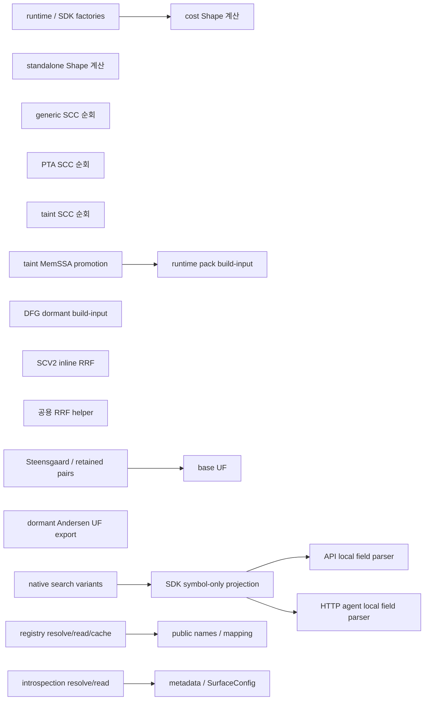
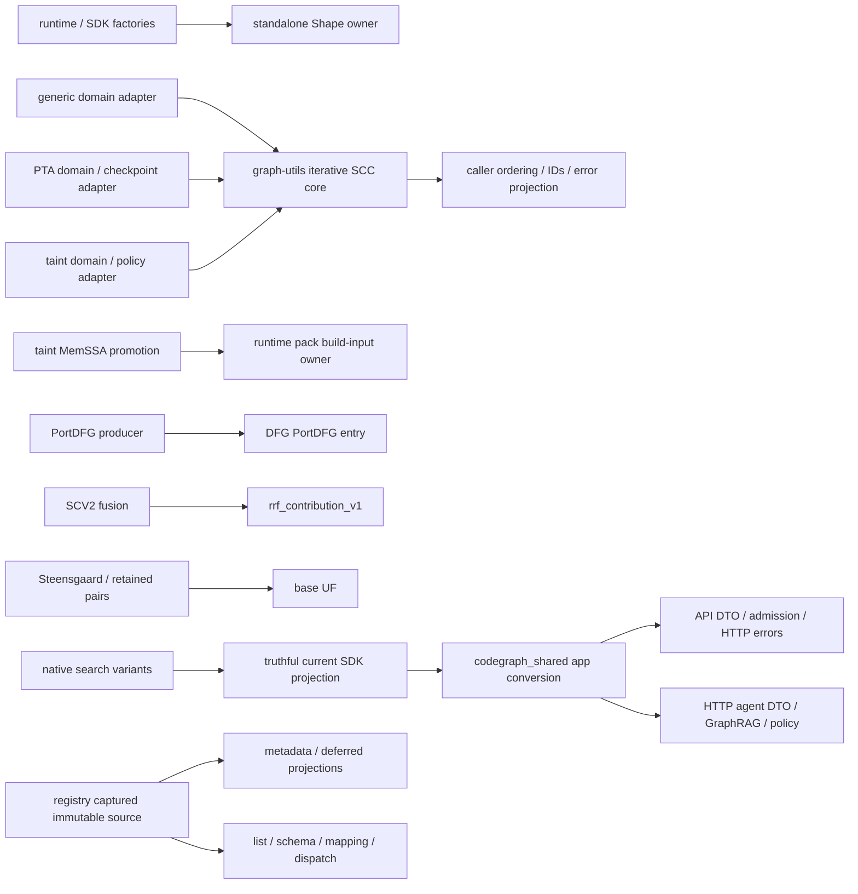

# 코드 변경 지도와 Before / After

상위 계획: [readme.md](readme.md). 테스트와 실행 경로: [test-plan.md](test-plan.md).

**Before는 현재 선택 소스의 정적 연결이며 After는 구현할 목표다. 이 문서의 코드 스케치는 적용된 diff가 아니다.** 자세한 source capture는 [detail-source-state.json](detail-source-state.json)을 따른다.

진행 중 diff/검증/main 반영은 [execution-progress.md](execution-progress.md)에서 별도로 관리한다.

## 1. 저장소 지도

아래 경로 축약을 사용한다. 각 파일 표의 링크는 실제 소스로 연결한다.

```text
code-new/
├── quanta-gqlang-v2/                         [G: 계획·감사 문서]
│   └── docs/plans/oct-6-substrate-dedup/
│       ├── readme.md                        범위·순서·DoD·ledger
│       ├── code-change-map.md               이 지도와 Before/After
│       ├── test-plan.md                     fixture·oracle·selector·통과 기준
│       ├── execution-progress.md            worker diff·실행·main checkpoint
│       ├── source-state.json                최초 계획 source/문서 검증 이력
│       └── detail-source-state.json         이번 상세화의 source/문서 검증
├── semantica-codegraph-v2/                   [S: runtime 코드 변경]
│   ├── packages/analysis/quanta-v2/crates/   [V: Rust owner/adapter]
│   │   ├── quanta-adapters-{shape,cost}/     D1
│   │   ├── quanta-graph-utils-v1/            D2 공통 SCC
│   │   ├── quanta-runtime-analysis/         D2 PTA caller
│   │   ├── quanta-taint-solver/              D2 taint; D3 실제 consumer
│   │   ├── quanta-adapters-dfg/              D3 퇴역 entry
│   │   ├── quanta-runtime-memssa-pack/       D3 활성 owner
│   │   ├── quanta-runtime-retrieval-kernel/  D4 SCV2
│   │   ├── quanta-retrieval-algo-v1/         D4 공용 RRF
│   │   └── quanta-runtime/                  D1 feature/SDK proof
│   ├── packages/core/pta/engine/             D5
│   ├── packages/sdk/python/codegraph_sdk/   F1 projection·public DTO/tests
│   ├── packages/analysis/codegraph-shared/  D6 app conversion
│   ├── apps/api/                            D6 HTTP consumer
│   ├── apps/mcp/                            D6 HTTP agent / D7 공개 MCP
│   └── tools/{ci,quanta-build-cli,
│              rust-crate-boundary-guard}/   gate·feature·generated 입력
└── quanta-index/                            [I: 알려진 외부 owner 확인]
    └── crates/quanta-index-sdk/              D4 consumer 확인; 현재 수정 없음
```

| 저장소 | 수정 책임 | 이번 계획에서의 코드 변화 |
|---|---|---|
| G | 계획·검증 기록·로컬 gate | 문서와 typos opaque hex identifier 처리. Frontend compiler/Execution DTO 변경 없음 |
| S | runtime/SDK/apps | D1–D7 및 F1의 실제 구현·consumer·tests·gates |
| I | Index SDK/provider | selected search source 확인. 현재 D4 변경은 S 안에서 닫힘 |

작업 표의 동작: **수정**, **삭제**, **추가 제안**, **유지·검증**, **재생성**. 추가 제안 파일명/API명은 착수 시 existing owner와 충돌 여부를 확인하며 아직 존재하는 구현으로 설명하지 않는다.

## 2. 전체 Before / After

| 항목 | Before: 현재 코드 | After: 목표 연결 | 완료 숫자 |
|---|---|---|---|
| D1 | cost Shape가 factory에 연결, standalone Shape도 별도 구현 | factory → standalone Shape; Cost는 Cost 책임 유지 | Shape production 구현 1 |
| D2 | generic, PTA, taint가 Tarjan 순회 각각 소유 | domain adapter → 기존 graph-utils의 공통 iterative core → caller output projection | 선택 범위 순회 core 1 |
| D3 | pack 활성 build-input + DFG dormant build-input | pack 활성; DFG는 PortDFG entry만 유지 | DFG build-input entry/export 0 |
| D4 | SCV2 inline RRF + 공용 RRF helper | SCV2 contribution → 공용 helper | SCV2 inline 수식 0 |
| D5 | base UF 활성 + Andersen UF dormant/public export | 실제 solver → base UF; dormant UF 제거 | 퇴역 module/export/consumer 0 |
| F1/D6 | native variants → symbol-only SDK 가정 → 앱 parser 둘 | truthful current SDK variants → shared app converter → 각 앱 DTO/policy | 공통 field converter 1 |
| D7 | registry·introspection 별도 resolve/read, source cache 분리 | process captured registry source → metadata/list/schema/mapping/dispatch | byte reader/resolver authority 1 |

### Before — 활성 연결과 dormant 복제



### After — 구현 목표



Disconnected Before nodes mean no selected production construction was found; known exports/tests can still exist. Public MCP search preserves its separate generated adapter/envelope path.

## 3. D3 — MemoryIR

### 파일·symbol 변경

| 파일 | 동작 | 구체적 변경 |
|---|---|---|
| [DFG canonical_ir.rs](../../../../semantica-codegraph-v2/packages/analysis/quanta-v2/crates/quanta-adapters-dfg/src/memssa_adapter/canonical_ir.rs) | 수정 | `canonical_memory_ir_from_build_input`, `validate_deletion_input_v1`, `lower_build_input_blocks_v1`와 exclusive helpers/tests 제거. PortDFG/shared digest/policy/finalizer/sort 유지 |
| [DFG memssa_adapter/mod.rs](../../../../semantica-codegraph-v2/packages/analysis/quanta-v2/crates/quanta-adapters-dfg/src/memssa_adapter/mod.rs) | 수정 | 퇴역 build-input export 제거 |
| [DFG error.rs](../../../../semantica-codegraph-v2/packages/analysis/quanta-v2/crates/quanta-adapters-dfg/src/memssa_adapter/error.rs) | 조건부 수정 | `DeletionAuthorityViolation` fresh census 후 orphan일 때만 제거 |
| [pack ingress](../../../../semantica-codegraph-v2/packages/analysis/quanta-v2/crates/quanta-runtime-memssa-pack/src/canonical_memory_ir_ingress.rs) / [tests](../../../../semantica-codegraph-v2/packages/analysis/quanta-v2/crates/quanta-runtime-memssa-pack/src/canonical_memory_ir_ingress/tests.rs) | 유지·검증 | active default/explicit-map producer의 ID/authority 계약 유지 |
| [taint promotion](../../../../semantica-codegraph-v2/packages/analysis/quanta-v2/crates/quanta-taint-solver/src/analysis/taint/adapter_solver_solve_v2_with_dfg/memssa_input_promotion.rs) | 유지·검증 | 실제 pack caller; 새 DFG→pack wrapper를 만들지 않음 |
| [ingress policy](../../../../semantica-codegraph-v2/tools/rust-crate-boundary-guard/policies/quanta-memssa-runtime-surface-ingress-boundary.toml) | 수정·검증 | surviving pack와 PortDFG boundary 유지, 삭제된 export 재도입 방지 |

Before: `MemSsaBuildInput → pack(active)`와 `MemSsaBuildInput → DFG(dormant)`의 두 producer. After: build-input producer는 pack만, PortDFG는 DFG의 별도 입력 계약으로 유지한다. Producer digest 또는 authority 구조 변경은 필요 근거가 생기기 전까지 범위에 넣지 않는다.

## 4. D5 — UnionFind

| 파일 | 동작 | 구체적 변경 |
|---|---|---|
| `solver/andersen/union_find.rs` / `union_find_tests.rs` (main에서 삭제됨) | 삭제 | dormant UF 구현과 그 구현 전용 tests |
| [andersen/mod.rs](../../../../semantica-codegraph-v2/packages/core/pta/engine/src/solver/andersen/mod.rs) / [crate lib.rs](../../../../semantica-codegraph-v2/packages/core/pta/engine/src/lib.rs) | 수정 | `mod union_find`, 해당 public UF export 제거; 활성 Andersen solver·BaseUnionFind alias 유지 |
| [base UF](../../../../semantica-codegraph-v2/packages/core/pta/engine/src/solver/union_find_base.rs) / [base tests](../../../../semantica-codegraph-v2/packages/core/pta/engine/src/solver/union_find_base_tests.rs) | 유지·검증 | 실제 root-returning 계약 유지 |
| [Steensgaard implementation](../../../../semantica-codegraph-v2/packages/core/pta/engine/src/solver/steensgaard_solver_impl.rs) / [retained pairs](../../../../semantica-codegraph-v2/packages/core/pta/engine/src/solver/steensgaard_retained_pairs.rs) | 유지·검증 | 현재 base consumer; bool-returning wrapper 추가 없음 |
| [Mahjong equivalence](../../../../semantica-codegraph-v2/packages/analysis/quanta-v2/crates/quanta-adapters-pta/src/mahjong/equivalence.rs) | 유지 | 별도 min-root semantics, 이 삭제 범위에 포함하지 않음 |

Before: solver는 base UF를 사용하고 dormant Andersen UF는 export/tests로 남아 있다. After: dormant UF file/module/export 삭제; 활성 solver의 UF 입력·대표값 계약은 동일하다. Public export 삭제의 알려진 consumer를 같은 checkpoint에 전환한다.

## 5. D4 — RRF

| 파일 | 동작 | 구체적 변경 |
|---|---|---|
| [scv2_exact_fusion.rs](../../../../semantica-codegraph-v2/packages/analysis/quanta-v2/crates/quanta-runtime-retrieval-kernel/src/scv2_exact_fusion.rs) | 수정 | `rrf_score_v1`의 map expression과 `RRF_K_V1` 제거/교체. iteration/sum·fusion result semantics 유지 |
| [retrieval-kernel Cargo.toml](../../../../semantica-codegraph-v2/packages/analysis/quanta-v2/crates/quanta-runtime-retrieval-kernel/Cargo.toml) | 수정 | `scv2-exact-owner-surface`에 `dep:quanta-retrieval-algo-v1` 직접 추가 |
| [rrf.rs](../../../../semantica-codegraph-v2/packages/analysis/quanta-v2/crates/quanta-retrieval-algo-v1/src/rrf.rs) | 유지·검증 | 기존 `rrf_contribution_v1(rank: u32)` / clamp / K=60 사용 |
| [Index SDK search.rs](../../../../quanta-index/crates/quanta-index-sdk/src/search.rs) | 유지·검증 | 기존 external consumer 확인; 현재 소스 변경 없음 |

실제 expression의 Before/제안 After:

```rust
// Before: scv2_exact_fusion.rs::rrf_score_v1
seed.contributions.iter()
    .map(|c| 1.0 / (RRF_K_V1 + f64::from(c.rank.max(1))))
    .sum()

// After: same iteration and accumulation order
seed.contributions.iter()
    .map(|c| quanta_retrieval_algo_v1::rrf_contribution_v1(c.rank))
    .sum()
```

```toml
# Before
scv2-exact-owner-surface = ["index-sdk-ingress-surface", "dep:quanta_contract_devos_bridge"]
# After: add only the helper dependency; do not activate identity-collapse-surface
scv2-exact-owner-surface = ["index-sdk-ingress-surface", "dep:quanta_contract_devos_bridge", "dep:quanta-retrieval-algo-v1"]
```

## 6. D7 — manifest

| 파일 | 동작 | 구체적 변경 |
|---|---|---|
| [query_surface_registry.py](../../../../semantica-codegraph-v2/apps/mcp/mcp/domain/query_surface_registry.py) | 수정 | 기존 resolver/loader를 process capture 하나로 통합. Private immutable path/digest/entries; canonical name uniqueness·bounded validation |
| [introspection.py](../../../../semantica-codegraph-v2/apps/mcp/mcp/handlers/introspection.py) | 수정 | `_find_crosswalk_path`와 local byte read 제거. `load_crosswalk`/`require_crosswalk`는 registry projection 소비. Error는 existing typed boundary에 연결 |
| [surface_config.py](../../../../semantica-codegraph-v2/apps/mcp/mcp/handlers/surface_config.py) | 수정 | 같은 captured source의 public/deferred projection 소비. Config cache는 projection cache이며 source authority가 아님 |
| [main.py](../../../../semantica-codegraph-v2/apps/mcp/mcp/main.py) | 수정 | `_initialize_sdk` direct/cold/retry preflight가 adapter import/SDK construction보다 먼저 실행 |
| [fluent_engine_sdk_query_adapter.py](../../../../semantica-codegraph-v2/apps/mcp/mcp/adapters/fluent_engine_sdk_query_adapter.py) | 수정·검증 | import-time public names가 preflight된 snapshot 사용. 실제 생성 파일이면 generator owner에서 변경 |
| [generated crosswalk.json](../../../../semantica-codegraph-v2/packages/analysis/quanta-v2/crates/quanta-usecase/src/generated/crosswalk.json) | 유지·검증 | data source 유지; duplicate test는 controlled fixture. Production manifest에 결함 fixture 삽입 없음 |

```text
Before
  _canonical_crosswalk_path_v1()        [path cache]
  _tool_to_usecase_mapping()           [own read + mapping cache]
  _mcp_public_tool_names_v1()          [another read + names cache]
  introspection._find_crosswalk_path() [another resolution + read]
  SurfaceConfig.load()/refresh        [reads through introspection]

After (design sketch; new internal API names are provisional)
  existing registry: capture once(path, bounded bytes, digest, validated immutable entries)
    ├─ executable public names / usecase mapping
    ├─ public schema and dispatch contract
    └─ metadata / deferred projections as independent dict/list copies
  _initialize_sdk(): ensure capture → import adapter → construct SDK
  direct retry: same ensure capture; file replacement takes effect on process restart
```

Failure behavior: explicit missing/invalid override must stop preflight; env/cwd fallback은 다른 source를 승인할 수 없다. Missing authority is not an empty successful registry. Public metadata entries need not equal executable entries; their captured source identity must agree.

## 7. D1 — Shape

### D1-A: owner cutover write set

| 파일 | 동작 | 구체적 변경 |
|---|---|---|
| [standalone implementation](../../../../semantica-codegraph-v2/packages/analysis/quanta-v2/crates/quanta-adapters-shape/src/shape_analyzer_adapter.rs) / [exports](../../../../semantica-codegraph-v2/packages/analysis/quanta-v2/crates/quanta-adapters-shape/src/lib.rs) | 수정·검증 | surviving public adapter/converters; unique cost regressions 수용 |
| cost `src/shape_analyzer_adapter.rs` / `src/shape_analyzer_adapter_tests.rs` | 삭제 | regression 이동 후 복제 production algorithm과 전용 tests 삭제; Before source는 최초 worker base에 보존 |
| [cost lib.rs](../../../../semantica-codegraph-v2/packages/analysis/quanta-v2/crates/quanta-adapters-cost/src/lib.rs) | 수정 | Shape module/export 제거; Cost/Termination/Heap exports 유지 |
| [runtime-surface factory](../../../../semantica-codegraph-v2/packages/analysis/quanta-v2/crates/quanta-adapters-runtime-surface/src/analysis/mod.rs) / [Cargo](../../../../semantica-codegraph-v2/packages/analysis/quanta-v2/crates/quanta-adapters-runtime-surface/Cargo.toml) | 수정 | concrete factory/import를 standalone으로, 필요한 direct dependency 추가 |
| [adapters facade](../../../../semantica-codegraph-v2/packages/analysis/quanta-v2/crates/quanta-adapters/src/analysis/mod.rs) / [Cargo](../../../../semantica-codegraph-v2/packages/analysis/quanta-v2/crates/quanta-adapters/Cargo.toml) | 수정 | Shape export/factory/converter source를 standalone으로, 실제 cfg/dependency 연결 |
| [analysis facade](../../../../semantica-codegraph-v2/packages/analysis/quanta-v2/crates/quanta-adapters-analysis-facade/src/lib.rs) / [Cargo](../../../../semantica-codegraph-v2/packages/analysis/quanta-v2/crates/quanta-adapters-analysis-facade/Cargo.toml) | 수정 | concrete export/factory/PTA converter와 dependency 연결 |
| [SDK session adapter surface](../../../../semantica-codegraph-v2/packages/analysis/quanta-v2/crates/quanta-sdk-session-backend-owner/src/adapter_surface.rs) / [Cargo](../../../../semantica-codegraph-v2/packages/analysis/quanta-v2/crates/quanta-sdk-session-backend-owner/Cargo.toml) | 수정·검증 | consumer export/cfg wiring; facade를 통하면 불필요한 direct dependency를 추가하지 않음 |

Before: factory/export는 cost crate의 concrete type, standalone는 별도 구현. After: 모든 factory/export는 standalone concrete type. D1-A에서는 필요한 현재 feature 활성화 경로를 유지해 consumer cutover를 닫고, D1-B에서 feature responsibility를 정리한다.

### D1-B: feature·SDK·gate write set

| 파일 | 동작 | 구체적 변경 |
|---|---|---|
| [runtime Cargo.toml](../../../../semantica-codegraph-v2/packages/analysis/quanta-v2/crates/quanta-runtime/Cargo.toml) | 수정 | `shape-analyzer` → standalone/consumer feature closure; 불필요한 `cost-analyzer` activation 제거 |
| [SDK shape builder](../../../../semantica-codegraph-v2/packages/analysis/quanta-v2/crates/quanta-runtime/src/sdk/shape_analysis_builder.rs) | 수정·검증 | enabled/disabled, pure/PTA-derived selector/capability/factory 일치 |
| D1-A의 consumer Cargo/cfg exports | 수정 | shape-specific forwarding/optional activation 정리; independent Cost feature 유지 |
| [shape smoke gate](../../../../semantica-codegraph-v2/tools/ci/gates/gate-shape-analysis-smoke.sh) / [Ghiya-Hendren gate](../../../../semantica-codegraph-v2/tools/ci/gates/gate-shape-analysis-ghiya-hendren.sh) | 수정 | standalone unit selector, SDK/pta feature lanes, empty selection 거절 |
| [runtime structure checker](../../../../semantica-codegraph-v2/tools/rust-crate-boundary-guard/check_runtime_structure_source_contracts.py) / [QBC taxonomy](../../../../semantica-codegraph-v2/tools/quanta-build-cli/contracts/feature-taxonomy-v1.toml) | 수정·검증 | Shape owner/feature invariants와 실제 public closure 일치 |
| [shape-only honesty](../../../../semantica-codegraph-v2/tools/ci/honesty/baselines/shape-only.json) | 재생성 | owning generator 출력으로 갱신; 비용 dependency를 숨기는 baseline 손편집 금지 |

Before: `runtime/shape-analyzer → cost-analyzer → cost crate Shape`. After: `runtime/shape-analyzer → standalone Shape`와 필요한 factory feature; `cost-analyzer`는 Cost 소비자가 별도 선택. Shape-only lane에서 불필요한 Cost/regex 연결이 없어야 하고 Cost 자체가 regex를 쓰는 lane은 유지한다.

## 8. F1 / D6 — SDK·API·agent

### F1: 현재 계약 수리

| 파일 | 동작 | 구체적 변경 |
|---|---|---|
| [native search execution](../../../../semantica-codegraph-v2/packages/analysis/quanta-v2/crates/quanta-sdk-runtime-executor/src/client/daemon_search_execution.rs) | 유지·검증 / 필요 시 수정 | actual match/supplemental identity/location/count authority. Consumer 편의를 위해 fake symbol/coordinates 생성 없음 |
| [Python search projector](../../../../semantica-codegraph-v2/packages/sdk/python/codegraph_sdk/_product_search_projection_v1.py) | 수정 | symbol-only row requirement, fabricated span, old summary key assumptions를 current variants/schema로 전환 |
| [native Product search writer](../../../../semantica-codegraph-v2/crates/quanta-cli-ingress-runtime/src/project/search_projection.rs) | 유지·검증 | `match`/`supplemental` row와 primary/supplemental count 의미의 oracle. Runtime locator를 canonical symbol ID로 변환하지 않음 |
| [typed LexicalSearch DTO](../../../../semantica-codegraph-v2/packages/sdk/python/codegraph_sdk/queries/search.py) | 수정 | `symbols: list[Symbol]`/full location → native discriminated `hits`와 `summary`; optional source coordinates 보존 |
| [current SDK fixture owner](../../../../semantica-codegraph-v2/packages/sdk/python/codegraph_sdk/tests/_current_product_response.py) / [current response tests](../../../../semantica-codegraph-v2/packages/sdk/python/codegraph_sdk/tests/test_current_product_response.py) | 수정 | consumer가 만든 symbol-only fixture를 native serializer/typed writer 기준으로 갱신; variant·summary negative controls 추가 |
| SDK current public result DTO/export / API hit DTO / agent SearchHitResult | 필요 시 수정 | truthful optional identity/location·row variant를 표현. 정확한 public field 이름은 F1 contract에서 한 번 확정하고 producer/consumer 동시 전환 |

```text
Before
  native: optional symbol / file_path / line + primary/supplemental variants
  SDK: required symbol_id/name/kind/file/line
       start_column=0, end_line=line, end_column=0
       reads total/truncated; if absent defaults to row count/false

After (native writer 확인으로 확정한 current SDK contract; 구현 진행 중)
  data = {hits: [native match | supplemental fields], summary: {native scalar fields}}
  match: snippet, optional file_path/line/column,
         optional symbol_fqn/symbol_kind/runtime_symbol_locator, score/provenance
  supplemental: entity_id/entity_kind, score/projection_reason/provenance
  summary: total_count/page_count/match_count는 primary domain
           supplemental_match_count는 separate count; result_truncated 그대로 보존
  optional absent → None; authored byte highlights → array 그대로
  missing end coordinates는 생성하지 않음
  malformed required fields → typed SDK refusal; no old-reader fallback
```

### D6: app conversion write set

| 파일 | 동작 | 구체적 변경 |
|---|---|---|
| `S/packages/analysis/codegraph-shared/codegraph_shared/infra/search/current_search_projection.py` | 추가 제안 | current SDK row→app canonical hit 변환. 기존 shared package 내부, SDK transport/decode 의존 없음 |
| [shared search exports](../../../../semantica-codegraph-v2/packages/analysis/codegraph-shared/codegraph_shared/infra/search/__init__.py) | 수정 | shared conversion의 필요한 export만 제공 |
| [API routes/search.py](../../../../semantica-codegraph-v2/apps/api/api/routes/search.py) | 수정 | `_project_current_search_symbols`의 local field validation/mapping 삭제 후 shared 호출. Route admission/HTTP mapping 유지 |
| [HTTP agent query_adapter.py](../../../../semantica-codegraph-v2/apps/mcp/mcp/adapters/search/query_adapter.py) | 수정 | `_extract_search_hits_v1`의 symbol conversion·legacy payload 탐색 제거. `_parse_normalized_hits_v1`은 앱 DTO assembly만 수행 |
| `apps/mcp/mcp/adapters/search/symbol_retriever.py` (main에서 퇴역) | 삭제 | actual CLI caller 전환과 construction census 후 dormant module/converter 퇴역 |
| [search package exports](../../../../semantica-codegraph-v2/apps/mcp/mcp/adapters/search/__init__.py) / [legacy services](../../../../semantica-codegraph-v2/apps/mcp/mcp/adapters/mcp/services.py) / [lazy handlers](../../../../semantica-codegraph-v2/apps/mcp/mcp/handlers/__init__.py) / [legacy search handler](../../../../semantica-codegraph-v2/apps/mcp/mcp/handlers/search.py) | 수정·조건부 삭제 | retired imports/export cleanup. 필요한 live `SymbolAuthorityUnavailableError`만 owner 이동; obsolete facade를 위한 shim 없음 |
| [live public MCP adapter](../../../../semantica-codegraph-v2/apps/mcp/mcp/adapters/fluent_engine_sdk_query_adapter.py) | 유지·검증 | generated envelope path의 별도 control; HTTP agent converter에 강제로 합치지 않음 |

After 앱별로 남길 책임:

| SDK | Shared converter | API | HTTP agent |
|---|---|---|---|
| wire decode·variant/summary truth·typed status | current row field mapping·actual metadata/span 보존 | request admission·HTTP status·response DTO | anchor/mode·SearchHitResult·GraphRAG file presentation |

F1 이전에 D6 helper만 작성/전환하면 기존 broken assumptions가 공통 defect가 된다. F1 expected results 확정 후 D6 current reader만 남긴다.

## 9. D2 — SCC

| 파일 | 동작 | 구체적 변경 |
|---|---|---|
| [graph-utils scc.rs](../../../../semantica-codegraph-v2/packages/analysis/quanta-v2/crates/quanta-graph-utils-v1/src/scc.rs) | 수정 | existing crate 안 borrowed indexed iterative core. Generic와 indexed public entry 모두 같은 core 사용 |
| [graph-utils Cargo.toml](../../../../semantica-codegraph-v2/packages/analysis/quanta-v2/crates/quanta-graph-utils-v1/Cargo.toml) / [root Cargo](../../../../semantica-codegraph-v2/Cargo.toml) | 수정·검증 | root authority의 proposed tier/edge/empty-default landing policy; foreign hunks 분리 |
| [query-HIR Cargo](../../../../semantica-codegraph-v2/packages/analysis/quanta-v2/crates/quanta-runtime-query-hir-wire/Cargo.toml) | 수정·검증 | graph-utils edge의 default-feature policy 일치 |
| [PTA precise_query_scc.rs](../../../../semantica-codegraph-v2/packages/analysis/quanta-v2/crates/quanta-runtime-analysis/src/queries/pta/precise_query_scc.rs) | 수정 | local `TarjanFrameV1`/state/traversal 삭제; declared-key indexing·callback·output projection 유지 |
| [runtime-analysis Cargo](../../../../semantica-codegraph-v2/packages/analysis/quanta-v2/crates/quanta-runtime-analysis/Cargo.toml) | 수정·검증 | owner dependency 활성화와 selected PTA feature closure |
| [taint wire_recursion.rs](../../../../semantica-codegraph-v2/packages/analysis/quanta-v2/crates/quanta-taint-solver/src/analysis/taint/interproc/wire_recursion.rs) / [Cargo](../../../../semantica-codegraph-v2/packages/analysis/quanta-v2/crates/quanta-taint-solver/Cargo.toml) | 수정 | `tarjan_scc_v1` local 순회/state/sentinel 제거, common core와 successor-domain/sorted-output adapter 연결; cycle policy 유지 |
| [PTA SCC tests](../../../../semantica-codegraph-v2/packages/analysis/quanta-v2/crates/quanta-runtime-analysis/src/queries/pta/precise_query_scc_tests.rs) | 수정 | normalized partition controls 유지, unnormalized output/ID·domain·checkpoint tests 보강 |
| [Tarjan gate](../../../../semantica-codegraph-v2/tools/ci/gates/gate-tarjan-iterative.sh) | 수정 | generic core + PTA/taint adapter selectors, ignored 50k test 실제 실행 |

### Before: indexed entry가 있어도 공통 borrowed core는 없음

```text
graph-utils strongly_connected_components_v1
  BTreeMap keys → dense IDs + Vec<Vec<usize>> → local iterative Tarjan → Vec<BTreeSet<T>>
graph-utils strongly_connected_components_indexed_v1
  &[Vec<usize>] → BTreeMap<usize,BTreeSet<usize>> boxing → generic above → Vec<SCC id>
PTA
  declared keys → unknown targets omit → local TarjanStateV1/checkpoints → Vec<BTreeSet<T>>
taint
  roots/target-only nodes → local iterative frames → sorted members/components
```

### After: existing public entries와 adapters를 같은 core로

```text
generic: closed-domain validate + deterministic indexing ─┐
indexed: validate borrowed adjacency (no BTreeMap boxing) ├→ common iterative core
PTA: declared-key projection + typed stop control ───────┤   → typed components / Compute error / Stop<E>
taint: successor-domain admission + policy control ──────┘
  → generic/PTA: original emission/member ordering
  → indexed: original dense SCC IDs
  → taint: original sorted members/components + cycle budget decisions
```

Landed core signature:

```rust
pub fn strongly_connected_components_borrowed_with_checkpoint_v1<E, F>(
    adjacency: &[Vec<usize>],
    limits: SccLimitsV1,
    checkpoint: F,
) -> Result<Vec<Vec<usize>>, SccRunError<E>>
where
    F: FnMut() -> Result<(), E>;
```

Core traversal state는 borrowed domain/resource admission 후 할당한다. Domain adapters의 자체 indexing allocation과 generic value clone은 별도이며 core workspace byte cap에 포함되지 않는다. Indexing·loop/edge work·member materialization에는 checkpoint를 유지한다. Compute error와 caller stop을 구분하고 deterministic component result를 반환한다. Main `df2a867ad70`에는 공통 core가 반영됐고 PTA/Taint adapters는 별도 검증·checkpoint 대상이다.

현재 indexed public wrapper는 BTreeSet 변환으로 neighbor 순서 정렬·중복 제거도 수행한다. After에서 public 입력이 이미 canonical이라고 가정하지 않는다. Adapter가 필요할 때만 sorted/deduplicated adjacency를 만들고, core는 그 admitted adjacency를 빌린다. Unsorted/duplicate edge 입력도 현재 dense ID·emission order를 유지해야 한다. BTreeMap boxing 제거를 zero-allocation 주장으로 확대하지 않는다.

| Domain / output | Before | After requirement |
|---|---|---|
| generic unknown target | `UnregisteredNeighbor` | same typed refusal |
| indexed invalid neighbor | typed compute error | same typed refusal; no partial IDs |
| PTA successor outside declared keys | omitted by local projection | explicit PTA domain policy preserved; caller authority absence remains typed failure |
| taint successor-only node | included | same admitted node set |
| taint output | members sorted, outer sorted by first member | same exact vectors |
| PTA/generic output | traversal emission order | same exact order, not just normalized partition |
| cancel/budget | caller-specific control/error | no late partial success, original typed caller error preserved |

## 10. Generated / gate 변경 지도

| 입력 | 적용 항목 | 변경 방식 |
|---|---|---|
| [test-module inventory](../../../../semantica-codegraph-v2/tools/ci/lint/contracts/test-module-inventory-v2.json) | D1/D2/D3/D5 | 삭제·이동 module/selector를 owning generator로 갱신 |
| Honesty baselines `positive-negative-pair.json`, `relationship.json`, `shape-only.json`; `evidence-grounding.json`은 별도 regression 확인 | D1/D3 | 퇴역 DFG tests와 Cost Shape tests의 stale keys를 owning ratchet로 제거. Live evidence-grounding keys는 삭제 근거가 없으면 유지. 신규 위반을 baseline에 추가하지 않음 |
| [god-surface baseline](../../../../semantica-codegraph-v2/tools/ci/lint/god-surface-baseline.json) | D3/D5 및 실제 변화 | deleted symbols의 stale inventory 제거; unrelated allowance 완화 없음 |
| Shape gate/feature taxonomy/honesty | D1 | standalone + actual SDK closure, nonzero test selection |
| Tarjan gate | D2 | surviving core + caller contracts + ignored deep chain |
| MemSSA ingress boundary | D3 | build-input surviving owner와 PortDFG 다른 contract 유지 |
| registry ordered inventory/duplicate controls | D7 | same-usecase/alias duplicate를 set comparison으로 숨기지 않음 |
| current SDK/app fixture·strict converter census | F1/D6 | current schema only; retired parser/module 재도입 방지 |

파일 표는 시작 write set이다. Generated-source origin과 추가 caller가 발견되면 해당 owner만 보완한다. 모든 표의 After는 actual main commit과 [test-plan.md](test-plan.md)의 proof가 있을 때 ledger에서 완료로 바꾼다.


## 구현에서 확정된 추가 write set

이 표는 구현 중 actual caller 추적에서 추가된 범위다. [checkpoint ledger](execution-progress.md)의 실제 실행 상태와 함께 읽는다.

| S 파일 | Before | After / 이유 |
|---|---|---|
| `apps/cli/cli/main.py` + `tests/test_current_search.py` | 퇴역 SymbolRetriever import, logical repo/path 혼합 | existing registered SDK symbol search + truthful `{hits,summary,outcome_status_v1,degraded_reasons}`. Unsupported authority는 attach 전 거절 |
| `packages/sdk/python/codegraph_sdk/_receipt.py`, `client.py`, `_product_projection_values_v1.py` | with_status pair가 native degraded reason을 받지 못하고 absent receipt key도 손실 | existing pair에 reason tuple 전달; canonical ProductResponse metadata/receipt projection을 existing value owner로 이동. Receipt absence 그대로 보존 |
| `apps/api/api/routes/search.py`, `apps/mcp/mcp/adapters/search/query_adapter.py` | local symbol-only reader + data-only status loss | shared data converter + explicit with_status. QueryAdapter는 canonical search, graph store composition, graph-created rows append를 분리 |
| `apps/api/api/routes/agent.py`, shared `infra/search/agent_payloads.py` | absent file path가 fake file 후보, point-only/malformed range가 span | absent source 후보 제외, complete authored range만 보존, no-source analysis 명시 |
| SDK `queries/search.py` | symbol-only result/location DTO | primary/supplemental discriminated variants + native summary; optional points, no invented end coordinates |
| `apps/api/tests/test_product_client_di_lifecycle.py`, `test_agent_surface_smoke.py` | reachable HTTP positive test의 old symbols mock | actual current boundary pair/hits/summary fixture; negative503 controls 보존 |
| SDK `tests/test_packaged_wheel_runtime.py`, API `test_packaged_api_process_runtime.py`, `tests/support/packaged_daemon_release.py` | stale native fields/generated nullable keys, systemPython3.9 hardcode | actual native row/summary + canonical null authorities; installed SDK identity check 유지, test interpreter 사용 |

Python search checkpoint의 public SDK/HTTP/CLI output는 pre-release current schema로 교체한다. Old reader/dual schema/shim을 추가하지 않는다. 이는 compiled GQLang execution DTO 변경이나 새 graph engine 도입이 아니다.

| 추가 D1-B 실제 caller | Before | After |
|---|---|---|
| SDK backend→runtime composition→executor Cargo features/Shape port | Shape-only가 Cost feature에 묶인 field/impl로 연결되지 않음 | Shape feature 전달과 field/impl을 분리; Cost methods는 Cost feature 유지 |
| Runtime CostAnalysisWiringPort/framework injector/fluent snapshot pin | Shape 작업이 Cost feature에만 존재 | Shape feature에서 Shape port·pin operation 제공 |
| Runtime `heap-analyzer` feature | Shape를 통해 Cost를 간접 활성화 | explicit Cost dependency 유지; Shape-only normal deps에서는 Cost 제외 |

D2 admission은 실제 `TarjanFrameV1` 크기와 output header/member allocation을 포함하는 checked byte envelope로 보완한다. 작은 custom cap의 거절·경계 통과를 owner core 회귀로 고정한다. 이 변경의 proof는 기존 core19 결과와 별도로 실행한다.

| Consumer compile prerequisite | Before | After |
|---|---|---|
| [parser core_native_aug.rs](../../../../semantica-codegraph-v2/packages/analysis/quanta-v2/crates/quanta-adapters-parser/src/language_host_adapter/semantic_module_v3/core/core_native_aug.rs) | Unconditional Go branch가 `parser-java` cfg helper 호출; Shape-only runtime QBC E0425 | Shared helper의 cfg 1줄 제거. 같은 conversion body/diagnostic strings 유지; Java feature 추가 없음 |
