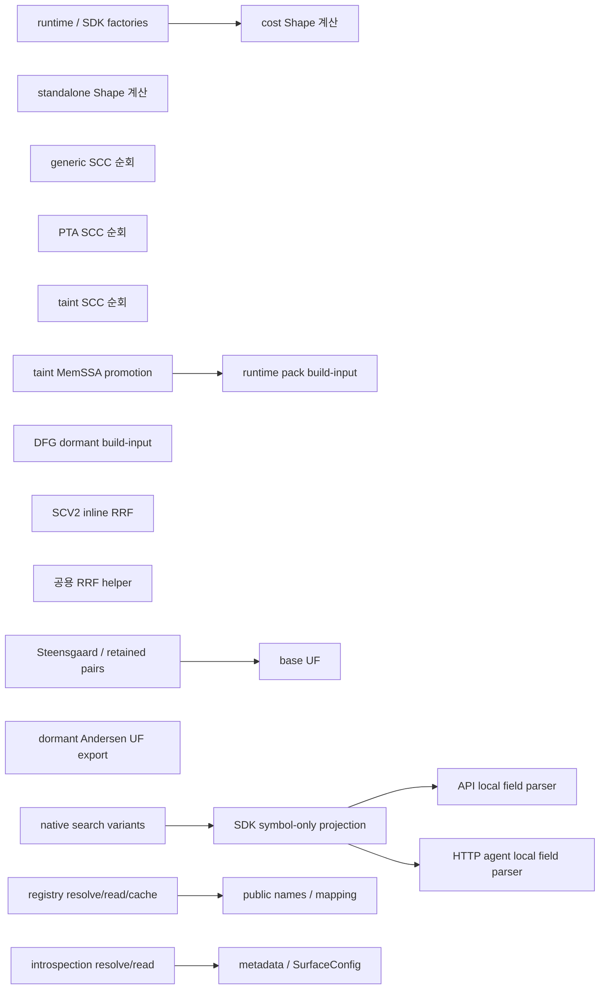
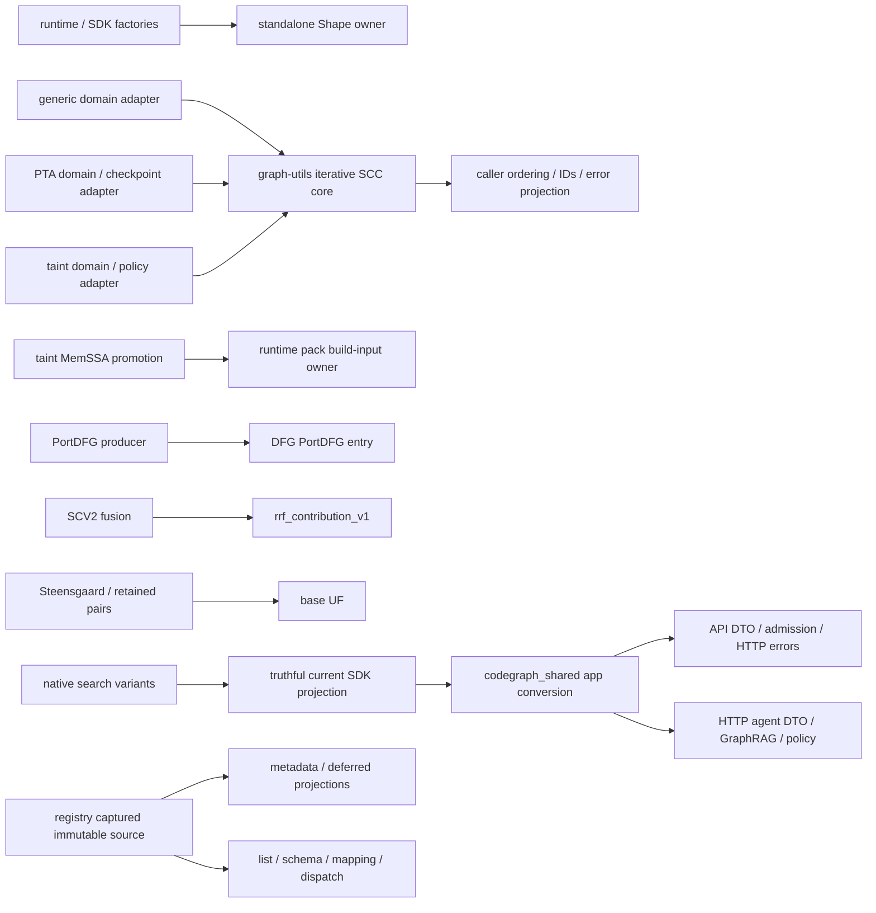

# 코드 변경 지도와 Before / After

상위 계획: [readme.md](readme.md). 테스트와 실행 경로: [test-plan.md](test-plan.md).

**Before는 현재 선택 소스의 정적 연결이며 After는 구현할 목표다. 이 문서의 코드 스케치는 적용된 diff가 아니다.** 자세한 source capture는 [detail-source-state.json](detail-source-state.json)을 따른다.

진행 중 diff/검증/main 반영은 [execution-progress.md](execution-progress.md)에서 별도로 관리한다.

**2026-10-06 현재 변경 경계:** Semantica clean private `02e00d7`/base main `9983d87`은 `a162`의 D1/D2 본문과 main의 JSON decoder·PTA `#[path]` 선행 수리를 main-first merge한 87경로 후보다. Owned 87경로와 main-only 43경로는 부모 blob과 같고 겹침0이다. 두 lock의 D1/D2 5개 dependency edge, package identity root953/nested914, 비의존 필드는 보존됐다. Exact 입력97경로의 영향받은 source policy92개가 PASS/exit0/scope complete다. GQLang `30b6efd`·Index `ab87837` overlay0의 `02e+ext-7c0966bc582839fd8230` snapshot은 sealed됐다. Root·nested locked metadata PASS는 Rust 판정이 아니다. JSON focused16 실행 중, canonical owner45 NOT_RUN이다. 직전 `a162` owner1 RED는 새 후보의 판정이 아니다. [현재 실행](execution-progress.md).

**2026-10-06 이전 `3f5c` 변경 경계:** Semantica clean private `3f5c4ac`/base main `7ba1cf1`은 D1/D2 본문과 parser 수리·boundary policy를 main-first merge한 87경로 후보다. Exact 92 input paths source policy92 PASS였으나 owner1/45는 Cargo `--locked` 선행 단계에서 exit101/테스트0·RED였고 나머지44 NOT_RUN이다. Root/nested lock 누락 edge는 이후 main `2852932`와 private `a162` 소스로 수리됐다. [이전 실행](execution-progress.md).

**2026-10-06 이전 `6583` 변경 경계:** Semantica clean private `6583c22`/base main `205c86d`는 Java projection visibility 수리와 `d056` D1/D2 본문을 main-first merge한 87경로 후보다. Candidate 87경로·main 전용 8경로는 부모 blob과 같고 겹침0이다. Exact source policy90 PASS, read-only GOD14→7/new0/worse0, Wire72 local crate 정적 closure가 있다. GQLang `30b6efd`·Index `ab87837` frozen snapshot은 sealed됐다. Owner1/45는 parser dependency 컴파일 오류 4건으로 RED/exit101/테스트0이며 나머지44 NOT_RUN이다. [이전 실행](execution-progress.md).

**2026-10-06 이전 `d056` 변경 경계:** Semantica clean private `d056dd6`/base main `0dee483`는 `05fc` D1/D2·registry 본문과 main의 Java 5-arity 수리를 main-first merge한 87경로 후보다. Candidate-only 84·main-only 178경로는 바이트 보존되고 Cargo.lock 2개·ingress 1개 겹침은 검토됐다. GQLang `30b6efd`·Index `ab87837`을 포함한 frozen snapshot은 sealed됐고 exact source policy 90건은 PASS다. Read-only GOD 14→7/new0/worse0와 Wire 72 local crate 정적 closure도 확인됐다. PTA-first owner 1/45는 Java E0364/E0603으로 실패했고 나머지44건은 NOT_RUN이다. [이전 실행](execution-progress.md).

**2026-10-06 이전 main 선행 수정:** Semantica `0dee483`에는 `1daa8f9`의 Java defuse extractor caller/helper 5-arity 수리와 `6efc64b` Cargo.lock edge가 committed다. D1/D2 본문은 아직 main에 들어오지 않았으며, 아래 `05fc` clean 후보는 Java 수리 전 source다. Live main의 foreign dirty 26경로와 Index `ab87837` drift를 새 source tuple에 묵시적으로 포함하지 않는다. 다음 sibling pin은 GQLang `30b6efd`·Index `ab87837`, Semantica fixed base는 `0dee483`다. Main-first merge의 새 candidate SHA·frozen snapshot·Rust owner receipt는 대기다. [현재 실행](execution-progress.md).

**2026-10-06 이전 `05fc` 변경 경계:** `05fc94d`/base main `578a539` clean 87경로 후보는 아래 `c5bb` D1/D2·registry 본문에 Cargo.lock의 parser→codegraph-core-dfg dependency edge만 추가했다. Cargo 1.92 offline full metadata에서 식별된 lock prerequisite이며 edge는 Semantica main `6efc64b`에 먼저 반영됐다. Exact `05fc` source policy 90 PASS, read-only GOD 14→7/new0/worse0, Wire 72 local crate 정적 closure가 있다. Frozen `05fc+ext-51a0b56268b11842364e`의 owner 1/45는 Java defuse extractor E0061/exit101/테스트0으로 실패했다. PASS0, 나머지44 NOT_RUN이다. D1/D2 본문 main import와 소비자·제품 검증은 대기다. [현재 실행](execution-progress.md).

**2026-10-06 이전 `c5bb` 변경 경계:** `c5bb60f`/base main `578a539` clean private 후보가 D1/D2 본문, PTA `self::demand_v1` 수리, D3/D4/D5의 isolation class·suite consumer 3개씩을 합친 87경로 diff다. D1 Shape의 cost 구현·test는 삭제되고 factory/export는 standalone owner를 사용한다. D2 PTA·taint wrapper는 graph-utils SCC core로 연결되며 local traversal frame/state는 퇴역했다. Shape-only 직접 feature 목록은 Cost를 켜지 않고 Heap은 Cost를 명시한다. Source policy 90 PASS와 read-only GOD 14→7/new0/worse0만 현재 후보의 증거다. **45개 canonical owner 중 PTA-first 1/45는 Cargo `--locked` 단계에서 실패101/테스트0; PASS0·나머지44 NOT_RUN이고 main 본문 import는 NOT_RUN**이며 이전 `3fe`의 4개 PASS는 이월하지 않는다. [영구 증거와 남은 게이트](execution-progress.md).

## 1. 저장소 지도

아래 경로 축약을 사용한다. 각 파일 표의 링크는 실제 소스로 연결한다.

```text
code-new/
├── quanta-gqlang-v2/                         [G: 계획·감사 문서]
│   └── docs/plans/oct-6-substrate-dedup/
│       ├── readme.md                        범위·순서·DoD·ledger
│       ├── code-change-map.md               이 지도와 Before/After
│       ├── test-plan.md                     fixture·oracle·selector·통과 기준
│       ├── execution-progress.md            worker diff·실행·main checkpoint
│       ├── source-state.json                최초 계획 source/문서 검증 이력
│       └── detail-source-state.json         이번 상세화의 source/문서 검증
├── semantica-codegraph-v2/                   [S: runtime 코드 변경]
│   ├── packages/analysis/quanta-v2/crates/   [V: Rust owner/adapter]
│   │   ├── quanta-adapters-{shape,cost}/     D1
│   │   ├── quanta-graph-utils-v1/            D2 공통 SCC
│   │   ├── quanta-runtime-analysis/         D2 PTA caller
│   │   ├── quanta-taint-solver/              D2 taint; D3 실제 consumer
│   │   ├── quanta-adapters-dfg/              D3 퇴역 entry
│   │   ├── quanta-runtime-memssa-pack/       D3 활성 owner
│   │   ├── quanta-runtime-retrieval-kernel/  D4 SCV2
│   │   ├── quanta-retrieval-algo-v1/         D4 공용 RRF
│   │   └── quanta-runtime/                  D1 feature/SDK proof
│   ├── packages/core/pta/engine/             D5
│   ├── packages/sdk/python/codegraph_sdk/   F1 projection·public DTO/tests
│   ├── packages/analysis/codegraph-shared/  D6 app conversion
│   ├── apps/api/                            D6 HTTP consumer
│   ├── apps/mcp/                            D6 HTTP agent / D7 공개 MCP
│   └── tools/{ci,quanta-build-cli,
│              rust-crate-boundary-guard}/   gate·feature·generated 입력
└── quanta-index/                            [I: 알려진 외부 owner 확인]
    └── crates/quanta-index-sdk/              D4 consumer 확인; 현재 수정 없음
```

| 저장소 | 수정 책임 | 이번 계획에서의 코드 변화 |
|---|---|---|
| G | 계획·검증 기록·로컬 gate | 문서와 typos opaque hex identifier 처리. Frontend compiler/Execution DTO 변경 없음 |
| S | runtime/SDK/apps | D1–D7 및 F1의 실제 구현·consumer·tests·gates |
| I | Index SDK/provider | selected search source 확인. 현재 D4 변경은 S 안에서 닫힘 |

작업 표의 동작: **수정**, **삭제**, **추가 제안**, **유지·검증**, **재생성**. 추가 제안 파일명/API명은 착수 시 existing owner와 충돌 여부를 확인하며 아직 존재하는 구현으로 설명하지 않는다.

## 2. 전체 Before / After

| 항목 | Before: 현재 코드 | After: 목표 연결 | 완료 숫자 |
|---|---|---|---|
| D1 | cost Shape가 factory에 연결, standalone Shape도 별도 구현 | factory → standalone Shape; Cost는 Cost 책임 유지 | Shape production 구현 1 |
| D2 | generic, PTA, taint가 Tarjan 순회 각각 소유 | domain adapter → 기존 graph-utils의 공통 iterative core → caller output projection | 선택 범위 순회 core 1 |
| D3 | pack 활성 build-input + DFG dormant build-input | pack 활성; DFG는 PortDFG entry만 유지 | DFG build-input entry/export 0 |
| D4 | SCV2 inline RRF + 공용 RRF helper | SCV2 contribution → 공용 helper | SCV2 inline 수식 0 |
| D5 | base UF 활성 + Andersen UF dormant/public export | 실제 solver → base UF; dormant UF 제거 | 퇴역 module/export/consumer 0 |
| F1/D6 | native variants → symbol-only SDK 가정 → 앱 parser 둘 | truthful current SDK variants → shared app converter → 각 앱 DTO/policy | 공통 field converter 1 |
| D7 | registry·introspection 별도 resolve/read, source cache 분리 | process captured registry source → metadata/list/schema/mapping/dispatch | byte reader/resolver authority 1 |

### Before — 활성 연결과 dormant 복제



### After — 구현 목표



Disconnected Before nodes mean no selected production construction was found; known exports/tests can still exist. Public MCP search preserves its separate generated adapter/envelope path.

## 3. D3 — MemoryIR

### 파일·symbol 변경

| 파일 | 동작 | 구체적 변경 |
|---|---|---|
| [DFG canonical_ir.rs](../../../../semantica-codegraph-v2/packages/analysis/quanta-v2/crates/quanta-adapters-dfg/src/memssa_adapter/canonical_ir.rs) | 수정 | `canonical_memory_ir_from_build_input`, `validate_deletion_input_v1`, `lower_build_input_blocks_v1`와 exclusive helpers/tests 제거. PortDFG/shared digest/policy/finalizer/sort 유지 |
| [DFG memssa_adapter/mod.rs](../../../../semantica-codegraph-v2/packages/analysis/quanta-v2/crates/quanta-adapters-dfg/src/memssa_adapter/mod.rs) | 수정 | 퇴역 build-input export 제거 |
| [DFG error.rs](../../../../semantica-codegraph-v2/packages/analysis/quanta-v2/crates/quanta-adapters-dfg/src/memssa_adapter/error.rs) | 조건부 수정 | `DeletionAuthorityViolation` fresh census 후 orphan일 때만 제거 |
| [pack ingress](../../../../semantica-codegraph-v2/packages/analysis/quanta-v2/crates/quanta-runtime-memssa-pack/src/canonical_memory_ir_ingress.rs) / [tests](../../../../semantica-codegraph-v2/packages/analysis/quanta-v2/crates/quanta-runtime-memssa-pack/src/canonical_memory_ir_ingress/tests.rs) | 유지·검증 | active default/explicit-map producer의 ID/authority 계약 유지 |
| [taint promotion](../../../../semantica-codegraph-v2/packages/analysis/quanta-v2/crates/quanta-taint-solver/src/analysis/taint/adapter_solver_solve_v2_with_dfg/memssa_input_promotion.rs) | 유지·검증 | 실제 pack caller; 새 DFG→pack wrapper를 만들지 않음 |
| [ingress policy](../../../../semantica-codegraph-v2/tools/rust-crate-boundary-guard/policies/quanta-memssa-runtime-surface-ingress-boundary.toml) | 수정·검증 | surviving pack와 PortDFG boundary 유지, 삭제된 export 재도입 방지 |

Before: `MemSsaBuildInput → pack(active)`와 `MemSsaBuildInput → DFG(dormant)`의 두 producer. After: build-input producer는 pack만, PortDFG는 DFG의 별도 입력 계약으로 유지한다. Producer digest 또는 authority 구조 변경은 필요 근거가 생기기 전까지 범위에 넣지 않는다.

## 4. D5 — UnionFind

| 파일 | 동작 | 구체적 변경 |
|---|---|---|
| `solver/andersen/union_find.rs` / `union_find_tests.rs` (main에서 삭제됨) | 삭제 | dormant UF 구현과 그 구현 전용 tests |
| [andersen/mod.rs](../../../../semantica-codegraph-v2/packages/core/pta/engine/src/solver/andersen/mod.rs) / [crate lib.rs](../../../../semantica-codegraph-v2/packages/core/pta/engine/src/lib.rs) | 수정 | `mod union_find`, 해당 public UF export 제거; 활성 Andersen solver·BaseUnionFind alias 유지 |
| [base UF](../../../../semantica-codegraph-v2/packages/core/pta/engine/src/solver/union_find_base.rs) / [base tests](../../../../semantica-codegraph-v2/packages/core/pta/engine/src/solver/union_find_base_tests.rs) | 유지·검증 | 실제 root-returning 계약 유지 |
| [Steensgaard implementation](../../../../semantica-codegraph-v2/packages/core/pta/engine/src/solver/steensgaard_solver_impl.rs) / [retained pairs](../../../../semantica-codegraph-v2/packages/core/pta/engine/src/solver/steensgaard_retained_pairs.rs) | 유지·검증 | 현재 base consumer; bool-returning wrapper 추가 없음 |
| [Mahjong equivalence](../../../../semantica-codegraph-v2/packages/analysis/quanta-v2/crates/quanta-adapters-pta/src/mahjong/equivalence.rs) | 유지 | 별도 min-root semantics, 이 삭제 범위에 포함하지 않음 |

Before: solver는 base UF를 사용하고 dormant Andersen UF는 export/tests로 남아 있다. After: dormant UF file/module/export 삭제; 활성 solver의 UF 입력·대표값 계약은 동일하다. Public export 삭제의 알려진 consumer를 같은 checkpoint에 전환한다.

## 5. D4 — RRF

| 파일 | 동작 | 구체적 변경 |
|---|---|---|
| [scv2_exact_fusion.rs](../../../../semantica-codegraph-v2/packages/analysis/quanta-v2/crates/quanta-runtime-retrieval-kernel/src/scv2_exact_fusion.rs) | 수정 | `rrf_score_v1`의 map expression과 `RRF_K_V1` 제거/교체. iteration/sum·fusion result semantics 유지 |
| [retrieval-kernel Cargo.toml](../../../../semantica-codegraph-v2/packages/analysis/quanta-v2/crates/quanta-runtime-retrieval-kernel/Cargo.toml) | 수정 | `scv2-exact-owner-surface`에 `dep:quanta-retrieval-algo-v1` 직접 추가 |
| [rrf.rs](../../../../semantica-codegraph-v2/packages/analysis/quanta-v2/crates/quanta-retrieval-algo-v1/src/rrf.rs) | 유지·검증 | 기존 `rrf_contribution_v1(rank: u32)` / clamp / K=60 사용 |
| [Index SDK search.rs](../../../../quanta-index/crates/quanta-index-sdk/src/search.rs) | 유지·검증 | 기존 external consumer 확인; 현재 소스 변경 없음 |

실제 expression의 Before/제안 After:

```rust
// Before: scv2_exact_fusion.rs::rrf_score_v1
seed.contributions.iter()
    .map(|c| 1.0 / (RRF_K_V1 + f64::from(c.rank.max(1))))
    .sum()

// After: same iteration and accumulation order
seed.contributions.iter()
    .map(|c| quanta_retrieval_algo_v1::rrf_contribution_v1(c.rank))
    .sum()
```

```toml
# Before
scv2-exact-owner-surface = ["index-sdk-ingress-surface", "dep:quanta_contract_devos_bridge"]
# After: add only the helper dependency; do not activate identity-collapse-surface
scv2-exact-owner-surface = ["index-sdk-ingress-surface", "dep:quanta_contract_devos_bridge", "dep:quanta-retrieval-algo-v1"]
```

## 6. D7 — manifest

| 파일 | 동작 | 구체적 변경 |
|---|---|---|
| [query_surface_registry.py](../../../../semantica-codegraph-v2/apps/mcp/mcp/domain/query_surface_registry.py) | 수정 | 기존 resolver/loader를 process capture 하나로 통합. Private immutable path/digest/entries; canonical name uniqueness·bounded validation |
| [introspection.py](../../../../semantica-codegraph-v2/apps/mcp/mcp/handlers/introspection.py) | 수정 | `_find_crosswalk_path`와 local byte read 제거. `load_crosswalk`/`require_crosswalk`는 registry projection 소비. Error는 existing typed boundary에 연결 |
| [surface_config.py](../../../../semantica-codegraph-v2/apps/mcp/mcp/handlers/surface_config.py) | 수정 | 같은 captured source의 public/deferred projection 소비. Config cache는 projection cache이며 source authority가 아님 |
| [main.py](../../../../semantica-codegraph-v2/apps/mcp/mcp/main.py) | 수정 | `_initialize_sdk` direct/cold/retry preflight가 adapter import/SDK construction보다 먼저 실행 |
| [fluent_engine_sdk_query_adapter.py](../../../../semantica-codegraph-v2/apps/mcp/mcp/adapters/fluent_engine_sdk_query_adapter.py) | 수정·검증 | import-time public names가 preflight된 snapshot 사용. 실제 생성 파일이면 generator owner에서 변경 |
| [generated crosswalk.json](../../../../semantica-codegraph-v2/packages/analysis/quanta-v2/crates/quanta-usecase/src/generated/crosswalk.json) | 유지·검증 | data source 유지; duplicate test는 controlled fixture. Production manifest에 결함 fixture 삽입 없음 |

```text
Before
  _canonical_crosswalk_path_v1()        [path cache]
  _tool_to_usecase_mapping()           [own read + mapping cache]
  _mcp_public_tool_names_v1()          [another read + names cache]
  introspection._find_crosswalk_path() [another resolution + read]
  SurfaceConfig.load()/refresh        [reads through introspection]

After (design sketch; new internal API names are provisional)
  existing registry: capture once(path, bounded bytes, digest, validated immutable entries)
    ├─ executable public names / usecase mapping
    ├─ public schema and dispatch contract
    └─ metadata / deferred projections as independent dict/list copies
  _initialize_sdk(): ensure capture → import adapter → construct SDK
  direct retry: same ensure capture; file replacement takes effect on process restart
```

Failure behavior: explicit missing/invalid override must stop preflight; env/cwd fallback은 다른 source를 승인할 수 없다. Missing authority is not an empty successful registry. Public metadata entries need not equal executable entries; their captured source identity must agree.

## 7. D1 — Shape

### D1-A: owner cutover write set

| 파일 | 동작 | 구체적 변경 |
|---|---|---|
| [standalone implementation](../../../../semantica-codegraph-v2/packages/analysis/quanta-v2/crates/quanta-adapters-shape/src/shape_analyzer_adapter.rs) / [exports](../../../../semantica-codegraph-v2/packages/analysis/quanta-v2/crates/quanta-adapters-shape/src/lib.rs) | 수정·검증 | surviving public adapter/converters; unique cost regressions 수용 |
| cost `src/shape_analyzer_adapter.rs` / `src/shape_analyzer_adapter_tests.rs` | 삭제 | regression 이동 후 복제 production algorithm과 전용 tests 삭제; Before source는 최초 worker base에 보존 |
| [cost lib.rs](../../../../semantica-codegraph-v2/packages/analysis/quanta-v2/crates/quanta-adapters-cost/src/lib.rs) | 수정 | Shape module/export 제거; Cost/Termination/Heap exports 유지 |
| [runtime-surface factory](../../../../semantica-codegraph-v2/packages/analysis/quanta-v2/crates/quanta-adapters-runtime-surface/src/analysis/mod.rs) / [Cargo](../../../../semantica-codegraph-v2/packages/analysis/quanta-v2/crates/quanta-adapters-runtime-surface/Cargo.toml) | 수정 | concrete factory/import를 standalone으로, 필요한 direct dependency 추가 |
| [adapters facade](../../../../semantica-codegraph-v2/packages/analysis/quanta-v2/crates/quanta-adapters/src/analysis/mod.rs) / [Cargo](../../../../semantica-codegraph-v2/packages/analysis/quanta-v2/crates/quanta-adapters/Cargo.toml) | 수정 | Shape export/factory/converter source를 standalone으로, 실제 cfg/dependency 연결 |
| [analysis facade](../../../../semantica-codegraph-v2/packages/analysis/quanta-v2/crates/quanta-adapters-analysis-facade/src/lib.rs) / [Cargo](../../../../semantica-codegraph-v2/packages/analysis/quanta-v2/crates/quanta-adapters-analysis-facade/Cargo.toml) | 수정 | concrete export/factory/PTA converter와 dependency 연결 |
| [SDK session adapter surface](../../../../semantica-codegraph-v2/packages/analysis/quanta-v2/crates/quanta-sdk-session-backend-owner/src/adapter_surface.rs) / [Cargo](../../../../semantica-codegraph-v2/packages/analysis/quanta-v2/crates/quanta-sdk-session-backend-owner/Cargo.toml) | 수정·검증 | consumer export/cfg wiring; facade를 통하면 불필요한 direct dependency를 추가하지 않음 |

Before: factory/export는 cost crate의 concrete type, standalone는 별도 구현. After: 모든 factory/export는 standalone concrete type. D1-A에서는 필요한 현재 feature 활성화 경로를 유지해 consumer cutover를 닫고, D1-B에서 feature responsibility를 정리한다.

### D1-B: feature·SDK·gate write set

| 파일 | 동작 | 구체적 변경 |
|---|---|---|
| [runtime Cargo.toml](../../../../semantica-codegraph-v2/packages/analysis/quanta-v2/crates/quanta-runtime/Cargo.toml) | 수정 | `shape-analyzer` → standalone/consumer feature closure; 불필요한 `cost-analyzer` activation 제거 |
| [SDK shape builder](../../../../semantica-codegraph-v2/packages/analysis/quanta-v2/crates/quanta-runtime/src/sdk/shape_analysis_builder.rs) | 수정·검증 | enabled/disabled, pure/PTA-derived selector/capability/factory 일치 |
| D1-A의 consumer Cargo/cfg exports | 수정 | shape-specific forwarding/optional activation 정리; independent Cost feature 유지 |
| [shape smoke gate](../../../../semantica-codegraph-v2/tools/ci/gates/gate-shape-analysis-smoke.sh) / [Ghiya-Hendren gate](../../../../semantica-codegraph-v2/tools/ci/gates/gate-shape-analysis-ghiya-hendren.sh) | 수정 | standalone unit selector, SDK/pta feature lanes, empty selection 거절 |
| [runtime structure checker](../../../../semantica-codegraph-v2/tools/rust-crate-boundary-guard/check_runtime_structure_source_contracts.py) / [QBC taxonomy](../../../../semantica-codegraph-v2/tools/quanta-build-cli/contracts/feature-taxonomy-v1.toml) | 수정·검증 | Shape owner/feature invariants와 실제 public closure 일치 |
| [shape-only honesty](../../../../semantica-codegraph-v2/tools/ci/honesty/baselines/shape-only.json) | 재생성 | owning generator 출력으로 갱신; 비용 dependency를 숨기는 baseline 손편집 금지 |

Current candidate `03ce6dec1ed` (base `7a887ec6cc0`, 87 paths)의 SDK packet 전달 정리: `quanta-sdk-runtime-composition-owner/src/types.rs::sdk_orchestrator_packet_from_runtime_state_v1`의 feature별 Shape field transfer를 private `selected_shape_analyzer_from_runtime_state_v1`로 분리했다. Enabled feature에서는 기존 Option의 포트를 한 번 move하고 disabled에서는 None을 유지한다. Clone/API/schema 변화가 없다. `60eaba`에서 Wire serde65/default46·SCC core20만 통과했고 Index compile 오류 이후 runtime/SDK rail은 실행되지 않았다. Source 연결을 session factory의 overlay 선택 증거로 세지 않는다.

Before: `runtime/shape-analyzer → cost-analyzer → cost crate Shape`. After: `runtime/shape-analyzer → standalone Shape`와 필요한 factory feature; `cost-analyzer`는 Cost 소비자가 별도 선택. Shape-only lane에서 불필요한 Cost/regex 연결이 없어야 하고 Cost 자체가 regex를 쓰는 lane은 유지한다.

## 8. F1 / D6 — SDK·API·agent

### F1: 현재 계약 수리

| 파일 | 동작 | 구체적 변경 |
|---|---|---|
| [native search execution](../../../../semantica-codegraph-v2/packages/analysis/quanta-v2/crates/quanta-sdk-runtime-executor/src/client/daemon_search_execution.rs) | 유지·검증 / 필요 시 수정 | actual match/supplemental identity/location/count authority. Consumer 편의를 위해 fake symbol/coordinates 생성 없음 |
| [Python search projector](../../../../semantica-codegraph-v2/packages/sdk/python/codegraph_sdk/_product_search_projection_v1.py) | 수정 | symbol-only row requirement, fabricated span, old summary key assumptions를 current variants/schema로 전환 |
| [native Product search writer](../../../../semantica-codegraph-v2/crates/quanta-cli-ingress-runtime/src/project/search_projection.rs) | 유지·검증 | `match`/`supplemental` row와 primary/supplemental count 의미의 oracle. Runtime locator를 canonical symbol ID로 변환하지 않음 |
| [typed LexicalSearch DTO](../../../../semantica-codegraph-v2/packages/sdk/python/codegraph_sdk/queries/search.py) | 수정 | `symbols: list[Symbol]`/full location → native discriminated `hits`와 `summary`; optional source coordinates 보존 |
| [current SDK fixture owner](../../../../semantica-codegraph-v2/packages/sdk/python/codegraph_sdk/tests/_current_product_response.py) / [current response tests](../../../../semantica-codegraph-v2/packages/sdk/python/codegraph_sdk/tests/test_current_product_response.py) | 수정 | consumer가 만든 symbol-only fixture를 native serializer/typed writer 기준으로 갱신; variant·summary negative controls 추가 |
| SDK current public result DTO/export / API hit DTO / agent SearchHitResult | 필요 시 수정 | truthful optional identity/location·row variant를 표현. 정확한 public field 이름은 F1 contract에서 한 번 확정하고 producer/consumer 동시 전환 |

```text
Before
  native: optional symbol / file_path / line + primary/supplemental variants
  SDK: required symbol_id/name/kind/file/line
       start_column=0, end_line=line, end_column=0
       reads total/truncated; if absent defaults to row count/false

After (native writer 확인으로 확정한 current SDK contract; 구현 진행 중)
  data = {hits: [native match | supplemental fields], summary: {native scalar fields}}
  match: snippet, optional file_path/line/column,
         optional symbol_fqn/symbol_kind/runtime_symbol_locator, score/provenance
  supplemental: entity_id/entity_kind, score/projection_reason/provenance
  summary: total_count/page_count/match_count는 primary domain
           supplemental_match_count는 separate count; result_truncated 그대로 보존
  optional absent → None; authored byte highlights → array 그대로
  missing end coordinates는 생성하지 않음
  malformed required fields → typed SDK refusal; no old-reader fallback
```

### D6: app conversion write set

| 파일 | 동작 | 구체적 변경 |
|---|---|---|
| `S/packages/analysis/codegraph-shared/codegraph_shared/infra/search/current_search_projection.py` | 추가 제안 | current SDK row→app canonical hit 변환. 기존 shared package 내부, SDK transport/decode 의존 없음 |
| [shared search exports](../../../../semantica-codegraph-v2/packages/analysis/codegraph-shared/codegraph_shared/infra/search/__init__.py) | 수정 | shared conversion의 필요한 export만 제공 |
| [API routes/search.py](../../../../semantica-codegraph-v2/apps/api/api/routes/search.py) | 수정 | `_project_current_search_symbols`의 local field validation/mapping 삭제 후 shared 호출. Route admission/HTTP mapping 유지 |
| [HTTP agent query_adapter.py](../../../../semantica-codegraph-v2/apps/mcp/mcp/adapters/search/query_adapter.py) | 수정 | `_extract_search_hits_v1`의 symbol conversion·legacy payload 탐색 제거. `_parse_normalized_hits_v1`은 앱 DTO assembly만 수행 |
| `apps/mcp/mcp/adapters/search/symbol_retriever.py` (main에서 퇴역) | 삭제 | actual CLI caller 전환과 construction census 후 dormant module/converter 퇴역 |
| [search package exports](../../../../semantica-codegraph-v2/apps/mcp/mcp/adapters/search/__init__.py) / [legacy services](../../../../semantica-codegraph-v2/apps/mcp/mcp/adapters/mcp/services.py) / [lazy handlers](../../../../semantica-codegraph-v2/apps/mcp/mcp/handlers/__init__.py) / [legacy search handler](../../../../semantica-codegraph-v2/apps/mcp/mcp/handlers/search.py) | 수정·조건부 삭제 | retired imports/export cleanup. 필요한 live `SymbolAuthorityUnavailableError`만 owner 이동; obsolete facade를 위한 shim 없음 |
| [live public MCP adapter](../../../../semantica-codegraph-v2/apps/mcp/mcp/adapters/fluent_engine_sdk_query_adapter.py) | 유지·검증 | generated envelope path의 별도 control; HTTP agent converter에 강제로 합치지 않음 |

After 앱별로 남길 책임:

| SDK | Shared converter | API | HTTP agent |
|---|---|---|---|
| wire decode·variant/summary truth·typed status | current row field mapping·actual metadata/span 보존 | request admission·HTTP status·response DTO | anchor/mode·SearchHitResult·GraphRAG file presentation |

F1 이전에 D6 helper만 작성/전환하면 기존 broken assumptions가 공통 defect가 된다. F1 expected results 확정 후 D6 current reader만 남긴다.

## 9. D2 — SCC

| 파일 | 동작 | 구체적 변경 |
|---|---|---|
| [graph-utils scc.rs](../../../../semantica-codegraph-v2/packages/analysis/quanta-v2/crates/quanta-graph-utils-v1/src/scc.rs) | 수정 | existing crate 안 borrowed indexed iterative core. Generic와 indexed public entry 모두 같은 core 사용 |
| [graph-utils Cargo.toml](../../../../semantica-codegraph-v2/packages/analysis/quanta-v2/crates/quanta-graph-utils-v1/Cargo.toml) / [root Cargo](../../../../semantica-codegraph-v2/Cargo.toml) | 수정·검증 | root authority의 proposed tier/edge/empty-default landing policy; foreign hunks 분리 |
| [query-HIR Cargo](../../../../semantica-codegraph-v2/packages/analysis/quanta-v2/crates/quanta-runtime-query-hir-wire/Cargo.toml) | 수정·검증 | graph-utils edge의 default-feature policy 일치 |
| [PTA precise_query_scc.rs](../../../../semantica-codegraph-v2/packages/analysis/quanta-v2/crates/quanta-runtime-analysis/src/queries/pta/precise_query_scc.rs) | 수정 | local `TarjanFrameV1`/state/traversal 삭제; declared-key indexing·callback·output projection 유지 |
| [runtime-analysis Cargo](../../../../semantica-codegraph-v2/packages/analysis/quanta-v2/crates/quanta-runtime-analysis/Cargo.toml) | 수정·검증 | owner dependency 활성화와 selected PTA feature closure |
| [taint wire_recursion.rs](../../../../semantica-codegraph-v2/packages/analysis/quanta-v2/crates/quanta-taint-solver/src/analysis/taint/interproc/wire_recursion.rs) / [Cargo](../../../../semantica-codegraph-v2/packages/analysis/quanta-v2/crates/quanta-taint-solver/Cargo.toml) | 수정 | `tarjan_scc_v1` local 순회/state/sentinel 제거, common core와 successor-domain/sorted-output adapter 연결; cycle policy 유지 |
| [PTA SCC tests](../../../../semantica-codegraph-v2/packages/analysis/quanta-v2/crates/quanta-runtime-analysis/src/queries/pta/precise_query_scc_tests.rs) | 수정 | normalized partition controls 유지, unnormalized output/ID·domain·checkpoint tests 보강 |
| [Tarjan gate](../../../../semantica-codegraph-v2/tools/ci/gates/gate-tarjan-iterative.sh) | 수정 | generic core + PTA/taint adapter selectors, ignored 50k test 실제 실행 |

Current candidate `03ce6dec1ed`의 PTA owner 정리: `field_strong_update_refinement_v1.rs::allocation_call_graph_proof_v1`의 SCC failure policy를 child `field_strong_update_refinement_v1/scc_failure_policy_v1.rs`로 이동했다. `#[path]`는 실제 child 경로를 가리킨다. `Stop`은 원래 typed reason을 전파하고 `Compute`는 incomplete authority로 남긴다. Graph/classification/checkpoint ordering은 유지한다. 기존 field-refinement owner tests의 recursive/missing receipt/각 checkpoint cancellation/positive controls가 현재 source에서 실행돼야 한다. 직접 Compute caller fixture는 없으므로 그 가지는 source policy proof로 한정한다.

| 현재 D2/PTA·선행 compile owner 파일 | Before | `03ce6dec1ed`의 책임 / 남은 검증 |
|---|---|---|
| `precise_query_scc.rs`, `precise_query_summary_catalog/recursive_scc.rs`, `recursive_call_graph_census_v1.rs`, `precision_critical_selector_v1.rs` | 각 caller의 local SCC traversal·projection | 공통 borrowed core 호출; declared-key domain, component order/ID, typed Compute/Stop과 caller checkpoint를 각각 보존. `e7be` Tarjan PTA는 선행 source-authority path 컴파일 실패101/0으로 미검증 |
| `field_strong_update_refinement_v1.rs` + `field_strong_update_refinement_v1/scc_failure_policy_v1.rs` | owner 함수에 SCC failure classification 동거 | child가 typed failure policy만 소유; 실제 nested module path 지정. Field-refinement caller QBC pending |
| `solve_worker_uniqueness.rs` + `worker_file_identity_v1.rs` | worker admission과 same-artifact lookup이 한 파일 | file path/lookup-axis/Python module-stem fallback/error의 기존 본문을 child로 이동. 테스트 32개 ID·순서 유지; 생산 file lines 1255→1150. 기존 `WorkerCfgDfgCacheV1` 공개 메서드 11개는 별도 미등록 GOD debt |
| `whole_program.rs` | 재귀 요약 함수가 adjacency 구축까지 수행 | `call_graph_scc_adjacency_v1` helper로 구축만 이동; SCC 호출·summary projection 순서 유지. 함수 84→73행, complexity 11→9는 정적 수치이며 현재 owner QBC pending |
| `incremental/mod.rs` + `incremental/resume_clone_logical_cost_v1.rs` | portable/native resume의 논리 비용 순회가 갈라짐 | borrowed `LiveResumeCopyViewV1` 기반 비용 walk 1개를 양쪽 상태가 호출. 기존 `clone_native_trailing_v1.rs` 퇴역; byte/work 비용·Stop 순서의 현재 source proof pending |
| `function_identity_matching.rs`와 W5 caller | 새 from-parts matcher 중복 제안 | upstream의 기존 borrowed matcher를 재사용; 중복 helper는 후보에서 버림. W5 caller의 typed admission 의미 유지 확인 필요 |
| `interprocedural.rs` role facade | owner에 정의된 `RecoveredCallGraphRoleSourceAxesV1`이 facade에서 빠짐 | 기존 타입을 reexport; 새 role 타입·wire schema 없음 |
| Candidate-only fixture `run_parts/alias_consumer_live_execution_v1_borrowed_refs_tests_v1.rs` | raw Vec와 현재 typed storage 불일치 | typed storage에 맞춘 기존 assertion 유지. 다른 5개(`committed_transition_custody_tests_v1.rs`, `query_contract_tests.rs`, `run_impl_stages_tests_part2.rs`, `run_impl_stages_tests_part3.rs`, `session_state_tests.rs`)의 admitted/retained API 수리는 base `7a887ec6cc0` main에 이미 반영돼 현재 후보의 신규 diff가 아니다. 여섯 경로의 실제 owner test는 현재 source에서 재실행 필요 |

PTA compile prerequisite는 기존 selector 10개로 구성되며 정적 test 선택 최소치는 합계 14 cases다. `60eaba` QBC는 Quanta Index `activation_token.rs:187`의 nested Visitor impl이 `deny(warnings)`에 걸려 PTA 0 cases에서 중단했다. Index의 별도 owner 수리 `93c85cf2`는 impl 위치만 옮겼다. Canonical native/default owner test는 기존 resource lock에서 각각 300초·60초 후 admission timeout(124), 실행 0건이다. Main 선행 수리 checkpoint `a72a85df`는 한 파일만 반영했다. 별도 Index owner test는 resource admission에서 재시도 대기 중이며, 수정 소스의 native-feature test 판정은 아직 없다. 현재 `03ce6dec1ed`에서 QBC completion마다 실제 nonzero 선택 수와 독립 assertion을 확인하기 전에는 fixture/API 수리를 검증 완료로 표시하지 않는다.

### Before: indexed entry가 있어도 공통 borrowed core는 없음

```text
graph-utils strongly_connected_components_v1
  BTreeMap keys → dense IDs + Vec<Vec<usize>> → local iterative Tarjan → Vec<BTreeSet<T>>
graph-utils strongly_connected_components_indexed_v1
  &[Vec<usize>] → BTreeMap<usize,BTreeSet<usize>> boxing → generic above → Vec<SCC id>
PTA
  declared keys → unknown targets omit → local TarjanStateV1/checkpoints → Vec<BTreeSet<T>>
taint
  roots/target-only nodes → local iterative frames → sorted members/components
```

### After: existing public entries와 adapters를 같은 core로

```text
generic: closed-domain validate + deterministic indexing ─┐
indexed: validate borrowed adjacency (no BTreeMap boxing) ├→ common iterative core
PTA: declared-key projection + typed stop control ───────┤   → typed components / Compute error / Stop<E>
taint: successor-domain admission + policy control ──────┘
  → generic/PTA: original emission/member ordering
  → indexed: original dense SCC IDs
  → taint: original sorted members/components + cycle budget decisions
```

Landed core signature:

```rust
pub fn strongly_connected_components_borrowed_with_checkpoint_v1<E, F>(
    adjacency: &[Vec<usize>],
    limits: SccLimitsV1,
    checkpoint: F,
) -> Result<Vec<Vec<usize>>, SccRunError<E>>
where
    F: FnMut() -> Result<(), E>;
```

Core traversal state는 borrowed domain/resource admission 후 할당한다. Domain adapters의 자체 indexing allocation과 generic value clone은 별도이며 core workspace byte cap에 포함되지 않는다. Indexing·loop/edge work·member materialization에는 checkpoint를 유지한다. Compute error와 caller stop을 구분하고 deterministic component result를 반환한다. Main `df2a867ad70`에는 공통 core가 반영됐고 PTA/Taint adapters는 별도 검증·checkpoint 대상이다.

Taint의 `tarjan_scc_v1`은 `Vec<Vec<String>>`에서 `Result<Vec<Vec<String>>, SccComputeError>`로 변경한다. 알려진 직접 consumer는 production policy와 같은 파일의 units, SCC integration 4 files, public contract 1 file이며 같은 checkpoint에서 Result를 처리한다. Pre-release 내부 Rust API 변경이고 frontend Execution DTO schema 변경은 없다.

착수 전 indexed public wrapper는 BTreeSet 변환으로 neighbor 순서 정렬·중복 제거도 수행했다. After에서도 public 입력이 이미 canonical이라고 가정하지 않는다. Adapter가 필요할 때만 sorted/deduplicated adjacency를 만들고, core는 그 admitted adjacency를 빌린다. Unsorted/duplicate edge 입력도 기존 dense ID·emission order를 유지해야 한다. BTreeMap boxing 제거를 zero-allocation 주장으로 확대하지 않는다.

| Domain / output | Before | After requirement |
|---|---|---|
| generic unknown target | `UnregisteredNeighbor` | same typed refusal |
| indexed invalid neighbor | typed compute error | same typed refusal; no partial IDs |
| PTA successor outside declared keys | omitted by local projection | explicit PTA domain policy preserved; caller authority absence remains typed failure |
| taint successor-only node | included | same admitted node set |
| taint output | members sorted, outer sorted by first member | same exact vectors |
| PTA/generic output | traversal emission order | same exact order, not just normalized partition |
| cancel/budget | caller-specific control/error | no late partial success, original typed caller error preserved |

Behavior/compatibility delta: 기존 generic core에는 node/edge/workspace cap이 없었다. 새 default는 nodes1,000,000·edges10,000,000·core logical workspace512MiB를 넘으면 typed `ResourceLimit`/`SizeOverflow`로 거절한다. `SccComputeError`의 새 variants를 소비자 match/error projection에서 처리해야 한다. Taint의 resource 거절은 typed NotComputed budget reason으로, PTA는 기존 QueryFailed owner projection으로 전달한다. Host-agnostic frontend Execution DTO schema를 변경하는 작업은 아니다.

## 10. Generated / gate 변경 지도

| 입력 | 적용 항목 | 변경 방식 |
|---|---|---|
| [test-module inventory](../../../../semantica-codegraph-v2/tools/ci/lint/contracts/test-module-inventory-v2.json) | D1/D2/D3/D5 | 삭제·이동 module/selector를 owning generator로 갱신 |
| Honesty baselines `positive-negative-pair.json`, `relationship.json`, `shape-only.json`; `evidence-grounding.json`은 별도 regression 확인 | D1/D3 | 퇴역 DFG tests와 Cost Shape tests의 stale keys를 owning ratchet로 제거. Live evidence-grounding keys는 삭제 근거가 없으면 유지. 신규 위반을 baseline에 추가하지 않음 |
| [god-surface baseline](../../../../semantica-codegraph-v2/tools/ci/lint/god-surface-baseline.json) | D3/D5 및 실제 변화 | deleted symbols의 stale inventory 제거; unrelated allowance 완화 없음 |
| Shape gate/feature taxonomy/honesty | D1 | standalone + actual SDK closure, nonzero test selection |
| Tarjan gate | D2 | surviving core + caller contracts + ignored deep chain |
| MemSSA ingress boundary | D3 | build-input surviving owner와 PortDFG 다른 contract 유지 |
| registry ordered inventory/duplicate controls | D7 | same-usecase/alias duplicate를 set comparison으로 숨기지 않음 |
| current SDK/app fixture·strict converter census | F1/D6 | current schema only; retired parser/module 재도입 방지 |

파일 표는 시작 write set이다. Generated-source origin과 추가 caller가 발견되면 해당 owner만 보완한다. 모든 표의 After는 actual main commit과 [test-plan.md](test-plan.md)의 proof가 있을 때 ledger에서 완료로 바꾼다.


## 구현에서 확정된 추가 write set

이 표는 구현 중 actual caller 추적에서 추가된 범위다. [checkpoint ledger](execution-progress.md)의 실제 실행 상태와 함께 읽는다.

| S 파일 | Before | After / 이유 |
|---|---|---|
| `apps/cli/cli/main.py` + `tests/test_current_search.py` | 퇴역 SymbolRetriever import, logical repo/path 혼합 | existing registered SDK symbol search + truthful `{hits,summary,outcome_status_v1,degraded_reasons}`. Unsupported authority는 attach 전 거절 |
| `packages/sdk/python/codegraph_sdk/_receipt.py`, `client.py`, `_product_projection_values_v1.py` | with_status pair가 native degraded reason을 받지 못하고 absent receipt key도 손실 | existing pair에 reason tuple 전달; canonical ProductResponse metadata/receipt projection을 existing value owner로 이동. Receipt absence 그대로 보존 |
| `apps/api/api/routes/search.py`, `apps/mcp/mcp/adapters/search/query_adapter.py` | local symbol-only reader + data-only status loss | shared data converter + explicit with_status. QueryAdapter는 canonical search, graph store composition, graph-created rows append를 분리 |
| `apps/api/api/routes/agent.py`, shared `infra/search/agent_payloads.py` | absent file path가 fake file 후보, point-only/malformed range가 span | absent source 후보 제외, complete authored range만 보존, no-source analysis 명시 |
| SDK `queries/search.py` | symbol-only result/location DTO | primary/supplemental discriminated variants + native summary; optional points, no invented end coordinates |
| `apps/api/tests/test_product_client_di_lifecycle.py`, `test_agent_surface_smoke.py` | reachable HTTP positive test의 old symbols mock | actual current boundary pair/hits/summary fixture; negative503 controls 보존 |
| SDK `tests/test_packaged_wheel_runtime.py`, API `test_packaged_api_process_runtime.py`, `tests/support/packaged_daemon_release.py` | stale native fields/generated nullable keys, systemPython3.9 hardcode | actual native row/summary + canonical null authorities; installed SDK identity check 유지, test interpreter 사용 |

Python search checkpoint의 public SDK/HTTP/CLI output는 pre-release current schema로 교체한다. Old reader/dual schema/shim을 추가하지 않는다. 이는 compiled GQLang execution DTO 변경이나 새 graph engine 도입이 아니다.

| 추가 D1-B 실제 caller | Before | After |
|---|---|---|
| SDK backend→runtime composition→executor Cargo features/Shape port | Shape-only가 Cost feature에 묶인 field/impl로 연결되지 않음 | Shape feature 전달과 field/impl을 분리; Cost methods는 Cost feature 유지 |
| Runtime CostAnalysisWiringPort/framework injector/fluent snapshot pin | Shape 작업이 Cost feature에만 존재 | Shape feature에서 Shape port·pin operation 제공 |
| Runtime `heap-analyzer` feature | Shape를 통해 Cost를 간접 활성화 | explicit Cost dependency 유지; Shape-only normal deps에서는 Cost 제외 |

| 현재 D1-B runtime/SDK 파일 | Before | `03ce6dec1ed`의 책임 / 남은 검증 |
|---|---|---|
| `quanta-runtime/src/sdk/capabilities_projection.rs` + `capabilities_projection/{default_context_v1.rs,sca_vulnerability_probe_v1.rs}` | capability projection 한 파일에 기본 context와 SCA probe 동거 | 기본 context·SCA authority probe만 각 child로 분리. Shape/Cost capability 표시와 typed unavailable 정책은 parent 유지; feature 조합별 consumer proof pending |
| `quanta-runtime/src/orchestration/observation_feedback_runtime/product_bound_runtime.rs` + `product_bound_runtime/active_ruleset_digest_v1.rs` | active-ruleset digest admission이 큰 runtime owner 내부에 동거 | expected/observed digest admission·거절을 child로 분리하고 기존 호출 순서 유지. 관련 runtime 회귀 pending |
| `quanta-runtime/src/sdk/orchestration.rs` + `orchestration/{gateway.rs,ingress_exports_v1.rs,test_support_v1.rs}` | 긴 평면 SDK public reexport 목록 | gateway·ingress·test support export를 feature cfg와 함께 child로 분리. Public 경로·feature surface 유지가 목표이며 현재 feature별 compile proof pending |
| SDK backend→composition→executor Cargo/port 전달 | Shape path가 Cost feature 경유 | standalone Shape port와 `shape-analyzer` feature를 직접 전달. Cost-only 공개 Shape API는 `any(cost,shape)`로 유지; disabled lane과 Heap의 explicit Cost dependency도 보존. 실제 SDK factory/overlay proof pending |

D2 admission은 실제 `TarjanFrameV1` 크기와 output header/member allocation을 포함하는 checked byte envelope로 보완한다. 작은 custom cap의 거절·경계 통과를 owner core 회귀로 고정한다. 이 변경의 proof는 기존 core19 결과와 별도로 실행한다.

Generated GOD의 선택 4경로(Cost Shape source/tests, Taint `wire_recursion.rs`, PTA `whole_program.rs`)는 `03ce6dec1ed`에 묶은 정적 witness에서 baseline 14키→7키, 퇴역 7키, 신규·악화 0이다. Generated 입력은 아직 갱신하지 않았다. 이 수치는 최종 source-bound witness와 owning generator의 scoped monotonic 갱신 대상이다. 전역 Honesty ratchet RED 및 선택 범위 밖 `WorkerCfgDfgCacheV1`의 기존 미등록 `impl_public_methods=11`은 이 갱신으로 통과되지 않는다.

| Consumer compile prerequisite | Before | After |
|---|---|---|
| [parser core_native_aug.rs](../../../../semantica-codegraph-v2/packages/analysis/quanta-v2/crates/quanta-adapters-parser/src/language_host_adapter/semantic_module_v3/core/core_native_aug.rs) | Unconditional Go branch가 `parser-java` cfg helper 호출; Shape-only runtime QBC E0425 | Main `39edfc1ca5b`: shared helper의 cfg 1줄 제거. Conversion body/diagnostic strings 유지; Java feature 추가 없음. Parser artifact `fresh=false` 확인; enclosing runtime은 analysis API 오류로 실패 |

### Current source delta — 2026-10-06 custody refresh

- S private candidate `a342228343d437a5eea1c7ff0715d29b0b70b19e`/base `968e57361399c2066c165479222189bbdfb40a46` is clean with 86 paths. The earlier 87-path candidate's `RecoveredCallGraphRoleSourceAxesV1` facade export is already on S main as `65d1d94ed96b6b1a471cd01c5a728a45a6713aa3`; do not re-add a second export or overwrite the stronger main path. The remaining D1 standalone Shape owner/factory/SDK feature responsibilities and D2 borrowed resume-cost walk are private-source changes pending consumer proof and main import.
- The Index compiler prerequisite at `crates/quanta-index-contract/src/ipc/control/native_decode_v1.rs` belongs to Index upstream `38eda80a5688`: module-scope `CorpusKeySeedV1` Visitor with unchanged field-visit work and refusal policy. Index `8fdaa95115e0` changes documentation only relative to that code. This is not a new substrate algorithm or library choice.
- S main `968e57361399c2066c165479222189bbdfb40a46` now owns canonical unicode vendored Index lock normalization: eight dependency identity qualifications and the path package identity, with no package version/checksum change. The `5fe8de` snapshot's incidental lock mutation invalidated receipt custody (exit 74); the old attempt proves no D1/D2 behavior. The rebased `a342` candidate carries no private duplicate lock patch and awaits fresh selected proof.

### Latest source delta — Wire retained capacity and shared resume cost

- S main `3ce7f396346b6a532a2229c6ffe36b79cd351380` fixed local `session_v1` name shadowing in the existing session fixture constructor; `3188fe799218cff227e7cfc4ae36598eb2c7eefa` retained Java parameter `Vec` capacity in the Wire census and added the existing owner regression. The private `4c493980` prototype was removed during reconciliation; it is not a second implementation.
- Private combined candidate `d14a8760c0397a78765636728d38ce9c4cd3d82c`/base `3188fe799218cff227e7cfc4ae36598eb2c7eefa` is clean with 86 paths. Its shared portable/live resume logical-cost walk retains main-owned `String` and `Vec` capacity calls and inline enum reason handling; existing clone-birth Arc and original-session work demand remain separate. The conflict resolution passed 12 boundary policies, which is static policy proof only.
- `a3422283` Wire failure (E0599, 0 tests, exit 101) is archived at `/tmp/oct6-current-substrate-proof-attempt7.json`; no D1/D2 behavior is inferred from that failed compile. Historical `d14a` Wire receipts are separate from current `e7be` owner and consumer gates.

### Current-main overlap and source-only retirement witness

- `/tmp/oct6-final-retirement-witness.json` now binds to clean `e7bebbe0`/base `858a120e`: four scoped paths, baseline 14 findings → current 7, retired 7, new/worsened 0; active Cost Shape symbols 0 and allowances/outside-baseline entries unchanged. This is a read-only scanner/source witness, not a generated-file update or global Honesty pass.
- `/tmp/oct6-final-main-delta-review.json` compared historical candidate base `3188fe79` to S main `03c9bfa8`: 76 main paths and 5 direct intersections. That pre-integration review is superseded by the `858a` base integration with seven reconciled overlaps and 81 main-only paths preserved. Refresh latest main against base `858a` before import, preserve subsequent memo/transcript/SDK behavior, then requalify affected owner/consumer rails. `d14a` frozen proof remains source-bound.

### Integrated candidate on current main — reviewed private merge

- Prior clean integration source in worktree `oct6-substrate-integrate/semantica-codegraph-v2`, branch `codex/oct6-substrate-current-main-sync`, source `689f4942da983e620cbaad92aad8c137f1300936`/base `858a120e2eb11237df1eabe1dad3b61b1fad1568`, 86 candidate paths. Reviewed merge preserves all 81 main-only path bytes and reconciles seven three-way overlaps: two lock files plus runtime/SDK ingress, exports, injector, composition Cargo and port impls. Main memo-pressure GC and transcript handle lifecycle remain; candidate Shape feature forwarding/wiring remains. This is source review, not consumer QBC.
- Previous `d14a` frozen Wire serde 68 and default 49 sealed PASS; the parent process was interrupted 130 while idle after that checkpoint to rebase the candidate. No later selected tests ran. `/tmp/oct6-current-substrate-proof-attempt8.json` retains the old tuple and receipts. No QBC ran on `689f` before the `e7be` SDK source-gate repair; later main movement requires a new source delta before import.

### SDK facade source gate checkpoint

- The previous clean integrated source was `e7bebbe0a86d73f56c3a62d096334cbf35ef7b2d`/base `858a120e2eb11237df1eabe1dad3b61b1fad1568`, 86 paths. Compared with prior `689f4942`, only `quanta-runtime/src/sdk/orchestration.rs` and `sdk/orchestration/ingress_exports_v1.rs` changed: two existing public SDK helpers are directly reexported from the canonical `crate::orchestration` owner under unchanged feature guards, and their private forwarding exports are removed. No new implementation or gateway policy change. The later e7 manual QBC failure remains source-specific.
- Exact failed snapshot topology is `e7bebbe0a86d73f56c3a62d096334cbf35ef7b2d+ext-ba823c5a7a0f40ab9fd3`, archived G `4dd74c7e5fc6` and Index `e6b90ff61a02`. Legacy `cg_test` ran Wire 68+49 and Tarjan core20 successfully as manual comparison-only diagnostics; PTA lib compile failed101/0 at `issued_parse_member_pinned_origin_v3.rs:191` because `controlled_single_source_v3` resolved to a missing path. The receipts report `authority_kind=manual`, `manual_invocation_comparison_only`, `reuse_eligible_v1=false`; canonical owner qualification is NOT_RUN. Full86-path boundary preflight passed 90 policies as static proof. The exact two-file/three-literal source-path repair landed on Semantica main `24f2b91d3f8`, preserving the current FileId owner during private integration. Registry class selection is separate private commit `6927b23bad8` (20 exact feature classes); neither checkpoint is a D1/D2 owner behavior verdict or product qualification.
- Previous clean private integration was `d20fe7ad7132246ab73cf4f659c838311034bf9c`/base `24f2b91d3f849cf245756f3039a936338aee1f0a`: 87 changed paths, 17 main-only paths byte preserved, no overlaps. Normal hooks passed integrity, rustfmt 15 files and safety 13 files/319 lines. Its boundary preflight attempt was withdrawn when source advanced; no d20 source-bound boundary PASS is claimed.
- Earlier clean private integration was `3fe43a60f4a9fbe962ee237fd6c2950b259e84c1`/base `5c8da1a4f2bc2bd61f301a6386713e331796d015`: same 87-path owned scope, 14 main-only paths byte preserved. The sole same-file `incremental/mod.rs` edit retains independent lines from both sides; current FileId, projected snapshot and Java/PTA source owners remain. Normal merge hooks passed rustfmt 12 files and safety 12 files/235 lines. Four-path source-bound GOD retirement witness is read-only with 14→7 findings; generated files and global Honesty are pending. Exact 87-path source policy passed 90 checks on 3fe (fresh persistent log/state checked). Canonical owner-direct 40 requests produced 0 test results after two setup failures: snapshot lifecycle `lsof` timeout, then launcher live-root misbinding. D1/D2 consumers and native product proof remain NOT_RUN. No D1/D2 body import to main is claimed.

### Historical leaf qualification authority

D3 DFG 91, pack 16, taint promotion 3, D5 PTA 227, D4 SCV2 34 cases는 각 저장된 QBC stdout에서 모두 exit 0/failed 0으로 확인했다. 다섯 receipt의 authority는 모두 `manual_invocation_comparison_only`이고 owner execution receipt와 reuse 권한은 false다. `d88f0a2ed7a`의 main 코드 반영은 유효하지만, 이 다섯 실행으로 canonical owner qualification을 주장하지 않는다. Exact current-source owner class 선행 조건은 [테스트 플랜](test-plan.md), receipt별 hash/source digest는 [Rust evidence](checkpoint-rust-evidence.json)에 기록했다.
