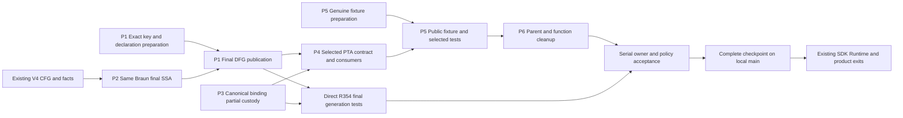

# Remaining implementation dispatch after R356

Updated: 2026-10-10. **PLANNED; dispatch consolidated downstream.** The active
Semantica remaining-work map is
[Oct-10 compiled](../../../../semantica-codegraph-v2/docs/handoff/oct-10/oct-10-compiled.md).
Its section 0 merges P1–P6 into E06/E07/E10/E13 with existing owners, actual
Runtime grant and fixture/feature dependencies, independent tests and DoD.
The broader E00–E18/sections9–10 map preserves original25/Parent18, residual
IFDS/F28/F27/SDK/finite-Path/product scope and actual SCC consumer proof.
This document retains the three read-only audits' detailed source reasoning;
its A/B/C scheduling roles do not authorize a second implementation queue.
It records no new implementation, test execution or Semantica integration.

## Oct-10 handoff reconciliation — overrides new-writer assignments

The user's subsequent overlap check identified the existing Semantica
`docs/handoff/oct-10/agent-1.md` through `agent-6.md`. **P1–P4 substantially
overlap the existing C5/Native work. A/B/C below are capacity and dependency
roles, not permission to create competing source owners.** Resume/reuse the
recorded owner work or obtain an exact path/hunk handoff before assigning a
writer in this chat. No source-writing agents were launched for this plan.

Input readback remains Semantica `e234efb0c1b` plus moving shared WIP, now 868
tracked dirty paths. The handoffs state that their authors stopped for intake;
this is not evidence that the scopes are unowned or that they are currently
running. This pass reads the six handoffs and selected current source; it does
not message those chats, resume them, or mutate Semantica.

| This plan | Existing handoff/owner | Overlap and disposition |
| --- | --- | --- |
| P1 final Source DFG/key and retained output | [agent-4 C5](/Users/songmin/Documents/code-new/semantica-codegraph-v2/docs/handoff/oct-10/agent-4.md), [agent-6 C5](/Users/songmin/Documents/code-new/semantica-codegraph-v2/docs/handoff/oct-10/agent-6.md): 3a Core final constructor, T1 upper DFG/FunctionRef/PTA receiver, Parent upstream | Direct same producer/output path. Keep exact-key/projection acceptance within this C5 bundle; do not start a second Source DFG pipeline or retained wrapper |
| P2 Original Braun SSA export | Same C5 handoffs: 3a | Direct same algorithm, paths and final export obligation. Reuse private unbound/bind state and the agreed Source-A/destination-D facade direction |
| P3 canonical binding partial custody | [agent-6 Native binding/import](/Users/songmin/Documents/code-new/semantica-codegraph-v2/docs/handoff/oct-10/agent-6.md): T1; existing external-index claim | Same PTA binding owner and shared index/occurrence contracts. Exact partial-index extension is not independently itemized in the handoff; retain it as a concrete T1-bundle subtask and reconcile exact hunks |
| P4 selected PTA and Runtime ingress/grant | agent-6 T1 actual import/extractor; [agent-3 selected suppliers](/Users/songmin/Documents/code-new/semantica-codegraph-v2/docs/handoff/oct-10/agent-3.md) D4; [agent-5 Native payload](/Users/songmin/Documents/code-new/semantica-codegraph-v2/docs/handoff/oct-10/agent-5.md) 72; Parent actual Runtime | Direct import/extractor scope plus coupled supplier dependencies. Do not assign a second broad Runtime/PTA writer. Freeze selected-input, genuine grant and Native payload handoffs together |
| P5 public full fixture/selected test | agent-6 C5 V4 member/Product receiver; agent-5 names Parent fixture scope | Contract/output integration overlap; six handoffs do not enumerate every exact test-support file in P5. Verify actual fixture ownership before changing it; lack of a named file is not an exclusive write grant |
| P6 parent God14 | No separate same God14 task found in the six handoffs | Candidate local structural task after exact parent hunks are released. The parent is still shared with T1/Native owners; no blanket ownership is inferred |
| Broader W0/W1/W2/W4 and I | [agent-1 Wire/FileText](/Users/songmin/Documents/code-new/semantica-codegraph-v2/docs/handoff/oct-10/agent-1.md), [agent-2 SDK/HIR/ItemIndex](/Users/songmin/Documents/code-new/semantica-codegraph-v2/docs/handoff/oct-10/agent-2.md), agent-3 D4, agent-4 Root00, agent-5 72/Parent, agent-6 T1 | Existing producer/consumer and integration responsibilities. Consume their retained source/handoffs; I does not create a second shared-index serializer or inherit execution/Git authority |

### Additional acceptance carried from the handoffs

- **Recorded destination D is a real obligation.** The agreed C5 direction is
  genuine A pair → existing `A.with_temporary_into_v3` child D → canonical
  SSA/final DFG → same QSF recorded-D Shared owner → paid final reader under
  that owner's actual output loan. An arbitrary semantic admission parameter
  is not proof of the recorded operation/group or escaping result funding.
- T1's `original_final_dfg_backing_v3.rs` is an **unaccepted proposal** in the
  handoffs and is absent from current source. Do not describe it as implemented
  or create a competing wrapper with a different name. Its exact facade,
  final payload, Send/Sync and Parent member/Product receiving remain to agree.
- Core local completion remains canonical SSA provenance and retained export;
  final DFG receiving and FunctionRef acceptance stay coupled. Existing
  `OriginalDfgFunctionEvidenceBackingV1` stores input fact evidence, not the
  completed final SSA/DFG owner.
- Native Call/ConstraintSet's actual first creation and opaque retained handle
  are existing **C4 dependencies**, owned by 72/T1. P4's full Native consumer
  result cannot be qualified by copying Port rows or by passing the narrower
  direct R354 generation tests. Keep C4's genuine Source/output, Core primitive
  and final-drop funding exits; do not add a second implementation here.
- Graph and published domain-map/Snapshot/Resume funding are existing T1
  scope. A census keeper alone does not fund persistent publication. This
  focused dispatch neither reimplements those owners nor closes their proof.

The independent work available to this chat now is source/handoff
reconciliation, R356/R354 oracle review and documentation; P5 fixture edits and
P6 structural edits require exact ownership intake. P1–P4 stay on the existing
owner completion path. All source implementation and execution gates below
remain required, with no new worker or foreign-chat dispatch implied.

## Purpose, scope and current input

Finish the genuine Source → canonical SSA/DFG → selected PTA → final generation
path using the existing owners. Remove the remaining duplicate ordinary fixture
handoff and resolve the giant parent's structural findings. Preserve exact
identities, deterministic ordering, typed refusal and paid-data lifetime.

- QGLang input: local `main` `8dcea6b54547d77c8c4a4ef718ac034788b09282`, clean
  before these planning edits.
- Semantica input: local `main` `e234efb0c1b15cd5001c5f129a9f019315a1acc5` plus
  shared WIP; 850 tracked dirty paths at preflight. The R356 ten paths are
  staged, not committed. Staging does not prove ownership or acceptance.
- The shared-main registry reports existing claims over DFG, SSA, PTA and
  fixture paths. Claims describe intended ownership; they do not establish
  that another worker is running. The observed integration barrier is absent.
- This planning pass reads Semantica only. Rust/compiler/tests/QBC/runtime and
  Semantica Git mutations are **NOT_RUN** here. Current execution constraints
  must be resolved by the integration owner before an execution wave starts.
- All implementation stays downstream. No new compiler, SSA engine, issuer,
  frontend DTO, library or hosted CI is required by this plan.

Existing tickets remain `CHECKED-RETAINED-CONTROL` and `FCP-COMPILE`, with the
existing W2/W3/W5/W6 exits. P1–P6 below are scheduling packages, not new defect
tickets. The broader SDK/Runtime/product remainder stays in the
[W0–W7 plan](parallel-dispatch.md#current-completion-plan--2026-10-09).

## Current source corrections that determine the order

1. R356 already connects the external occurrence/index births and removes the
   duplicate key copier. Do not rebuild that map or recreate its forwarding API.
2. Source evidence retains semantic identity/declaration and CFG/facts, but not
   the authenticated final DFG result/key. Original callable intake still
   rejects file-batch publication; existing V4 cohort/evidence lending is a
   separate present capability. The canonical final projection currently takes
   ordinary `PipelineOutput`, not the Source pair. Exact-key preparation can
   run beside SSA; successful nonzero DFG/FunctionRef publication also needs
   the same projection owner's Original input/output conversion.
3. Core has genuine V4 CFG/facts loans and Original state/collector births.
   Public SSA export remains Ordinary-only; Original `ExportWork = ()` and
   use-origin insertion refusal remain. Extend the same Braun algorithm.
4. The canonical binding-index producer still constructs local maps. Its
   existing external birth covers only part of the construction and has no
   production caller. R356 retains completed output, not all inner partials.
5. V4 is a retained CFG/facts builder, not a complete selected PTA ingress.
   Both the current native import factory and the return-shaped adapter
   downcast to `AdmittedSourceGenerationBundleV1`/`SelectedNativeSourceRowV1`.
   Reuse `OriginalNativeImportBirthPortV3` and its concrete factory; migrate the
   actual selected input/consumer closure before switching the full fixture.
   Runtime's derived-row prebirth validation also still refuses the complete
   owned grant; that production gate must be repaired at its funding owner.
6. God cleanup must cover functions as well as file organization. Moving
   inline tests or moving an over-budget function unchanged does not resolve
   its length/complexity finding.

## Ownership and parallel waves

Maximum capacity: **three implementation workers plus one integrator** in this
chat. These are future roles, not a claim that source writers were launched.
The three agents used for this plan performed read-only audits only.

| Wave | A: DFG and selected ingress | B: Core SSA, then structural debt | C: canonical binding, then fixture | I: integration |
| --- | --- | --- | --- | --- |
| 0 / write sets ready | P1 exact key/result ownership and caller census | P2 actual Original replay/export gap and owner tests | P3 partial-index state and fixture feature/caller census | Refresh HEAD/index/hashes/claims; record exact hunks and shared contracts; resolve owner witnesses without running Rust |
| 1 / independent source work | P1 exact-key/declaration mapping and external partial/error state; final success publication waits for B | P2 same Braun CFG/facts replay/finalizer/export and genuine final SSA provenance | P3 complete the existing canonical binding-index birth and its production callers | Review signatures/custody; prepare independent final/refusal oracles; maintain one future heavy queue |
| 2 / coupled source completion | Finish P1 after B handoff, then P4 selected PTA contract and adapter/factory | P4 Runtime storage/publication/prebirth grant counterpart under A's frozen contract; inventory P6 without editing the parent | P5 reuse existing genuine inventory/issuer/V4 in full fixture; selected extraction switch waits for P4 | Freeze each handoff; run ready direct R354 generation tests before selected ingress when execution is permitted; accept complete owner scopes serially |
| 3 / structural completion | Review selected identity and stable IDs | P6 parent responsibility/function refactor after P4/P5 release shared files | Final fixture/feature/refusal witnesses; remove the retired ordinary handoff | Run affected function/file/boundary rails and changed owner scopes; prepare complete compatible commits |
| 4 / local closeout | Review exact committed Source result/selection | Review committed SSA and retained state | Review committed fixture/consumer/features | Serialize complete checkpoint commits, confirm committed-source continuity, then continue W5–W7 exits |

**Public selected-ingress critical path:** genuine CFG/facts → P2 final SSA →
P1 authenticated final DFG publication → P4 adapter plus Runtime ownership/grant
→ P5 public fixture/selected regression → P6 and owner acceptance → compatible
local-main commit. Direct R354 final-generation tests do not enter selected PTA:
run them once P1/P2/P3 and their SourceWire feature closure are ready, without
waiting for P4. P3 and the preparation parts of P1/P5 run beside the critical
path. P6 parent edits start after its functional callers release the file.

### Shared-file custody before dispatch

Existing registry entries are overlap candidates, not proof of active writers:

| Package | Recorded overlapping scope | Coordination rule |
| --- | --- | --- |
| A / DFG | `OCT7-DFG-CONTROLLED-EVIDENCE-HOLDER-83`, `OCT9-JAVA-ORIGINAL-EXTERNAL-INTAKE-83` | Preserve current pair/evidence producers; one writer for Source projection/key/publication hunks |
| B / SSA | `OCT9-ROOT-SSA-*` collector/state/replay/CFG claims | Extend the current canonical implementation; do not fork the captured Original state/collector work |
| C / binding | `PTA-SOURCE248-OCT9-EXTERNAL-ISSUANCE-MATERIALIZER`, `OCT9-D4-FUNCTION-REF-WHOLE-UNIT-LOAN`, `S0-PTA-RETAINED-FINAL-OUTPUT-20261007` | One canonical index birth; release exact occurrence/index hunks before A consumes the selected API |
| C / fixture | `OCT9-PTA-RETAINED-TOPOLOGY-R337`, `OCT9-PTA-QRA-ORIGINAL-RECEIVING-R307` and retained fixture claims | Preserve genuine topology/QRA receiving; migrate only the remaining ordinary production path |
| B / Runtime counterpart | `OCT8-PTA-RUNTIME-SHARED-CURRENT-CALLERS`, `PTA-SOURCE248-OCT9-EXTERNAL-ISSUANCE-MATERIALIZER` plus current W4 owner | A publishes the contract first; B owns actual cache/storage/grant/caller hunks; no second W4 implementation |

I refreshes exact matched paths, HEAD and hashes before a writer starts; records
same-file disjoint hunks or serialized handoffs and the accepted invariants;
uses the existing shared-main reconciliation mechanism. Do not overwrite a
foreign postimage or treat a recorded claim as an exclusive lock. No messages
to other chats are authorized; all roles and coordination here stay in this chat.

## Exact code packages and before/after

Paths below are relative to Semantica. `qv2/` means
`packages/analysis/quanta-v2/crates/`; `pta/` means
`qv2/quanta-adapters-pta/src/`; `artifact/` means
`pta/native_normalized_attribution_generation_artifact_v2/`;
`dfg/` means `qv2/quanta-adapters-dfg/src/multi_lang_dfg_adapter/`.
Lists define candidate responsibility boundaries; claim only the files/hunks
actually needed after fresh source inspection.

### P1 / A — genuine DFG result, exact key and declaration publication

- **Current:** `semantic_identity_sidecar_v1/original_java_callable_intake_v3.rs`
  refuses file-batch publication; `original_evidence_backing_v1.rs` lacks the
  genuine DFG result/key. The ordinary key is emitted from validated owner
  projection, while Source assignment entity identity has separate provenance.
- **Change:** connect the genuine callable owner's Source CFG/facts pair and
  P2's actual SSA events to the SAME stage-3 projection and final emitter.
  `build_dfg_components_for_function_v1` currently requires ordinary
  `CfgV1`/`DefUseFactsV1`; `finalize_projected_result_internal_v1` requires
  ordinary `PipelineOutput`. Their Original input/exterior output boundary is
  real implementation work, not an already callable adapter. Reuse existing
  projection/storage algorithms and the Original owner writer where complete;
  do not create or clone ordinary `PipelineOutput` to bypass custody.
  Retain the actual result, exact `(function_name, entity_id, symbol_uid)` key,
  stable declaration, and checked batch-member/evidence-ordinal correspondence
  under the same source/operation. Add the controlled selected loan at this
  owner. Publish only after the complete row and its provenance validate.
- **Candidate write set:** `dfg/semantic_identity_sidecar_v1.rs`;
  `dfg/semantic_identity_sidecar_v1/{original_java_callable_intake_v3.rs,retained_java_callable_pipeline_v1.rs}`;
  its existing `retained_java_callable_pipeline_v1/original_intake_birth_v3.rs`;
  `original_evidence_backing_v1.rs` and its `controlled_rows_v3.rs`/
  `declaration_index_v3.rs`; `dfg/adapter/java_source_closure/batch_publication_v1.rs`;
  `dfg/adapter/source_generation_admission_v1/{retained_java_binding_v1.rs,controlled_evidence_v3.rs}`;
  existing `dfg/build_pipeline/{core.rs,parser_rca/pipeline_results_v1.rs}` and
  `dfg/adapter/enrichment.rs` where the same projection's Original boundary is
  added. Coordinate the existing `OriginalSourceFunctionOwnerBuilderV3` owner
  writer only if required; its presence/private API does not prove a live
  production caller.
- **Handoff to P4:** exact controlled loan signature, original source/operation
  authentication, DFG-key/declaration/ordinal invariants, exterior error/partial
  ownership, compatibility delta and all changed caller hashes.
- **DoD:** real nonempty Source DFG row and selected declaration agree with an
  independently authored expected tuple/ordinal. Reject foreign operation,
  swapped ordinal, duplicate/ambiguous mapping and missing provenance. No
  semantic-digest/name heuristic, fabricated ordinary result or early success.

### P2 / B — complete the same Original SSA exporter

- **Current:** `packages/core/dfg/engine/src/solver/ssa_braun/canonical_exporter/`
  exposes Ordinary export; `storage_mode_v3.rs` has Original `ExportWork = ()`
  and refused use-origin insertion. Some path-constraint collection still
  directly reads ordinary `CfgV1` fields.
- **Change:** connect existing `CfgReadV3::admitted_v3`, predecessor/traversal
  births, `collect_original_canonical_events_into_birth_v3`, same replay,
  sealing, finalizer and retained export. Use the existing controlled CFG and
  predicate projections for branch/loop reads. Keep partial state, export work
  and full causes outside the highest enclosing Source.
- **Candidate write set:** `ssa_braun/mod.rs`; existing exporter
  `mod.rs`, `cfg_read_v3.rs`, `pipeline.rs`, `fact_events/admitted_v3.rs`,
  `event_replay.rs`, `exporter.rs`, `storage_mode_v3.rs`,
  `state_data_v3/original_birth_v3.rs`, `retained_rows_work_v3.rs`, and their
  owning regression modules. Controlled projection owners change only if a
  demonstrated read obligation is missing.
- **Handoff to A:** real final SSA `DefId`/`UseSiteId` and binding provenance
  under the same member/current/output, through the existing external birth
  model. These are Core's SSA IDs, not public `DfgBuildResult` handles. A joins
  the actual DFG emitter IDs through existing semantic-event/statement/slot/
  symbol relations, including `project_exact_constraint_handles_v1`.
- **DoD:** independent straight-line def/use, branch+phi and loop expectations;
  Ordinary/Original semantics agree on the same graphs. Core's local exit is
  final SSA def/use/phi provenance and full-cause/partial/refund proof. Final
  lambda FunctionRef 1 is the coupled P1/P4/P5 oracle after this handoff, not a
  Core-only result. Reject foreign current; missing/ambiguous semantic joins
  are rejected by the consuming DFG/selected owner. Final DFG rows must not
  become inputs required to create SSA.

### P3 / C — finish canonical binding-index partial custody

- **Current:** `pta/native_generation_binding_index_v1.rs` constructs
  local token/function-ref maps in `NativeGenerationBindingIndexV1::prepare_v1`.
  Its `original_birth_v3.rs` is only partially implemented and unused by the
  production caller.
- **Change:** extend `OriginalNativeBindingIndexBirthV3` to own declaration
  allocation, token/function-ref maps, pending insertions, full causes and
  funding keepers. Transfer into the same canonical index only after success.
  Migrate actual occurrence/direct-index consumers in the same source cut.
- **Candidate write set:** `pta/native_generation_binding_index_v1.rs`
  and its `original_birth_v3.rs`/tests;
  `artifact/native_occurrence_admission_v1.rs` and its `original_birth_v3.rs`;
  direct `row_index_by_token_v1` consumer hunks discovered by census. Parent
  mount/re-export edits belong to I; A does not edit these hunks concurrently.
- **DoD:** genuine two-declaration/nonzero-ref case, duplicate-token refusal,
  late failure after the first insertion, partial-map/text retention until
  Source completion, no refused output, complete first cause and last-drop
  refund. Reuse the current index/key comparison and R356 occurrence owner.

### P4 / A contract and adapter, B Runtime counterpart after handoff

- **Current:** `artifact/dfg_declaration_index_v3` selected lookup and
  `pta_constraint_extractor_port_v2_adapter` native import factories retain
  ordinary-row/bundle assumptions. A V4 fixture alone cannot satisfy them.
- **Change:** consume P1's authenticated result/key/declaration loan in exact
  lookup and selected validation. Reuse `OriginalNativeImportBirthPortV3`,
  `AdapterOriginalNativeImportBirthV3` and their retained full-error model.
  Co-cut the borrowed selected input, the concrete adapter and actual Runtime
  cache/publication/caller. Complete the genuine original byte-root/owned grant
  and retained grant custody at
  `extraction_chunk_prepare_source_preflight_v1/native_mixed_v1.rs::validate_v1`
  and `prepare_v1`; the current derived-source refusal must not be removed
  without its real funding producer. Keep ordinary ingress behavior explicitly supported by its existing
  path; do not create an ordinary Arc as an Original capability.
- **Candidate write set:** `artifact/dfg_declaration_index_v3.rs` and its
  `original_birth_v3.rs`; PTA adapter `original_native_import_factory_v3.rs`,
  `native_import_handoff` owner files and
  `native_issued_envelope_v1/selected_original_validation_v3.rs` and its parent
  `native_issued_envelope_v1.rs`;
  `pta_constraint_extractor_port_v2_adapter.rs`;
  `qv2/quanta-contract-ports/src/pta_constraint_extractor_port/{import_handoff.rs,original_native_import_birth_v3.rs}`
  and the trait only where the real loan shape requires a signature change;
  A owns this selected contract/adapter set. B owns the existing Runtime
  `qv2/quanta-runtime-analysis/src/queries/pta/precise_query/extraction_solve/`
  `extraction_chunk_port_constraints.rs`, `extraction_chunk_sidecar.rs`,
  `extraction_chunk.rs`, `file_dfg_generation.rs`,
  `file_dfg_generation_publication.rs`,
  `extraction_chunk_prepare_source_preflight_v1/native_mixed_v1.rs` and their
  actual input/factory/grant-holder callers. This includes the ordinary Arc
  publication and selection fields, not just the last extraction function.
- **Contract gate before C switches fixture:** enumerate all request/trait
  constructors, selected-row downcasts and feature classes. Publish one
  compatible borrowed API and complete caller map. No speculative second
  abstraction or wire-contract change is assumed.
- **DoD:** actual selected Source ingress extracts the independent expected
  constraints. Foreign source/member/current, equal-value foreign handles,
  wrong selected row and unsupported provenance refuse with zero publication.
  Preserve first cause, outer Source priority, one-shot transfer and refund.

### P5 / C after P3 — genuine full fixture and selected consumer conversion

- **Current:** public `ExactJavaNativeSourceFixtureV1` calls ordinary inventory/
  diagnostic production and stores an ordinary retained workspace Arc. Its
  selected mixed-source test consumes that Arc. V4's current test proves only
  the CFG/facts callback.
- **Change:** reuse private `issue_original_inventory_v3` with the public
  fixture's existing execution session, FD capture, pin/spec and build context.
  Retain evidence/inventory before passing it to the genuine generation issuer
  and `JavaOriginalSourceClosureBuilderBirthV4`. Convert the selected mixed
  test to P4's actual Original ingress. Remove the retired Arc getter/field
  after its external and internal consumers move.
- **Candidate write set:**
  `qv2/quanta-runtime-test-support-pta/src/exact_native_generation_fixture_v1.rs`;
  its `owner_stages_v1.rs`, `owner_first_source_v3.rs`,
  `original_inventory_fixture_v3.rs` and existing tests;
  `qv2/quanta-runtime-test-support-pta/tests/pta_native_mixed_source_owner_contract_test.rs`
  and its `census_v1.rs`; test-support `Cargo.toml`. P4 owns shared PTA/Runtime
  signatures; C consumes the frozen handoff rather than implementing them twice.
- **Compatibility:** preserve constructors, `generation_v1`, session/cancel,
  source/path/namespace and alternate build-context identity. Check every
  `exact-native-generation-fixture`, `original-source-dfg-fixture` and
  `pta-native-w6-product-contract` consumer. The exact feature currently does
  not enable the DFG lean-Java feature; decide the complete feature forwarding
  from the new real caller closure and retain minimal/default rejection rails.
- **DoD:** alias/returning-alias/lambda/returning-lambda literal census;
  foreign generation/equal-handle/short-budget refusal; W6 normal one write and
  identity mismatch zero writes. Same original session/pin/build axes, no
  duplicate FD capture, inventory producer, diagnostic issuer or SDK back-edge.

### P6 / B after functional freeze — parent and function structural cleanup

- **Current:** giant `native_normalized_attribution_generation_artifact_v2.rs`
  retains the R356 God14 unbaselined result; raw comparison has 17 findings.
  One function finding is selected-match validation; the remainder cover
  persisted decoding/revalidation/inventory conversion and enum token/rank.
- **Change:** separate selected-match validation, persisted codec, persisted
  validation/inventory conversion and seed-kind wire mapping by responsibility,
  using existing owner children where applicable. Shorten the actual long/
  complex functions with cohesive helpers and one canonical enum mapping.
  New child files are organizational destinations, not new authority owners.
- **Write set:** giant parent plus affected existing/new responsibility
  children and owning tests. Claim both move source and destinations. Only B
  edits the parent during this wave; I serializes mounts/re-exports.
- **DoD:** all affected parent/child file/function/complexity rails pass with
  no added allowance, threshold increase or baseline expansion. Public exports,
  enum text, canonical byte/digest results, ordering, errors and refusal paths
  retain independent literals. Test-only extraction cannot close this package.

## Proof matrix and checkpoint commits

| Scope | Required oracle before acceptance |
| --- | --- |
| Existing R356 owners | Exact-key tuple/UID-coordinate copy and sorted ordinal tests; late work refusal retaining first key/partial text; retained topology last-reader refund; foreign-group resolver refusal |
| P1/P4 authenticated selection | Real nonempty Source cohort, exact producer key/declaration/ordinal, selected PTA result; swapped/foreign/duplicate/ambiguous/missing authority rejects; no fabricated ordinary fallback |
| P2/P3 allocation and binding | Literal SSA/phi/loop, final handle provenance, duplicate-token rejection; genuine finite-budget late refusal, full cause and complete retained partial state through highest Source; final refund |
| P5 existing R354 tests | `original_noop_inventory_reaches_final_generation_under_same_source_v3`: final refs 0 for default and alternate `0x62` build context; `original_alias_inventory_reaches_final_generation_under_same_source_v3`: final refs 0; `original_returning_lambda_preserves_final_function_reference_v3`: pre-final 1 and independent final refs 1 |
| P5 public/selected/W6 | Actual public fixture→selected consumer, alias/lambda census and strict negatives; W6 one-write/zero-write invariants under actual feature closures |
| P6 compatibility | Literal persisted wire/digest and enum/error behavior; all affected God modules/functions and boundary rails, not only the moved parent |

All tests in this dispatch are **required/unaccepted** until a matching executed
owner receipt exists. A test authored in source, a resolved selector or a lower
historical GREEN does not supply that receipt. R356/R354 tests remain NOT_RUN.
The R354 tests already use genuine inventory and the final generation issuer;
their direct execution is an early P1/P2/P3 proof rail, not a dependency on the
public P5 fixture or selected P4 extraction. Public selected/Runtime proof still
requires the complete P4/P5 closure and actual prebirth grant.

I performs these steps serially when execution is permitted:

1. Refresh exact owner request manifests and `owner resolve` results. Fail on
   zero selected witnesses. Preserve actual target/features/toolchain and the
   common SourceWire compile prerequisite; latest recorded Cut20 has 24 compile
   diagnostics and zero tests on its own input, not 24 new defect tickets.
2. Run the smallest coherent changed owner scope through the existing
   `scripts/quanta-build-cli owner run`. Keep one heavy Rust/QBC queue on the
   shared host. Do not pre-run `cargo check` and the same test build separately.
3. Hold source custody through postflight and canonical publication/archive
   readback. On input drift, compare relevant files and rerun only invalidated
   scopes. Reuse matching prior accepted scopes without adding their counts
   to a different-source product result.
4. Checkpoint **CP1**: complete canonical binding/SSA owner cuts, including all
   changed callers, may commit independently if their contracts compile and
   their own behavior/custody rails pass. A coupled signature stays with all
   affected callers; unused scaffolding is not a completed checkpoint.
5. Checkpoint **CP2**: complete Source DFG→selected PTA→public fixture closure,
   feature matrix and final positive/negative/refund proofs. Commit the full
   compatible bundle; never cherry-pick just the consumer/test files.
6. Checkpoint **CP3**: structural cleanup plus affected compatibility/owner
   rails. Recheck exact staged ownership and committed-source continuity.
   Shared index/HEAD operations are owned by I only; preserve foreign staged
   and unstaged hunks. No `git add -A`, foreign unstage, hook bypass or push is
   part of this dispatch.

Commit ordering follows actual dependency/custody readiness, not a requirement
to wait for every product rail before recording a complete independent owner
cut. Source on a local main worktree is not a committed checkpoint.

## Broader closeout dependencies and final DoD

This focused dispatch does not silently close the other substrate work:

| Existing package | Remaining dependency and scheduling rule |
| --- | --- |
| W0 / W6 compatible compile | Finish existing SourceWire production/test API migration under its current owner; one causal compile repair and one successor capture, not duplicate fixes per blocked consumer |
| W1 / W2 SDK, Parser and providers | Existing owners finish genuine generation/receipt, Java HIR receiving, provider/import/fact-map publication. Consume their exact released contract; do not copy SDK orchestration into fixture or QGLang |
| W4 Runtime | Reuse existing Original input/factory/trace/context/memo/persist/packet owners. P4 changes only the complete selected PTA caller seam; broader Runtime work keeps its existing write set |
| W5 actual consumers | Re-resolve affected Shape/Cost, PTA/Andersen, taint/depth, DFG/MemSSA, language/callback/cursor, SCC, registry/Preview and deadline witnesses after compatible production source is ready |
| W7 installed product | Actual Graph/CHECK process outputs need the release-owned signed Linux artifact/trust tuple and an appropriate local executor. Missing inputs retain their own NOT_RUN/external prerequisite; they do not erase independent accepted owner cuts |

Final code closeout requires P1–P6 implemented/reviewed, exact affected owner
and policy rails accepted, complete compatible local-main commits, and no
remaining duplicated key/index algorithm or retired ordinary fixture handoff.
Final substrate/product closeout additionally requires the existing W0–W7
consumer and product exits; keep those states separate.

The plan has no credible elapsed-time or percentage estimate before P2/P4's
actual compatible compile closure is accepted. Report package states as
**planned → authored → reviewed → executed/accepted → committed**, plus a
separate product qualification state.

Evidence: task-local `query-owner-build-r1/r356-parallel-plan-preflight.json`
records both HEADs, the exact dirty inventories and registry snapshot. The
three planning auditors performed no source edits or test execution.
