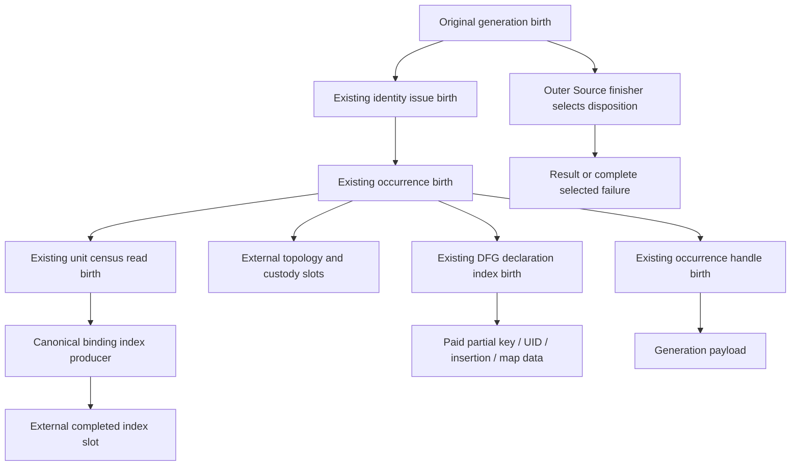

# External occurrence and exact-key owner cut — R356

## Purpose and source boundary

Prevent the final PTA occurrence factory from dropping paid key copies,
completed indexes/topology or complete failure causes inside an enclosing
Original Source. Use the existing owner births and remove the old duplicate
key-copy operation. No new engine, library, DTO or Source authority is added.

Input: Semantica `e234efb0c1b15cd5001c5f129a9f019315a1acc5` plus the separately
captured shared dirty tree. QGLang documentation parent: `66b6b64088983309bfe68a7d786747ade249cdd6`.
Ten Semantica paths changed under the reconciled
`OCT10-GQLANG-EXTERNAL-OCCURRENCE-OWNER-R356` source claim. This chat does not
stage, commit or push Semantica, and executes no Rust compiler/tests/QBC/runtime.

## Before and after

| Responsibility | Before | R356 source |
| --- | --- | --- |
| Final occurrence caller | Return-shaped local factory bypassed the two existing births | Existing outer identity birth owns the occurrence birth; preflight invokes it directly |
| Owned occurrence inputs | Borrowed exact refs/identity mixed with moved census/evidence | Inputs own only data; preflight/identity remain short function loans |
| Exact key | Live `copy_dfg_key_v3` duplicated external birth's `copy_key_v3` | Only external `copy_key_v3` remains; ordered map, tuple and scalar ordinal are unchanged |
| Census read | Generic lender could return a completed owned index | Existing unit read birth retains Source failure; callback installs index externally and returns unit |
| Binding/topology postchecks | Successful local values could drop on a later check failure | External destination receives the value before subsequent target/custody checks |
| Final handle | Return-shaped handle issuance | Existing handle birth receives external owner slot and retains partial/header failure state |
| Full causes | Local consumer error values crossed nested callbacks | Existing census/index/handle banks and explicit binding/topology slots retain complete causes |
| FunctionRef lender | Callback declared one argument but called/consumed two | Lender lives with existing target reader and explicitly forwards its failure slot |
| Stale test | Retired builder fields/helper; foreign fixture could panic before resolver | Genuine topology-retain lifetime test and actual resolver foreign-group rejection |

`B` still has its own return-shaped partial construction. Keeping its completed
output external does not certify every inner allocation failure. Source-member
key/SSA support is also absent; the diagram is custody routing, not a successful
Source-member execution claim.

## Exact code map

All paths below are relative to Semantica
`packages/analysis/quanta-v2/crates/quanta-adapters-pta/src/`.
`artifact/` abbreviates `native_normalized_attribution_generation_artifact_v2/`.

| Path | Change |
| --- | --- |
| `native_normalized_attribution_generation_artifact_v2.rs` | Remove retired factory/index imports; make occurrence build inputs own data only |
| `artifact/native_generation_issuance_v1.rs` | Invoke the existing occurrence birth from preflight; remove thin legacy forwarding factory; retain optional relation output after installing owned inputs |
| `artifact/native_generation_issuance_v1/original_issuance_birth_v3.rs` | Own occurrence birth externally, retain its failure marker, select its cause after outer Source and earlier prerequisites |
| `artifact/native_occurrence_admission_v1.rs` | Unit census read; separate read/build/postvalidation responsibilities; install completed binding/topology before later fallible checks; remove local occurrence factory |
| `artifact/native_occurrence_admission_v1/original_birth_v3.rs` | Retain owned inputs, completed intermediates, key birth/result and owner/handle/backing; reject repeated build; keep fallback protocol refusal behind actual causes |
| `artifact/native_occurrence_admission_v1/function_ref_targets_read_v3.rs` | Consolidate the inventory lender with its exact target reader; co-cut the two-argument callback with the existing consumer |
| `artifact/dfg_declaration_index_v3.rs` | Delete return-shaped map builder and duplicate `copy_dfg_key_v3`; keep exact query/comparison behavior |
| `artifact/dfg_declaration_index_v3/original_birth_v3.rs` | Limit birth/type methods to artifact ancestor visibility; mount owner tests |
| `artifact/dfg_declaration_index_v3/original_birth_v3/tests_v3.rs` | Two new direct paid-copy/map regressions with literal oracles |
| `artifact/sealed_constraint_resolution_v1_tests.rs` | Migrate topology retention proof; repair foreign-group fixture boundary |

The sole FunctionRef consumer remains
`pta_constraint_extractor_port_v2_adapter/native_issued_envelope_v1/validation_v3.rs`.
It already expects `|targets, failure|`; no new consumer facade is introduced.

## Invariants and failure behavior

- Preserve `(function_name, entity_id, symbol_uid)`, including absent versus
  present-empty values and every UID coordinate. No hash/name heuristic joins.
- Keep canonical ordered-map comparison and deterministic scalar ordinals.
- Duplicate keys remain terminal `BindingMismatch` at the enclosing index
  birth. Direct map displacement is not accepted as successful admission.
- Require the genuine same-operation output. Unsupported Source member reads
  remain typed refusal. Diagnostic storage was already refused by the old
  output-required index builder; R356 adds no diagnostic authority bypass.
- Keep paid partial text, UID vector/name part, pending insertion and allocator
  causes in external DATA. Their original funding keepers outlive those values.
- Outer Source failure wins. Consumer and losing complete causes remain stored
  until that finisher returns. Protocol fallback never replaces an actual
  recorded census/index/binding/topology/handle cause.
- No result on a refused/reused birth; completed backing transfers once.

## Test plan and present evidence

All Rust tests below are authored source, **NOT_RUN**.

1. `original_index_key_copy_keeps_all_tuple_axes_and_sorted_ordinals_v3`:
   distinguish function name, entity absent/empty/present, UID absent/present,
   name-part values/count and file/start/end/kind perturbations; exact literal
   key-to-ordinal lookup, sorted first-six ordinals, duplicate displacement and
   final-drop refund. This tests the paid-copy/map owner directly, not a
   nonempty evidence cohort or supplier admission.
2. `original_index_late_work_refusal_retains_first_key_and_partial_text_until_drop_v3`:
   genuine finite-work root, existing first key, second 2048-byte input refused
   after its first 1024-byte destination chunk; exact `WorkLimitExceeded`,
   retained map/text, and final refund.
3. `retained_occurrence_topology_keeps_original_lease_until_last_consumer_drop_v3`:
   actual Original topology and production retain helper, two retained
   consumers, producer drop, first-consumer drop, final zero refund. This is
   topology retention proof, not full final occurrence admission.
4. Existing sealed-container identity regression remains; foreign-group
   regression uses an authentic original output with mismatched storage group
   so the resolver returns `AuthorityRejected`.
5. Execute the existing R354 genuine final-generation no-op, context, alias and
   nonzero-lambda cases after the actual Source supplier is complete. Keep their
   required final literal counts and rejection oracles.

Executed static checks: AST10, exact-file rustfmt9, scoped LLM guardrails and
ten-path diff checks pass. Seven owning production modules pass God-surface
without allowances or baseline updates. The giant parent retains fourteen
pre-existing unbaselined God findings; raw pre/post comparison has seventeen
findings each, no added/worsened finding and file budget 3169 -> 3162. Parent
formatting and Rust type checking are not claimed. Independent current-source
type/custody/oracle reviews found no remaining new actionable defect.

## Remaining acceptance and dependencies

- **Supplier/selection:** same-owner Source DFG result/key plus declaration;
  Source-aware selected lookup/validation; finish partial custody inside the
  canonical binding-index producer. Do not duplicate its algorithm behind a
  new adapter or treat R356's completed-output slot as complete birth proof.
- **Nonzero references:** actual final Source SSA/definition/binding handles.
  `BindingRequired` must not become zero or guessed success.
- **Public fixture:** reuse the existing V4 Original retained builder and
  convert the public fixture and selected PTA consumer together. Ordinary Arc
  handoff and diagnostic issuer remain until that actual co-cut exists.
- **Structural debt:** giant parent's fourteen God findings remain. This
  scoped owner repair neither changes that gate nor declares the file clean.
- **Proof/integration:** one compatible source tuple; owner-feature tests;
  genuine Java/Python late-refusal/full-cause/custody/refund and final positives
  plus strict negatives; verified owner publication and complete coupled main
  integration. Foreign staging is not committed integration.

These exits stay under `CHECKED-RETAINED-CONTROL` and `FCP-COMPILE`; no new ticket
or duplicate implementation is dispatched. Evidence lives in the existing
task-local `query-owner-build-r1` directory under `r356-*`, including preimages,
owned delta, postimage hashes, parent God comparison and independent reviews.
