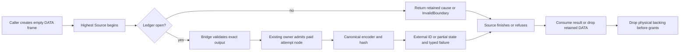

# Native identity custody boundary

Updated: 2026-10-09. Status: authored source WIP; static review and remaining receiving in progress.
This is part of `CHECKED-RETAINED-CONTROL`, not a new engine or ticket.
Semantica committed base: `3b8f86dd9ea7f94a2426277311037ea9d6480a6a` plus
changing shared source. No Rust compilation, tests, source capture or Semantica
Git publication ran in this source-only lane.

## Purpose and scope

Keep every Native identity attempt's partial encoder state, completed bytes,
full typed cause and copied text until its enclosing Source finishes. Reuse the
existing canonical serializer, BLAKE3 owner, domains, tuple axes and ordering.
This addresses a retained-control migration seam; no reproduced wrong digest,
leak, refund or user-visible failure is asserted.

Paths below are Semantica-relative. `parser/` means
`packages/analysis/quanta-v2/crates/quanta-adapters-parser/src/`.

| Owner | Before | After / receiving boundary |
| --- | --- | --- |
| `packages/core/codegraph-lang-common/src/stable_span_map_entry_id_v1/native_v3.rs`, `stable_symbol_id_v2/native_hash_v3.rs` | Owned canonical bytes die at lower return or hash refusal. | Mandatory fresh external encoder/completed/error state per ID; same five-field span and v2 symbol preimages. Parser Java materialization and hierarchy keep the ledger before Source; Python requires the same outer receiving. |
| `packages/core/ir/canonical-symbol-id/src/{canonical_symbol_id_v2,semantic_occurrence_id_v1}/borrowed_mint_v3.rs` | Both Original mints use owned-return `hash_axes_v3`. | Shared single-use `CanonicalDescriptorMintSlotsV3`; in-place Original symbol/occurrence methods, copied ID accessors, same domains and 16-byte prefix. Ordinary diagnostic mint stays ordinary. |
| `packages/analysis/quanta-v2/crates/quanta-contract-statement-shared/src/statement_identity/native_structural_path_v3.rs` | Copied String is local across charged comparison, including mismatch/refusal. | External partial text/error/encoder slots and completed ID sink; same copier-byte rejection and feature-off refusal. External cache/result storage precedes both HIR Source entrances. |
| `packages/analysis/quanta-v2/crates/quanta-runtime-source-authority-wire/src/original_identity_mint_ledger_v3.rs` | No per-attempt storage shared by these bridges. R259 first placed the helper privately in Parser. | R266 moves the same generic DATA ledger to the existing SourceWire owner. The same NativeCore admitted Box primitive births one exact paid linked node per attempt. Pending, born and prior nodes remain outside Source. Parser reexports that module; its former implementation file is removed. No Cargo/feature/dependency change. |



The ledger is storage and cleanup infrastructure. It performs admitted Box
birth through NativeCore; it does not calculate identities, select source,
issue authority or introduce another query/runtime engine.

## Public and internal compatibility

- Rust Original APIs change signatures; receiving callers must migrate together.
  Frontend IR, wire schemas and ID formats are unchanged. Original lower APIs
  require external slots. Do not add an owned Original shim
  or reset single-use state after success/refusal.
- The semantic bridge keeps its existing `&self` trait and Clone context by
  accepting an explicit outer `RefCell<Ledger<Slots>>`. Borrow conflicts become
  typed refusal; no mutable slot or borrowed error escapes the cell borrow.
- Authenticate the exact output object before mint-node birth. Same group alone
  is insufficient; preserve different-output/same-group rejection.
- Each node retains its real issuing operation/group leases. During cleanup,
  detach next and custody, destroy payload and Box, then release custody.
  A lease stored as the last Box field alone releases before Box deallocation.
- One exact admitted node per attempt gives O(1) append and O(n) retained nodes.
  Original memory/work admission bounds attempts. Extra retained metadata and
  replacement backings can refuse historical small budgets. Node admission now
  precedes lower leaf validation, so tiny-budget refusal precedence can change.
  No speed claim is made.
- No serializer dependency, hash domain, identity format or runtime engine is added.

## Actual Source entrances

- Java semantic module: `parser/language_host_adapter/semantic_expression_identity_ledger_v1/original_java_inputs_v3.rs`
  declares its materialization birth before registered parse/read loans. If its
  caller is already inside workspace request Source, receiving must reach that
  enclosing caller too; the inner materialization birth alone is insufficient.
- Hierarchy: storage must precede the enclosing workspace request Source as well
  as `with_original_output_v3` in
  `parser/language_host_adapter/java_workspace_resolution_syntax_v1/workspace_hierarchy_projection_v3.rs`.
  `workspace_batch_birth_v3.rs` calls this projection after the outer request
  Source begins; a local hierarchy ledger alone is insufficient.
- Java external binary: storage precedes the request control loan and the earlier
  edited-member selection loan in `workspace_original_build_type_owner_v3.rs`.
  A batch created inside that loan is not the lifetime owner.
- Python module/import/provider completion have distinct outer frames. Required
  receiving must reach each frame; one generic Python module field is not proof
  for import or provider augmentation.
- Statement projection: cache/result and attempt storage precede workspace
  `with_original_finalized_member_v3` and registered-target `with_loan_v3`.

## Current receiving map

| Path / owning boundary | Authored source | Remaining acceptance |
| --- | --- | --- |
| Java module, hierarchy and external binary | R260/R261 lend stable and semantic ledgers from before workspace request/member loans through materialization, finalization and classification. | R269 Java owner decomposition removes the introduced parameter/size findings; two foreign cache/Python findings remain RED. R274 source review finds no concrete new defect. Complete owner execution remains open. |
| Java incremental SDK entry | R268 `Store::issue_exact_edit_transition_from_persisted_closures_original_v3` creates `JavaOriginalIdentityMintBirthV3` before `with_original_source_session_v3`, then lends it through selected-member loans into Parser. Parser public reexport is present. | Same existing Java birth now bundles stable/semantic lenders throughout Java callers. Actual SDK owner regression is NOT_RUN. |
| Python module | R269 adds stable/semantic DATA fields to existing `OriginalPythonMaterializationBirthV3`, nested in `OriginalPythonSourceProjectionBirthSlotsV3`. `canonical_module_into_slots_v3` and `admitted_modules_into_slots_v3` lend those fields to the mandatory hash APIs. | Caller must keep that SourceProjection frame outside its highest Source; module-local owned convenience entry is not proof for a higher enclosing caller. Import/provider completion are separate rows. |
| Python import binding | R295 introduces adjacent DATA-only `OriginalPythonImportBindingsBirthV3`; caller lends it through `controlled_python_tree_v3.rs` → registered collector. It holds the semantic ledger and partial/completed workspace before retained output/operation grants. | Actual direct and framework fixtures create DATA before their highest Source. Full import payload/error receiving and complete owner execution remain separate. R298 corrects fresh request validation order. |
| Python provider completion | R292 lends external provider-frame and direct-cohort ledger plus workspace sinks through actual augmentation into the canonical mint. R297 fixes direct-cohort data/grant drop order and guards terminal reuse before new Current validation. | Source cut and static checks pass; whole feature/type and genuine completion execution remain NOT_RUN. Test-only owned completion shim is removed in R297; product closure already used external frames. |
| Statement → portable HIR | The Port-frame cut uses `PortStatementProjectionBirthV3` from contract-ports, with no Parser type in the public trait. Actual ID backings move external ID slots → external completed items → external HIR → external bound HIR. Binder validates before taking HIR. | R272 independent source review finds no concrete ID custody defect. Q1 public V3 now requires a caller-supplied frame; no direct product caller was located. Final caller/test/feature compilation and shared query God remain open. Non-ID partial HIR fields and parent/sibling scratch are excluded below. |

### Mandatory receiving ABI

- SourceWire: `OriginalIdentityMintLedgerV3<T>::begin_v3(output, (operation, group))`
  and `stop_v3()`. `ensure_open_v3()` rejects terminal DATA before any bridge
  output method. Default T is empty DATA; no current/control/callback is stored.
- Stable Python: `with_original_python_stable_hash_v3(output, &mut stable_attempts, callback)`.
  `stable_attempts` is `OriginalIdentityMintLedgerV3<OriginalStableIdentityAttemptV3>`.
- Semantic: `OriginalSemanticIdentityHashV3::new(output, project_native, &semantic_attempts)`.
  `OriginalSemanticMintLedgerV3` is the existing internal
  `RefCell<OriginalIdentityMintLedgerV3<CanonicalDescriptorMintSlotsV3>>` alias.
- Statement: object-safe target lowering lends `&mut PortStatementProjectionBirthV3`
  and returns unit. The caller borrows the final bound HIR; no owned Original
  return shim or fake byte-only source may replace the genuine target.

R269 modifies only the Python materialization fields and those two hash call
sites; the existing header, metadata, import census, native parts, typed errors
and funding-last fields are preserved. No outbound message to another chat was
sent. The receiving receipts are available for the authorized courier.

## Acceptance and test plan

| Case | Independent oracle / failure to reject |
| --- | --- |
| Canonical parity | Existing ordinary reference vectors, including Unicode/NUL and domain separation, equal the Original ID; same sorted/tuple order. |
| Two attempts in one Source | Earlier partial/completed state remains alive through later mint and Source finish. Replacing a single Option must fail this oracle. |
| Encoder/hash refusal | Inject refusal after partial encoding and after complete CBOR before hash completion; retain full lower cause and backing. |
| Statement copier | Changed bytes, partial-copy refusal and charged comparison refusal retain copied text and reject success. |
| Occupied/reused slot | Reject a second use without clearing the first result/error/backing. |
| Authority | Different output object with the same group refuses before encoding or allocation. |
| Late Source refusal | Successful callback followed by Source finish rejection publishes no result; external slots remain until finish returns. |
| Drop/refund | Payload and physical Box die before their issuing grants; long chains drain iteratively. Verify prebirth/postbirth failure and first unwind separately. |
| Compatibility | All actual Java/Python/statement constructors, direct tests and feature-off callers compile on one complete tuple. |
| Empty or first-allocation refusal | Statement frame retains actual operation/temporary/output grants before its first cache/result/item allocation, including zero-mint input. |
| Fallible HIR projection | Refuse a later item/call or binder check after an earlier ID succeeds; the actual ID String remains external. Retaining only a different cache copy fails the oracle. |

Smallest affected owning rails run first after the coupled source is compatible.
Owner publication, Native/SDK product execution and process gates remain separate.
AST/rustfmt/changed-file/God checks do not prove Rust types or runtime custody.

## Explicit exclusions

Statement parent/sibling scratch, borrowed sibling-map keys and non-ID partial
HIR item/call fields remain separate current owners. The current cut includes
the actual ID backing through completed item projection and final binder;
it does not establish custody for every other partial HIR field.

R299 migrates the nine Source-backed tests in `java_workspace_resolution_syntax_v1/part_6.rs`
and the getter helper; R304 migrates `literal_receiver_tests.rs`. These are
current authored source with preserved positive assertions, not executed proof.
Existing other Java batch-wrapper/full-output consumers remain a separate
coupled receiving scope. The detailed current remaining list below governs.

R304 current audit confirms all four SDK direct QRA calls already use external
`into_birth` receiving; they are removed from remaining source work. Their
current owner tests are still NOT_RUN. R308 repairs the distinct PTA fixture
QRA call, but its upstream type-finalization/retained-output frontier remains.
The shared identity ledger does not implement genuine FULL hydration, binary
input issuance or complete fixture consumer migration.

## Source receipts

The local recovery root is
`~/.codex/task-evidence/oct6-substrate-dedup/recovery-20261006/query-owner-build-r1/`.
R256/R257/R258 trace current callers; R259 authors the initial shared ledger;
R260/R261/R268 record Lang, semantic and Java SDK source. R266/R270 move the
same ledger to SourceWire and tighten its public signature/Parser cfg. R268
independent review finds no concrete ledger defect; R270 AST3, new-ledger format,
changed-file guard3, new-ledger God and parent diff check pass.

R269 Python module AST1, rustfmt, changed-file guard, God and diff check pass.
R269 Java owner decomposition reduces the initial God findings from 20 to two
pre-existing cache/Python findings. R274 independent source review finds no
concrete new defect; one shared statement test has a later postimage. Shared
query God remains separate. No allowance or baseline reset was applied.
Statement R271 final27 rustfmt parse/diff pass; changed-file LLM passes on 26
production scopes with one normal test exemption. R276 independently reviews
the eight new/changed paths after R272 and confirms all 27 recorded SHAs still
match. Shared symbol-query God is RED: file 802/800, a foreign 140/50-line
function, and another shared function 117 versus baseline104. The file-size
delta partly includes this cut's frame handoff and remains an active policy gap.
No broad foreign query refactor or allowance was applied.

Exact per-lane SHA receipts identify authored postimages, not a frozen complete
consumer/dependency tuple. R271/R274/R275/R276 are independent static reviews.
Compiler/tests/product qualification: **NOT_RUN**.

## R273 genuine FULL source selection receiving

This is the existing SDK target-issuance prerequisite within the same retained-
control ticket. It does not add a source issuer or query engine.

- Before: `OriginalGenerationSourceInputV3::try_select_member_v3(self, path, current)`
  consumes the opaque FULL owner before its fallible authenticated Source read.
  Failure can destroy that local owner inside a higher Source callback.
- After: `try_select_member_into_slot_v3(&mut Option<Full>, path, current,
  &mut Option<OriginalGenerationSourceSelectionV3>) -> Result<(), Error>` borrows
  the same genuine FULL through all ordinal/member/Source checks. Only after
  success does it move the owner into the external destination. Occupied or
  absent slots refuse without replacing prior owners. Both Options precede
  the highest enclosing Source; errors use the existing canonical error owner.
- Code: SourceWire `original_generation_source_input_v3/selection_v3.rs` and SDK
  `durable_normal_source_attribution_generation_store_v1/original_full_source_input_tests_v3.rs`.
  The consumed API is removed. Three original fixture calls migrate, and a new
  occupied-destination case adds two calls. No old Rust reference remains.
- Oracles: genuine Store/pin fixtures retain census/text/digest after Store drop
  and reject foreign current; absent path re-lends the same FULL after Source
  finish; occupied destination preserves both the earlier Main selection and
  the other FULL input. These tests are authored, **NOT_RUN**.
- R273 AST2/rustfmt2/diff2/changed guard2 and selection-source God pass. R275
  independent source review finds no concrete defect. SDK tests are excluded
  by the normal God scope. Budget/refund and late-stop oracles remain unrun.
- Production target binder has no located selection caller yet. Its existing
  owner still needs genuine hydration into the earlier external input slot,
  full error retention and actual execution. Existing upstream typed
  `UnsupportedAllocation` remains; this API cannot bypass it.

Receipts: `r273-selection-receiving-design.json`,
`r273-selection-source-packet.json`, `r275-selection-independent-source-review.json`.
No compiler/test/QBC/runtime/source capture or Semantica Git publication ran.

## Terminal reuse ordering — R278–R286

Source review located three related ordering defects; no executed runtime failure
is claimed. They are repaired at the existing storage and supplier owners:

| Boundary | Before | Authored repair |
| --- | --- | --- |
| SourceWire `OriginalIdentityMintLedgerV3::begin_v3` | Polls a supplied output before rejecting stopped/pending/born DATA. A later Current can be observed unnecessarily. | `ensure_open_v3()` returns the already stored Native first cause, otherwise static `InvalidBoundary`, before any output method, node default or allocation. `begin_v3` reuses this one owner check. |
| Parser `semantic_identity_mint/original_hash_v3.rs` | Output validation, checkpoints and lease/canonical preparation precede the ledger guard. | Both exact-output validation and canonical preparation check the ledger first; RefCell conflicts return static typed refusal without recording on a different output. The same-owner finish helper preserves drop-before-error projection and final-checkpoint precedence; scoped God passes. |
| Parser `language_host_adapter/adapter_impl/native_typed_surface_cache/original_java_canonical_semantic_v3.rs` | Outer factory and callbacks validate/poll before begin. Callback or final-checkpoint failure returns without closing attempts. | Guard the factory and three hash callbacks before output access. Latch `stop_v3()` on callback and final-checkpoint failure exits; preserve the first generic callback error and Native final-checkpoint error unchanged. A later call refuses terminal DATA. |

Terminal rejection deliberately precedes later cancellation or foreign-admission
failure. `stop_v3()` retains lower typed error DATA; when no ledger-native first
cause exists, reuse returns `InvalidBoundary`. No later output is asked to record
that static refusal. Successful repeated factory calls remain allowed. Statement
leaf issue/copy already begin first. R294 later traces earlier receiving-entry
Source/output access; R295 adds those guards and records the two direct D4
entry boundaries still requiring their own co-cut.
Hash axes, canonical bytes, ID domains and allocation ownership are unchanged.
Prebirth factory admission failures before a mint begins are outside this
terminal-ledger acceptance; R285 does not classify them as another defect.

Four new genuine regressions are authored: stopped ledger with canceled fresh
Current, ledger-native first cause with a different active Current, stopped
semantic bridge after a real canonical symbol, and actual stable post-callback
cancellation followed by a different canceled Current. Each checks zero new
lifecycle polls/work/memory/first-refusal changes, retained first backing and final
refund. The existing generic callback-error test now also requires terminal
rejection before later cancellation while retaining its original typed error.
Tests use real budget/current/output issuers; the counting lifecycle is only an
observer. **All these tests are NOT_RUN.**

Final scoped source checks cover four paths: AST4, rustfmt4 and diff4 pass;
changed-file LLM covers three production files with one normal test exemption;
God passes on the three production files without allowance or baseline changes.
R285 independently reviews the final regression and supplier source; R286 records
the stable failure-latching correction. These are source facts, not Rust type,
owner-publication, runtime/refund or product proof. The remaining receiving and
owner/test obligations above stay open.

Receipts: `r278-ledger-terminal-source-packet.json`,
`r279-ledger-terminal-genuine-tests-source.json`,
`r281-semantic-terminal-bridge-source.json`,
`r283-semantic-bridge-god-source.json`,
`r285-terminal-regression-static-review.json`,
`r286-terminal-final-source-packet.json`.

## SDK join and FULL factory handoff — R288–R289

The private SDK join receiving cut is a different ownership hunk from Native ID
projection. Preserve the latter while its existing supplier owner repairs the
former. Paths are Semantica-relative under `packages/analysis/quanta-v2/crates/`.

| Exact surface | This lane's authored hunk | Receiving boundary |
| --- | --- | --- |
| SDK `quanta-sdk-session-backend-owner/src/normal_source_attribution_build_context_v1/original_exact_edit_join_v3.rs` | Only `PortRetainedTargetSyntaxV3::lower_target_hir_v3`: caller-supplied Port birth and unit forwarding. The whole file is not unowned. | Private bind/joined-owner/keeper/source-bridge and builder logic are not this lane's hunks. Parent export and source-parts/provider composition belong to that receiving owner. |
| Parser `.../exact_incremental_transition_authority/original_v3/retained_target_v3/syntax_facet_v3.rs` | External-frame lowering only. R289 directly forwards the borrowed frame, removing an extra `&mut` of its non-mut binding. | Existing copy/from/new/retained syntax ownership methods are separate; preserve their active hunks. |
| SourceWire FULL `original_generation_source_input_v3/{factory_v3,head_read_v3}.rs` and parent pair/input/target-transfer declarations | No authored hunk in this lane. | Genuine hydration/HEAD Source capability and earlier external pair/input/result/error births remain a coupled prerequisite. |
| SourceWire `original_generation_source_input_v3/selection_v3.rs` | R273 canonical input-slot selection and genuine SDK fixture oracles. | Preserve the same FULL through fallible checks; transfer only after Source finishes successfully. |

Receiving must retain real source/member/generation/manifest/path/token checks,
external full errors and physical backings through the highest enclosing Source.
Keep the external `PortStatementProjectionBirthV3`; no local default frame,
dummy ledger or copied source DTO establishes the missing factory capability.
Typed `Unsupported` remains until the actual owner can issue that capability.
Identity algorithms, domains and canonical axes are unchanged.

R289's one-line forwarding correction passes scoped rustfmt parse, diff, LLM
and God. A readback of actual external-frame callers finds no further confirmed
extra reborrow; the runtime entry with a genuine mutable local frame is valid.
This changes one current shared postimage after the historical final27 receipt;
it does not requalify that whole source tuple. Compiler/tests/QBC/Git/source
capture remain **NOT_RUN**. An incoming report of Source289 owner success is
not independently adopted as this lane's current product proof.

Receipts: `r288-private-join-and-full-source-hunk-map.json`,
`r289-native4-target-frame-forward-source.json`.

## Python receiving and higher terminal guards — R291–R298

These are source changes on the same Semantica dirty-main base, not a new
engine, hash format, source issuer or qualified integration.

| Owner / actual route | Before | Authored after |
| --- | --- | --- |
| Parser `semantic_scope_identity.rs` | The admitted workspace helper returns an owned String; a late copy refusal destroys partial text inside Source. | Extend this canonical owner with `workspace_owner_identity_namespace_digest_into_with_output_admission_v3(authority, output, (partial, completed))`. Both entry forms share one fixed64 hex preparation and unchanged domain/work accounting. NativeCore performs the paid external copy; success moves text only after fallibility. Occupied sinks refuse without output polling or replacement. |
| Parser import `controlled_python_tree_v3.rs` → `original_import_output_v3.rs` | Import hash still uses the old two-argument constructor and has no outer mint attempts owner. | Public entry accepts `(request, generation, member)`, Current and caller `OriginalPythonImportBindingsBirthV3`. Empty Default is DATA only. Terminal guard precedes new Source; fresh registered request validation precedes output-grant acquisition. Partial/completed workspace and semantic attempts precede their actual retained group/operation grants. |
| Parser completion frame and direct Python cohort → `augment.rs` → `native_import_transaction_v3.rs` → `mint_context_v3.rs` | Provider/cohort calls do not lend the mandatory semantic ledger; workspace digest is local. | Existing external frames hold ledger and both workspace sinks, and lend references to the canonical three-argument hash. Direct public augmentation and provider preparation reject terminal ledger before new Current/output work. In the direct cohort, those DATA fields precede both assembly and final owner fields, whose grants must outlive them. |
| SDK old postorder completion → Parser resolver/raw provider shim | Exactly one genuine test caller reaches an owned helper that creates a completion frame inside Source. Product closure already calls `complete_final_into_slots_v3`. | Migrate that fixture to the existing external work/index/postorder/completion pool born before `with_production_fixture_members_v3`; retire both `complete_final_v3` methods, resolver `try_complete_original_provider_v3` and raw `try_complete_with_original_imports_v3`. Removed call search is zero. Product route is unchanged. |
| Port statement birth → managed target lower and Parser Java conversion/projection | Higher APIs acquire/read Source or output before the later issue/copy `begin_v3` rejects reused DATA; occupied-state refusal can mask stored Native cause. | `PortStatementProjectionBirthV3::ensure_open_v3` checks mint first then the existing occupied predicate; begin delegates. Managed target lower, Java batch/direct conversion and original projection guard before their own Source/output work. Fresh validation remains. Direct D4 member-view/materialize and target syntax trait entries remain a separate finite receiving cut. |

Import birth retains the actual output group and operation before paid text.
These two lease acquisitions add two work units on successful entry; canonical
hash charges/preimage are unchanged. Tiny-budget acceptance must be executed
on the complete owner tuple before treating that compatibility impact as closed.

R291 adds a genuine same-root regression: two distinct currents/output groups
are issued from one root before the first failure. A real mint and first-current
cancellation precede second-current reuse. The oracle checks the retained Native
cause, zero later polls/work/bytes/cause changes, backing retention and final
refund. This is not fresh issuance after sticky root failure. The five terminal
regressions now authored across R279/R284/R291 remain **NOT_RUN**.

R295 strengthens the existing genuine workspace test with independent literal
BLAKE3 preimage parity, absent-axis nonallocation and occupied-sink no-new-work /
no-new-refusal assertions. Genuine import and framework fixture results and SDK
retained-provider / foreign-current assertions are retained. These are authored
oracles, not executed results. Full import carrier/payload/error receiving,
non-ID HIR scratch, Java fixture migration, shared query God and complete
feature/owner/product gates remain distinct obligations.

Root R295 AST11, scoped changed-file LLM and God pass. Eight owned child files
pass rustfmt; three shared parents retain pre-existing foreign formatting only.
Tracked diff-check passes; independent owned preimage patches cover untracked
files. Provider R292/R297 and old-SDK R297 static checks pass on their scoped
postimages. R298 independent review corrected the request/grant ordering before
final readback. R300 current readback matches all25 current source postimages across the four
receiving cuts. R302 statement AST4/LLM4/God4 pass; one pre-existing foreign
retained-target formatting blank line remains. These receipts still do not
establish Rust type or product compatibility. No compiler/test/QBC/runtime/
source capture or Semantica Git ran.

Receipts: `r291-same-root-terminal-genuine-source.json`,
`r292-python-provider-native-id-source-cut.json`,
`r295-native-python-import-owner-decision.json`,
`r295-static-source-manifest.json`, `r295-native-python-import-owned.patch`,
`r295-statement-terminal-guard-source-cut.json`,
`r295-statement-terminal-d4-residual.json`,
`r297-python-terminal-order-source.json`,
`r297-old-sdk-python-completion-source-cut.json`,
`r298-native-python-import-independent-review.json`,
`r300-native-id-receiving-source-readback.json`,
`r302-statement-terminal-final-static.json`.

## Replay upper callers and ownership — R301

The seven audited Replay upper paths have zero overlap with the R271 Native4
27-file cut and R295 statement guard four-file cut, and no statement birth/mint
references. This lane has **zero authored signature/forwarding hunks** there.
Their actual earliest controls differ: installed execution-session capture,
ChangeEvent materialization operation, daemon request control, installed
RuntimeCtx search control and admitted dense materialization budget. The
attribution-port test setup does not itself issue Source control.
`prepare_daemon_search_code_v2` must not be treated as universally highest.

Preserve the separate R288 Native4 lowering hunk and R273 canonical selection;
private SDK join/FULL receiving stays with its existing owner. Replay may carry
its existing canonical read DATA from each actual highest control wrapper; no
new control or local owned Result shim is authorized by this audit. Exact
paths/SHAs and hunk0 map: `r301-replay-upper-native4-hunk-map.json`. No source
edit, claim or outbound app message was made for this read-only mapping.

## Java fixtures and PTA QRA receiving — R299–R313

- Java `part_6.rs`: keep all12 original test names; migrate the nine source-backed
  cases to the existing genuine sorted Session/batch fixture. Java identity
  birth precedes the whole fixture. Five batch cases call the canonical
  in-original-context owner; unsealed cases use authenticated member reads and
  the existing local-type issuer. One64-hex build-context constant serves all
  nine cases. The old-to-new oracle matrix preserves packaged/wildcard nominal
  census, exact getClass/constructor callable identity, same-package/anonymous/
  instanceof/parameterized/fully-qualified type and provenance assertions.
- Getter helper: lend the external semantic ledger to the mandatory third hash
  argument and keep it beyond hash/output drop. Existing getter results,
  Unicode names and refund assertion remain. Literal receiver: genuine external
  birth plus checked member read retains equals / `java.lang.String` / non-static
  `ExternalBinaryAuthorityRequired` expectations.
- R306 identifies the actual highest Source in the fixture's production batch
  publication. Calling the public owned batch wrapper inside that callback
  creates identity DATA too late. Both test lanes instead lend earlier DATA to
  the existing in-original-context owner. No new issuer or local owned shim.
- Callsite sealing and binary finalization are separate. The getClass/constructor
  cases compare the same sealed callsite/signature fields while explicitly
  retaining binary `pending_finalization_count_v3`. They do not prove a fully
  finalized cohort or authorize pending finalization as completed.
- PTA `original_execution_v1.rs` and `owner_stages_v1.rs`: pass the real first-FD
  pin and external retained-group/setup-error/parts birth into existing
  `produce_live_native_lowering_generation_parts_into_birth_v3`. The earlier
  first-FD Source finishes before this separate QRA Source. Producer result or
  full typed failure is taken only after its finisher; birth drops before group.
  Original input no longer goes through the ordinary-only producer. R310's
  upstream type frontier still prevents a current positive fixture claim.

Independent source reviews R308/R312/R313 find no additional concrete defect in
these five source paths. New-five AST and scoped static rails pass; test-only
LLM/God exemptions are reported as N/A, never as executed behavioral proof.
R311 records two foreign successor hunks: ordinary join callbacks now receive
an origin argument and Parser exports Source-phase DATA. Native workspace hash
and import exports are unchanged; delta AST2/LLM2/God2 pass without overwriting
those hunks. R314 matches all30 latest receiving postimages and checks all26
Parser semantic-hash constructors have the mandatory three arguments. This is
source/arity evidence, not Rust type checking or a frozen dependency tuple.

Receipts: `r299-java-native-id-callers-source-cut.json`,
`r304-java-literal-receiver-source-cut.json`,
`r304-qra-direct-receiving-current-audit.json`,
`r306-java-fixture-highest-source-trace.json`,
`r308-java-literal-independent-source-review.json`,
`r308-pta-qra-receiving-source-cut.json`,
`r310-pta-type-finalization-owner-frontier.json`,
`r311-delta-independent-source-review.json`,
`r312-pta-qra-independent-review.json`,
`r313-java-native-id-independent-review.json`,
`r314-native-id-final-source-readback.json`.

## Retained topology receiving — R337–R338

Source-only code checkpoint, 2026-10-09. Input: QGLang `c411d60c7627`;
Semantica shared `main` `a63f536b1b3` plus the six exact postimages recorded in
`r338-topology-postimages.json`. The earlier terminal owner repairs and the
broader W0–W7 plan retain their own source and proof boundaries.

### Purpose and before/after

The actual `issue_and_validate_native_parts_v1` caller supplies
`NativeLoweringOutputBackingV1` and `OriginalDfgFunctionEvidenceBackingV1`.
Its former validator accepted a raw lowering DTO and raw evidence slice.
That mismatched receiving seam is replaced using the existing fixture's
Original session; no solver, runtime engine or authority issuer is added.

| Owner path, under Semantica `packages/analysis/quanta-v2/crates/` | Before | R338 source |
| --- | --- | --- |
| `quanta-runtime-test-support-pta/src/exact_native_generation_fixture_v1/original_execution_v1.rs` | Pass retained backings into the raw receiver; unused raw evidence import | Pass the existing actual session alongside both retained backings; remove that unused import |
| `quanta-runtime-test-support-pta/src/exact_native_generation_fixture_v1/owner_stages_v1.rs` | Raw DTO/slice access and cloned declaration `BTreeSet` census | Remove the three private raw validator helpers; keep the producer/sealing stages unchanged |
| `quanta-runtime-test-support-pta/src/exact_native_generation_fixture_v1.rs` | Raw validator included with owner stages | Mount private `topology_v3` and import its single receiver |
| `quanta-runtime-test-support-pta/src/exact_native_generation_fixture_v1/topology_v3.rs` | Absent | Reuse PTA `with_lowering_unit_into_birth_v3`, require Original admission, DFG checked cohort/index and canonical per-member visit; park all full causes and provisional scalar census outside highest fixture Current |
| `quanta-adapters-pta/src/lib.rs` | Existing returned checked-read type lacked a public root name | Reexport existing opaque `NativeLoweringReadV3` with the existing read birth; no constructor, raw access, method or authority change |
| `quanta-runtime-test-support-pta/src/exact_native_generation_fixture_v1/topology_v3/tests.rs` | Absent | Two actual fixture-entry rejection regressions with literal source outcomes; NOT_RUN |

### Invariants and work bounds

- Callable census stays nonempty, count-equal, unique and declaration-equal.
  DFG's existing paid unique index supplies membership; the fixture independently
  rejects repeated lowering declarations with paid comparisons. No cloned IDs,
  replacement raw DTO or new authority map is created.
- All three old relation predicates stay: retained object relations require
  allocation plus constraints; void-only requires the sole function's canonical
  return seed and no allocations/calls/lambda bindings; exact function references
  require a nonzero expected count, equal bindings and no allocations.
- Each lowering/cohort/member loan authenticates the actual Current. Diagnostic
  lowering is refused. Census and visit completion remain provisional until the
  enclosing lowering/session path succeeds. Incomplete/failed reads cannot publish
  a matching topology as success.
- Full read/consumer/provider error banks and scalar scratch precede highest
  fixture Current. Unit crosses lower Source finishers; no row or admission loan
  enters retained scratch. Provider causes selected by their same lower finishers
  take precedence; occupied/invalid transfer failure is handled explicitly.
- Existing canonical reads/index retain their own work and storage charging.
  Independent duplicate comparisons cost64 work units each and are quadratic in
  fixture callable count, bounded by the actual operation budget. Lambda binding
  accumulation uses checked addition. No runtime/performance equivalence is claimed.

### Test plan and executed proof

New regressions call `produce_exact_java_native_generation_fixture_parts_v1`,
the same entry as the existing positive contracts:

1. `noop_source_cannot_satisfy_a_lambda_witness_v3`: the literal void method must
   reject an expected lambda count1 with observed allocation0, callsite0,
   constraint1 and function-ref0.
2. `returning_lambda_cannot_satisfy_void_return_only_v3`: the actual returning
   lambda fixture must reject void-only with function-ref1. An earlier producer
   refusal fails the assertion; it cannot substitute for the topology outcome.

Retain existing positive no-op, alias, returning-lambda and mixed-source result
oracles, callable census and foreign Source/session rejection contracts. Run the
new two regressions with those positives after the genuine whole-cohort producer
and retained handoff consumers are connected on one compatible source tuple.

Executed: AST6, rustfmt6, scoped effective LLM5/God5 and tracked diff pass.
God reports two preexisting improved/stale entries; no allowance or baseline
reset is used. Six-path postimages and the owned before/after patch are recorded.
Compiler, Rust tests, QBC, runtime/product and Semantica Git publication are
NOT_RUN in this source-only lane. The new test assertions are authored source,
not an execution receipt or proof that the whole fixture currently succeeds.

### Actual remaining code and DoD

The topology type mismatch is source-repaired. W2 still needs one coupled
genuine producer/consumer cut:

1. Reuse and reconcile the concurrently authored fixture binary input tied to
   its immutable build source, pin/session and Current. R339 finds
   `original_binary_provider_v3.rs` and `original_inventory_fixture_v3.rs` in
   foreign WIP; no second provider/inventory fixture is assigned here. Their
   existence is not owner acceptance or proof of the legacy fixture caller.
2. Original whole-cohort into-birth production through the existing world owner,
   then canonical retained generation-file/inventory sealing with all partial,
   failure and funding DATA outside highest Source. The owned world-return API
   explicitly refuses `UnsupportedOperation`. A foreign retained-world/sealing
   API successor and a no-op Original inventory fixture now exist; reconcile
   their complete source/custody/error/feature cut before using them. The earlier
   finalized fixture unit-API comment about missing inventory receiving retains
   its earlier input and is not a current absence claim.
3. Migrate retained V1 handoff fixture/DFG consumers together to genuine checked
   Original reads. Preserve alias/lambda/callable/foreign-source outcomes.
4. Direct genuine SDK joined-target HIR regression plus compatible owner/feature/
   SDK/PTA/DFG/Graph/CHECK proof and complete local-main integration. Current SDK
   `lower_target_hir_v3` still has its terminal guard first after a foreign source
   successor; no new SDK hunk is authored here.

Method renaming, a synthetic V1-to-Original adapter, a reverse SDK dependency,
empty success or weakened positive assertions do not satisfy this cut. Broader
W1/W3/W4 source obligations remain in the completion plan and18-ticket ledger.

Receipts in the existing local evidence directory: `r337-topology-claim.json`,
`r337-topology-owner-decision.json`, `r337-beforeimages.json`,
`r338-topology-owned.patch`, `r338-topology-postimages.json`,
`r338-topology-static.json`, `r338-topology-llm.log`, `r338-topology-god.log`.
The sole PTA root reexport beforeimage is reconstructed from its exact pre-edit
readback because the coordination status call exceeded the initial tool wait;
that fact is recorded, and its other source hunks are preserved.

### R339 concurrent source reconciliation

The fixture parent changed after the R338 gate tuple: foreign error variants,
binary/inventory fixture mounting and a whole-world test successor are present.
Its topology mount is preserved. The other five reviewed paths retain their
exact hashes at R339. The current legacy native-fixture stages and mixed-source
handoff still use V1; the separate no-op Original inventory fixture is not that
complete producer/consumer migration. No supplier, inventory or test helper from
the foreign successor is attributed to this lane or staged by it.

`r339-topology-owned.patch` and `r339-owned-postimages/` contain only the six
owned changes. `r339-owned-foreign-reconciliation.json` and
`r339-foreign-successors/` separate preserved foreign content from those changes;
`r338-reviewed-postimages/` preserve the actual scoped gate input. R338 gates
remain scoped to that reviewed tuple, not the moving parent successor. Tests,
compiler/QBC and Semantica publication are still NOT_RUN.

### R341 source inclusion, local qualification and remaining owners

Read back on 2026-10-09: Semantica `8217a38bf04d` and QGLang
`99fc50d98b13`. The five independent topology paths exactly match the R339
owned postimages in committed Semantica HEAD. The fixture parent contains the
owned topology mount alongside concurrent supplier changes. This establishes
source inclusion; this lane did not stage or commit Semantica and does not
claim downstream owner or product acceptance.

- Current six-path AST and rustfmt checks pass with stable inputs. Scoped LLM
  and God checks pass over five eligible production files; the test child is
  outside those production scopes. No allowance or baseline is changed.
- The existing Graph ingress seals one witness; host admission distinguishes
  Reachability `Endpoints` from Path `NodeSequence`. The consumer's composition
  golden uses source schema3 and contract/qualification schema8. Both producer
  subtree pins and the vector SHA-256 match the current committed producer.
  The two false-AND EXISTS result regressions and Rename registry entry are
  present. These downstream observations are static, not executed outcomes.
- Clean-HEAD QGLang `just qualify-local` passes on `99fc50d98b13`, including
  Nextest1514/1514, zero skip/leak, facade positive1/negative23, public API156,
  both Clippy rails and all remaining local CI groups. The receipt's log and
  raw Nextest streams were independently hash-checked. An absent owned build
  cache was restored under the qualification lock after marker/source checks;
  the initial preflight failures remain recorded separately.

| Remaining work | Existing implementation owner / receiving boundary |
| --- | --- |
| SDK admitted generation/receipt/context, nonempty PTA/DFG/facts publication, Runtime final context/packet/memo | Active `quanta-gqlang-v2 평가 검증` workers own W1/W3/W4; reuse their coupled contracts and implementations. |
| World, retained members, generation files/entity/import, seal/inventory | `IR 잔여 · Java world·artifact 원 authority`; the concurrent Original provider/inventory fixture is existing source, not a new implementation assigned here. |
| Production PTA graph/census/chunk/binding | `Find benchctl usage (2)`; the fixture topology validator is a separate receiving seam. |
| Topology acceptance | The actual fixture owner must execute both literal negative regressions together with real void/alias/lambda positives on one compatible supplier/consumer tuple. Earlier producer refusal must fail those negative assertions. |
| Final downstream acceptance | Existing W5/W6/W7 owners retain consumer features, policy, complete main integration and actual Graph/CHECK/install proof. |

The initial D1-D7 duplicate-removal commits are ancestors of the observed
Semantica HEAD; they are not seven new implementation assignments. The18 active
closeout IDs include authority integration, verification and installation.
Do not report them as18 surviving duplicates or infer a total percentage from
their count. This source-only lane keeps Semantica compiler/tests/QBC/product
execution with the downstream owners; both topology tests remain NOT_RUN here.

Evidence: `r341-topology-static-readback.json`,
`r341-topology-policy-readback.json`,
`r341-source-inclusion-and-local-qualification.json`,
`r341-qualification-cache-recovery.json` and
`r341-qualification-99fc50d/`. The frontend qualification stays bound to
`99fc50d98b13`; a later documentation checkpoint is not a new qualified SHA.

### R345 regression boundary and current assignments

Observed on 2026-10-09: Semantica `8217a38bf04d` plus shared staged
supplier/consumer work; QGLang documentation input `af0ff1d6c8d0`.
The R341 committed topology implementation remains present. The following
regression changes are authored successor source, not executed acceptance.

- Both topology negatives now reuse the existing genuine Original inventory
  fixture and call `issue_and_validate_native_parts_v1` through a private
  `cfg(test)` fixture method. They inspect the production owner's returned error
  before final-generation construction or its separate final census checker.
  The no-op literal tuple and returning-lambda witness oracle are retained.
- Two positive companions use the same preparation and owner: no-op accepts
  `VoidReturnOnly`; returning lambda accepts `ExactFunctionReferences(1)`.
  A skipped topology call, ignored topology error or predicate returning success
  cannot be hidden by a later checker in these tests. This is the intended
  regression coverage; mutation execution and Rust tests remain NOT_RUN.
- Scoped AST, rustfmt and changed-file LLM checks pass. God-surface is RED on
  the existing inventory supplier's119-line generic producer (limit50), whose
  body is byte-identical to the beforeimage. Its W2 owner has the decomposition
  task. No allowance or baseline weakening is used.
- The Source evidence integration still requires an independently authored
  DFG binding contract. The temporary Parser-anchor lambda census API was
  removed by its supplier owner. Reuse the actual supplier contract when ready;
  neither Parser nested-lambda count nor final PTA count is a substitute.
- This chat owns topology receiving and the pre-final regression boundary.
  Existing W1/W2/W3/W4 workers retain SDK/Foundation, genuine suppliers,
  nonempty CFG/DFG/facts and Runtime context/memo/persist. Existing downstream
  owners retain actual compiler/QBC execution and complete main integration.
- Java/Python workspace late-copy partial/error preservation remains open.
  The two concrete materialization callers and the existing into/output-admission
  helper were handed to the92 materialization owner and common primitive owner.
  General active supplier work does not establish that this defect is fixed.

The existing eight-chat task/DoD dispatch is recorded separately from source
and acceptance. No second engine, provider or issuer is assigned here.
Evidence: `r343-peer-dispatch.json`, `r344-current-chat-ownership-audit.json`,
`r345-topology-test-decision.md`, `r345-owned.patch` and
`r345-topology-static.json`. The actual fixture owner must execute all four
`topology_v3::tests` under the compatible Source feature closure; zero selection,
upstream refusal and compile failure do not satisfy their acceptance conditions.

### R346 producer-sealed zero Source receiving

The W3 supplier added `try_exact_zero_source_function_refs_v3` after R345.
Its private `ExactZero` witness is issued after the actual parser row accepts an
empty-void or one identifier-copy body and Source CFG/facts are sealed. It is
not inferred from Parser lambda anchors. The reader authenticates the real
cohort and each Source member, checks operation leases and relevant fact rows,
and refuses mixed cohorts. `None` identifies an all-ordinary cohort.

The topology receiver now obtains the actual lowering output admission and
reuses that controlled reader. `Some(0)` provides the independent producer
witness; `None` retains the existing authored lambda-binding visitor. A failed
Source read is parked in the existing external runtime-error slot and never
falls back to ordinary data. Declaration census, predicates, error precedence
and the four genuine topology regressions are unchanged. The existing
`native-java-relation-output` feature already enables the DFG reader; this cut
adds no feature, public contract, provider, issuer or binding algorithm.

- Topology AST, rustfmt, changed-file LLM, God-surface and diff checks pass for
  SHA-256 `3a3c787c13ee721c1c49b44a8f8477b0afbaad1a9195ff37772e58ec928f79a8`.
- The supplier's inventory decomposition now passes its size rail. The new
  DFG zero-read method still exceeds the function budget (62/50); its W3 owner
  retains that repair. These are distinct source cuts from the R345119-line
  finding, which stays recorded as the initial failure.
- Java/Python callers now use the existing into helper and external partial
  text slots. Full allocation-error preservation in that helper and actual
  late-cancel/final-refund proof remain with the92/common primitive owners.
- Nonzero Source lambda support and executed owner acceptance remain open.
  The new zero subset does not satisfy the returning-lambda positive or its
  strict negative oracle. All four tests must execute on one compatible
  supplier/consumer source; no upstream refusal, skip or zero selection is
  acceptance. The common downstream compiler queue has not reached their
  test bodies. No Semantica staging or commit is performed by this lane.

Evidence: `r346-source-zero-receiving-decision.md`, `r346-owned.patch`,
`r346-topology-static.json` and the current supplier/source readback receipts.

### R347 Source read completion correction

Independent source review found an integration defect in R346: a successful
controlled Source zero read does not enter the ordinary visitor, yet the outer
finisher unconditionally required that visitor's completed birth. This made
the successful Source path fall through to `CallableCensusMismatch`.

The same topology owner now records the actual successful Source read in its
existing exterior DATA. FunctionRef completion accepts that observed Source
read or the ordinary visitor's completed birth. Highest Source, lowering and
declaration-census completion, empty error slots and relation predicates remain
required. The unused visitor birth is not marked complete. No reader failure
falls back to ordinary data. The existing genuine no-op positive and strict
negative are the owner regressions for this path; execution is still NOT_RUN.

AST, rustfmt, changed-file LLM, God-surface and diff checks pass for topology
SHA-256 `63bb5c6efcac207b93f6d46ebb08e5133c409bbc9b536c0c461c0795a6d75e82`.
This supersedes R346's receiver postimage; it does not create a new downstream
qualification. Nonzero Source bindings, actual four-test acceptance and the
complete Semantica main bundle remain open with the existing supplier/owner
queue. The receiver patch and exact postimage were sent to that queue.

Evidence: `r347-source-read-completion-decision.md`, `r347-owned.patch` and
`r347-topology-static.json`. The defect and repair are statically traced;
runtime reproduction and mutation execution are not claimed.

## Current source reconciliation and remaining work — R333

Historical input: the retained topology row below is superseded by
[R337–R338 source receiving](#retained-topology-receiving--r337r338).

Observed source: Semantica `a63f536b1b3fa6e6990acd3dff0b6ef8a8f1a740`
plus shared dirty work; QGLang documentation input `09276c57…`, clean.
This section supersedes the R314 missing-code list below. Source presence,
static checks, executed owner proof and Git publication are separate states.

### Completed source repairs in this cut

| Owner / reachable consumer | Before | After / invariant |
| --- | --- | --- |
| Parser Java member portable HIR: `workspace_member_read_v3/original_portable_hir_v3.rs`, two methods | Finalized validation and paid Source work preceded the terminal statement-frame guard. | Existing `ensure_open_v3` runs first; the stored exact Native propagates through `NativeRefusedV1`. Fresh finalized/member validation remains. |
| Parser retained target `syntax_facet_v3.rs` and SDK `original_exact_edit_join_v3.rs`, direct trait lower methods | Source/shared-owner validation preceded the deeper conversion guard. | Both direct methods guard before their own Source access. The already guarded public `PortManagedTargetParseResultV3` route is preserved. Four direct entries in three files are repaired. |
| SourceWire `original_identity_mint_ledger_v3.rs`; semantic, statement and Java/Python stable mint bridges | Several successful-begin failures used bare `stop_v3`; a later output received `InvalidBoundary` instead of the selected Native. Each bridge could implement its own optional-cause selection. | Same ledger owner provides `stop_with_output_first_refusal_v3`, reading only the existing admission's observed cause. Production bridges reuse it. Semantic-only callback errors retain their full typed error and generic terminal refusal. No new Current poll, allocation, serializer or authority. |
| Parser semantic `original_hash_v3.rs` | Error projection could record Native only after the ledger had stopped. Invalid authored axes followed by unsupported Original error-detail birth exposed this chronology. | Finish/project the error while the actual ledger borrow remains; then stop using the observed output cause. Failure skips the success-only final checkpoint. Canonical full error slots remain retained. |
| Java/Python common stable owner | Span and symbol methods duplicated authentication/operation/group/ledger preparation. | One private `begin_stable_attempt_v3` preserves the same order; the returned borrow is tied only to the existing ledger. Semantic hash also shares its duplicate lease-error mapping locally. No public identity/schema change. |

### Stale missing-code claims removed

- Shared symbol-query `hir/query.rs` now passes scoped God on stable SHA
  `efda8841…`; the historical R305 RED is not the current verdict. No allowance
  or baseline reset was used. This is a scoped source gate, not workspace proof.
- SDK FULL/private exact-edit receiving exists on the product route:
  `apply_existing_file_attribution_v4` → request preparation →
  `prepare_original_exact_edit_binding_provider_v3` → Parser binding → retained
  selected Source/joined syntax. The inspected provider/binding/copy path has
  no unimplemented stub. Compile/runtime qualification remains open.
- Java `receiving_attempts_v3` and its materializer caller exist. Raw scope
  projection now retains descriptor/name/error frames externally in
  `original_projection_v3/descriptor_birth_v3.rs`, using `ScopePathAccessV3` and
  the same mint owner; the previous descriptor-only pointer vectors are removed.
  This readback does not qualify full highest-Source custody.
- PTA already has genuine FD/pin/Original execution and external native-parts
  receiving. Those are not new implementation assignments.

### Actual remaining work and DoD

| Work | Current source obligation | Completion condition |
| --- | --- | --- |
| PTA fixture whole-cohort producer and consumers | `owner_stages_v1.rs` still calls diagnostic `java_workspace_resolution_batch_v1`, V1 type finalization and ordinary inventory extraction. `type_identities_v3.rs` still finalizes V1. The real Original binary-input product implementation is SDK-local; the PTA fixture dependency set has no genuine provider. Mixed-source consumer retains the V1 handoff. | Use the existing Original whole-cohort/type/binary owners with an actually issued fixture provider; migrate retained handoff consumers together. Preserve alias/lambda/callable/foreign-source oracles. A method rename, synthetic adapter, SDK dependency cycle or empty success is insufficient. |
| PTA retained topology receiver | `issue_and_validate_native_parts_v1` supplies retained lowering/evidence backings; `fixture_validate_native_topology_v1` still expects raw lowering DTO and evidence slice. | Use genuine checked lowering/evidence reads under the fixture's existing Current, with external scratch/error custody and independent callable/relation census. Preserve positive assertions and work limits. Do not allocate replacement raw DTOs inside Source. |
| Owner and product proof | New terminal fixes and broader SDK/raw/cohort receiving are source-only. Direct genuine SDK joined-target HIR regression was not found; contract-ports fake syntax fixtures do not prove that route. | One frozen compatible tuple: default/no-Java and Java/Python owners compile; focused genuine terminal/custody/refund tests run; affected SDK/PTA/DFG and Graph/CHECK outcomes pass their actual owner/QBC gates. |
| Main integration | Semantica authored source is shared dirty main, not a committed complete bundle. | Integrate the complete compatible accepted producer/consumer bundle on local main. QGLang documentation commits and G local CI do not establish downstream integration. |

### Regression and verification plan

- SourceWire two pure DATA tests cover observed-cause retention and semantic-only
  terminal behavior. Their stub cannot issue Source or allocation authority.
- Existing genuine Java `failed_original_hash_factory_never_polls_fresh_output_v3`
  now expects the original `Cancelled`, retaining its different-root no-poll/
  work/byte/cause and final-refund assertions.
- New genuine `invalid_axis_detail_refusal_is_stored_before_terminal_retry_v3`
  uses authored `Class` → Core InvalidAxis → actual Original detail refusal
  `UnsupportedOperation`; later cancellation cannot change the terminal cause,
  poll/work/bytes or retained funding. Ledger drops last and refunds.
- Run these under their existing owner targets together with R324's two genuine
  scoped-symbol regressions. Preserve the independent legacy-ID oracle. Then
  run the complete coupled receiving feature/SDK/PTA/product gates. No test
  execution, compiler or QBC verdict is claimed by this source-only cut.

R333 scoped AST9 and diff9 pass; stable owned paths pass rustfmt, changed-file
LLM and production God without allowance/baseline reset. SDK's joined-owner
file received concurrent foreign changes after the initial nine-file format
pass; its whole-file formatting receipt is superseded, while this lane's one
guard hunk remains intact. The successor is retained separately, not counted
as this lane's patch or aggregate PASS.

Evidence root remains `query-owner-build-r1`: R330 normal claim/beforeimages/
owner decision, R330 homologous audit, R331/R332 independent reviews,
`r333-owned-terminal.patch`, final per-path postimages/static receipts,
`r332-current-shared-query-god.json`, and R333 SDK product-path readback.
Semantica compiler/tests/QBC/runtime/stage/commit/push are **NOT_RUN** in this
lane. No outbound app messages were sent.

## Current remaining work — R314

Historical source inventory; superseded by the
[R333 current reconciliation](#current-source-reconciliation-and-remaining-work--r333).

| Work | Concrete scope / purpose | Completion condition |
| --- | --- | --- |
| PTA Original fixture producer and consumers | `exact_native_generation_fixture_v1/{owner_first_source_v3,owner_stages_v1,type_identities_v3}.rs` and final fixture parts still use legacy single-member APIs and diagnostic V1 handoff. The removed handoff finalizer cannot be replaced by a method rename. Current canonical finalization requires a genuine `JavaOriginalBinaryResolutionInputPortV3` tied to this fixture pin/session; SDK's implementation is private and the legacy synthetic class catalog is insufficient. | Reuse the existing request-scoped binary owner to issue genuine whole cohort; identity DATA before highest Source; canonical full finalization/seal to retained Original inventory; migrate V1 handoff consumers to checked Original reads. Preserve alias/lambda/callable/topology and foreign-source refusal oracles. Existing QRA into-birth receiving then consumes that actual inventory. No fabricated V1/V3 adapter or empty success. |
| D4 direct terminal entries | Two Parser files / three entries: member-view `with_original_portable_hir_result_v3`, `materialize_original_portable_hir_v3`, and target trait `lower_target_hir_v3`. They still perform finalized/Source checks before the frame guard; higher managed/batch entries are already guarded. | Add the existing `ensure_open_v3` before each own Source/output access with existing typed Native projector; preserve first cause and fresh validation. Genuine same-root/foreign Current retry must show no later polling/work/backing replacement. Exact R295 residual SHAs still match on final readback. |
| SDK FULL/private join | R288 map separates existing Native4 forwarding/R273 selection from genuine FULL factory/head/parent/private join receiving owned elsewhere. | Actual genuine hydration→selection→target admission, external input/result/full errors before highest Source, late refusal/custody preservation; retain Unsupported until capability exists. |
| Shared query God | `quanta-runtime-query-surface-symbol-owner/src/symbol_query_rail/hir/query.rs`. R305 re-run is RED: production file802/800; managed function140/50; shared function117 vs baseline104. Source matches R271. | Split responsibilities at the existing query owner together with active D4 receiver changes, preserve Source/error behavior; scoped God passes without allowance/baseline reset. |
| Broader receiving and qualification | Full payload/error births, non-ID HIR fields, other coupled producer/consumer callers and complete owner/feature/process/product execution are outside the current Native identity evidence. | Compatible committed tuple, affected owner/feature tests, first/late refusal and real refund oracles, QBC publication and product proof under their owning gates. Current static checks cannot close this row. |

Semantica remains shared dirty main; this lane performs no compilation/tests/
QBC/runtime/source capture/stage/commit/push. The R315 QGLang documentation checkpoint updates the two owned paths and only
Native status hunks in the shared tickets/remaining files. Historical R167 `just ci` remains an
older receipt and was not rerun here. No new engine, dependency, wire schema or
identity algorithm was introduced.


## Concurrent terminal ABI receiving — R316

After R315, two shared Parser export files change: `language_host_adapter/mod.rs`
and `lib.rs` each add `JavaWorkspaceSyntaxTerminalBirthV3`. Exact R314-to-current
reconstruction finds only that reexport delta. Native Python birth exports and
all three statement guards in `conversion.rs` are unchanged. Delta AST2 passes;
28 other receiving postimages still match R314. R314/R315's earlier30/30 receipt
is not transferred to the changing dependency tuple.

The existing D4 syntax-terminal producer now exposes borrowed
`project_runtime_error_into_birth_v3`; its owned `into_runtime_error_v3` method
is removed. Readback still finds the old calls in Parser `part_5.rs:76`,
`conversion.rs:280` and `semantic_attribution_java_nominal_source_closure_v1.rs:65`.
These are an existing D4 receiving compatibility gap, not three new runtime
failures or another Native writer. Preserve the earlier statement guard before
Current/Source while receiving the new external terminal birth, full cause and
message custody. The independently owned DFG terminal caller cut remains with
its existing receiver. No terminal formatter, message owner or shim was added.

The Java higher identity birth still contains the existing stable and semantic
ledgers and their disjoint-borrow methods. A coherent additional raw-module DATA
borrow must use the actual canonical raw-owner ABI in that same outer birth.
The ABI has not been delivered to this lane; no placeholder field, local dummy
ledger, authority, generic dyn contract or second serializer is invented.

Receipts: `r316-terminal-abi-current-drift.json`,
`r316-terminal-export-hunk-map.json`, `r316-terminal-native-hunk-contract.json`.
This is read-only collision mapping; Semantica edits/build/test/QBC/Git and
outbound app messages are zero. It does not close the broader receiving row.

## Borrowed descriptor transport — R318–R319

R318–R319 authors nine Semantica paths on shared dirty main at the committed
base above. Final readback matches all9 recorded postimages. These changes are
uncommitted Semantica source, independently reviewed and statically checked;
they are not compiled, executed or qualified. The R316 paragraph's zero source
edits applies only to that earlier read-only map.

### Purpose and before/after

The existing descriptor fixes scope storage to a borrowed slice. Rooting that
slice previously allocated a temporary `Vec<&str>` for workspace/file/tail.
External raw-owner DATA cannot retain such a vector borrowing its own Strings
without a self-reference. The canonical owner now accepts an indexed borrowed
view over existing storage. It keeps the same descriptor axes, validation,
canonical encoding and hash owner; it adds no identity algorithm or authority.

| Owner / exact source scope | Before | Authored after |
| --- | --- | --- |
| `packages/core/ir/canonical-symbol-id/src/canonical_symbol_id_v2.rs` | Borrowed slice descriptor and fixed scope storage in the private axes helper. | Add `BorrowedResolvedSymbolDescriptorViewV3` using the same generic `ResolvedSymbolDescriptorV2`; add slice `as_scope_view_v3`; generalize only scope storage in the same seven-axis tuple. |
| Same owner's `canonical_symbol_id_v2/borrowed_mint_v3.rs` | Slice validation and ordinary/Original mint entrypoints. | Add two view entrypoints; old slice and new view share private validation/mint bodies. Existing public slice mint/verify APIs remain. |
| Same owner's `canonical_symbol_id_v2/scope_path_view_v3.rs` and `scope_path_view_v3/tests.rs` | No segmented storage adapter. | Add allocation-free slice access and workspace/file/tail view, checked total length, missing-index refusal, existing-serde sequence serialization, and three parity/rejection tests. |
| `parser/semantic_identity_mint/original_mint_v3.rs` | `rooted_path_v3` allocates a pointer vector. | Borrow a rooted view; preserve explicit per-segment preparation work. Preserve three old `&[&str]` entry signatures and forward to explicit indexed-view entries. |
| `parser/semantic_identity_mint/{original_hash_v3,diagnostic_hash_v3}.rs` | Object-safe bridge accepts only the default slice descriptor. | Both implementations accept the concrete view descriptor. Original uses existing external slots/ledger; diagnostic admission remains diagnostic. Existing concrete generic Original `hash_symbol_with_axes_v3` remains. |
| `parser/semantic_identity_mint/{external_subject,original_mint_v3_tests}.rs` | Direct bridge calls supply slice descriptors. | Adapt direct calls with `as_scope_view_v3`; extend the genuine Original test with pre-Source String slices and the independent legacy CBOR/BLAKE3 expected IDs. |

### Finite receiving API

Core module: `codegraph_core_canonical_symbol_id::canonical_symbol_id_v2`.

```rust
pub trait ScopePathAccessV3 {
    fn len_v3(&self) -> usize;
    fn segment_v3(&self, index_v3: usize) -> Option<&str>;
}
```

`impl<S: AsRef<str>> ScopePathAccessV3 for &[S]` lets a receiver borrow an
existing String slice: bind `let tail: &[String] = ...`, then pass `&tail` to
the dyn parameter. Keep this local slice witness alive for the synchronous
mint. Neither the view nor the witness owns its backing or grants authority.

- `BorrowedScopePathViewV3::unrooted_v3(&dyn ScopePathAccessV3)` and
  `try_rooted_v3(Option<&str>, Option<&str>, &dyn ScopePathAccessV3)` preserve
  workspace → file → tail order; the latter checks length arithmetic.
- `CanonicalSymbolIdV2::from_borrowed_descriptor_view_v3` and
  `from_borrowed_descriptor_view_into_with_v3` reuse the ordinary and external
  Original mint owners respectively.
- Parser `scope_symbol_id_with_scope_path_v3`,
  `projected_symbol_id_with_scope_path_v3` and
  `file_scoped_symbol_id_with_scope_path_v3` receive indexed storage explicitly.
  The old three slice entrypoints remain thin same-owner forwarding methods.
  An intermediate generic-entry candidate was corrected because existing
  untyped `&[]` calls could lose inference. Those callers require no migration.

`ScopePathAccessV3` requires stable length/segment bytes across validation and
all encoding passes, bounded allocation-free access, and live backing DATA.
The current production adapter uses immutable slices. Arbitrary external trait
implementations must honor this contract; static review does not prove that
for future implementations. Missing indexed segments are refused, not omitted.

### Behavior, resource and compatibility limits

The canonical seven-axis tuple, CBOR owner, domain
`codegraph.semantic-symbol.v2\0`, BLAKE3 and16-byte prefix stay unchanged.
Original `require_output_v3`, `with_canonical_v3` and
`finish_canonical_result_v3` function bodies match their beforeimages exactly.
No `borrowed_verify_v1.rs`, Foundation/Core allocation primitive, raw projection
receiver, Cargo dependency, issuer or owned Original shim is changed here.

Rooted pointer-vector backing demand changes from
`Layout::array::<&str>(rooted_len).size()` to zero for that temporary vector.
Its allocation-admission work/checkpoints and allocation refusal points also
disappear. Explicit `consume_semantic_work_v1(rooted.len_v3())` remains, as do
canonical validation/encoding/hash work. Total work and refusal traces are not
claimed identical; a tiny memory budget may now permit a formerly refused
attempt. No runtime or performance measurement ran.

### Exact remaining receiver work and DoD

The [current remaining list](#current-remaining-work--r314) stays open. This cut
removes the rooted vector through current production wrappers; it does not
remove every upstream scope/name transport vector or close whole Original
payload/error lifetime.

- Raw receiving remains with its existing owner, Root92; this lane's write
  hunks there are0. `parser/semantic_scope_identity/original_projection_v3.rs`
  still calls `scope_path_refs_v3` four times, at277/552/561/589 in this snapshot.
  The vectors at277/561 serve descriptor transport only. The vector at589 is
  shared by descriptor and fq-name construction;552 serves fq-name construction.
  Removing the descriptor use at589 alone cannot delete its storage.
- Receive the new explicit view API over the actual external raw-owner slice;
  move fq-name and partial/full error storage coherently before the highest
  Java Source using its real disjoint-borrow ABI. Existing temporary
  `file:{canonical_path}` String in `original_mint_v3.rs` also remains to receive.
- Lower allocation primitive receiving stays with Root3a; this cut's write
  hunks there are0. No second raw owner or local authority substitutes for it.
- Source DoD: actual raw Strings/name/result/error DATA precedes highest Source;
  views stay synchronous, immutable and non-owning; canonical bytes/IDs stay
  identical; first cause stays terminal; backing drops before retained grants.
- Executed proof: AST9, rustfmt9, effective production LLM7/God7, tracked diff7
  and manual whitespace9 pass; no allowances or baseline reset. Two independent
  source reviews complete. These do not establish Rust type correctness.
- Next owner proof: run the three Core view tests (exact CBOR/ID and UTF8/order,
  String/empty slice, blank/missing/overflow refusal), then the genuine Parser
  legacy-oracle and first/late-refusal/foreign-output/no-later-poll/refund tests.
  Follow with the complete coupled owner/feature/process/product gates on a
  compatible committed tuple. Compiler/tests/QBC/runtime/source capture and
  Semantica Git publication remain NOT_RUN in this source-only lane.

Receipts: `r318-descriptor-transport-owner-decision.json`,
`r318-normal-claim.json`, `r319-descriptor-scope-view-owned.patch`,
`r319-descriptor-scope-view-postimages.json`,
`r319-descriptor-static-ast-first-cause.json`,
`r319-descriptor-view-independent-review.json`,
`r319-parser-view-independent-review.json`,
`r319-final-source-readback.json`, and the finite
`r319-descriptor-scope-view-receiving-packet.json` in the existing local evidence
directory. This QGLang documentation checkpoint records Semantica source WIP;
it does not merge or qualify that source.

## External temporary descriptor DATA — R320–R324

This successor receives the file-axis/temporary-group remainder recorded in
R319. Seven Semantica paths are authored, uncommitted shared-main WIP at the
same committed base. It also fixes one source-confirmed first-cause gap found
while reviewing the new mid-attempt refusal path. No runtime failure is claimed
reproduced; compiler/tests/QBC/runtime remain NOT_RUN.

### Canonical owner and finite code map

| Path / owner | Before | Authored after |
| --- | --- | --- |
| `parser/semantic_identity_mint/original_mint_v3.rs` | Scope/file methods own local temporary dispatch; file path creates owned formatted String. | Existing slice/view signatures remain. Send the unrooted descriptor plus existing workspace/file axes through object-safe `hash_scoped_symbol_v3`. Same-owner `prepare_scope_path_v3` uses existing count → exact String into-birth → bounded write, then the same rooted view/work charge. |
| `parser/semantic_identity_mint/original_hash_v3.rs` | External ledger holds only canonical mint slots. Native failure after successful `begin_v3` can stop without saving its first cause. | Same ledger holds `OriginalSemanticMintAttemptV3`: canonical slots, file-axis String, exact preparation Native, and genuine temporary-group birth LAST. One RefMut covers the attempt; no recursive bridge borrow. Existing canonical mint/projection remains. Terminal helper saves observed first Native before releasing RefMut. |
| `parser/semantic_identity_mint/original_hash_v3/scoped_symbol_v3.rs` | No external preparation receiver. | Borrow the actual temporary Core through a unit callback, prepare into that attempt's String, call the same Core descriptor mint directly into its canonical slots, then honor temporary/parent finishers. Contains a genuine retained-file-axis/full-failure/legacy-byte/refund regression. |
| `parser/semantic_identity_mint/diagnostic_hash_v3.rs` | Diagnostic bridge uses ordinary canonical mint. | Add the corresponding scoped bridge using the same preparation owner and explicit ordinary temporary storage. Native refusal cannot select this rail. |
| `parser/language_host_adapter/semantic_module_v3/controlled_java_output_admission_v3/temporary_callback_v3.rs` | Java wrapper exposes only owned-result temporary convenience. | Add direct `self.core_v3.with_temporary_into_v3` delegation to the existing Foundation external unit owner; callback borrows Core, not a constructed/cloned Java wrapper. |
| `packages/analysis/quanta-v2/crates/quanta-runtime-source-authority-wire/src/original_identity_mint_ledger_v3.rs` | `stop_v3` sets only the terminal bit; native `first` is populated only by `begin_v3` failures. | Add pure DATA `stop_with_native_refusal_v3(actual_cause)` with first `get_or_insert`; no Current, allocation, cause projection or rearm. Semantic-only stop remains unchanged. |
| `parser/semantic_identity_mint/original_mint_v3_tests.rs` | Existing independent legacy oracle and pre-begin/terminal tests. | Reuse the oracle from the child test; add genuine mid-file-scope cancellation and same-root other-Current retry that rejects the faulty `InvalidBoundary` result. |

The Java delegate's finite signature is:

```rust
with_temporary_into_v3(
    &self,
    born: &mut OriginalSemanticTemporaryGroupBirthV3,
    operation: impl FnOnce(&OriginalSemanticOutputAdmissionV3<'_>) -> Result<(), ()>,
) -> Result<Result<(), ()>, NativeAllocationErrorV1>
```

Both types inside this signature belong to the existing Foundation original
semantic output owner. Java's private `core_v3` delegates directly. No downcast,
alternate group issuer, owned-return bridge, encoder or authority is introduced.
Root92 may use this exact delegate for its bounded raw receiver. The existing
scope/file methods automatically receive the external mint preparation through
the Original hash bridge; their caller-facing signatures do not change.

### Failure and custody behavior

The temporary callback returns only unit or unit failure. File String backing,
canonical partial/completed bytes, full existing canonical error, exact Native
preparation refusal and genuine temporary funding remain in external DATA.
The same Core mint runs inside the one ledger borrow. Its full canonical error
is not replaced by a summary or formatter failure. A temporary-finisher Native
refusal rejects an already minted ID; the parent final checkpoint still runs on
successful completion. Existing semantic error projection occurs after the
temporary finisher/ledger borrow; higher full-error receiving remains required.

The found first-cause gap is specific: successful ledger begin → later Native
failure → `stop_v3` left `first=None` → fresh output was rejected as
`InvalidBoundary`. The new terminal helper observes actual
`output.first_refusal_v1()` before dropping RefMut and stores that selected
cause. The observer reads existing refusal DATA without polling Current. A
semantic-only canonical failure with no Native cause still keeps its full
canonical error and the existing generic terminal refusal.

Drop order is canonical DATA → file String → preparation cause → temporary
group funding, then the enclosing ledger Node backing before its operation/
output grants. Canonical seven-axis bytes, root/file/tail order, hash domain,
BLAKE3 and16-byte prefix stay unchanged. The ledger Node grows; temporary
funding now stays until external DATA retires. Foundation's unit owner charges
one explicit work unit. Peak retained demand and exact budget thresholds may
change; no identical budget trace or performance claim is made.

### Proof, remaining work and hunk coordination

- Authored regression1 uses actual Original Current/output/group and a literal
  Unicode seven-axis legacy CBOR/BLAKE3 oracle. It checks both successful ID
  and full invalid-kind error, reads the actual file-axis String after Current
  ends, then checks genuine final refund.
- Authored regression2 issues two genuine Currents/output groups on the same
  root before refusal. Stable scope bytes trigger real lifecycle cancellation
  at canonical tail read after file-axis birth. Retry with the other Current
  must return `Cancelled`, with unchanged polls/work/memory/source/output cause;
  final refund remains required. The earlier faulty stop returns
  `InvalidBoundary`, so this is an independent rejection oracle.
- Static proof: AST7/rustfmt7, effective production LLM6/God6, tracked diff6 and
  manual whitespace7 pass. Two independent reviewers find no additional
  concrete source defect. R323's God RED (52 lines / complexity12) is preserved;
  R324 extracts the same owner's terminal operation and passes without an
  allowance or baseline reset. Compiler and both regressions are NOT_RUN.
- This supersedes R319's canonical file-axis/local-temporary source remainder.
  Actual raw/fq-name/result/full-error DATA receiving before highest Java Source
  remains with Root92; no raw receiver or higher Java identity birth field is
  written here. Its stable/semantic ledgers and disjoint borrows are preserved.
- Exact write hunks remain0 for Root3a primitives/Foundation temporary owner,
  R56 `manifest_json_policy_v3::unique_count` (active83), R60 three parent
  reexports already received elsewhere, and31's terminal-error Debug derive.
  No whole-claim release or overwrite is needed for these unrelated hunks.
- The broader [remaining list](#current-remaining-work--r314) and complete
  compatible committed tuple/owner/feature/process/product proof stay open.
  Refresh those older inventory rows against source before asserting closure.

Finite packet: `r324-canonical-descriptor-temporary-receiving.json`; owned patch
and final source SHAs: `r324-scoped-symbol-owned.patch` and
`r324-scoped-symbol-postimages.json`. Claims/decisions/reviews: R320 normal claim
and semantic reuse decision, R322 normal claim/owner decision/confirmed native
cause audit, R321 two bridge reviews and R323 two refusal/regression reviews.
R324 static receipts retain the final checks. These are local source evidence,
not compilation, execution, source capture, Semantica integration or publication.
