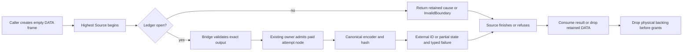

# Native identity custody boundary

Updated: 2026-10-09. Status: authored source WIP; static review and remaining receiving in progress.
This is part of `CHECKED-RETAINED-CONTROL`, not a new engine or ticket.
Semantica committed base: `3b8f86dd9ea7f94a2426277311037ea9d6480a6a` plus
changing shared source. No Rust compilation, tests, source capture or Semantica
Git publication ran in this source-only lane.

## Purpose and scope

Keep every Native identity attempt's partial encoder state, completed bytes,
full typed cause and copied text until its enclosing Source finishes. Reuse the
existing canonical serializer, BLAKE3 owner, domains, tuple axes and ordering.
This addresses a retained-control migration seam; no reproduced wrong digest,
leak, refund or user-visible failure is asserted.

Paths below are Semantica-relative. `parser/` means
`packages/analysis/quanta-v2/crates/quanta-adapters-parser/src/`.

| Owner | Before | After / receiving boundary |
| --- | --- | --- |
| `packages/core/codegraph-lang-common/src/stable_span_map_entry_id_v1/native_v3.rs`, `stable_symbol_id_v2/native_hash_v3.rs` | Owned canonical bytes die at lower return or hash refusal. | Mandatory fresh external encoder/completed/error state per ID; same five-field span and v2 symbol preimages. Parser Java materialization and hierarchy keep the ledger before Source; Python requires the same outer receiving. |
| `packages/core/ir/canonical-symbol-id/src/{canonical_symbol_id_v2,semantic_occurrence_id_v1}/borrowed_mint_v3.rs` | Both Original mints use owned-return `hash_axes_v3`. | Shared single-use `CanonicalDescriptorMintSlotsV3`; in-place Original symbol/occurrence methods, copied ID accessors, same domains and 16-byte prefix. Ordinary diagnostic mint stays ordinary. |
| `packages/analysis/quanta-v2/crates/quanta-contract-statement-shared/src/statement_identity/native_structural_path_v3.rs` | Copied String is local across charged comparison, including mismatch/refusal. | External partial text/error/encoder slots and completed ID sink; same copier-byte rejection and feature-off refusal. External cache/result storage precedes both HIR Source entrances. |
| `packages/analysis/quanta-v2/crates/quanta-runtime-source-authority-wire/src/original_identity_mint_ledger_v3.rs` | No per-attempt storage shared by these bridges. R259 first placed the helper privately in Parser. | R266 moves the same generic DATA ledger to the existing SourceWire owner. The same NativeCore admitted Box primitive births one exact paid linked node per attempt. Pending, born and prior nodes remain outside Source. Parser reexports that module; its former implementation file is removed. No Cargo/feature/dependency change. |

The ledger is storage and cleanup infrastructure. It performs admitted Box
birth through NativeCore; it does not calculate identities, select source,
issue authority or introduce another query/runtime engine.

## Public and internal compatibility

- Rust Original APIs change signatures; receiving callers must migrate together.
  Frontend IR, wire schemas and ID formats are unchanged. Original lower APIs
  require external slots. Do not add an owned Original shim
  or reset single-use state after success/refusal.
- The semantic bridge keeps its existing `&self` trait and Clone context by
  accepting an explicit outer `RefCell<Ledger<Slots>>`. Borrow conflicts become
  typed refusal; no mutable slot or borrowed error escapes the cell borrow.
- Authenticate the exact output object before mint-node birth. Same group alone
  is insufficient; preserve different-output/same-group rejection.
- Each node retains its real issuing operation/group leases. During cleanup,
  detach next and custody, destroy payload and Box, then release custody.
  A lease stored as the last Box field alone releases before Box deallocation.
- One exact admitted node per attempt gives O(1) append and O(n) retained nodes.
  Original memory/work admission bounds attempts. Extra retained metadata and
  replacement backings can refuse historical small budgets. Node admission now
  precedes lower leaf validation, so tiny-budget refusal precedence can change.
  No speed claim is made.
- No serializer dependency, hash domain, identity format or runtime engine is added.

## Actual Source entrances

- Java semantic module: `parser/language_host_adapter/semantic_expression_identity_ledger_v1/original_java_inputs_v3.rs`
  declares its materialization birth before registered parse/read loans. If its
  caller is already inside workspace request Source, receiving must reach that
  enclosing caller too; the inner materialization birth alone is insufficient.
- Hierarchy: storage must precede the enclosing workspace request Source as well
  as `with_original_output_v3` in
  `parser/language_host_adapter/java_workspace_resolution_syntax_v1/workspace_hierarchy_projection_v3.rs`.
  `workspace_batch_birth_v3.rs` calls this projection after the outer request
  Source begins; a local hierarchy ledger alone is insufficient.
- Java external binary: storage precedes the request control loan and the earlier
  edited-member selection loan in `workspace_original_build_type_owner_v3.rs`.
  A batch created inside that loan is not the lifetime owner.
- Python module/import/provider completion have distinct outer frames. Required
  receiving must reach each frame; one generic Python module field is not proof
  for import or provider augmentation.
- Statement projection: cache/result and attempt storage precede workspace
  `with_original_finalized_member_v3` and registered-target `with_loan_v3`.

## Current receiving map

| Path / owning boundary | Authored source | Remaining acceptance |
| --- | --- | --- |
| Java module, hierarchy and external binary | R260/R261 lend stable and semantic ledgers from before workspace request/member loans through materialization, finalization and classification. | R269 Java owner decomposition removes the introduced parameter/size findings; two foreign cache/Python findings remain RED. R274 source review finds no concrete new defect. Complete owner execution remains open. |
| Java incremental SDK entry | R268 `Store::issue_exact_edit_transition_from_persisted_closures_original_v3` creates `JavaOriginalIdentityMintBirthV3` before `with_original_source_session_v3`, then lends it through selected-member loans into Parser. Parser public reexport is present. | Same existing Java birth now bundles stable/semantic lenders throughout Java callers. Actual SDK owner regression is NOT_RUN. |
| Python module | R269 adds stable/semantic DATA fields to existing `OriginalPythonMaterializationBirthV3`, nested in `OriginalPythonSourceProjectionBirthSlotsV3`. `canonical_module_into_slots_v3` and `admitted_modules_into_slots_v3` lend those fields to the mandatory hash APIs. | Caller must keep that SourceProjection frame outside its highest Source; module-local owned convenience entry is not proof for a higher enclosing caller. Import/provider completion are separate rows. |
| Python import binding | R295 introduces adjacent DATA-only `OriginalPythonImportBindingsBirthV3`; caller lends it through `controlled_python_tree_v3.rs` → registered collector. It holds the semantic ledger and partial/completed workspace before retained output/operation grants. | Actual direct and framework fixtures create DATA before their highest Source. Full import payload/error receiving and complete owner execution remain separate. R298 corrects fresh request validation order. |
| Python provider completion | R292 lends external provider-frame and direct-cohort ledger plus workspace sinks through actual augmentation into the canonical mint. R297 fixes direct-cohort data/grant drop order and guards terminal reuse before new Current validation. | Source cut and static checks pass; whole feature/type and genuine completion execution remain NOT_RUN. Test-only owned completion shim is removed in R297; product closure already used external frames. |
| Statement → portable HIR | The Port-frame cut uses `PortStatementProjectionBirthV3` from contract-ports, with no Parser type in the public trait. Actual ID backings move external ID slots → external completed items → external HIR → external bound HIR. Binder validates before taking HIR. | R272 independent source review finds no concrete ID custody defect. Q1 public V3 now requires a caller-supplied frame; no direct product caller was located. Final caller/test/feature compilation and shared query God remain open. Non-ID partial HIR fields and parent/sibling scratch are excluded below. |

### Mandatory receiving ABI

- SourceWire: `OriginalIdentityMintLedgerV3<T>::begin_v3(output, (operation, group))`
  and `stop_v3()`. `ensure_open_v3()` rejects terminal DATA before any bridge
  output method. Default T is empty DATA; no current/control/callback is stored.
- Stable Python: `with_original_python_stable_hash_v3(output, &mut stable_attempts, callback)`.
  `stable_attempts` is `OriginalIdentityMintLedgerV3<OriginalStableIdentityAttemptV3>`.
- Semantic: `OriginalSemanticIdentityHashV3::new(output, project_native, &semantic_attempts)`.
  `OriginalSemanticMintLedgerV3` is the existing internal
  `RefCell<OriginalIdentityMintLedgerV3<CanonicalDescriptorMintSlotsV3>>` alias.
- Statement: object-safe target lowering lends `&mut PortStatementProjectionBirthV3`
  and returns unit. The caller borrows the final bound HIR; no owned Original
  return shim or fake byte-only source may replace the genuine target.

R269 modifies only the Python materialization fields and those two hash call
sites; the existing header, metadata, import census, native parts, typed errors
and funding-last fields are preserved. No outbound message to another chat was
sent. The receiving receipts are available for the authorized courier.

## Acceptance and test plan

| Case | Independent oracle / failure to reject |
| --- | --- |
| Canonical parity | Existing ordinary reference vectors, including Unicode/NUL and domain separation, equal the Original ID; same sorted/tuple order. |
| Two attempts in one Source | Earlier partial/completed state remains alive through later mint and Source finish. Replacing a single Option must fail this oracle. |
| Encoder/hash refusal | Inject refusal after partial encoding and after complete CBOR before hash completion; retain full lower cause and backing. |
| Statement copier | Changed bytes, partial-copy refusal and charged comparison refusal retain copied text and reject success. |
| Occupied/reused slot | Reject a second use without clearing the first result/error/backing. |
| Authority | Different output object with the same group refuses before encoding or allocation. |
| Late Source refusal | Successful callback followed by Source finish rejection publishes no result; external slots remain until finish returns. |
| Drop/refund | Payload and physical Box die before their issuing grants; long chains drain iteratively. Verify prebirth/postbirth failure and first unwind separately. |
| Compatibility | All actual Java/Python/statement constructors, direct tests and feature-off callers compile on one complete tuple. |
| Empty or first-allocation refusal | Statement frame retains actual operation/temporary/output grants before its first cache/result/item allocation, including zero-mint input. |
| Fallible HIR projection | Refuse a later item/call or binder check after an earlier ID succeeds; the actual ID String remains external. Retaining only a different cache copy fails the oracle. |

Smallest affected owning rails run first after the coupled source is compatible.
Owner publication, Native/SDK product execution and process gates remain separate.
AST/rustfmt/changed-file/God checks do not prove Rust types or runtime custody.

## Explicit exclusions

Statement parent/sibling scratch, borrowed sibling-map keys and non-ID partial
HIR item/call fields remain separate current owners. The current cut includes
the actual ID backing through completed item projection and final binder;
it does not establish custody for every other partial HIR field.

R299 migrates the nine Source-backed tests in `java_workspace_resolution_syntax_v1/part_6.rs`
and the getter helper; R304 migrates `literal_receiver_tests.rs`. These are
current authored source with preserved positive assertions, not executed proof.
Existing other Java batch-wrapper/full-output consumers remain a separate
coupled receiving scope. The detailed current remaining list below governs.

R304 current audit confirms all four SDK direct QRA calls already use external
`into_birth` receiving; they are removed from remaining source work. Their
current owner tests are still NOT_RUN. R308 repairs the distinct PTA fixture
QRA call, but its upstream type-finalization/retained-output frontier remains.
The shared identity ledger does not implement genuine FULL hydration, binary
input issuance or complete fixture consumer migration.

## Source receipts

The local recovery root is
`~/.codex/task-evidence/oct6-substrate-dedup/recovery-20261006/query-owner-build-r1/`.
R256/R257/R258 trace current callers; R259 authors the initial shared ledger;
R260/R261/R268 record Lang, semantic and Java SDK source. R266/R270 move the
same ledger to SourceWire and tighten its public signature/Parser cfg. R268
independent review finds no concrete ledger defect; R270 AST3, new-ledger format,
changed-file guard3, new-ledger God and parent diff check pass.

R269 Python module AST1, rustfmt, changed-file guard, God and diff check pass.
R269 Java owner decomposition reduces the initial God findings from 20 to two
pre-existing cache/Python findings. R274 independent source review finds no
concrete new defect; one shared statement test has a later postimage. Shared
query God remains separate. No allowance or baseline reset was applied.
Statement R271 final27 rustfmt parse/diff pass; changed-file LLM passes on 26
production scopes with one normal test exemption. R276 independently reviews
the eight new/changed paths after R272 and confirms all 27 recorded SHAs still
match. Shared symbol-query God is RED: file 802/800, a foreign 140/50-line
function, and another shared function 117 versus baseline104. The file-size
delta partly includes this cut's frame handoff and remains an active policy gap.
No broad foreign query refactor or allowance was applied.

Exact per-lane SHA receipts identify authored postimages, not a frozen complete
consumer/dependency tuple. R271/R274/R275/R276 are independent static reviews.
Compiler/tests/product qualification: **NOT_RUN**.

## R273 genuine FULL source selection receiving

This is the existing SDK target-issuance prerequisite within the same retained-
control ticket. It does not add a source issuer or query engine.

- Before: `OriginalGenerationSourceInputV3::try_select_member_v3(self, path, current)`
  consumes the opaque FULL owner before its fallible authenticated Source read.
  Failure can destroy that local owner inside a higher Source callback.
- After: `try_select_member_into_slot_v3(&mut Option<Full>, path, current,
  &mut Option<OriginalGenerationSourceSelectionV3>) -> Result<(), Error>` borrows
  the same genuine FULL through all ordinal/member/Source checks. Only after
  success does it move the owner into the external destination. Occupied or
  absent slots refuse without replacing prior owners. Both Options precede
  the highest enclosing Source; errors use the existing canonical error owner.
- Code: SourceWire `original_generation_source_input_v3/selection_v3.rs` and SDK
  `durable_normal_source_attribution_generation_store_v1/original_full_source_input_tests_v3.rs`.
  The consumed API is removed. Three original fixture calls migrate, and a new
  occupied-destination case adds two calls. No old Rust reference remains.
- Oracles: genuine Store/pin fixtures retain census/text/digest after Store drop
  and reject foreign current; absent path re-lends the same FULL after Source
  finish; occupied destination preserves both the earlier Main selection and
  the other FULL input. These tests are authored, **NOT_RUN**.
- R273 AST2/rustfmt2/diff2/changed guard2 and selection-source God pass. R275
  independent source review finds no concrete defect. SDK tests are excluded
  by the normal God scope. Budget/refund and late-stop oracles remain unrun.
- Production target binder has no located selection caller yet. Its existing
  owner still needs genuine hydration into the earlier external input slot,
  full error retention and actual execution. Existing upstream typed
  `UnsupportedAllocation` remains; this API cannot bypass it.

Receipts: `r273-selection-receiving-design.json`,
`r273-selection-source-packet.json`, `r275-selection-independent-source-review.json`.
No compiler/test/QBC/runtime/source capture or Semantica Git publication ran.

## Terminal reuse ordering — R278–R286

Source review located three related ordering defects; no executed runtime failure
is claimed. They are repaired at the existing storage and supplier owners:

| Boundary | Before | Authored repair |
| --- | --- | --- |
| SourceWire `OriginalIdentityMintLedgerV3::begin_v3` | Polls a supplied output before rejecting stopped/pending/born DATA. A later Current can be observed unnecessarily. | `ensure_open_v3()` returns the already stored Native first cause, otherwise static `InvalidBoundary`, before any output method, node default or allocation. `begin_v3` reuses this one owner check. |
| Parser `semantic_identity_mint/original_hash_v3.rs` | Output validation, checkpoints and lease/canonical preparation precede the ledger guard. | Both exact-output validation and canonical preparation check the ledger first; RefCell conflicts return static typed refusal without recording on a different output. The same-owner finish helper preserves drop-before-error projection and final-checkpoint precedence; scoped God passes. |
| Parser `language_host_adapter/adapter_impl/native_typed_surface_cache/original_java_canonical_semantic_v3.rs` | Outer factory and callbacks validate/poll before begin. Callback or final-checkpoint failure returns without closing attempts. | Guard the factory and three hash callbacks before output access. Latch `stop_v3()` on callback and final-checkpoint failure exits; preserve the first generic callback error and Native final-checkpoint error unchanged. A later call refuses terminal DATA. |

Terminal rejection deliberately precedes later cancellation or foreign-admission
failure. `stop_v3()` retains lower typed error DATA; when no ledger-native first
cause exists, reuse returns `InvalidBoundary`. No later output is asked to record
that static refusal. Successful repeated factory calls remain allowed. Statement
leaf issue/copy already begin first. R294 later traces earlier receiving-entry
Source/output access; R295 adds those guards and records the two direct D4
entry boundaries still requiring their own co-cut.
Hash axes, canonical bytes, ID domains and allocation ownership are unchanged.
Prebirth factory admission failures before a mint begins are outside this
terminal-ledger acceptance; R285 does not classify them as another defect.

Four new genuine regressions are authored: stopped ledger with canceled fresh
Current, ledger-native first cause with a different active Current, stopped
semantic bridge after a real canonical symbol, and actual stable post-callback
cancellation followed by a different canceled Current. Each checks zero new
lifecycle polls/work/memory/first-refusal changes, retained first backing and final
refund. The existing generic callback-error test now also requires terminal
rejection before later cancellation while retaining its original typed error.
Tests use real budget/current/output issuers; the counting lifecycle is only an
observer. **All these tests are NOT_RUN.**

Final scoped source checks cover four paths: AST4, rustfmt4 and diff4 pass;
changed-file LLM covers three production files with one normal test exemption;
God passes on the three production files without allowance or baseline changes.
R285 independently reviews the final regression and supplier source; R286 records
the stable failure-latching correction. These are source facts, not Rust type,
owner-publication, runtime/refund or product proof. The remaining receiving and
owner/test obligations above stay open.

Receipts: `r278-ledger-terminal-source-packet.json`,
`r279-ledger-terminal-genuine-tests-source.json`,
`r281-semantic-terminal-bridge-source.json`,
`r283-semantic-bridge-god-source.json`,
`r285-terminal-regression-static-review.json`,
`r286-terminal-final-source-packet.json`.

## SDK join and FULL factory handoff — R288–R289

The private SDK join receiving cut is a different ownership hunk from Native ID
projection. Preserve the latter while its existing supplier owner repairs the
former. Paths are Semantica-relative under `packages/analysis/quanta-v2/crates/`.

| Exact surface | This lane's authored hunk | Receiving boundary |
| --- | --- | --- |
| SDK `quanta-sdk-session-backend-owner/src/normal_source_attribution_build_context_v1/original_exact_edit_join_v3.rs` | Only `PortRetainedTargetSyntaxV3::lower_target_hir_v3`: caller-supplied Port birth and unit forwarding. The whole file is not unowned. | Private bind/joined-owner/keeper/source-bridge and builder logic are not this lane's hunks. Parent export and source-parts/provider composition belong to that receiving owner. |
| Parser `.../exact_incremental_transition_authority/original_v3/retained_target_v3/syntax_facet_v3.rs` | External-frame lowering only. R289 directly forwards the borrowed frame, removing an extra `&mut` of its non-mut binding. | Existing copy/from/new/retained syntax ownership methods are separate; preserve their active hunks. |
| SourceWire FULL `original_generation_source_input_v3/{factory_v3,head_read_v3}.rs` and parent pair/input/target-transfer declarations | No authored hunk in this lane. | Genuine hydration/HEAD Source capability and earlier external pair/input/result/error births remain a coupled prerequisite. |
| SourceWire `original_generation_source_input_v3/selection_v3.rs` | R273 canonical input-slot selection and genuine SDK fixture oracles. | Preserve the same FULL through fallible checks; transfer only after Source finishes successfully. |

Receiving must retain real source/member/generation/manifest/path/token checks,
external full errors and physical backings through the highest enclosing Source.
Keep the external `PortStatementProjectionBirthV3`; no local default frame,
dummy ledger or copied source DTO establishes the missing factory capability.
Typed `Unsupported` remains until the actual owner can issue that capability.
Identity algorithms, domains and canonical axes are unchanged.

R289's one-line forwarding correction passes scoped rustfmt parse, diff, LLM
and God. A readback of actual external-frame callers finds no further confirmed
extra reborrow; the runtime entry with a genuine mutable local frame is valid.
This changes one current shared postimage after the historical final27 receipt;
it does not requalify that whole source tuple. Compiler/tests/QBC/Git/source
capture remain **NOT_RUN**. An incoming report of Source289 owner success is
not independently adopted as this lane's current product proof.

Receipts: `r288-private-join-and-full-source-hunk-map.json`,
`r289-native4-target-frame-forward-source.json`.

## Python receiving and higher terminal guards — R291–R298

These are source changes on the same Semantica dirty-main base, not a new
engine, hash format, source issuer or qualified integration.

| Owner / actual route | Before | Authored after |
| --- | --- | --- |
| Parser `semantic_scope_identity.rs` | The admitted workspace helper returns an owned String; a late copy refusal destroys partial text inside Source. | Extend this canonical owner with `workspace_owner_identity_namespace_digest_into_with_output_admission_v3(authority, output, (partial, completed))`. Both entry forms share one fixed64 hex preparation and unchanged domain/work accounting. NativeCore performs the paid external copy; success moves text only after fallibility. Occupied sinks refuse without output polling or replacement. |
| Parser import `controlled_python_tree_v3.rs` → `original_import_output_v3.rs` | Import hash still uses the old two-argument constructor and has no outer mint attempts owner. | Public entry accepts `(request, generation, member)`, Current and caller `OriginalPythonImportBindingsBirthV3`. Empty Default is DATA only. Terminal guard precedes new Source; fresh registered request validation precedes output-grant acquisition. Partial/completed workspace and semantic attempts precede their actual retained group/operation grants. |
| Parser completion frame and direct Python cohort → `augment.rs` → `native_import_transaction_v3.rs` → `mint_context_v3.rs` | Provider/cohort calls do not lend the mandatory semantic ledger; workspace digest is local. | Existing external frames hold ledger and both workspace sinks, and lend references to the canonical three-argument hash. Direct public augmentation and provider preparation reject terminal ledger before new Current/output work. In the direct cohort, those DATA fields precede both assembly and final owner fields, whose grants must outlive them. |
| SDK old postorder completion → Parser resolver/raw provider shim | Exactly one genuine test caller reaches an owned helper that creates a completion frame inside Source. Product closure already calls `complete_final_into_slots_v3`. | Migrate that fixture to the existing external work/index/postorder/completion pool born before `with_production_fixture_members_v3`; retire both `complete_final_v3` methods, resolver `try_complete_original_provider_v3` and raw `try_complete_with_original_imports_v3`. Removed call search is zero. Product route is unchanged. |
| Port statement birth → managed target lower and Parser Java conversion/projection | Higher APIs acquire/read Source or output before the later issue/copy `begin_v3` rejects reused DATA; occupied-state refusal can mask stored Native cause. | `PortStatementProjectionBirthV3::ensure_open_v3` checks mint first then the existing occupied predicate; begin delegates. Managed target lower, Java batch/direct conversion and original projection guard before their own Source/output work. Fresh validation remains. Direct D4 member-view/materialize and target syntax trait entries remain a separate finite receiving cut. |

Import birth retains the actual output group and operation before paid text.
These two lease acquisitions add two work units on successful entry; canonical
hash charges/preimage are unchanged. Tiny-budget acceptance must be executed
on the complete owner tuple before treating that compatibility impact as closed.

R291 adds a genuine same-root regression: two distinct currents/output groups
are issued from one root before the first failure. A real mint and first-current
cancellation precede second-current reuse. The oracle checks the retained Native
cause, zero later polls/work/bytes/cause changes, backing retention and final
refund. This is not fresh issuance after sticky root failure. The five terminal
regressions now authored across R279/R284/R291 remain **NOT_RUN**.

R295 strengthens the existing genuine workspace test with independent literal
BLAKE3 preimage parity, absent-axis nonallocation and occupied-sink no-new-work /
no-new-refusal assertions. Genuine import and framework fixture results and SDK
retained-provider / foreign-current assertions are retained. These are authored
oracles, not executed results. Full import carrier/payload/error receiving,
non-ID HIR scratch, Java fixture migration, shared query God and complete
feature/owner/product gates remain distinct obligations.

Root R295 AST11, scoped changed-file LLM and God pass. Eight owned child files
pass rustfmt; three shared parents retain pre-existing foreign formatting only.
Tracked diff-check passes; independent owned preimage patches cover untracked
files. Provider R292/R297 and old-SDK R297 static checks pass on their scoped
postimages. R298 independent review corrected the request/grant ordering before
final readback. R300 current readback matches all25 current source postimages across the four
receiving cuts. R302 statement AST4/LLM4/God4 pass; one pre-existing foreign
retained-target formatting blank line remains. These receipts still do not
establish Rust type or product compatibility. No compiler/test/QBC/runtime/
source capture or Semantica Git ran.

Receipts: `r291-same-root-terminal-genuine-source.json`,
`r292-python-provider-native-id-source-cut.json`,
`r295-native-python-import-owner-decision.json`,
`r295-static-source-manifest.json`, `r295-native-python-import-owned.patch`,
`r295-statement-terminal-guard-source-cut.json`,
`r295-statement-terminal-d4-residual.json`,
`r297-python-terminal-order-source.json`,
`r297-old-sdk-python-completion-source-cut.json`,
`r298-native-python-import-independent-review.json`,
`r300-native-id-receiving-source-readback.json`,
`r302-statement-terminal-final-static.json`.

## Replay upper callers and ownership — R301

The seven audited Replay upper paths have zero overlap with the R271 Native4
27-file cut and R295 statement guard four-file cut, and no statement birth/mint
references. This lane has **zero authored signature/forwarding hunks** there.
Their actual earliest controls differ: installed execution-session capture,
ChangeEvent materialization operation, daemon request control, installed
RuntimeCtx search control and admitted dense materialization budget. The
attribution-port test setup does not itself issue Source control.
`prepare_daemon_search_code_v2` must not be treated as universally highest.

Preserve the separate R288 Native4 lowering hunk and R273 canonical selection;
private SDK join/FULL receiving stays with its existing owner. Replay may carry
its existing canonical read DATA from each actual highest control wrapper; no
new control or local owned Result shim is authorized by this audit. Exact
paths/SHAs and hunk0 map: `r301-replay-upper-native4-hunk-map.json`. No source
edit, claim or outbound app message was made for this read-only mapping.

## Java fixtures and PTA QRA receiving — R299–R313

- Java `part_6.rs`: keep all12 original test names; migrate the nine source-backed
  cases to the existing genuine sorted Session/batch fixture. Java identity
  birth precedes the whole fixture. Five batch cases call the canonical
  in-original-context owner; unsealed cases use authenticated member reads and
  the existing local-type issuer. One64-hex build-context constant serves all
  nine cases. The old-to-new oracle matrix preserves packaged/wildcard nominal
  census, exact getClass/constructor callable identity, same-package/anonymous/
  instanceof/parameterized/fully-qualified type and provenance assertions.
- Getter helper: lend the external semantic ledger to the mandatory third hash
  argument and keep it beyond hash/output drop. Existing getter results,
  Unicode names and refund assertion remain. Literal receiver: genuine external
  birth plus checked member read retains equals / `java.lang.String` / non-static
  `ExternalBinaryAuthorityRequired` expectations.
- R306 identifies the actual highest Source in the fixture's production batch
  publication. Calling the public owned batch wrapper inside that callback
  creates identity DATA too late. Both test lanes instead lend earlier DATA to
  the existing in-original-context owner. No new issuer or local owned shim.
- Callsite sealing and binary finalization are separate. The getClass/constructor
  cases compare the same sealed callsite/signature fields while explicitly
  retaining binary `pending_finalization_count_v3`. They do not prove a fully
  finalized cohort or authorize pending finalization as completed.
- PTA `original_execution_v1.rs` and `owner_stages_v1.rs`: pass the real first-FD
  pin and external retained-group/setup-error/parts birth into existing
  `produce_live_native_lowering_generation_parts_into_birth_v3`. The earlier
  first-FD Source finishes before this separate QRA Source. Producer result or
  full typed failure is taken only after its finisher; birth drops before group.
  Original input no longer goes through the ordinary-only producer. R310's
  upstream type frontier still prevents a current positive fixture claim.

Independent source reviews R308/R312/R313 find no additional concrete defect in
these five source paths. New-five AST and scoped static rails pass; test-only
LLM/God exemptions are reported as N/A, never as executed behavioral proof.
R311 records two foreign successor hunks: ordinary join callbacks now receive
an origin argument and Parser exports Source-phase DATA. Native workspace hash
and import exports are unchanged; delta AST2/LLM2/God2 pass without overwriting
those hunks. R314 matches all30 latest receiving postimages and checks all26
Parser semantic-hash constructors have the mandatory three arguments. This is
source/arity evidence, not Rust type checking or a frozen dependency tuple.

Receipts: `r299-java-native-id-callers-source-cut.json`,
`r304-java-literal-receiver-source-cut.json`,
`r304-qra-direct-receiving-current-audit.json`,
`r306-java-fixture-highest-source-trace.json`,
`r308-java-literal-independent-source-review.json`,
`r308-pta-qra-receiving-source-cut.json`,
`r310-pta-type-finalization-owner-frontier.json`,
`r311-delta-independent-source-review.json`,
`r312-pta-qra-independent-review.json`,
`r313-java-native-id-independent-review.json`,
`r314-native-id-final-source-readback.json`.

## Current remaining work — R314

| Work | Concrete scope / purpose | Completion condition |
| --- | --- | --- |
| PTA Original fixture producer and consumers | `exact_native_generation_fixture_v1/{owner_first_source_v3,owner_stages_v1,type_identities_v3}.rs` and final fixture parts still use legacy single-member APIs and diagnostic V1 handoff. The removed handoff finalizer cannot be replaced by a method rename. Current canonical finalization requires a genuine `JavaOriginalBinaryResolutionInputPortV3` tied to this fixture pin/session; SDK's implementation is private and the legacy synthetic class catalog is insufficient. | Reuse the existing request-scoped binary owner to issue genuine whole cohort; identity DATA before highest Source; canonical full finalization/seal to retained Original inventory; migrate V1 handoff consumers to checked Original reads. Preserve alias/lambda/callable/topology and foreign-source refusal oracles. Existing QRA into-birth receiving then consumes that actual inventory. No fabricated V1/V3 adapter or empty success. |
| D4 direct terminal entries | Two Parser files / three entries: member-view `with_original_portable_hir_result_v3`, `materialize_original_portable_hir_v3`, and target trait `lower_target_hir_v3`. They still perform finalized/Source checks before the frame guard; higher managed/batch entries are already guarded. | Add the existing `ensure_open_v3` before each own Source/output access with existing typed Native projector; preserve first cause and fresh validation. Genuine same-root/foreign Current retry must show no later polling/work/backing replacement. Exact R295 residual SHAs still match on final readback. |
| SDK FULL/private join | R288 map separates existing Native4 forwarding/R273 selection from genuine FULL factory/head/parent/private join receiving owned elsewhere. | Actual genuine hydration→selection→target admission, external input/result/full errors before highest Source, late refusal/custody preservation; retain Unsupported until capability exists. |
| Shared query God | `quanta-runtime-query-surface-symbol-owner/src/symbol_query_rail/hir/query.rs`. R305 re-run is RED: production file802/800; managed function140/50; shared function117 vs baseline104. Source matches R271. | Split responsibilities at the existing query owner together with active D4 receiver changes, preserve Source/error behavior; scoped God passes without allowance/baseline reset. |
| Broader receiving and qualification | Full payload/error births, non-ID HIR fields, other coupled producer/consumer callers and complete owner/feature/process/product execution are outside the current Native identity evidence. | Compatible committed tuple, affected owner/feature tests, first/late refusal and real refund oracles, QBC publication and product proof under their owning gates. Current static checks cannot close this row. |

Semantica remains shared dirty main; this lane performs no compilation/tests/
QBC/runtime/source capture/stage/commit/push. This QGLang documentation checkpoint updates the two owned paths and only
Native status hunks in the shared tickets/remaining files. Historical R167 `just ci` remains an
older receipt and was not rerun here. No new engine, dependency, wire schema or
identity algorithm was introduced.
