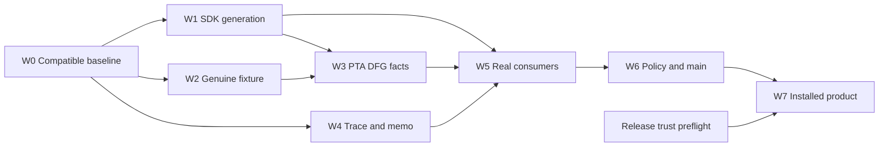

# Parallel closeout dispatch — R78

Updated: 2026-10-10. This is a plan, not an implementation or runtime verdict.
All execution is local. [R77 RCA](rca.md) owns cause analysis;
[tickets](tickets.md) own scope/DoD and [remaining work](../../work/remaining.md)
owns current states.

Latest local frontend CI:1514/1514 at `2d5b1852f077` plus document WIP.
Later frontend changes through observed main `5ec537f48e92` are documentation only.
Cut9 downstream DFG facts passes157/157 on its own exact source with verified
publication. Core CFG Cut11 stays UNKNOWN. Cut13 accepts the Fact contract191/191; Core
executes362 tests and reaches two diagnostic fixture failures. Those fixtures are
repaired with two added strict negatives. Cut14 runs zero tests at `--locked`;
registry-preserving metadata recovery passes. Cut15 Core accepts364/364 with
verified publication on its separately reviewed29-path input. Parser/SDK/product acceptance remains open. Exact inputs, source candidates and
limits are in the [W014 successor](execution-r79.md#latest-local-checks-and-released-source--w014-successor).

## Current completion plan — 2026-10-09

Objective: finish the existing Native/Original producer-to-consumer chain, accept
all18 active tickets and integrate complete compatible bundles into local main.
This section supersedes the historical R78 waves below. It is an executable
plan. Three implementation lanes were dispatched; B has since stopped on a usage
limit and A/C remain pending initialization. Root has taken the Core CFG split,
Fact validation repair and one serial verification queue. A replacement worker
request is rejected by the agent thread limit; dispatch is not active capacity. [W014 execution](execution-r79.md#w014-parallel-implementation-and-first-owner-cut--2026-10-09)
records actual released source, the first zero-test lockfile refusal and repair.
Dispatch does not establish owner acceptance or integration.
Latest main is Semantica `8217a38bf04d` plus successor WIP; previous readbacks
below are historical. Cut2/Cut3 run zero tests on distinct dependency/lock
prerequisites. Keep A on SDK/Foundation external births, B on genuine Source
CFG/facts/V4 publication, C on owned execution/registry/memo/persist, and root
on typed QRA consumption and one serial owner queue.

Current next cuts: A finishes external Parser import/provider fact/map/row birth
and actual SDK generation admission; the analysis lane still needs Source Lambda final SSA handle and
FunctionRef/declaration consumers; root has resolved all six CFG size findings
in source with zero God allowances; C connects the
selected FileText token to actual B/A typed-input/key/registered handler ownership.
Root also fixes the confirmed early Fact publication bug, preserving input on
every refusal, and migrates old diagnostic tests to strict current APIs. Cut13
accepts Fact191/191 and reaches Core360 pass/two fixture failures. Both fixture
contracts are repaired with two additional rejection oracles; after Cut14 locked
refusal and metadata recovery, Cut15 Core whole-library acceptance passes364/364
with verified publication and independent archive readback. Root records UNKNOWN
launches without inferred counts, and waits for compatible supplier/consumer bundles before Semantica Git.
Cut9 facts157/157 is one qualified lower input; W5–W7 remain separate exits.

### Exact remaining producer cuts — 2026-10-10

The following cuts remain implementation work. A receiver or lower diagnostic
GREEN does not close the corresponding positive producer/consumer oracle.

| Existing package | Reachable current boundary | Required coupled change and exit |
| --- | --- | --- |
| W0 / W6 | SourceWire copy/retain callers still reference retired owned APIs; Cut7 records52 fixed-input compile diagnostics | Reuse the existing into-slot/into-birth owners; migrate complete production and test callers with exterior partial/full-error banks. Cut16 stops at41 compile diagnostics/tests0; nine nested mounts are repaired; Cut17 stops at28 remaining compile diagnostics/tests0, with no missing-module/wrong-test diagnostics. Do not restore removed owned returns to obtain compilation |
| W1 | Java `language_parser_plugin/hir_lowering.rs::hir_from_controlled_read_v1` calls the owned `hir_from_read_v1`; Parser `conversion.rs::convert_original_registered_target_hir_v3` receives that owned HIR | Extend the same Java declaration/call/argument/parameter/position/quarantine engine with exterior DATA and unit completion, then connect the real Parser/D4 receiving seam. All paid partials and full causes survive the highest Source refusal; no second HIR engine or bank around an already-owned return |
| W1 / W2 | Parser external generation-files/inventory banks and two-Source fixture receiving are authored; lower import/provider projection still has local map/row births | Finish the actual file/entity/import/body producers and canonical fact-map/index publication. Sealed/files/inventory consumers preserve their exact full selected cause after Source; verify a genuine nonempty provider/cohort route and late refusal/refund |
| W3 | Source Lambda CFG/facts exists; evidence stays `BindingRequired`; actual final SSA and DFG storage are missing | Extend the existing finalizer to emit authentic final definition handles keyed by the exact semantic event, use the canonical FunctionRef binding join, then publish actual DFG rows/constraints to workers. Parser anchor count or facts ordinal cannot mint a final handle |
| W4 | Source-aware input hooks exist, while `typed_input_unit_copy_v3.rs` and `request_input_storage_v3.rs` still lend output A alone | Reuse `QueryOutputCurrentsReadBirthV3` to validate the selected child under genuine B and fund copy/key/output under A. Construct workareas/full-error banks before highest Source; connect the consuming registered FileText handler and owned context/packet/memo path |
| W5 / W6 | Original Shape/SCC routing is committed; current lower owners are separately accepted | Run the actual affected feature/consumer witnesses on one compatible complete bundle; exact owned staging and committed-source continuity precede complete local-main integration |
| W7 | Darwin arm64; signed Linux artifact/trust/generation inputs are unset | Release-owned immutable artifact tuple and Linux executor are prerequisites for installed positive Graph/CHECK. Keep installed positive and non-Linux refusal as separate NOT_RUN claims |

Root currently accepts Fact191 at Cut13 and Core364 at Cut15 on separate
source tuples. Cut9 facts157 remains separate. Source/SDK/runtime/product and
all18-ticket rollup are not accepted by adding those counts together.

### Current source and changed assignments

- Source readback at16:48 KST: clean QGLang `231707d879de6024e47ba6f6665b90f571aa0213`;
  Semantica `a63f536b1b3fa6e6990acd3dff0b6ef8a8f1a740` plus shared WIP, with4,854
  foreign staged paths. An index is not a source commit. Refresh claims, HEAD,
  selected postimages and integration barriers before writing or capturing.
- Postflight16:55 KST: both HEADs unchanged, all selected SDK/trace/terminal/
  PTA/DFG/facts hashes stable; the foreign index has4,857 staged paths. This
  selected-source continuity does not freeze or accept the rest of that index.
- Original Shape/SCC canonical routing is committed. JSON old production/test
  calls are migrated. R333's first-cause/terminal guards are authored;8/9 recorded
  postimages match. The SDK joined-owner file has a foreign successor, whose direct
  `ensure_open_v3` guard remains first on current readback. Reconcile its complete
  signature/format closure; do not restore an older whole-file postimage.
- SDK FULL/private binding receiving and paid provider exist. The provider has
  a newer external-birth source successor. Its upstream durable pair hydration,
  preparation success and Original receipt/evidence admission still refuse.
- PTA still rejects nonempty Original relation outputs in
  `original_java_workspace_v1/prepared_workspace_v3.rs`; DFG's
  `adapter/java_source_closure/retained_workspace_issuance_v1.rs` rejects its
  unadmitted source-world birth. General facts context has Native input control,
  but no canonical output admission. These are implementation work, not only tests.
- PTA test-support still uses diagnostic/V1 cohort/type finalization. R338
  [replaces raw topology receiving](native-identity-boundary.md#retained-topology-receiving--r337r338)
  with retained unit reads, external DATA and two authored rejection regressions.
  Its genuine binary provider, inventory sealing and retained handoff consumers
  must change together. Already authored QRA receiving is reused; owner execution
  remains NOT_RUN.
- Product pre-key/context, Native finalizer and final trace/snapshot/packet/memo
  remain incomplete. Discard-only cleanup is authored; genuine guard proof is open.
- R334 local QGLang CI passes1,514/1,514 and facade positive1/negative23 on
  `09276c57…` plus five document inputs, snapshot `f1b8ab5f…`. Receipt/log readback
  matches. Current main has no non-document delta; this is neither committed-HEAD
  qualification nor Semantica proof. Evidence: `closeout-plan-oct9-current-before.json`
  in the R79 root and `r334-gqlang-ci-receipt.json` in the existing recovery root.

### Work packages and concrete exits

Package IDs are scheduling units under the existing tickets, not new defect IDs.

| Package / role | Concrete work and owning source | Exit condition |
| --- | --- | --- |
| W0 / I+A: compatible baseline | Reconcile foreign staging and supplier claims; repair SQLite Linux-only imports/unused OsStrExt and inherited TaskLocal formatting; accept JSON production/test cut on actual feature closures | Selected supplier/caller hashes stable; current affected parser/SourceWire/Runtime/SDK requests compile and resolve nonzero witnesses. No lint/feature weakening |
| W1 / A: SDK Original generation | `quanta-sdk-session-backend-owner`: durable pair hydration → exact preparation → FULL selected member → paid generation/evidence/build context → existing binding provider; finish Original receipt admission and live-base custody | Actual installed SDK route issues genuine Original TARGET and reaches D4; exact source/session/generation and paid backing survive producer drop. Missing/foreign/stale authority, first refusal, late cancel and final refund proven |
| W2 / B: genuine PTA fixture | `quanta-runtime-test-support-pta/exact_native_generation_fixture_v1`: genuine binary-input provider + whole cohort/type finalization; retained handoff and checked lowering/evidence topology consumers | Actual fixture pin/current/provider; exact alias/lambda/callable/relation census and foreign-source rejection. No diagnostic/V1 adapter, empty positive or ordinary DTO reconstruction under Source |
| W3 / B with A contract handoff: PTA/DFG/facts output | Finish nonempty PTA formal/alias/catalog/transaction births, DFG retained source-world/digest/Tree-C/callable publication, and `FactExtractionRequestV1` → `DefUseFactsParseContextV1` → real extractors → final facts keeper output admission | Nonempty real Java output first, then required controlled language matrix; independent expected facts/relations, atomic no-publication on refusal, same permits to last reader and full refund. Complete signature consumers in one candidate |
| W4 / C: Runtime trace and memo | Product pre-key arm/key and owned RuntimeCtx; canonical Native admitted finalizer/read → checked snapshot → packet, persistence, leader/waiter memo retain | Ordinary guard discard1/finalize0/publish0 and nested-parent preservation; genuine Original B/A guard; deterministic positive trace facts/hash/order, first cause, retained success across producer drop, no unauthorized ordinary conversion |
| W5 / free implementation slot + I: consumers | Re-resolve existing Shape/Cost, PTA/Andersen, taint/deep50k, DFG/MemSSA, language/callback/cursor, SCC callers, F2 registry/Preview and F7 deadline owners | Required named witnesses actually execute and pass under correct features; zero selection fails; ignored50k explicit; no duplicate traversal or rebuilt passing scope without changed inputs |
| W6 / I: policy and main | Complete canonical supplier/consumer packet review, affected mandatory static rails, locked manifests and exact staged-path integrity; coordinated local-main integration | Complete compiling candidate, published owner results and stable held-lease postflight; normal integration preserves foreign hunks. Commit SHA/path set recorded, required gates rebind to committed source |
| W7 / I + release owner: product | Receipt-bound actual Graph/CHECK process rails and release-owned signed x86_64 Linux install trust; F1/D6/D7 rollup uses same artifacts | Independent positive/refusal process outputs, no skip/leak, immutable artifact/generation/trust identities and committed source. Unavailable external trust leaves its own ticket open |

### Ownership and dependency decisions before implementation

1. **One shared contract steward (A):** facts output/admission, source authority
   and any shared context signature changes go through the existing owner. A
   publishes exact new signature/postimages before B/C edit dependent callers.
   I serializes manifest/lock/registry changes. A file has one writer at a time.
2. **SDK owns durable generation; Parser owns HIR:** reuse the existing Source B
   FULL selection and binding provider. Do not introduce another attribution,
   mint, Source issuer, trace engine or backend in QGLang.
3. **Fixture provider decision in W0/W2:** trace the actual SDK-private binary
   provider to existing lower binary/type owners. Share only the demonstrated
   factory/issuance seam needed by real fixture pin/current; keep SDK session
   orchestration downstream. The fixture must not depend back on SDK or create
   fake authority. Reject an extraction that introduces a Cargo cycle.
4. **First positive is one real vertical path:** source/session → Original SDK
   preparation → joined target HIR → nonempty PTA/DFG/facts → admitted trace →
   checked success packet. Debug it on a guarded candidate; broaden to required
   language/features before integrating coupled public signatures on main.
5. **Finalizer and cleanup are separate:** keep discard infallible/no-publication.
   Positive finalization consumes/checks genuine admitted ownership and returns
   its retained read interface. Never enable Original by deleting a refusal alone.

Each nontrivial source cut records compatibility before choosing its signature:
all reachable constructors/consumers, public accessor or trait obligations and
any DTO/digest change. Preserve existing IDs/order/diagnostics and ordinary
compatibility; version a public wire contract only when its compatibility requires
it. Native input control cannot be downcast into fabricated Source/output authority.
Bound physical births, work, recursion and retained lifetime using the existing
issuer/owner controls; establish comparable workload/source measurements before
making performance or latency claims. No new library/framework is required for
the inventoried seams: canonical SCC, binary/type, generation and admitted trace
owners already exist, along with Clippy/Tokei/Semgrep and current boundary rails.

W1/W2/W4 implementation can overlap after contract handoffs; positive integrated
proof waits for the joined supplier closure. Ordinary owners not depending on
Original may run earlier. The graph governs completion, not blanket build blocking.

### Three workers plus one integrator

| Wave / exit | A: SDK/supplier | B: fixture/analysis/facts | C: trace/consumer | I: integration and one heavy queue |
| --- | --- | --- | --- | --- |
| 0: boundaries fixed | Platform/JSON/format source cut; shared contracts reviewed | Provider/cohort/topology reachable-path review and exact oracle inventory | Existing guard regressions and finalizer/read contract review | Claims/index/source census; installed trust preflight; resolve request catalog and compile-dependency groups |
| 1: sources authored | W1 durable generation, receipt/evidence/context | W2 genuine fixture; prepare W3 nonempty/facts owners after A handoff | W4 cleanup/context/finalizer; packet consumer handoff | Capture ready complete owner cuts; run smallest affected owner; route actual first compiler cause |
| 2: complete vertical path | Genuine SDK/D4 success and negative fixtures; free slot takes ready W5 | W3 actual PTA/DFG/facts publication and language custody | Finish W4 packet/persist/memo and genuine leader/waiter/guard cases | One compatible vertical-path capture; supplier→consumer owner queue, custody/publication readback |
| 3: required consumers accepted | W5 Shape/SDK/registry/deadline | W5 PTA/DFG/taint/language/cursor | W5 SCC callers and product oracle preparation | Reuse identical accepted scopes; run changed owners + feature matrix; mandatory policy and bundle review |
| 4: main/product closed | Review committed SDK custody | Review committed facts/analysis custody | Review actual process output | W6 coordinated complete integration; committed-source continuity; W7 installed Graph/CHECK and final18-ID audit |

These are role slots, not claims that three workers are currently running. Use
existing claim holders where active; if capacity is lower, retain the boundaries
and run ready work sequentially. Heavy Cargo/QBC owners run one at a time on the
shared host; workers do source/review/oracle work while that queue runs.

### Execution and evidence discipline

- Each handoff records owning paths/hunks, producer/consumer functions, contract
  delta, pre/post hashes, invariants, rejection behavior and exact owner requests.
  **Authored → source reviewed → owner accepted → main committed → product qualified**
  are separate status columns, never one percentage.
- Re-resolve the existing request catalog on the compatible input. Use
  `scripts/quanta-build-cli owner resolve` and matching `owner run`; actual
  `--compile-policy` and selector come from the owner manifest/current profile.
  Reuse the R79 consumer map as discovery, not a passing result.
- Hold the canonical snapshot execution lease through run, source postflight and
  archive readback. A changing source capture has no owner verdict. An owner
  receipt is accepted only with required witnesses/counts and committed publication.
- After a shared compile failure, stop only dependent requests of that same
  compile closure, route the concrete owning cause and capture one successor.
  Repeated identical errors are one causal prerequisite, not more defect tickets.
- Run the smallest affected owner after its coherent cut. Broaden once when the
  compatible consumer bundle is ready; rerun only changed compile/owner closures.
  `lib(test)` filtering does not avoid compilation of other tests.
- QGLang remains local CI: one `just ci` at final repository completion when its
  source/gate input changes; current R334 remains historical proof for its tuple.
  `just qualify-local` only on clean committed HEAD when that receipt is required.
  Hosted CI and remote push are not part of this plan.
- External install trust is checked in wave0. Its absence blocks W7's installed
  positive CHECK, not independent owner proof or integration of otherwise complete
  accepted bundles. Final rollup retains EXTERNAL_PREREQUISITE/NOT_RUN truthfully.

### Original frontend hardening items

The current source owns module cuts, test suite splits, local size/MSRV rails,
18 closed-authority examples and public DTO field map. Keep those accepted source
boundaries; current `execution.rs` is at1200 Tokei code lines with no exceptions.
If this work must add frontend code, split coherent internal execution types first
and preserve export paths/digests; do not raise the ceiling.

The facade currently depends on Pipeline. Moving DTO declarations into that same
facade while Pipeline uses them would form a dependency cycle. Keep the current
facade contract for this closeout. A later physical extraction requires a justified
host-agnostic leaf owner and producer/consumer compatibility design; it is not a
completed move. Fuzz smoke is a local explicit target outside qualification;
automatic cadence remains a separate optional tooling item, not a product blocker.

### Final completion checklist

- [ ] W0 compatible current compile and formatting; all required request witnesses resolved.
- [ ] W1 genuine SDK Original durable generation/receipt/evidence/context success and failures.
- [ ] W2 real provider/cohort/type finalization and retained fixture/topology consumers.
- [ ] W3 nonempty PTA/DFG/facts output, complete language custody and refund/atomicity.
- [ ] W4 discard and positive admitted trace/context/snapshot/packet/persist/memo proof.
- [ ] W5 all actual consumer/feature oracles, including ignored depth and SDK regressions.
- [ ] W6 mandatory policy, exact complete main commit and committed-source evidence continuity.
- [ ] W7 actual installed Graph/CHECK and18-ticket final rollup; external prerequisites recorded.

Ticket mapping is in [tickets](tickets.md#current-completion-package-map--2026-10-09);
required oracles are in [test plan](test-plan.md#current-acceptance-matrix--2026-10-09).

## Historical dispatch and execution context

Executed handoffs, source custody, serial main integration and owner outcomes
are in [R79 onward execution](execution-r79.md). The capacity/error observations
below are planning history; three replacement workers executed A/B/C afterward.

Actual independent work accepts four R87 SCC scopes106 and the R88 Foundation
exact test1. A's complete feature-policy correction is integrated serially on
Semantica main as3b8f86d. B observes an existing descriptor-mount owner and avoids
a competing edit. The single heavy-build queue runs parser/F2 successors on
captured inputs; failed prerequisites do not erase independent accepted scopes.

R96's parser successor reaches the Kernel contract before tests. A/B then author
four bounded Kernel file repairs with narrow reconciled claims and leaf checks;
I captures their R97 parser successor in the same serial heavy-build queue;
it stops on14 other Kernel errors before tests. Later minimal-import changes
retain their existing owner and need the next compatible source capture.
Current V1/V2 copy, facts/taint and delta/incidence migrations have existing child
owners. Their distributed caller and first-cause obligations remain coordinated
in FCP-COMPILE; no second opaque-result implementation is dispatched. Exact
postimages, observed claims and owner outcomes remain in the execution record.

R98–R105 dispatch history: A closes exact owned runtime context/budget/session
callers and reviews erased-slot compatibility; B repairs the reached Core reason
intent-lock and maps remaining independent owner requests; C closes the reached
Kernel contract and typed MemSSA boundaries. I runs the canonical captured
owner queue serially and updates source-bound evidence. R98 error1 and R99 PTA
result37 and R103 Core447 are accepted. R103 reaches Kernel fixture errors and
two unused production imports; those and PTA fixture successors are authored.
A closes typed ordinary pre-key/recursive trace; B migrates ordinary PTA
fixtures without changing literal expected results. I runs the frozen R105
consumer queue. No worker starts Cargo, stages shared files or integrates part of the
coupled Native contract. Existing Original producer writers retain their exact
birth/materializer seams; the void-only candidate is not general success.

R106's whole Kernel executes557 pass/11 fail. A repairs genuine fixture backing
and issuer custody; I preserves the caller error rail and prepares R107 whole
Kernel/recursive plus PTA/Taint/SCC owners. B migrates the reached symbol checked
views. The separate SDK worker repairs the real source keeper, paid pin and cold
committed baseline handoff and authors the installed source/foreign-current
regression. A continues the actual checked binding/overlay/paid packet producer
cut; the SDK worker next traces PTA nonempty transaction/final materializer.
No Original success is inferred from a source-ready packet or a removed refusal.

## Planning inputs and capacity

- QGLang: clean `main` at `9eee2bee1728c67abfae26f74804bd2ce9e5fd67` before
  this documentation change.
- Semantica: committed `main` at `f574fa82bf123c817e80fc3afc795b4dd033ea3f`.
  Separate planning reads observe 2,750 dirty/untracked entries, 458 claims and
  no integration barrier. This is not an atomic source snapshot.
- Existing child agents `consumer_proof`, `python_defuse` and `rust_java_defuse`
  report usage-limit errors. The slots below are the intended allocation, not
  three running workers. Reconcile actual capacity before dispatch. With one
  available worker, retain the same ownership boundaries and execute ready tasks
  in dependency order.
- Refresh HEAD, index, dirty postimages, claims and path-dependency siblings at
  dispatch. Existing supplier/S0/D0 writers occupy these roles; ticket assignment
  does not transfer their files to another writer.

## Objective and priority

Finish the existing canonical-owner and Original-output packet, prove real
consumers on compatible captured inputs, and integrate complete bundles into
local `main` through the normal coordinator.

1. **P0 compile:** supplier/module/API closure and every changed caller;
   capture and prove no-Java/Java plus actual runtime/SDK compilation.
2. **P0 Original:** genuine member forwarding, admitted PTA transactions/DFG
   publication and adapter→context→extractor→final-facts output custody.
3. **Acceptance:** controlled language/callback/cursor, Shape/Cost, PTA/taint/DFG,
   additional SCC consumers, real SDK/Preview and affected policies.
4. **Product:** receipt-bound Graph/CHECK results and release-owned installed
   trust. Inspect external prerequisites early; unavailable installed trust does
   not block unrelated local owners.

Reuse integrated Python/TypeScript migrations, scalar counter, Kotlin binding,
SCC core20/facade1, ordinary-language owners, worklist77 and scoped D4/D5 evidence
when inputs match. Their remaining acceptance does not authorize another source
migration. Hosted CI, automatic fuzz scheduling, A-series features and a new
library/engine are outside this closeout.

## Four slots and existing writers

| Slot | Accountability | Exclusive write boundary |
| --- | --- | --- |
| I — integrator | Claims, shared-signature decisions, capture, build queue, serial main integration and receipts/states | Shared registries/manifests/locks through existing owners; stage complete reviewed bundles |
| A — supplier and contract steward | FCP-COMPILE; shared admission/context; controlled language/callback/cursor proof | Supplier/parser module/API closure and canonical facts context; coordinate existing S0/D0 authors |
| B — Original producer and analysis owner | Real runtime/SDK→PTA→DFG publication; Shape/PTA/taint/DFG acceptance | Actual producer/caller/retainer and handed-off language consumer hunks; request shared contract edits from A |
| C — consumer and oracle owner | Authored SDK2/community2, F2/F7, additional SCC consumers and policy review | Handed-off test files/request definitions; no shared contract, producer or manifest edits |

One integrator plus three workers is the ceiling, including existing workers.
When another active owner holds a file, review their result or prepare independent
tests until an explicit hunk/symbol handoff. Do not add a second implementation.

## Wave schedule

| Wave | A | B | C | I / exit |
| --- | --- | --- | --- | --- |
| W0 — ownership/design | Inventory supplier postimages, parser mounts/exports and shared contracts | Trace members, transaction/publication births and last retainers; agree signatures with A | Reconcile SDK2/community2, eleven SCC scopes and policy/product oracles; inspect installed prerequisites | Record owners, exact coupled paths/siblings, invariants and acceptance before edits |
| W1 — compile/preparation | Finish existing native-core/tree-sitter→Kernel→Foundation→SourceWire/parser closure; preserve lint strength | Verify authenticated parser member loans through both actual callers; prepare admitted-success changes | Review existing SDK2/community2 oracles and deduplicate owner requests | Capture supplier + changed callers; metadata and owning no-Java/Java/runtime/SDK compile pass. CP1 |
| W2 — Original success | Carry canonical output admission through existing context/supplier contracts | Complete admitted PTA transactions, DFG publication and language/facts keepers | Prepare independent exact facts, rejection, deadline/value and lifetime expectations | Capture/prove complete producer + consumers: success, typed rejection and last-drop/refund. CP2 |
| W3 — owner acceptance | Controlled DefUse/language/callback/cursor witnesses | Shape/Cost features, PTA/Andersen/runtime, taint50k, DFG promotion and current bootstrap | Real SDK/Preview and eleven SCC consumers, including community2; policy coverage | One heavy owner at a time; unique source-bound receipts and test integration CP3; final affected policies CP4 |
| W4 — product/closeout | Review first-refusal/output custody through actual callers | Review analysis/public projections and cleanup | Review SDK/Preview/Graph/CHECK results and installed assets | Receipt-bound product/process CP5; installed positive CHECK CP6 when available; all18-state reconciliation CP7 |

W1/W2 order the coupled shared changes. Test authoring, request review and an
independent owner whose complete closure is captured may proceed in any wave.
CP1 may compile while Original deliberately still refuses; it cannot close CP2
or product acceptance. CP2 is not a blanket prerequisite for unrelated SCC,
Shape or SDK proof.

Parallelize disjoint authoring/review; run **one heavy native Rust build at a
time**, including nested fixture builds. A filter does not reduce `lib(test)`
compilation. I owns one deduplicated execution queue; workers do not start
competing Cargo jobs. Lightweight checks can run independently when their source
and resource admission permit them.

## Exact write-set handoffs

Paths are Semantica-relative; `core/` means `packages/core/`, `qv2/` means
`packages/analysis/quanta-v2/crates/`. These boundaries do not authorize whole-file
staging of foreign WIP. Refresh claims/hunks before edits.

### A — supplier and canonical contract

- Existing backing packet: `core/codegraph-native-allocation-core/`,
  `third_party/tree-sitter/binding_rust/`,
  `core/codegraph-cfg-dfg-kernel/src/ports/language_plugin_port/`,
  `qv2/quanta-runtime-query-surface-foundation/` and
  `qv2/quanta-runtime-source-authority-wire/`; follow the
  [coupled supplier closure](code-map.md#coupled-shared-backing-supplier-closure).
- Parser: `qv2/quanta-adapters-parser/src/lib.rs` and exact hierarchy mount pairs
  under `language_host_adapter/java_workspace_resolution_syntax_v1/`.
  R79 integrated the three R77 hierarchy mounts and feature-scoped imports;
  qualify them with the owned no-Java enum export hunk. The105
  diagnostics are fixed-tuple evidence, not a current WIP count.
- Facts context: `core/codegraph-defuse-extractor-contract/src/lib.rs` and its
  owning admission interfaces/construction. A coordinates canonical semantics
  and signatures; B implements adapter/extractor consumers. Required shared
  module/manifest/lock edits go through I and existing owners once.

### B — actual producer, consumer and keeper

- Member callers:
  `qv2/quanta-runtime-analysis/src/queries/intraprocedural/production_live_native_lowering_generation_parts_v1.rs`
  and `qv2/quanta-sdk-session-backend-owner/src/production_normal_source_java_workspace_generation_port_v1_tests/original_native_parts_v1.rs`.
- Producer: `qv2/quanta-adapters-pta/src/production_live_native_workspace_generation_v1/original_java_workspace_v1.rs`
  and existing `original_java_evidence_v1.rs`.
- DFG: `qv2/quanta-adapters-dfg/src/multi_lang_dfg_adapter/adapter/java_source_closure/retained_workspace_issuance_v1.rs`,
  existing workspace issuer/member/cohort keeper, and general adapter/final-output
  bridge in `build_pipeline/fact_extraction.rs`.
- Handed-off language extractor consumers and
  `core/codegraph-lang-common/src/{c,go,typescript}_syntax_snapshot_v1.rs`
  use A's existing admission. Preserve integrated counter/binding guards and
  distinct grammar projections; coordinate each current language writer.
- DoD: real members/operation identity; admission before physical growth; charged
  post-snapshot work; current/first refusal before publication; temporary/final
  permits until last owner and refund on final drop. Missing required authority
  refuses; ordinary unsealed compatibility stays explicit. No empty member slice,
  second issuer, post-allocation grant wrapping or unnecessary public trait.

### C — independent tests and owner requests

- `qv2/quanta-runtime/tests/abstract_interpret_fluent_api_e2e_test.rs` already has
  the SDK two-case timeout0 and exact Sign/Interval/Constant regression. Review
  the owned cut; change production only after a reached reproducible defect.
- Existing community empty/cycle two-case cut: discover current owner/target from
  the [consumer oracles](test-plan.md#consumer-regression-oracles), preserve foreign
  hunks and require actual test discovery. Do not author a second copy.
- Reconcile eleven additional SCC consumers with B's PTA/taint requests. One
  executed request can satisfy several ticket obligations; record aliases and
  matching witnesses rather than another solver run. Discover selectors/features
  and expected counts before freezing request cardinality.
- F2 covers real Native registry→worker→Preview/provider-off and preserves Apply
  refusal. F7 mapper5 is separate from actual deadline2. Policy/product review
  uses existing rails; tests/request changes do not create a new engine.

### I — compatible capture and serial integration

1. Record HEAD, claims, index and exact tracked/untracked postimages for the full
   changed closure and participating path-dependency siblings; agree shared ABI.
2. Coordinate bounded quiet capture with relevant writers through normal
   shared-main custody/barrier handling. Capture compatible reviewed postimages
   into the supported immutable tuple and hold the snapshot execution lease.
   Writers may resume live main after capture without modifying the frozen root.
3. If capture rejects changing input, retain the failed attempt and identify its
   path/owner. Retry after addressing that cause; do not loop on mutable main,
   bypass guards or label capture failure as compilation. Once compilation runs,
   repair only reached owning causes and recapture the successor tuple.
4. Recheck base/head, foreign staged hunks and claims before integration. Stage
   only the complete reviewed compatible packet with the normal coordinator,
   `git diff --cached --check`, commit locally and record postimages/HEAD. Changed
   signatures and every dependent caller ship together; preserve unrelated WIP.
5. Reconcile candidate proof-to-main input continuity, including manifests and
   siblings. Changed inputs require the affected successor proof. A snapshot
   result is not automatically an integrated-main or whole-product result.

GQLang documentation/contracts stay here; runtime edits stay downstream. A push
is separate; this dispatch requests local-main integration.

## Ticket dispatch matrix

Each active ID has one accountable slot. Shared A/B changes follow the exclusive
write sets above; cross-ticket reuse never duplicates an executed request.

| Active ID | Slot | Ready work / checkpoint |
| --- | --- | --- |
| FCP-COMPILE | A | W1 supplier + B callers; I capture/compile/integration CP1 |
| CHECKED-RETAINED-CONTROL | B | W1 callers, W2 A contract + B producer/keeper; CP2 |
| CHECKED-DEFUSE | A | W3 extraction/binding/refusal after affected context closure; CP3 |
| CHECKED-LANG-SUPPLIERS | A | W3 remaining controlled-carrier/custody; ordinary owners reused; CP3 |
| CHECKED-CALLBACK-FIRST-CAUSE | A | W3 bridge chronology after parser compile; CP3 |
| CHECKED-CURSOR | A | W3 original-issued five after parser/issuer closure; CP3 |
| D1-PROOF | B | W0/W1 map review, W3 Shape/Cost SDK/features; CP3 |
| D2-PTA-PROOF | B | W3 PTA adapter/Andersen/runtime; core/facade reused; CP3 |
| D2-TAINT-PROOF | B | W3 public contract and explicit ignored50k owner; CP3 |
| D2-CALLER-COVERAGE | C | W0/W1 map, W3 eleven consumers with B request reuse; CP3 |
| D3-PROOF | B | W3 PortDFG/MemSSA/taint promotion; CP3 |
| FCP-PTA | B | W3 current bootstrap; source repair only on reached defect; CP3 |
| F2 | C | W0/W1 oracles, W3 real Native/Preview owner; CP3 |
| F7 | C | W1 authored SDK2 review, W3 deadline/domain owner + integration; CP3 |
| SUBSTRATE-POLICY | I | A/C review; final integrated affected mandatory gates; CP4 |
| FCP-PROCESS | I | W4 receipt-bound Graph/CHECK result/cleanup; CP5 |
| FCP-INSTALL | I | W0 prerequisites, W4 release-owned installed positive CHECK; CP6 |
| SUBSTRATE-PRODUCT | I | W4 accepted owners/public projections/process/install rollup; CP7 |

Closed QG-DIAG and scoped accepted D4/D5 are not dispatched. Missing external
prerequisites stay explicit; CP7 retains open rows instead of claiming full
campaign completion.

## Local proof sequence and handoff record

- Resolve actual captured features/root/target/selector with
  `scripts/quanta-build-cli owner resolve` and run its admitted `owner run`.
  Metadata/raw Cargo is not owner/product proof. Require finished GREEN
  publication and matching hashes; pending publication fails. A test request
  requiring executable witnesses cannot pass with zero tests; a compile-only
  check retains its narrower verdict.
- Reuse matching accepted SCC core/facade, ordinary language, worklist and scoped
  D4/D5 receipts. Reconcile Shape/Cost features and eleven SCC consumers once.
- Require independent exact results plus relevant source/backend/missing-authority,
  low-budget/work/cancel/first-cause and last-owner lifetime/refund witnesses.
  Keep original5, original8/JSON13/quarantine discovery and actual counts distinct;
  the [test plan](test-plan.md) owns executable selections.
- Run final affected feature/topology/Honesty/GOD/source policies; repair reached
  causes without weakening selectors, minima, baselines or allows.
- Execute actual SDK/runtime/Preview and Graph/CHECK on receipt-bound binaries
  with result/cleanup counts. Installed positive CHECK additionally needs signed
  x86_64 Linux profile, immutable root-owned slots, independent approval/key and
  active generation. Reuse the same product evidence rather than another queue.
- QGLang behavior changes require its smallest affected owner and one `just ci`
  for repository completion; `just qualify-local` only on clean committed HEAD.
  This prose-only plan supplies no new CI/runtime qualification.

Each handoff records ticket IDs, owner/claim, base HEAD and exact changed hunks;
postimage digests and full supplier/caller/sibling pins; compatibility/failure/
lifetime invariants; command/toolchain/features/root; selected/executed/pass/fail/
ignored/skip/leak counts and literal oracle witnesses; immutable owner receipt/
publication hashes; integration HEAD; blocker and next ready action. Preserve
`NOT_RUN`, failed capture, compile failure, focused GREEN and product acceptance
as separate states.

## Exit rule

Required local producer/consumer, affected owner/policy and actual product
obligations have matching accepted evidence on their integrated compatible inputs.
Missing authority/unsupported operations never fabricate success. Installed trust
retains its state until DoD is met. Move accepted durable decisions to ADR/contracts
and retire this packet only after its acceptance; proposed query/optimizer work
remains separate.

## R107 closed proof and R108 source handoff

- Completed proof: Kernel whole lib569/569 and recursive integration11/11 GREEN, exact R107 publications and45-file archive verified.
- Next serial proof: DFG-mount and HirArgs feature-off successors; whole Kernel checked hooks; runtime trace/context/rule; SDK source cold-baseline; PTA/Taint/metrics/navigation; source-wire OS-path prebirth regression. Freeze one coherent source tuple before owner resolve.
- A owns paid dependency-drift/result custody across classifier, packet, retainer and public output. Prebirth refusal remains until all real allocations have retained grants.
- B owns actual HIR Source B/output A split, borrowed canonical encoding/pair and the bounded ItemIndex query keeper plus reachable consumers. Preserve ordinary DTO/wire schema.
- SDK/PTA lane owns genuine selected-provider FileText carrier regression and actual parser/QRA-to-PTA final output copying; stale synthetic fixture issuers cannot prove this chain.
- I owns canonical Fresh routing, selected-source FileText producer, immutable capture/owner queue, receipts and document reconciliation. Full co-owned Native bundle integrates only after compatible affected proof.

[R107 source/result authority](execution-r79.md#r107-completed-owner-postflight).

## R79 root R111 next dispatch

- Root: completed67-file archived proof readback; owns serial frozen QBC queue,
  root R112 URI slots and document reconciliation. First independent proof:
  ContractIds/SourceWire canonical normalization and genuine late-refusal tests.
- A: released serde/storage/runtime-import/query-floor compile repairs; owns the
  next actual trace/snapshot recorder contract cut. Retain current/group across
  record growth, finalization, packet/memo and error-guard cleanup.
- B: finishes ItemIndex managed HirArgs/key/output plus retained checked joins.
  Stable IDs replace escaping DTO/ItemEntry references; preserve keeper mismatch
  rejection and exact scratch/node admission. Partial source is not integrated.
- SDK/PTA lane: released genuine parser root/void-method final owner and actual
  SDK positive/foreign/forwarded-control/refund fixtures; owns independent static
  review and newly reached owner repairs. Synthetic issuers are not reinstated.
- After each complete cut: verify exact released postimages, freeze canonical
  source/sibling tuple, execute affected owner rails, validate publication and
  held-lease postflight, then coordinate compatible local-main integration.

[Exact current scoped proof and remaining boundaries](execution-r79.md#r79-root-r111-completed-owner-postflight).

## R79 root R120 dispatch successor

- Root: close SourceWire's one reached genuine-loan fixture; freeze and run only
  affected owners, then independent archive/publication readback. Preserve
  GREEN@R117 ContractIds82/ContractBase58 and R118 value-carriers98 with delta
  boundaries. Narrow QCP/snapshot proof may proceed before unrelated trace WIP.
- A: finish concrete paid TaskLocal stack and checked Original RuntimeCtx owner;
  release coherent start/record/finalizer source. Keep packet/memo fence intact.
- B: receive canonical external nine-phase fresh encode at ItemIndex's actual
  lender path. Reuse existing managed HIR phase enum; keep full errors/retired
  buffers outside highest Source. Genuine Java positive requires SDK hydration,
  evidence/build context and an actual exact-edit binder caller first.
- C: released19-path selected FileText/snapshot source and actual SDK regression;
  review highest-loan error custody, then qualify the compatible owning closure.
  Full snapshot packet/persist/memo receiving depends on A's trace contract.
- Integration: no partial Semantica Native commit. Review released postimages,
  freeze the complete compatible closure, run affected owner rails, then serialize
  local-main integration. Installed product acceptance remains separate.

## R79 root R145–R146 coupled dispatch

- Root serial proof: R124 SourceWire259 and R132 QCP387 accepted on recorded
  exact sources. R134 trace reaches relation's three compile diagnostics;
  R132 SDK reaches33 Foundation diagnostics. Both execute zero tests; ordinary
  trace is NOT_RUN. Their stable custody/archive readbacks are accepted.
- A released: native event storage, actual finite B/A parent-start/discard
  regressions; symbol-owner wiring; Foundation facade; six relation/ingress/SDK
  consumer paths with exact typed source refusal and ordinary copy before effects.
- C released: path-bound selected snapshots/SDK fixture, canonical facade repairs,
  encoder error slots, BuildContext and seven Foundation ordinary consumers.
  Concurrent D4 parser/Runtime birth supersedes C's initial receiving object;
  C removes only the obsolete object/export/test. No D4 behavior proof is claimed.
- Root released: private contract corruption fixtures, exact UTF-8 work/cause
  oracle, self-crate reference, lock edge, checked HIR consumers, SpanMap error
  annotation and actual paid admission short reborrow/move ordering.
- R144 fresh queue verifies106 selected postimages, including both repaired locks,
  reviewed D4/terminal successors and the three Serde documentation fixes.
  R140 stopped at two missing-doc errors, zero tests; R142 caught the later
  constructor omission statically before Rust. Run QCP and relation whole targets, native/ordinary
  trace, Foundation equality and two SDK witnesses serially. No parallel tooling
  in the root's leased execution tree. Genuine D4 cause/custody regression needs
  paid SDK generation/receipt/preparation; installed Scenario02 is ordinary.
- R144 completes stable custody/postflight/archive36: four owner compiles stop
  at the same23 SourceWire JSON diagnostics, relation18/1, two dependent scopes
  NOT_RUN. A releases the legal long-prefix fixture; root R146 accepts only that
  reached relation whole target19/19, with verified publication and stable
  custody/archive9. Do not transfer this to Runtime/SDK.
- C releases the14-path required discard port/guard cut after root finds two
  missing multiline implementations. All16 are covered; two ordinary regressions
  are authored, NOT_RUN. Format13/14; inherited TaskLocal findings remain.
- R146 canonical JSON readback: three production calls migrated after R144 while
  three decoder test calls and seven scratch constructors remained stale. The
  current audit supersedes this inventory; inspected current calls use external
  state. Coordinate the canonical owner and fresh runtime/SDK acceptance.
- Actual product pre-key/owned-context receiving, admitted final trace/packet/memo
  and genuine SDK generation/receipt/preparation remain implementation work. Freeze
  and integrate one complete compatible bundle; keep Product acceptance separate.
