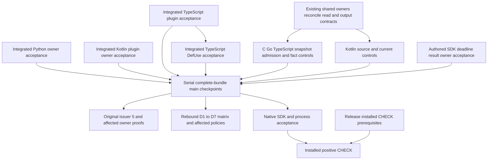

# Substrate closeout execution plan

Status: implementation in progress; source edits and execution attempts are
recorded in the R49 update below and the
[current execution handoff](../../work/substrate-repair-checkpoints-2026-10-07.md#r67r71-main-integration-and-missing-test-repair).
No product qualification is claimed.
Updated: 2026-10-08.

This is a successor to the retired Oct-6 implementation packet. It schedules
unfinished acceptance from [remaining work](../../work/remaining.md); it does not
reopen integrated decisions in [ADR-0005](../../adr/0005-substrate-reuse-and-consumer-projection.md).
[Code map](code-map.md) defines write boundaries and before/after behavior.
[Test plan](test-plan.md) defines owner requests and completion evidence.
The [current tickets](tickets.md) cover every active closeout ID and alias;
the proposed code-query roadmap is outside this repair campaign.
[Parallel dispatch](parallel-dispatch.md) defines four-slot work allocation,
shared-file stewardship, checkpoint acceptance and final local proof ordering.

## Purpose and scope

Make retained syntax, language calculations and runtime facts use the existing
checked read and original resource owners. Resolve demonstrated duplicate budget
mechanics in that resource cut, preserve semantics, and qualify actual callers.

- QGLang owns frontend compilation, normalized IR and diagnostics stdio.
- Semantica owns parser suppliers, DefUse, runtime substrate, SDK and installed
  product acceptance. Most work below belongs there.
- Reuse existing crates and ports. No new compiler, optimizer, execution engine,
  SMT dependency or external library is needed for these demonstrated gaps.
- D1–D7 remain in the closeout list as verification obligations. Their reviewed
  duplicate-removal source is integrated; new edits require a reached defect.
- Proposed A00–A15 query features are a separate proposal, not a prerequisite
  for completing this repair campaign.
- All verification is local. Hosted CI is not part of this plan.

## Audited source and ownership

The table retains the initial committed-source audit. Later source integrations
and R49–R60 issued overlays have separate receipt identities in the active
handoff; do not substitute this baseline for a current runtime result.

| Input | Identity / interpretation |
| --- | --- |
| QGLang | `01cfe39ca0571b4fc099d41b24628fda70e754fe`, clean before this final ticket audit |
| Semantica | `871224b2059422a8f36eca91ffb0c9119238ac9c`, frozen committed-source audit; foreign dirty work excluded |
| Index | observed `5bf6b15216968afde597606033870cc710cb9bc8`; observation is not an execution pin |
| Earlier source/claims evidence | `remaining-r46-plan-audit-state.json` at initial `070f4f9`; `remaining-r46-main-reconciliation.json` records that audit's `ff8f2ce`, supplier scope and SCC request repair |
| Final ticket/source evidence | `remaining-r48-final-ticket-audit.json` records committed source, getter classification, producer pin match and all20 states; current claims not rechecked |
| Implementation evidence | `implementation-r49-state.json` records authored consumer/ledger changes, current claims and exact owner attempts; QG-DIAG is resolved, leaving19 active IDs |
| Existing execution evidence | R38/R44 and other receipts keep their original source tuples; none qualifies this audited main |

Evidence root:
`/Users/songmin/.codex/task-evidence/oct6-substrate-dedup/recovery-20261006/query-owner-build-r1`.

The [R67–R71 checkpoint](../../work/substrate-repair-checkpoints-2026-10-07.md#r67r71-main-integration-and-missing-test-repair)
confirms Kotlin/local-ledger/rule changes remain integrated and records the
additional one-file Rust regression activation `f574fa82bf1`. R70/R71 accepts385
cases across ordinary language libraries and exact SCV2 on one issued source;
their active dependency closures match that main commit. SDK2/community2 remain pending.
The canonical supplier implementation already exists in other owners' WIP;
complete its tree-sitter→Kernel→Foundation→SourceWire closure and general facts
handoff rather than creating another holder or facts ingress. Those two source
obligations and unexecuted product acceptance are distinct from the completed
duplicate accounting removal.

Typed receiver census: **0 retired production carrier getter calls** at R49
Semantica `f2d85a9c430`. Python checked extraction is integrated as `27d9505015e`;
its145 package files match the captured R49 source. TypeScript plugin/DefUse were
already integrated as `b32361e9d83`. Live ParseResult APIs, constructors and test
code are excluded. R45's17 inventoried entrypoint calls are all migrated. This
bounded source metric does not establish runtime/control qualification.
The final SCC cut uses `codegraph-graph-scc` as calculation owner;
`quanta-graph-utils-v1` is a compatibility facade. The old source is renamed,
not a remaining dead copy. Historical owner45 requires a successor request map:
core/facade split plus the uncovered PTA adapter owner gives 47 requests if all
other rows remain. Resolve that map before execution; no 47 runs occurred here.
The concurrency engine and schema deadlock cuts also reuse this SCC owner.
Tarjan gate source includes the PTA adapter and Andersen across ten rails.
[D2-CALLER-COVERAGE](tickets.md#d2-caller-coverage) records eleven additional
consumer scopes, including the later abstract worklist cut, omitted by the historical45/Tarjan10 selectors; final request
cardinality is pending that reconciliation. None is a new SCC implementation.
The `07093dbe72a` follow-up shares Shape/Cost allocation-reference projection
through `quanta-contract-pta-result-shared`; D1 retains no-Java/Java feature
closure and real consumer proof. Feature policy entries alone are not run results.

| Work | Current source / ownership | Scheduling disposition |
| --- | --- | --- |
| Rust plugin + Rust DefUse | Source integrated `ed94af892c0` | Existing owner acceptance; no repeated migration |
| Go plugin | Source integrated `ed94af892c0` | Existing owner acceptance; no repeated migration |
| Java DefUse | Read cut `e14eeda8604` and lvalue lifetime follow-up `909ad96cc56` integrated | Current owner acceptance; no repeated lifetime repair |
| Python DefUse | Source integrated `27d9505015e`; R49 captured package identical | Existing owner acceptance; no repeated migration |
| Kotlin plugin | Source integrated `ecc0c5784b4`, sharing checked nodes with DefUse | Owner/control acceptance; cancel its new-migration assignment |
| TypeScript plugin | Source integrated `b32361e9d83`; checked scalar snapshot | Owner acceptance; cancel new-migration assignment |
| TypeScript DefUse | Source integrated `b32361e9d83`; shares checked scalar owner | Owner/control acceptance; cancel new-migration assignment |
| C plugin / C DefUse | Source cuts `801fbd6777a` / `480b5fb445d` integrated | Verify and repair the concrete control gaps below; do not repeat getter migration |
| Kotlin DefUse | `736a8047245` integrated | Source binding and original-control acceptance |
| Go DefUse | `070f4f96770` integrated during this audit | Original-control acceptance; cancel the former new-migration assignment |

Claims are observations, not exclusive locks or proof of completion. Refresh
HEAD, dirty paths, claims and barriers immediately before every assignment.
The earlier audit found shared `syntax_authority_v1.rs` and `current_read_v1.rs`
co-owned. Re-query claims before assigning current edits. D0 is the proposed
output-interface steward; the existing metadata,
incremental and Java error owners must reconcile their hunks first. Adding
another shared-file writer would increase overlap.

## Remaining code and contract work

### Additional checked-read chronology audit

Source-only follow-up at Semantica `65036b7221a882ff45968ee20b9938a31abee53c`:
the canonical typed owned-syntax bridge saves callback `Err(E)` but tells the
object-safe owner `Ok(())`. Ordinary and controlled owners can consequently
post-poll after failure; Kernel also postvalidates metadata on the Err branch.
The bridge itself still returns `Err(E)`. The confirmed defect is the later
poll side effect and changed first-refusal chronology, not a demonstrated
standalone replacement of its returned error.

**S0-CALLBACK source is now integrated as `aac43629734`**, including the
consumer-stop disposition, ordinary/controlled implementations, Kernel success-only
postcheck and source fixtures. Current-source execution acceptance is not supplied
by this readback. Its required contract remains: the existing object-safe
protocol must express consumer failure without inventing a Native allocation
cause. Both actual implementations and Kernel skip postvalidation after that
failure; successful callbacks retain all current/grant/metadata checks. Preserve
already-recorded refusal through the existing passive issuer/finisher boundary;
zero-work polling cannot substitute for passive observation.

The earlier 83/31 source handoff is integrated. That source audit ran no tests.
R49 authored independent consumer/ledger scopes under downstream claims;
execution acceptance requires normal source/lane admission and receipts.

| Batch | Concrete result | Preconditions / owner |
| --- | --- | --- |
| S0-CALLBACK | Source integrated `aac43629734`; prove actual callback-failure chronology | Existing owner proof on the frozen admitted tuple |
| S0 | Reconcile checked reads; implement actual adapter→context→extractor output-admission bridge using existing interfaces; centralize source/backend admission policy | Existing shared owners, steward D0; no new parallel shared-file editor |
| P-KOTLIN | Source integrated `ecc0c5784b4`; prove shared checked-node/bundle behavior | Existing owning tests; no duplicate migration |
| P-TS | Source integrated `b32361e9d83`; prove actual helper/bundle behavior | Existing owner proof; no new migration |
| D-TS | Source integrated `b32361e9d83`; prove binding/assignment/fact semantics | Existing owner proof; controls covered by S0/snapshot cut |
| Existing cuts | Python DefUse integrated `27d9505015e`; other source cuts already integrated | Existing owner proof, not redevelopment |
| CONTROL-SNAPSHOTS (former CONTROL-CGO) | Account snapshot materialization and subsequent fact calculation under the actual original owner; preserve the integrated shared cap/overflow counter (`f2d85a9`, QBC2/2) | C/Go/TypeScript consumers + shared admission mechanics, one writer; S0 output custody seam |
| CONTROL-KOTLIN | Exact source/backend binding integrated `df315e6` (QBC70/70); exercise original current failure priority | Kotlin DefUse writer, S0 contract |
| SDK-DEADLINE | Execute and qualify the authored result-based deadline tests through the real fluent SDK caller; retain existing mapper tests | Runtime SDK test owner; Native adapter/deadline behavior is already implemented |
| QG-DIAG — resolved | Existing parity and NDJSON consumers require primary-only exact fields | ADR-0008 documents the existing private contract; no wire change |

### Contract constraints before implementation

1. `single_parse` carries source/language/tree/current; each extractor separately
   owns function/CFG binding. The Native source-sealed path requires exact source
   and backend admission. Root bounds do not prove same-length source equality.
   Missing required Native source authority is typed refusal. Existing ordinary
   unsealed retained fixtures keep their documented contract; strictifying all
   ordinary inputs would require a separate coupled compatibility migration.
2. Preserve the first original refusal and function ID. Current/no-tree can be
   expressed using the existing test-support `source_only` context and public
   current field; test that guard without adding a constructor. No production
   caller for that state was observed. No controlled reparse fallback.
3. Plugin from-tree traits currently have **no current parameter**. Ordinary
   `None` use is legitimate there; controlled carriers require typed refusal.
   Do not extend the public trait merely to make a migration test pass. A new
   controlled-success API needs a demonstrated caller and one coupled contract cut.
4. Raw Tree/Node cannot escape a checked callback. Owned scalar snapshots can
   escape only with accounted storage and calculation custody. C/Go currently
   build snapshots under checked reads but calculate facts afterwards without
   passing current. TypeScript now shares this posture. Their private 128 MiB
   caps are not original memory grants.
5. Keep C/Go/TypeScript grammar projections separate. Reuse original output/temporary
   backing interfaces and implement their missing DefUse bridge. Resolve the
   three duplicate small local cap/checked-add ledgers within the real admission cut:
   extract common mechanics where the consumers share a contract; explicitly
   retain distinct caps where justified. A new standalone abstraction for thirteen
   lines is not a required gate. No lang-common → kernel reverse dependency.
6. Language-specific interpretation remains in its current owner. Preserve
   order, stable IDs, quarantine, exact semantic assignments, CFG binding,
   depth limits and typed failure. No default success after a failed read.

## Maximum parallel scheduling

The scheduling template uses four slots: one integrator and three workers.
Earlier external T1/D0/C65/C66 claims must be refreshed before source assignment.
R49 integrated Kotlin binding and the common counter; SDK test acceptance and original controls remain;
foreign Python/output-custody hunks remain with their current owners.

| Wave | Integrator | Worker 1 | Worker 2 | Worker 3 |
| --- | --- | --- | --- | --- |
| W0 | Refresh claims; reconcile S0 output signatures and source inventory | Review Kotlin control acceptance | Review integrated TS plugin | Review integrated TS DefUse |
| W1 | Accept integrated Python source and completed bundles; serialize main checkpoints | CONTROL-KOTLIN review/affected repair | Integrated plugin owner acceptance | Integrated DefUse owner acceptance |
| W2 | Review control/output custody; reconcile existing WIP | CONTROL-SNAPSHOTS coupled C/Go/TS + common budget mechanics | CONTROL-KOTLIN admission/regressions | SDK-DEADLINE real SDK tests |
| W3 | Freeze complete committed source tuple; serialize heavy QBC logical lane | D1–D7 and added SCC caller request/feature review | Affected policy reports/fixes in owned paths | Product and installed-trust prerequisite review |
| W4 | Execute owner matrix and F2/F7 on the frozen tuple | Review immutable receipts / witness coverage | Product artifact and process preparation | Documentation / installed trust prerequisite inventory |

The read-migration portion of Kotlin/Rust/Go/Java/TypeScript is integrated. Python source is integrated;
its existing owner remains responsible for acceptance. Do not spawn a replacement writer for those source cuts.
W0 audit is complete except the shared owners' output-interface
reconciliation. W1 read migration may use the existing interface immediately;
an S0 signature change must be handed off before the dependent source bundle.
TS plugin and TS DefUse need actual owner acceptance on their integrated cut.
Their shared snapshot control change follows S0; no new read-migration writer
is assigned. Serialize matching compile closures and retain distinct oracles.

The T → D edge is a compile dependency, not permission to edit the other's
files. F2 minimal registry and narrow independent owners need not wait for
unrelated D2 solver proof. Original5 waits for its actual compile closure.
Signed installed trust gates CHECK, not all local helpers or Native Preview.

## Main checkpoints and failure handling

- **CP0:** Shared-owner reconciliation: exact owned hunks, API/source binding,
  actual output owner, and dependent caller list. No partial shared API commit
  leaving its callers uncompilable.
- **CP1:** Complete language bundle per owner: real helper walk, source admission,
  tests and manifests. Merge independently when its dependency closure passes;
  couple plugin/DefUse if that language's owner requires both to compile.
- **CP2:** C/Go/TypeScript original-admission cut and all three consumers together; Kotlin
  binding/control bundle separately; SDK deadline test bundle separately.
- **CP3:** Freeze committed Semantica + committed GQLang + committed Index and
  resolved features/toolchain/execution root. Rebind old owner requests.
- **CP4:** Record current owner/policy/Native/SDK verdicts. Only reached defects
  reopen source; do not restart the whole request map after one local failure.
- **CP5:** Product process and installed acceptance. Keep unavailable external
  installed trust in its own incomplete row; do not mark the whole task complete.

Index/HEAD/commit operations are serial under the normal main coordinator and
hooks. Stage only the reviewed owner bundle, preserve foreign dirty hunks and
index entries, and review source drift before each commit. No `git add -A` for
this campaign. Checkpoint means local integration; push is a separate action.
An incomplete bundle remains in its owned branch/snapshot. A failed run retains
its receipt and source; the owner repairs the actual failure and freezes a
successor. Do not discard others' work or restore retired getters as a shortcut.

## Definition of done

1. Retired `CfgParsedTree` getter census is zero on committed source, and reviewed
   reachable consumers preserve checked read/custody; live ParseResult APIs remain
   classified by their own contract.
2. Source/backend/CFG binding, ordinary versus controlled behavior, first refusal,
   deterministic results and resource births are proved by discriminating tests.
3. C/Go/TypeScript original budget mechanics reuse one admission owner with all consumers.
   Duplicate ledger code has a recorded remove/share/retain disposition inside
   that cut; grammar semantics remain tested. D1–D7 decisions stay integrated.
4. Every affected QBC request has a current source/feature receipt with real
   selected/executed counts and required witnesses. Compile success is not proof.
5. Original issuer5, F2 registry/Preview, SDK mapper and real deadline behavior,
   custody/JSON/quarantine and D1–D7 acceptance have their separate verdicts.
6. Mandatory affected policies pass without baseline reapproval, allow growth or
   scope reduction. Product proof uses current installed artifacts and actual
   process output; external prerequisites remain explicit until fulfilled.
7. Remaining-work IDs are closed only by their own acceptance, durable choices
   move to ADR/contracts, and this execution packet retires after closeout.

## R49 implementation checkpoint

GQLang `just ci` passed on source digest
`752824c448d59280a887a86c2887685ff14fa6c4d6ff0b619e5e460669887a67`: Rust1514,
doctest10, external positive1/negative23 and all policy groups. Later prose-only
status updates retain that code result with an explicit documentation delta;
this is not a clean committed-HEAD qualification receipt.

Kotlin exact binding regression passed1/1 with an accepted QBC owner result on
Semantica base `90e6bb0ea3d`, captured dirty source digest
`40d2092ddda2012522722442adf83a8270987b57d2dd56ff3605a7ed0768ba36`.
Whole Kotlin QBC70/70 and common ledger QBC2/2 passed; these complete source
bundles are integrated as `df315e6530f` and `f2d85a9c430`. Abstract solver77,
canonical SCC core20 and facade1 also passed on the captured tuple. SDK, parser
original5 and callback5 stopped before tests at working-tree compile blockers;
no behavior-failure claim is made.

- Authored Kotlin retained source/backend admission inside the checked callback.
  Regression includes exact-source facts, equal-length foreign source and foreign
  backend. Ordinary unsealed retained input remains compatible.
- Authored real fluent SDK timeout0 typed-error and Sign/Interval/Constant literal
  normal-result tests. Production deadline behavior is unchanged.
- Extracted three identical snapshot cap/overflow ledgers into one private
  lang-common module. Existing charge sites and grammar projections are unchanged;
  this does not issue original allocation grants.
- Resolved QG-DIAG through the actual exact-field private client contract;
  [ADR-0008](../../adr/0008-private-diagnostics-primary-location-contract.md) owns the decision.
- Recovered root/nested lock projection with the offline Cargo generator. Only the
  duplicate registry Unicode package identity was removed; no surviving package
  version/source/checksum changed. Foreign dependency-record changes were retained.
  Both workspaces passed `cargo metadata --offline --locked`; this is metadata
  coherence, not a Rust or runtime verdict.
- Owner attempts so far: mutable-source guard; locked-input refusal; sibling
  overlay change during CAS capture. All stopped before Kotlin tests. Freeze the
  sibling before the successful exact retry; subsequent requests reuse that captured tuple.

`implementation-r49-state.json` at the evidence root records exact attempts and
source inputs. Original DFG output admission remains a coupled upstream/request/
context/facts-storage/final-keeper change with existing shared owners. The generic
retained frontdoor currently refuses unadmitted original output; do not remove
that guard or attach grants to finished rows. No whole-product result is claimed.

R49 reached two working-tree compile defects: duplicate outer/serializer generic
`S` in semantic snapshot serde, and a missing explicit path to the existing
SourceWire repo-relative normalization module. Minimal fixes preserve other
workers' storage/issuer edits; successor owner proof and coupled integration
remain required. Unicode manifest/lock projection likewise awaits its complete
coowned checkpoint; metadata coherence on the dirty tree is not clean-main proof.
