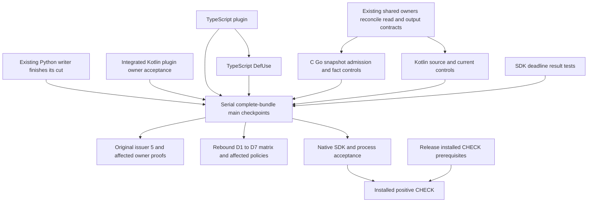

# Substrate closeout execution plan

Status: planned; read-only audit, no runtime execution in this revision.
Updated: 2026-10-07.

This is a successor to the retired Oct-6 implementation packet. It schedules
unfinished acceptance from [remaining work](../../work/remaining.md); it does not
reopen integrated decisions in [ADR-0005](../../adr/0005-substrate-reuse-and-consumer-projection.md).
[Code map](code-map.md) defines write boundaries and before/after behavior.
[Test plan](test-plan.md) defines owner requests and completion evidence.

## Purpose and scope

Make retained syntax, language calculations and runtime facts use the existing
checked read and original resource owners. Resolve demonstrated duplicate budget
mechanics in that resource cut, preserve semantics, and qualify actual callers.

- QGLang owns frontend compilation, normalized IR and diagnostics stdio.
- Semantica owns parser suppliers, DefUse, runtime substrate, SDK and installed
  product acceptance. Most work below belongs there.
- Reuse existing crates and ports. No new compiler, optimizer, execution engine,
  SMT dependency or external library is needed for these demonstrated gaps.
- D1–D7 remain in the closeout list as verification obligations. Their reviewed
  duplicate-removal source is integrated; new edits require a reached defect.
- Proposed A00–A15 query features are a separate proposal, not a prerequisite
  for completing this repair campaign.
- All verification is local. Hosted CI is not part of this plan.

## Audited source and ownership

| Input | Identity / interpretation |
| --- | --- |
| QGLang | `784bba129970cbdd1b18b13db4c21ff04c7e3aff`, clean before this status update |
| Semantica | `5f76eca7812cdbed3cdd66dd6d0f6533ce9b1c9c`, progress readback at `93fb840b` plus reviewed concurrency/SCC gate delta; foreign dirty work excluded |
| Index | observed `5bf6b15216968afde597606033870cc710cb9bc8`; observation is not an execution pin |
| Source/claims evidence | `remaining-r46-plan-audit-state.json` at initial `070f4f9`; `remaining-r46-main-reconciliation.json` records final `ff8f2ce`, unchanged supplier scope and SCC request repair |
| Existing execution evidence | R38/R44 and other receipts keep their original source tuples; none qualifies this audited main |

Evidence root:
`/Users/songmin/.codex/task-evidence/oct6-substrate-dedup/recovery-20261006/query-owner-build-r1`.

Typed receiver census: **4 retired production carrier getter calls** remain:
TypeScript plugin × two, Python/TypeScript DefUse × one. The live
`ParseResult::tree_sitter_tree_v1()` API, constructors and test code are excluded.
This count measures entrypoints, not the size of their reachable helper graphs.
R45's 17 calls are now 4: 13/17 entrypoint calls migrated (about 76%). This is a
bounded source metric, not overall task completion or runtime qualification.
The final SCC cut uses `codegraph-graph-scc` as calculation owner;
`quanta-graph-utils-v1` is a compatibility facade. The old source is renamed,
not a remaining dead copy. Historical owner45 requires a successor request map:
core/facade split plus the uncovered PTA adapter owner gives 47 requests if all
other rows remain. Resolve that map before execution; no 47 runs occurred here.
The latest concurrency deadlock cut also reuses this SCC owner. Tarjan gate
source now includes the PTA adapter and Andersen owners across ten rails;
execution and the expanded consumer/request inventory still require review.

| Work | Current source / ownership | Scheduling disposition |
| --- | --- | --- |
| Rust plugin + Rust DefUse | Source integrated `ed94af892c0` | Existing owner acceptance; no repeated migration |
| Go plugin | Source integrated `ed94af892c0` | Existing owner acceptance; no repeated migration |
| Java DefUse | Source integrated `e14eeda8604`; separate lvalue working change observed | Owner acceptance; preserve the foreign lvalue change |
| Python DefUse | D0 frontdoor and helper claims; foreign WIP | Existing owner; split only after explicit path/symbol handoff |
| Kotlin plugin | Source integrated `ecc0c5784b4`, sharing checked nodes with DefUse | Owner/control acceptance; cancel its new-migration assignment |
| TypeScript plugin | Two retired calls; targeted paths clean/unclaimed | New independent consumer lane |
| TypeScript DefUse | One retired call; targeted paths clean/unclaimed | New independent consumer lane |
| C plugin / C DefUse | Source cuts `801fbd6777a` / `480b5fb445d` integrated | Verify and repair the concrete control gaps below; do not repeat getter migration |
| Kotlin DefUse | `736a8047245` integrated | Source binding and original-control acceptance |
| Go DefUse | `070f4f96770` integrated during this audit | Original-control acceptance; cancel the former new-migration assignment |

Claims are observations, not exclusive locks or proof of completion. Refresh
HEAD, dirty paths, claims and barriers immediately before every assignment.
The earlier audit found shared `syntax_authority_v1.rs` and `current_read_v1.rs`
co-owned. Re-query claims before assigning current edits. D0 is the proposed
output-interface steward; the existing metadata,
incremental and Java error owners must reconcile their hunks first. Adding
another shared-file writer would increase overlap.

## Remaining code and contract work

### Additional checked-read chronology audit

Source-only follow-up at Semantica `65036b7221a882ff45968ee20b9938a31abee53c`:
the canonical typed owned-syntax bridge saves callback `Err(E)` but tells the
object-safe owner `Ok(())`. Ordinary and controlled owners can consequently
post-poll after failure; Kernel also postvalidates metadata on the Err branch.
The bridge itself still returns `Err(E)`. The confirmed defect is the later
poll side effect and changed first-refusal chronology, not a demonstrated
standalone replacement of its returned error.

**S0-CALLBACK source is now integrated as `aac43629734`**, including the
consumer-stop disposition, ordinary/controlled implementations, Kernel success-only
postcheck and source fixtures. Current-source execution acceptance is not supplied
by this readback. Its required contract remains: the existing object-safe
protocol must express consumer failure without inventing a Native allocation
cause. Both actual implementations and Kernel skip postvalidation after that
failure; successful callbacks retain all current/grant/metadata checks. Preserve
already-recorded refusal through the existing passive issuer/finisher boundary;
zero-work polling cannot substitute for passive observation.

The earlier 83/31 source handoff is integrated; do not repeat that repair.
This task remains read-only for Semantica. The source delegation supplied no
new Rust/compiler/QBC/product execution authority; focused acceptance remains
separate from committed source and authored fixtures.

| Batch | Concrete result | Preconditions / owner |
| --- | --- | --- |
| S0-CALLBACK | Source integrated `aac43629734`; prove actual callback-failure chronology | Existing owner proof when execution is authorized; no duplicate source repair |
| S0 | Reconcile checked reads; implement actual adapter→context→extractor output-admission bridge using existing interfaces; centralize source/backend admission policy | Existing shared owners, steward D0; no new parallel shared-file editor |
| P-KOTLIN | Source integrated `ecc0c5784b4`; prove shared checked-node/bundle behavior | Existing owning tests; no duplicate migration |
| P-TS | Move both from-tree entrypoints and reachable HIR/identity/dispatch/type helpers | Existing public read API; TS plugin writer |
| D-TS | Move retained extraction and the full binding/assignment/traversal graph | Shared admission contract; TS DefUse writer |
| Existing cuts | Python DefUse remains WIP; Rust/Go and Java source cuts are integrated | Python existing owner; other cuts require proof, not redevelopment |
| CONTROL-CGO | Account snapshot materialization and subsequent fact calculation under the actual original owner; resolve duplicated cap/overflow mechanics within this cut | C/Go consumers + shared admission mechanics, one writer; S0 output custody seam |
| CONTROL-KOTLIN | Check exact retained source/backend binding and exercise original current failure priority | Kotlin DefUse writer, S0 contract |
| SDK-DEADLINE | Add result-based deadline acceptance through the real fluent SDK caller; retain existing mapper tests | Runtime SDK test owner; Native adapter/deadline behavior is already implemented |
| QG-DIAG | Locate the actual stdio consumer and settle the required diagnostic wire fields | Frontend diagnostic owner; narrower contract documentation or a versioned coupled DTO/consumer change |

### Contract constraints before implementation

1. `single_parse` carries source/language/tree/current; each extractor separately
   owns function/CFG binding. The Native source-sealed path requires exact source
   and backend admission. Root bounds do not prove same-length source equality.
   Missing required Native source authority is typed refusal. Existing ordinary
   unsealed retained fixtures keep their documented contract; strictifying all
   ordinary inputs would require a separate coupled compatibility migration.
2. Preserve the first original refusal and function ID. Current/no-tree can be
   expressed using the existing test-support `source_only` context and public
   current field; test that guard without adding a constructor. No production
   caller for that state was observed. No controlled reparse fallback.
3. Plugin from-tree traits currently have **no current parameter**. Ordinary
   `None` use is legitimate there; controlled carriers require typed refusal.
   Do not extend the public trait merely to make a migration test pass. A new
   controlled-success API needs a demonstrated caller and one coupled contract cut.
4. Raw Tree/Node cannot escape a checked callback. Owned scalar snapshots can
   escape only with accounted storage and calculation custody. C/Go currently
   build snapshots under checked reads but calculate facts afterwards without
   passing current. Their private 128 MiB caps are not original memory grants.
5. Keep C/Go grammar projections separate. Reuse original output/temporary
   backing interfaces and implement their missing DefUse bridge. Resolve the
   duplicate small local cap/checked-add ledgers within the real admission cut:
   extract common mechanics where the two consumers share a contract; explicitly
   retain distinct caps where justified. A new standalone abstraction for thirteen
   lines is not a required gate. No lang-common → kernel reverse dependency.
6. Language-specific interpretation remains in its current owner. Preserve
   order, stable IDs, quarantine, exact semantic assignments, CFG binding,
   depth limits and typed failure. No default success after a failed read.

## Maximum parallel scheduling

The current root team has four slots: one integrator and three workers. Existing
external T1/D0/C65/C66 source owners continue their own cuts; they are not new
assignments by this packet. Do not infer that they have unlimited capacity.

| Wave | Integrator | Worker 1 | Worker 2 | Worker 3 |
| --- | --- | --- | --- | --- |
| W0 | Refresh claims; reconcile S0 output signatures and source inventory | Review Kotlin control acceptance | Audit TS plugin cut | Audit TS DefUse cut |
| W1 | Review Python WIP and completed bundles; serialize main checkpoints | CONTROL-KOTLIN review/affected repair | P-TS implementation + owner proof | D-TS implementation + owner proof |
| W2 | Review control/output custody; reconcile existing WIP | CONTROL-CGO coupled C/Go + common budget helper | CONTROL-KOTLIN admission/regressions | SDK-DEADLINE real SDK tests |
| W3 | Freeze complete committed source tuple; serialize heavy QBC logical lane | D1–D7 request/feature review | Affected policy reports/fixes in owned paths | QG-DIAG consumer decision / frontend change if required |
| W4 | Execute owner matrix and F2/F7 on the frozen tuple | Review immutable receipts / witness coverage | Product artifact and process preparation | Documentation / installed trust prerequisite inventory |

The read-migration portion of Kotlin/Rust/Go/Java is integrated. Python remains
with its existing writer. Do not spawn a replacement writer for those source cuts.
W0 audit is complete except the shared owners' output-interface
reconciliation. W1 read migration may use the existing interface immediately;
an S0 signature change must be handed off before the dependent source bundle.
TS plugin and TS DefUse are disjoint write sets, but D-TS owner compilation may
need the plugin cut first. Worker 3 can finish static review while waiting.

The T → D edge is a compile dependency, not permission to edit the other's
files. F2 minimal registry and narrow independent owners need not wait for
unrelated D2 solver proof. Original5 waits for its actual compile closure.
Signed installed trust gates CHECK, not all local helpers or Native Preview.

## Main checkpoints and failure handling

- **CP0:** Shared-owner reconciliation: exact owned hunks, API/source binding,
  actual output owner, and dependent caller list. No partial shared API commit
  leaving its callers uncompilable.
- **CP1:** Complete language bundle per owner: real helper walk, source admission,
  tests and manifests. Merge independently when its dependency closure passes;
  couple plugin/DefUse if that language's owner requires both to compile.
- **CP2:** C/Go original-admission cut and both consumers together; Kotlin
  binding/control bundle separately; SDK deadline test bundle separately.
- **CP3:** Freeze committed Semantica + committed GQLang + committed Index and
  resolved features/toolchain/execution root. Rebind old owner requests.
- **CP4:** Record current owner/policy/Native/SDK verdicts. Only reached defects
  reopen source; do not restart the whole request map after one local failure.
- **CP5:** Product process and installed acceptance. Keep unavailable external
  installed trust in its own incomplete row; do not mark the whole task complete.

Index/HEAD/commit operations are serial under the normal main coordinator and
hooks. Stage only the reviewed owner bundle, preserve foreign dirty hunks and
index entries, and review source drift before each commit. No `git add -A` for
this campaign. Checkpoint means local integration; push is a separate action.
An incomplete bundle remains in its owned branch/snapshot. A failed run retains
its receipt and source; the owner repairs the actual failure and freezes a
successor. Do not discard others' work or restore retired getters as a shortcut.

## Definition of done

1. Retired `CfgParsedTree` getter census is zero on committed source, and reviewed
   reachable consumers preserve checked read/custody; live ParseResult APIs remain
   classified by their own contract.
2. Source/backend/CFG binding, ordinary versus controlled behavior, first refusal,
   deterministic results and resource births are proved by discriminating tests.
3. C/Go original budget mechanics reuse one admission owner with both consumers.
   Duplicate ledger code has a recorded remove/share/retain disposition inside
   that cut; grammar semantics remain tested. D1–D7 decisions stay integrated.
4. Every affected QBC request has a current source/feature receipt with real
   selected/executed counts and required witnesses. Compile success is not proof.
5. Original issuer5, F2 registry/Preview, SDK mapper and real deadline behavior,
   custody/JSON/quarantine and D1–D7 acceptance have their separate verdicts.
6. Mandatory affected policies pass without baseline reapproval, allow growth or
   scope reduction. Product proof uses current installed artifacts and actual
   process output; external prerequisites remain explicit until fulfilled.
7. Remaining-work IDs are closed only by their own acceptance, durable choices
   move to ADR/contracts, and this execution packet retires after closeout.

This revision ran no Rust owner or process tests. It records source/claim audits
and a concrete execution plan, not completed implementation or qualification.
