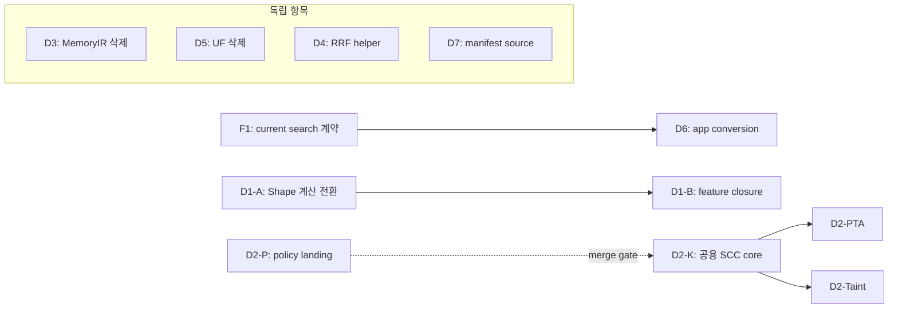

# Oct 6 — Substrate 중복 제거 실행 계획

## 1. 목적과 완료 결과

**D1–D7의 중복 계산·변환·manifest reader를 제거하고, 실제 진입점이 선택한 공통 owner를 사용하도록 전환한다.**

- 동일 의미의 수정·회귀 검증을 여러 구현에 반복하는 유지보수 비용을 줄인다.
- production factory, SDK, API, MCP의 실제 연결을 정리한다. 미사용 구현은 재연결하지 않고 제거한다.
- 입력 authority, 결과·순서·ID, typed failure, 취소·예산 계약을 보존한다. 서로 다른 계약은 caller의 작은 admission/projection으로 유지한다.
- 완료 결과는 **계산 owner 단일화 + 소비자 전환 + 퇴역 코드 삭제 + 로컬 증명 + 재발 방지 gate**다. 파일 이동, forwarding wrapper, 컴파일 성공만으로 완료 처리하지 않는다.

상태: **IN_PROGRESS — 별도 Semantica 워크트리에서 구현·owner 검증 중. Main 반영 및 항목별 DoD 미완료.**

### 구체적인 실행 자료

- [코드 변경 지도·Before/After](code-change-map.md): 저장소 tree, 실제 파일/symbol별 수정·삭제·추가·유지·재생성, 현재/목표 caller 연결과 코드 스케치.
- [테스트 플랜](test-plan.md): 기존/추가 case 구분, fixture 입력·독립 expected 결과, Rust QBC/Python 명령, owner/consumer/feature/retirement 통과 기준.
- [구현 checkpoint 기록](execution-progress.md): 작업 root/base/branch, 실제 diff·실행 결과·main 반영·남은 proof. 아래 계획표의 목표를 구현 완료와 혼동하지 않는다.
- [상세화 소스·문서 검증](detail-source-state.json): 이번 작업의 HEAD/dirty와 input continuity. 기존 [source-state.json](source-state.json)은 `a660384` 문서 버전에 대한 이력이며 이후 문서 hash와 일치해야 하는 current receipt가 아니다.

## 2. 배경과 현재 근거

GQLang frontend는 syntax/sema/normalized IR을 소유하고, 실행 substrate는 Semantica가 소유한다. 감사에서는 GQLang 전용 ingress뿐 아니라 native SDK, Python SDK, HTTP agent, 공개 MCP, Index 연계를 따라 실제 caller와 계산 owner를 비교했다.

확인된 중복은 성격이 다르다.

| 유형 | 해당 항목 | 적용 방식 |
|---|---|---|
| 활성 계산 구현의 복제 | D1 Shape, D2 SCC | 기존 owner 선택 → 실제 factory/caller 전환 → 복제 구현 삭제 |
| 미사용 대체 구현 | D3 MemoryIR, D5 UnionFind | fresh consumer census → 고유 entry/module·export 삭제 |
| 작은 활성 수식 복제 | D4 RRF contribution | 기존 helper 직접 재사용, 전체 fusion 책임 유지 |
| 소비자 변환 복제 | D6 SDK row→app hit | F1 현재 계약 수정 후 기존 shared package로 공통 변환 통합 |
| source 읽기·cache authority 분리 | D7 manifest | 기존 registry가 bytes를 한 번 캡처하고 모든 projection에 제공 |

### 2.1 소스 기준과 확인 수준

작성 시작 시점인 2026-10-06의 상태다. HEAD는 영구적인 최신 상태를 뜻하지 않는다.

| 저장소 | 관찰 HEAD | branch / dirty 항목 | 이번 범위의 역할 |
|---|---|---|---|
| GQLang | `6932c256eeb0fcf0599f57254526169a32dd22e5` | `main` / 11 | 계획·감사 문서 |
| Semantica | `a0e0eb2d59f01dc140583628639c55ebe47c8d77` | `main` / 392 | D1–D7·F1 구현 저장소 |
| Quanta Index | `846512a87f20146c6783c3de89d7f308b6f3d8c4` | `main` / 0 | D4의 알려진 downstream 연계 확인 |

- 이전 계획의 80 evidence 항목과 F1 공개 계약 입력 25항목의 live SHA256을 다시 비교했다. **105개 hash claim 모두 동일**했다. 항목 수는 고유 파일 수나 deep audit 수가 아니다.
- D6/D7 관련 app 입력 11개도 이전 감사 bytes와 동일한지 확인했다. 합계 116개 hash claim, 고유 입력 103개다. Caller·계약 판정은 누적 감사의 해당 evidence를 따른다. 현재 문서 검증·source capture는 [source-state.json](source-state.json)에 기록한다.
- 소스·호출 관계의 정적 판정과 이전 component 관찰이 근거다. 이번 문서 정리에서 Rust/QBC, Python owner tests, daemon/HTTP/MCP stdio, installed product, 성능 검증은 실행하지 않았다.
- Semantica의 dirty 작업은 이 계획의 구현 완료로 세지 않는다. 착수 직전 관련 bytes, caller, feature, 같은 파일의 hunks를 다시 확인한다.

2026-10-06 상세화 초기에 GQLang `a660384`, Semantica `04aaa523`, Index `14175629`를 관찰했으며 위 116개 input hash는 동일했다. 이후 관찰 HEAD와 추가 파일 digest는 `detail-source-state.json`에 기록한다. 상세화는 실제 파일·test symbol·QBC 문법을 더 확인한 문서 작업이다. `owner resolve`/test enumeration/behavior rail은 아직 실행하지 않았으므로 [테스트 플랜의 resolve 조건](test-plan.md)을 착수 gate로 적용한다.

근거 문서:

- [누적 substrate 감사](../../audits/2026-10-06-substrate-ownership-and-usecase-audit.md): §9.1 잔여 액션, §9.5 의존 관계, §9.10 최종 보완.
- [관찰·반증·source 증거](../../audits/2026-10-06-substrate-component-observations.json): 실행 component와 미실행 범위, D6/D7 세부 caller.
- [이전 계획 source snapshot](../../audits/2026-10-06-substrate-dedup-plan-source.json): 이전 source tuple과 검증 이력. 그 안의 `plan_sha256`은 이동 전 문서에 대한 값이며 이 문서의 receipt가 아니다.

## 3. 범위와 책임

### 포함

- D1–D7의 owner 선택, consumer cutover, 삭제, feature/import/export/generated selector 정리.
- D6의 직접 선행인 **F1: native→현재 Python SDK search 계약 정합성**.
- 실제 영향 경로의 positive/negative 회귀, 기존 구조·feature·manifest gate 갱신.
- checkpoint별 owned 변경의 local `main` 반영 및 실행 증거 기록.

### 별도 backlog

- F2/F4/F5/F6/F7/F9/F10 기능 수리는 [감사 §9.1](../../audits/2026-10-06-substrate-ownership-and-usecase-audit.md)에 남긴다. 이 계획의 완료로 함께 해결됐다고 표시하지 않는다.
- Core Andersen SCC, CallGraph, Abstract Worklist, dominance 등 다른 그래프 계산은 D2의 첫 세 owner 범위 밖이다. 계약 차이를 확인한 뒤 별도 판단한다.
- Mutation recovery, V1/V3 계약, local ANN/searchd, 독립 fusion pipeline 등 역할·수명이 다른 구성은 중복 제거 대상으로 묶지 않는다.
- 신규 compiler/graph engine/SMT, 범용 graph trait, 신규 공용 crate, third-party 알고리즘 library 도입은 이번 작업 범위에 없다. 선택 범위에는 재사용할 owner가 이미 있다.
- 성능 향상이나 installed product qualification은 별도 측정·실행 증거가 있을 때만 주장한다.

**책임 경계:** Semantica가 runtime 구현과 증명을 소유한다. GQLang의 host-agnostic frontend DTO를 runtime 구현의 위치 때문에 옮기지 않는다. Index 소스 수정은 현재 D4에 필요하지 않으며 새로운 consumer 근거가 생기면 범위를 다시 정한다.

## 4. 공통 설계·착수 기준

### 4.1 모든 항목의 보존 계약

1. 실제 caller→admission→owner→result 경로를 고정한다. public export만 보고 활성 owner를 선택하지 않는다.
2. domain, identity, ordering, authority, budget/cancel, failure semantics를 항목별로 명시한다.
3. authority가 없거나 unsupported/malformed이면 기존 typed `Incomplete`/refusal/error를 보존한다. 빈 결과·가짜 ID/좌표·성공으로 바꾸지 않는다.
4. 공통 계산과 caller별 정책을 분리한다. 동일 알고리즘을 policy 이름으로 다시 복제하지 않는다.
5. pre-release 현재 계약으로 알려진 consumer를 함께 전환한다. obsolete reader, dual write, 호환 wrapper로 퇴역 구현을 남기지 않는다. 공개 호환성이 실제 필요하면 삭제 전에 사용 범위와 version 변경을 확정한다.

### 4.2 Definition of Ready — checkpoint 착수 조건

- exact HEAD, relevant dirty bytes/digest, 실행 root와 owned write set 기록.
- known consumer/feature/target/alias/glob import census와 실제 production 진입점 확인.
- 남길 owner, 삭제할 symbols, 유지할 다른 계약, expected 결과·실패 경로 확정.
- owning rail의 package/selector/features, 실제 선택 cases, 필요한 mandatory gate 확인.
- 동시 변경과 같은 파일을 수정하면 소유 hunks·index/commit 순서를 먼저 맞춘다. unrelated dirty를 reset/revert하지 않는다.

## 5. 작업 패키지

### D3 — 미사용 MemoryIR build-input entry 제거

**목적:** 활성 MemSSA build-input authority를 runtime pack 하나에 유지한다.

- **남길 owner:** [runtime pack ingress](../../../../semantica-codegraph-v2/packages/analysis/quanta-v2/crates/quanta-runtime-memssa-pack/src/canonical_memory_ir_ingress.rs)의 `canonical_memory_ir_from_build_input` 및 explicit load-ID map entry. 실제 taint promotion caller도 이 경로다.
- **삭제:** [DFG canonical_ir](../../../../semantica-codegraph-v2/packages/analysis/quanta-v2/crates/quanta-adapters-dfg/src/memssa_adapter/canonical_ir.rs)의 미사용 build-input entry, `validate_deletion_input_v1`, `lower_build_input_blocks_v1`, 이 경로에만 필요한 helper/test. `memssa_adapter/mod.rs` export와 orphan import/error를 함께 정리한다.
- **유지:** PortDFG entry, shared producer digest·shape policy·common IR·finalizer·sort helper. `DeletionAuthorityViolation`은 fresh caller census 후 orphan이면 삭제한다.
- **작업 경계:** 전체 `canonical_ir.rs` 삭제나 DFG→pack forwarding dependency를 만들지 않는다. [MemSSA ingress boundary policy](../../../../semantica-codegraph-v2/tools/rust-crate-boundary-guard/policies/quanta-memssa-runtime-surface-ingress-boundary.toml)를 보존·갱신한다.
- **검증:** pack의 real/synthetic ID·explicit map·collision·authority·digest·typed refusal 회귀, DFG PortDFG와 실제 taint promotion owning QBC.
- **DoD:** DFG build-input 정의/export/활성 참조 0; 활성 pack/PortDFG/taint 결과와 거절 계약 보존; generated selector·inventory에 퇴역 활성 참조 0.

### D5 — 미사용 Andersen UnionFind 제거

**목적:** 사용되지 않는 대체 UF와 public export를 제거한다.

- **남길 owner:** [base UF](../../../../semantica-codegraph-v2/packages/core/pta/engine/src/solver/union_find_base.rs), 실제 Steensgaard main/retained-pair session. 활성 Andersen solver와 Mahjong의 별도 min-root 계약은 유지한다.
- **삭제:** `solver/andersen/union_find.rs` (main에서 삭제됨), `union_find_tests.rs`, Andersen `mod.rs` 등록/export, crate root의 해당 `UnionFind` re-export. `BaseUnionFind` alias는 유지한다.
- **소비자 확인:** Semantica·Index·GQLang 및 확인 가능한 target/feature의 alias·glob까지 census. 알려진 consumer가 발견되면 같은 checkpoint에서 전환한다. In-repo census로 미확인 외부 consumer 부재를 주장하지 않는다.
- **검증:** `codegraph-core-pta-engine`의 실제 Steensgaard/Andersen positive·negative 결과와 retained pair-session 회귀. 삭제한 UF 구현을 재현하는 mirror test는 추가하지 않는다.
- **DoD:** 퇴역 module·정의·export·consumer 0; 실제 solver 회귀 통과. Bool/root 호환 wrapper나 새 UF trait를 남기지 않는다.

### D4 — SCV2 RRF contribution 단일화

**목적:** 작은 활성 수식을 기존 검증 owner에 연결한다.

- **남길 owner:** [기존 RRF helper](../../../../semantica-codegraph-v2/packages/analysis/quanta-v2/crates/quanta-retrieval-algo-v1/src/rrf.rs)의 `rrf_contribution_v1`.
- **변경:** [SCV2 `rrf_score_v1`](../../../../semantica-codegraph-v2/packages/analysis/quanta-v2/crates/quanta-runtime-retrieval-kernel/src/scv2_exact_fusion.rs)의 inline contribution을 helper 호출로 교체하고 중복 상수를 제거한다.
- **feature:** `scv2-exact-owner-surface`가 optional algo dependency를 직접 활성화한다. helper 하나를 위해 전체 `identity-collapse-surface`를 켜지 않는다.
- **보존:** K=60, rank clamp, floating-point 합산 순서, identity/tie-break/top-k/duplicate refusal. 전체 fusion pipeline은 각 책임에 유지한다.
- **검증:** rank 0/1/2/`u32::MAX`의 독립 expected score, mixed contribution·동점 ordering·duplicate conflict, leaf-only feature owning QBC. S17/S19 membership/history gate를 RRF 직접 증명으로 세지 않는다.
- **DoD:** SCV2 자체 contribution 수식·불필요한 K 상수 0; 기존 helper 사용; leaf feature와 결과 계약 검증 통과.

### D7 — MCP manifest source authority 단일화

**목적:** schema/list/mapping/dispatch가 서로 다른 파일 version을 소비하지 않도록 한다.

- **남길 owner:** 기존 [query_surface_registry](../../../../semantica-codegraph-v2/apps/mcp/mcp/domain/query_surface_registry.py).
- **write set:** registry, `handlers/introspection.py`, `handlers/surface_config.py`, `main.py`, import 시 registry names를 평가하는 `adapters/fluent_engine_sdk_query_adapter.py`, 해당 consumer tests.
- **구현:** resolve → bounded read → decoded validation을 한 번 수행하고 private deep-immutable path/digest/full entries를 캡처한다. Metadata/executable/deferred projection은 목적대로 유지하며 public dict/list는 독립 copy로 반환한다.
- **초기화:** `_initialize_sdk`의 cold/direct/retry 모두 adapter import·SDK 생성 전에 동일 idempotent preflight를 통과한다. Main-only 검사나 path helper 공유만으로 완료 처리하지 않는다.
- **삭제:** introspection fallback resolver, manifest 별도 read/source cache, `CODEGRAPH_REPO_PATH`/cwd 재탐색 authority. 잘못된 explicit override는 fail closed; checkout default와 packaged artifact 선택은 명시한다.
- **수명:** 같은 process의 refresh는 captured source 재투영이다. 새 파일 version 적용은 restart로 한다. Hot reload engine은 추가하지 않는다.
- **검증:** 파일 교체 전후 source 일치, cold import/preflight 순서, SDK unavailable retry, missing/invalid override, packaged artifact, public copy mutation isolation. Same-usecase duplicate와 alias-normalized name 충돌을 거절한다. Ordered list/cardinality/uniqueness를 검사한다.
- **DoD:** crosswalk byte reader/resolver authority 1개; schema/list/mapping/dispatch의 version/digest 일치; 모든 init/retry 경로 및 거절 control 통과. 현재 manifest가 중복된다는 결함이나 installed socket leak을 새로 주장하지 않는다.

### D1 — Shape 계산 owner와 제품 feature 정리

**목적:** 실제 factory를 standalone Shape에 연결하고 Shape-only dependency를 닫는다. 두 checkpoint로 나눈다.

#### D1-A — production owner cutover

- **남길 owner:** [quanta-adapters-shape](../../../../semantica-codegraph-v2/packages/analysis/quanta-v2/crates/quanta-adapters-shape/src/shape_analyzer_adapter.rs). 기존 `ShapeAnalyzerPort`, V1/V2 authority·PTA 변환 계약 유지.
- **직접 전환:** `quanta-adapters-runtime-surface`, `quanta-adapters`, `quanta-adapters-analysis-facade`, `quanta-sdk-session-backend-owner`의 concrete import/export/factory와 PTA converters.
- **삭제:** cost의 `shape_analyzer_adapter.rs`, 전용 tests·mod/export. Unique regression은 standalone 또는 해당 owning test로 옮긴다. Cost/Termination/Heap 기능과 그 기능의 실제 integration tests는 유지한다.
- **gate:** `gate-shape-analysis-smoke.sh`, `gate-shape-analysis-ghiya-hendren.sh`의 Shape unit selector를 standalone으로 전환하고 실제 선택 cases를 확인한다.
- **검증:** Tree/DAG/cycle/alias, V2 authority 누락·불일치 refusal, 실제 SDK factory→port, pure/PTA-derived 입력.
- **DoD:** production Shape 계산 정의 1개; 알려진 factory 모두 standalone 사용; cost의 복제 계산과 obsolete exports/selectors 0. Cost→standalone wrapper는 남기지 않는다.

#### D1-B — shape-only feature closure

- **직접 선행:** D1-A.
- **변경:** runtime `shape-analyzer`의 불필요한 `cost-analyzer` 활성화 제거. Cargo뿐 아니라 selector/builder/capability/public cfg exports/overlays/QBC feature taxonomy/generated honesty 입력을 함께 정리한다.
- **검증 lanes:** pure Shape, PTA-derived Shape, Shape disabled typed unavailable, 기존 Cost/Termination/Heap 조합. 실제 SDK feature closure와 두 Shape gate·mandatory feature-policy 확인.
- **DoD:** dependency closure로 shape-only 주장을 입증한다. D1-A 결과를 D1-B나 regex-free 제품 증명으로 확대하지 않는다. Generated 입력은 해당 owner generator로 갱신하고 baseline을 낮춰 통과시키지 않는다.

### F1 → D6 — 현재 search 계약과 app 변환 통합

**목적:** 정상 native 결과를 현재 SDK·API·HTTP agent가 같은 의미로 소비하도록 만든 뒤 중복 parser를 제거한다.

#### F1 — 직접 선행 계약 수리

- **확인된 불일치:** native match/supplemental은 symbol/location이 optional이며 canonical symbol ID가 항상 있지 않다. 현재 SDK `_product_search_projection_v1.py`는 모든 row에 symbol ID/name/kind/file/line을 요구하고 이전 summary key를 읽거나 좌표를 합성한다.
- **작업:** producer/current SDK/consumer의 symbol·nonsymbol·supplemental variant, 실제 identity, optional location, `total_count/page_count/match_count/supplemental_match_count/result_truncated` 의미를 확정하고 현재 reader·DTO·회귀를 전환한다.
- **실패 계약:** 가짜 symbol ID·line/column을 만들지 않는다. Variant에 필요한 값이 malformed이면 typed refusal. Primary/supplemental count는 각각의 정의로 검사하며 근거 없이 `total >= primary + supplemental`을 강제하지 않는다.
- **DoD:** source-shaped 정상/거절 입력이 실제 SDK projector를 통과하고 정확한 row·summary를 출력한다. Public compatibility 영향과 소비자 수정 범위를 기록한다. 그 후 D6를 진행한다.

#### D6 — 기존 shared package의 app conversion owner

- **남길 owner 위치:** 기존 `packages/analysis/codegraph-shared/codegraph_shared/infra/search/` 안의 current SDK row→app hit 공통 변환. SDK decode 자체는 SDK에 유지한다.
- **동시 전환:** [API search route](../../../../semantica-codegraph-v2/apps/api/api/routes/search.py)와 [HTTP agent QueryAdapter](../../../../semantica-codegraph-v2/apps/mcp/mcp/adapters/search/query_adapter.py)의 중복 field mapping을 삭제하고 공통 변환을 사용한다.
- **보존:** authored metadata span, optional identity/location의 부재, 앱별 request admission/HTTP error/anchor/GraphRAG file presentation. DTO 변경이 필요하면 F1 현재 계약과 함께 처리한다.
- **퇴역:** dormant `SymbolRetriever`의 non-test construction을 재조사한다. Converter/module 삭제 시 package export, service exception import, lazy legacy handler를 함께 정리한다. 필요한 live exception만 적절한 owner로 옮긴다.
- **별도 공개 경로:** live MCP는 `GeneratedDaemonSdkQueryAdapter`의 envelope 경로다. HTTP agent parser와 동일 경로로 설명하지 않는다.
- **검증:** native-shaped symbol/nonsymbol/mixed/empty/truncated → 실제 SDK projector → shared 변환 → API/HTTP agent. Span·typed invalid rejection·GraphRAG file ID, live public MCP envelope의 별도 control. Converter monkeypatch만 한 smoke는 boundary 증명이 아니다.
- **DoD:** current SDK row field 변환 owner 1개; active consumers 전환; retired converter/import/export 0; 실제 variants와 각 소비자 회귀 통과.

### D2 — 선택한 SCC 세 구현 통합

**목적:** generic/PTA/taint가 같은 iterative Tarjan 계산 core를 사용하되 각 domain/ordering/stop 계약을 보존한다. 가장 큰 작업이다.

#### D2-P — policy landing 조건

- Before `quanta-graph-utils-v1`은 `tier0-shared`, empty default였다. Main `df2a867ad70`에서는 crate/root mapping을 `tier1-adapter`로 맞추고 empty default와 query-HIR explicit default-feature edge policy를 유지했다.
- `quanta-runtime-query-hir-wire` dependency도 함께 확인한다. Foreign root Cargo hunk를 섞지 않는다.
- **DoD:** 관련 layer/feature policy 통과. Unrelated baseline blocker가 있으면 경계·영향을 기록하고 미완료로 유지한다. 정책 검증은 landing 조건이며 algorithm parity 증명이 아니다.

#### D2-K — 기존 core 확장

- **남길 owner:** [quanta-graph-utils-v1 SCC](../../../../semantica-codegraph-v2/packages/analysis/quanta-v2/crates/quanta-graph-utils-v1/src/scc.rs)의 borrowed indexed iterative traversal. 기존 generic entry도 이 core를 사용한다.
- **자원·실패:** adapter indexing 전에 dimension admission, core traversal/result state allocation 전에 checked logical byte admission. Default cap은 nodes1,000,000·edges10,000,000·core workspace512MiB다. Borrowed input, domain projection/generic clone, allocator metadata와 RSS는 byte cap 범위 밖이다. Overflow/input/work bound, traversal·edge/materialization checkpoint를 연결하고 Compute error와 caller `Stop<E>`를 구분한다. Callback 존재만으로 allocation bound를 주장하지 않는다.
- **domain 정책:** generic closed domain의 unknown target은 거절. PTA의 declared-key projection, taint의 successor-only nodes 처리는 adapter가 명시적으로 보존한다.
- **출력 정책:** component/member ordering·IDs·failure/cancel을 caller projection으로 보존한다. 새 universal graph trait/crate는 만들지 않는다.
- **기존 indexed API:** 현재 wrapper의 neighbor sort/dedup을 보존한다. Unsorted/duplicate public 입력을 canonical로 가정하지 않으며, 필요한 normalization을 adapter에서 처리한 뒤 core가 빌린다. Exact dense IDs와 emission order를 회귀로 고정한다.
- **DoD:** generic entry가 같은 core를 사용하고 독립 expected partition·exact order/ID·typed error·stop·admission 회귀 통과.

#### D2-PTA / D2-Taint — 각각 caller cutover

- **PTA:** [precise_query_scc](../../../../semantica-codegraph-v2/packages/analysis/quanta-v2/crates/quanta-runtime-analysis/src/queries/pta/precise_query_scc.rs)의 복제 Tarjan state/frame 순회를 삭제한다. PTA admission/domain/output projection만 남긴다.
- **Taint:** [wire_recursion](../../../../semantica-codegraph-v2/packages/analysis/quanta-v2/crates/quanta-taint-solver/src/analysis/taint/interproc/wire_recursion.rs)의 복제 순회/state와 전용 sentinel helper를 삭제한다. Opt-in cycle policy/budget/sorted output은 caller가 소유한다.
- **gate:** [gate-tarjan-iterative.sh](../../../../semantica-codegraph-v2/tools/ci/gates/gate-tarjan-iterative.sh)를 새 core와 taint adapter tests에 연결한다. Ignored `deep_chain_50k`를 명시적으로 실행하고 empty selection을 거절한다.
- **검증:** empty/isolated/self-loop/cycle/disconnected/target-only/invalid index, cancellation/compute error, pre-allocation admission failure, 50k deep chain. Partition만 같고 order/ID가 달라지면 실패다.
- **DoD:** generic/PTA/taint 선택 범위의 Tarjan traversal core 1개; 두 caller cutover·퇴역 정의 삭제·계약 회귀 통과. PTA만 전환하면 D2는 미완료다. 동일 workload의 allocation/latency 측정 전 성능 수치를 주장하지 않는다.

## 6. 의존 관계와 실행 순서

단독 개발의 기본 순서다. 순서 자체를 hard dependency로 만들지 않는다.

| 순서 | main checkpoint | 범위·주요 위험 | 직접 선행 |
|---|---|---|---|
| C1 | D3 | 작음: PortDFG 공용 helper 오삭제 | 없음 |
| C2 | D5 | 작음: public export·숨은 consumer | 없음 |
| C3 | D4 | 작음: leaf feature·FP 합산/정렬 | 없음 |
| C4 | D7 | 중간: import/retry·manifest source 수명 | 없음 |
| C5 | D1-A | 중간: concrete factory·authority·tests | 없음 |
| C6 | D1-B | 중간 이상: Cargo/cfg/SDK closure | D1-A |
| C7a / C7b | F1 / D6 | 중간 이상: public variants·DTO·실제 consumers | D6는 F1 |
| C8a | D2-P + D2-K | 큼: policy·generic API·allocation/stop | policy landing 통과 |
| C8b / C8c | D2-PTA / D2-Taint | 큼: exact order/ID·caller budget | 각각 D2-K |

PTA→taint는 권장 pilot 순서이며 hard dependency가 아니다. Search 공개 경로 복구를 우선하면 F1→D6를 앞으로 옮긴다. 상대 크기는 수정·검증 범위이며 일정/소요시간 추정이 아니다.

## 7. 로컬 검증과 재발 방지

**유료 hosted CI는 이 계획의 통과 조건이 아니다.** Existing owning rails와 mandatory policy gates를 로컬에서 실행한다.

| 항목 | 최소 의미 있는 owner/consumer proof | 구조·feature proof |
|---|---|---|
| D3 | runtime pack + DFG PortDFG + 실제 taint promotion | MemSSA ingress boundary, retired exports/generated inventory |
| D5 | core PTA Steensgaard/Andersen + retained pair session | module/export/alias census, target inventory |
| D4 | SCV2 rank/score/order/refusal + leaf-only QBC | `scv2-exact-owner-surface` dependency closure |
| D7 | registry/introspection/config/init/retry consumer tests | byte-reader authority 1, ordered uniqueness, projection digest |
| D1-A/B | standalone Shape + SDK factory; pure/PTA/disabled/Cost lanes | 두 Shape gate, runtime feature policy, generated honesty |
| F1/D6 | 실제 SDK projector + API/HTTP agent + 별도 MCP control | shared conversion owner, retired parser/import census |
| D2 | generic/PTA/taint parity·error·cancel·50k chain | layer/feature policy, Tarjan gate·selector cardinality |

- Rust verdict는 Semantica의 `scripts/quanta-build-cli` owning QBC를 사용한다. Raw Cargo 출력은 diagnostic이다. 착수 시 현재 CLI/registry에서 실제 selector와 feature를 확정하고 command를 기록한다. 이 문서에 미확인 실행 flags를 만들지 않는다.
- Python은 해당 owner/consumer tests를 사용한다. SDK가 필요한 rail은 Semantica의 SDK Python 환경을 사용한다.
- 기존 meaningful regression을 재사용하고 behavior 위험에 독립 expected/rejection control을 보강한다. 구현과 동일한 수식을 다시 쓰는 test만으로 parity를 주장하지 않는다.
- source invariant는 기존 boundary/feature/manifest gate에 추가한다. Retired production definition/export/factory/reader의 재등장과 empty selector를 막는다. History 문서나 독립 test oracle에 blanket text ban을 적용하지 않는다.
- generated inventory/baseline은 해당 generator로 갱신한다. Gate를 완화하거나 baseline을 낮춰 green을 만들지 않는다.
- focused rail 뒤 affected repository의 기존 mandatory completion gate를 실행한다. GQLang 코드 변경으로 repository-wide 완료를 주장할 때는 `just ci`를 한 번 실행한다. 이 문서 정리에 대한 link/hash 검증을 runtime completion으로 세지 않는다.
- full HTTP/daemon/stdio/installed proof는 해당 통합 주장에 필요한 경우 실행·별도 기록한다. Pure helper 하나의 변경에 무관한 product receipt를 강제하지 않는다.

## 8. Main checkpoint 운영과 증거

1. checkpoint의 owned write set과 actual source tuple을 고정한다. Frozen source와 dirty-overlay proof를 구분한다.
2. consumer cutover·복제 삭제·해당 gate/selector 갱신을 함께 review한다. Retired 구현을 남긴 채 checkpoint를 완료 표시하지 않는다.
3. smallest owning rail → 해당 mandatory gate 순으로 실행한다. Command/root/selector/features/case count/result·NOT_RUN을 기록한다.
4. source drift가 있으면 바뀐 관련 범위의 판정·proof를 다시 확인한다. 서로 다른 source receipt를 하나의 qualification으로 합치지 않는다.
5. shared index/commit을 직렬화하고 owned hunks만 local `main`에 합친다. Foreign dirty, full `git add -A`, reset/revert를 섞지 않는다.
6. 상태와 main commit을 이 문서 ledger에 갱신한다. 실패하면 exact blocker·remaining work를 남기고 incomplete로 유지한다.

기록 필드:

| 필드 | 필요한 내용 |
|---|---|
| source | repo/root/HEAD·related dirty SHA256·시각 |
| change | surviving owner, deleted paths/symbols, active consumers, compatibility impact |
| proof | 실행 command/selector/features/case count·독립 expected·positive/negative 결과 |
| retirement | production/module/export/factory/generated active refs의 census 결과 |
| gate | owner invariant·feature/boundary/generator 결과, NOT_RUN/blocker |
| checkpoint | owned main commit, 완료 범위, 아직 없는 product/perf proof |

## 9. 상태 ledger와 최종 DoD

| 항목 | 구현 상태 | main 코드 checkpoint | owner/gate proof |
|---|---|---|---|
| D3 | MAIN_IMPLEMENTED | `d88f0a2ed7a` | worker DFG91/pack16/taint3 QBC GREEN; final combined main qualification 별도 |
| D5 | MAIN_IMPLEMENTED | `d88f0a2ed7a` | worker PTA solver227 QBC GREEN |
| D4 | MAIN_IMPLEMENTED | `d88f0a2ed7a` | worker SCV2 leaf34 QBC GREEN; canonical main fences PASS |
| D7 | MAIN_IMPLEMENTED | `b258f5919a5` | Final clean integration에서 6-file owner matrix70/70 GREEN; captured source·기존 parity/surface/DI. Full product qualification 별도 |
| D1-A / D1-B | PRIVATE_COMMITTED / IN_PROGRESS | 없음 | Final rebased standalone owner17 GREEN; static Shape-only closure에서 Cost 부재. Runtime owning QBC는 parser feature guard compile failure; 최소 owner prerequisite와 consumer proof 진행 |
| F1 / D6 | MAIN_IMPLEMENTED | `c1f821db572` | SDK211 pass/2 skip; rebased consumers141 pass/1 skip; installed wheel1 + Granian/scripted daemon1 GREEN. Native daemon/product qualification 별도 |
| D2-P / D2-K | MAIN_IMPLEMENTED | `df2a867ad70` | Final core20 QBC GREEN; actual frame/output bound·typed stop·order/ID controls. Rebased std-only owner source/toolchain unchanged |
| D2 PTA / Taint | PRIVATE_COMMITTED / IN_PROGRESS | 없음 | PTA 이전 source owner QBC는 local API skew compile54 errors/0 cases; rebased7e에서도 missing owner exports/API 남음. Taint 이전 component proof와 current consumer proof 구분. [Rust evidence/RCA](checkpoint-rust-evidence.json) |

### 최종 Definition of Done

- [ ] D1: production Shape 정의 1개·알려진 factories 전환·D1-B 실제 feature closure proof.
- [ ] D2: 선택한 generic/PTA/taint traversal core 1개·두 adapter 전환·order/ID/stop/admission/deep-chain proof.
- [x] D3/D5: 퇴역 entry/module·exports·active consumers 0·보존한 실제 owner 회귀 통과.
- [x] D4: SCV2 inline contribution 0·기존 helper 사용·leaf feature·score/order/refusal proof.
- [x] F1/D6: truthful current row/summary·shared app 변환 1개·active consumers 전환·old converter/import/export 0.
- [x] D7: captured source authority 1개·projection version/digest 일치·init/retry/duplicate/override/restart controls. Exact commands/cases는 [checkpoint-d7-evidence.json](checkpoint-d7-evidence.json).
- [ ] 모든 항목의 existing mandatory gates, regenerated inputs, actual selected cases를 기록.
- [ ] 각 dependency가 닫힌 checkpoint의 owned 변경을 local main에 반영하고 문서 ledger 동기화.
- [ ] source tuple·실행 증거·NOT_RUN·외부 compatibility/installed/perf의 남은 범위를 명시.

이 조건이 모두 충족될 때 **선택한 D1–D7 중복 제거 완료**로 표시한다. 다른 F 기능 수리와 전체 제품 qualification 완료를 뜻하지 않는다.

## 10. 주요 실패 위험과 대응

| 위험 | 대응·중단 조건 |
|---|---|
| 미사용으로 본 public export에 consumer 존재 | fresh alias/glob/feature census. 알려진 consumer를 같은 checkpoint에 전환하거나 compatibility 범위 확정 전 삭제 중단 |
| source/cache만 공유하고 실제 read 또는 계산은 중복 유지 | byte reader/production 정의와 실제 caller를 모두 census. Wrapper·path helper만으로 DoD 처리 금지 |
| D6가 broken SDK contract를 중앙화 | F1 source-shaped projector proof 전 D6 cutover 금지 |
| D2 partition은 같지만 order/ID/stop이 달라짐 | independent partition + exact ordered output/ID + failure/cancel controls; adapter domain 정책 명시 |
| D1 factory만 전환하고 feature·generated 입력은 stale | D1-A/B 별도 체크; actual dependency closure·SDK lanes·두 gate selectors |
| 삭제가 shared helper나 독립 계약을 침범 | exclusive helper만 삭제; PortDFG/Mahjong/Cost/fusion 책임별 owner 회귀 유지 |
| shared dirty 또는 drift를 같은 결과로 잘못 인증 | owned hunks·source digest·serial index/commit; 관련 bytes 변경 시 proof 재확인 |
| 테스트 0개 또는 compile만 성공 | selector case count 기록·empty pass 거절; typed negative와 실제 consumer proof 필요 |

## 11. 문서 권위와 갱신 규칙

이 `readme.md`가 D1–D7 실행 범위·DoD·상태의 canonical plan이다. [기존 실행 계획 경로](../../audits/2026-10-06-substrate-dedup-implementation-plan.md)는 이 문서로 안내한다. 누적 감사와 JSON receipt는 판정 근거·historical source cut으로 보존한다.

새 consumer나 계약 차이가 확인되면 해당 패키지의 범위/DoD/ledger만 보완한다. 기능 결함·증명 공백·중복 제거를 혼동해 독립 항목을 늘리지 않는다. 코드 완료는 실제 main checkpoint와 owning proof가 있을 때만 표시한다.
