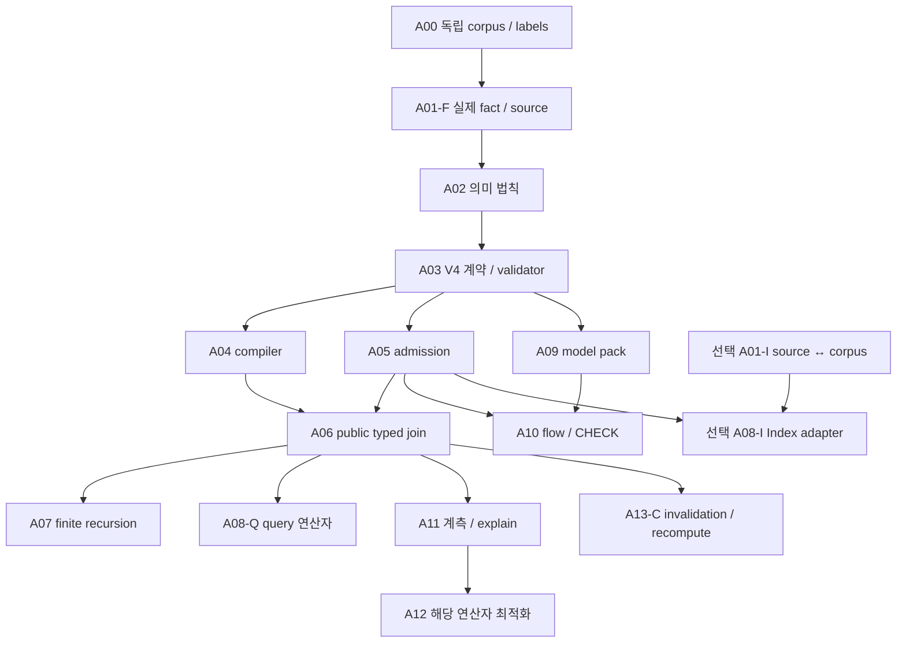

# Code-query 구현 액션 리스트

상태: 제안. 아래 항목은 source-paired 제품 증거가 붙기 전까지 완료로 표시하지 않는다.
갱신: 2026-10-04. [설계 RFC](./2026-10-04-code-query-dsl-and-substrate.md) · [소스 근거](../audits/2026-10-04-reference-source-review.md)

## 목표와 순서

첫 milestone: 공개 Java 질의가 **실제 두 fact를 join해 설치 프로세스에서 typed row를 반환**한다. Index·전체 optimizer·재귀·flow는 이 milestone의 선행 조건이 아니다.

A08-Q·A12·A13은 실제로 사용하는 재귀/flow 연산자의 gate만 추가로 요구한다. 단계 번호만으로 독립 작업에 선행 조건을 걸지 않는다.

## 작업·소유자·완료 조건

| ID | 소유자 / 선행 | 산출물 | 완료 증거 |
| --- | --- | --- | --- |
| A00 | 양쪽 / 시작 | Java corpus·독립 label·query/model 정책; CodeQL CLI/extractor/database/query/model pin | calls/cycle/duplicate/absence/alias/sanitizer/unknown-call의 기대값과 측정 범위 고정 |
| A01-F | Semantica fact/source / A00 | 두 실제 fact adapter; schema·nominal key·closure·coverage·lookup/pushdown 계약 | 공통 key로 source-sealed row 발행; 외부 closure·잘못된 schema·불완전 owner 거절 |
| A02 | 양쪽 / A01-F | RFC의 set/bag·tuple identity·dedup 위치·Option/negation/recursion/aggregate/order/path/failure 법칙과 독립 oracle | false·Incomplete·unsupported·resource failure 구분; projection/union 중복과 위험한 변환의 반례 보유 |
| A03 | frontend-contract + downstream result/consumer / A02 | V4 전체 rule/logical 계약과 별도 Result/Completion 계약; ID·capture·type·DAG·SCC validator, 지원 profile | 독립 bytes/vector·paired pin 일치; binding/basis 불일치·구버전·미지원 정책 거절; non-success를 complete answer로 해석 불가 |
| A04 | QGLang / A03 | 모든 head/body term·typed variable·occurrence·binding/correlation·조건·polarity·대안과 span을 보존하는 lowering | source→IR가 oracle과 일치; unbound/negative cycle/value-generating recursion·크기 초과 거절; physical bound/free 도출에 필요한 정보 유지 |
| A05 | Semantica ingress/provider / A01-F+A03 | artifact에 source·key·coverage/model·capability·예산 결합; 필요한 owner만 준비 | public admission 성공과 source/coverage/capability 거절; 작업 전체가 한 요청에 귀속 |
| A06 | Semantica physical/result / A04+A05 | reference evaluator, 기존 연산자 호환성표, public typed join·QueryResultV4 전송 | 설치 SDK/daemon 결과가 tuple oracle과 일치; memory/drop/cancel과 prefix→terminal 검증; coverage 없는 부재·전체 count 거절 |
| A07 | Semantica recursion / A04+A06 | typed finite domain·strata·전체 body 실행; dedup 후 main과 차집합한 new/delta | base/empty/cycle/mutual/nonlinear/negation이 fixed-point oracle과 일치; 동일 tuple의 복수 derivation은 재삽입 안 됨; 수렴 전 cap은 non-success |
| A08-Q | QGLang+Semantica / A06; 재귀 사용 시 A07 | 필요한 aggregate/sort/limit/cursor·multi-provider query | reorder/duplicate/residual/offset에서 결과·multiplicity·최종 상태 일치 |
| A09 | modules+model/taint owner / A01-F+A03 | Java pack + FlowProfileV4/FlowCoverageV4; alias/call-resolution/summary·unknown-call 정책·model pin·가정·absence authority | labeled sanitizer/alias/state/ambiguous dispatch 일치; 누락 model/summary를 식별; 보수적 fallback과 coverage gap 구분 |
| A10 | flow/check+solver/SDK / A05+A09; 필요한 result 연산자 | 새 flow/check 계약을 기존 solver·결과 경로에 연결 | 설치 positive/sanitizer-negative와 실제 context/state/source-valid witness; model gap·cap·worker 오류가 clean 판정으로 바뀌지 않음; profile/scope 밖의 안전성 주장 거절 |
| A11 | 양쪽 / 최소 A06부터 | logical/physical ID·선택 이유·추정/실제 rows·work/memory·delta·model·optimizer stop | 원인을 owner까지 추적; redaction·evidence 생성 크기 제한. rewrite 설명과 flow witness 구분 |
| A12 | Semantica / 해당 실행 연산자+A11 | 합법적 접근/join 대안·guarded rewrite·demand/SIPS의 별도 검증·동일 workload 비교 | 결과/order/witness 일치; bad stats/skew/fanout/재귀 증폭에서 bounded work·memory·typed 실패; 이후 평균 비용 개선 |
| A13 | 양쪽 / A06부터; 유지할 연산자의 gate | SCC/strata invalidation+recompute 먼저, 이후 +Δ/-Δ·replay-safe epoch·lease·증분 유지 | 매 공개 epoch가 fresh run과 일치; replay/delete/anti-join/model/retention 실패가 stale 성공을 만들지 않음 |
| A14 | 양쪽 / 비교에서 주장하는 gate | 동일 label/source/model의 CodeQL 비교, 미지원·품질·build/query/RSS 공개 | 사전 정의한 장점·허용 회귀 기준 통과. Index·증분은 구현·검증한 경우만 비교 |
| A15 | 양쪽 / A14 | 언어·framework별 fact/model/query 확대 | 추가 family마다 독립 label·실제 provider·설치 proof·새 비교 |

## 실행·그래프 gate

**A06-P baseline:** 기존 작업 planner·physical lowering·executor의 역할을 먼저 연결한다. bag/set, Option/null, match/post-join filter, correlation, source, budget을 연산자별로 확인한다. 필요한 order/partition 속성만 요구하고 유효한 deterministic baseline을 유지한다.

회귀에는 duplicate key, projection/union의 set dedup와 명시적 bag multiplicity, correlated EXISTS/NOT EXISTS의 거짓 conjunct, cross-provider key, partial fact, residual로 앞 후보가 제거되는 limit, reserve 실패·취소 후 해제를 넣는다. 중간 page 이후 오류는 완전한 count/absence/0행으로 바뀌면 안 된다. Complete answer의 binding/basis 위조·scope/profile 불일치, incomplete cursor, authored limit 완료를 decoder와 SDK에서 구별한다.

Graph를 지원할 때 A01-F/A02/A03에 exact 방향별 adjacency·edge ID·scope/path profile을 추가한다. Endpoint 필터와 중간 traversal domain을 구분한다. Parallel edge·self-loop·cycle·repeated node/edge·동률·zero hop·정확한 hop 경계·paged adjacency·역방향·중복 derivation을 oracle로 검사한다. Host cap, endpoint true, required witness 생성 실패는 각각 구분한다.

## 선택적인 Index 연결

[별도 통합 캠페인 에이전트 전달 프롬프트](../audits/2026-10-04-quanta-index-integration-campaign-prompt.md)에 배경·현행 호출 경로·재감사 범위·산출물을 명시한다.

- **A01-I / Semantica+Index:** 분석 source closure↔정확한 검색 corpus의 발행 관계, workspace overlay·incarnation·snapshot 서비스 가능성 정의.
- **A08-I / A01-I+A05+사용 연산자:** candidate→canonical fact ID, window/continuation·snapshot을 보존하는 adapter.
- **완료:** admitted exact plan의 Index on/off 결과 일치; corpus mismatch/expiry·잘못된 candidate 거절. Active head 이동이 읽기를 retarget하지 않음. Approximate/top-k/capped 결과는 exhaustive 입력으로 승격되지 않음.

## 최적화·증분 세부 배치

| 배치 | 작업과 gate |
| --- | --- |
| A12-P | Provider가 지원하는 scan/lookup/join 후보만 생성. 필수 schema/source/물리 속성을 검사하고 unknown/nonfinite/overflow 비용·canonical tie-break 정의 |
| A12-R | Rewrite별 독립 결과 oracle과 금지 반례. residual/limit·semi/anti·correlation·Option·multiplicity 보존. 미지원 outer/volatile 의미는 거절 |
| A12-D | A07 이후 positive recursion의 bound/free를 도출. Demand specialization과 SIPS/early filtering을 별도 변환으로 검증. Entry가 제한된 그래프에서 full-closure oracle과 scoped answer 일치·charged work 비교; negation/aggregate/flow 확장은 별도 proof 전 거절 |
| A12-M | planning+execution latency, estimation error, work·retained memory 비교. Bad stats/skew/fanout·반복 증폭에서 reservation/cancel/bounded work 검증. 선택적 optimizer cutoff는 유효 계획과 stop reason을 반환할 수 있음; request cancel/resource failure는 terminal |
| A13-C | source/provider/schema/query/contract/model dependency와 SCC/downstream strata에 따라 invalidate+fresh recompute. Query DX는 별도로 진행 |
| A13-I | owner별 기여·+Δ/-Δ·tuple equality/multiplicity·checked weight·replay-safe sequence/atomic replace·epoch input/output seal 정의; signed weight를 public negative row로 노출하지 않음 |
| A13-L | old query/cursor/evidence lease·expiry·shared memory owner·compaction 제한. 보존 압력은 명시적 거절/실패; held history를 몰래 제거하지 않음 |
| A13-O | duplicate/reorder/restart·owner-local retraction·두 재귀 경로의 순차 삭제·SCC 재계산·anti-join 첫 RHS 추가/마지막 RHS 삭제·partial coverage·model change·lease expiry를 매 epoch fresh run과 비교 |

A13-I/L과 A13-O는 **함께 통과해야** 유지 실행 결과를 공개할 수 있다. 전체 memo/e-graph, Differential runtime, DataFusion/Soufflé 채택은 동일 workload의 적응 비용·결과·자원 측정 후 결정한다. 신규 dependency를 지금 채택하지 않는다.

## 중단 조건과 검증 기록

- Source-sealed 두 fact를 발행하지 못하면 grammar 확대보다 provider를 먼저 수정한다.
- 부재를 정당화하지 못하면 `not`을 거절한다. Solver가 정책을 지원하지 못하면 그 flow/path 조합을 거절한다.
- Reference oracle과 결과 의미가 다르면 최적화를 중단한다. 실제 자원 실패와 optimizer 노력 종료를 혼동하지 않는다.
- 각 배치에 owner·HEAD/dirty 경로·source/contract/model/Index tuple·명령·결과를 기록한다. 다른 source의 receipt를 합치지 않는다.
- 작은 owner rail과 faulty behavior를 거절하는 회귀부터 실행한다. Repository 전체 완료는 로컬 `just ci`, clean committed receipt는 `just qualify-local`; hosted CI는 요구하지 않는다.
- [기존 V3 수리 계획](../audits/2026-10-04-frontend-consumer-contract-plan.md)은 별도다. 현재 CHECK dispatch나 V3 receipt를 새 V4 기능 완료로 세지 않는다.

이번 갱신은 문서 정리다. V4 구현·제품 테스트·성능 비교·로컬 CI 완료를 주장하지 않는다.
