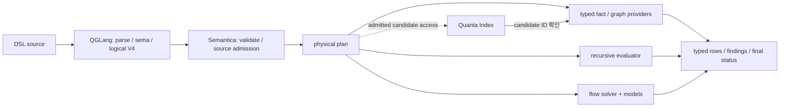

# RFC: typed code-query DSL과 실행 경계

상태: 설계 제안. 구현·제품 검증 완료를 뜻하지 않는다. 갱신: 2026-10-04.
[구현 액션](./2026-10-04-code-query-action-list.md) · [소스 근거와 레퍼런스](../audits/2026-10-04-reference-source-review.md)

## 1. 목적과 배경

기존 코드 분석 fact를 하나의 typed DSL로 조합하고, 재귀 질의와 모델 기반 보안 검사를 실제 실행한다. 결과는 typed row 또는 finding과 검증된 witness이며, “없음”과 “분석 불완전·미지원·예산 실패”를 구분한다.

목표 시나리오는 HTTP 진입점→SQL 실행기의 호출 관계와 request 값→SQL 인자의 taint 검사다. CodeQL은 기능·품질 비교 기준이다. Java의 명시한 corpus/model부터 검증하고, 우위는 동일 조건의 결과·자원 측정으로 입증한다.

현재 소스에는 frontend pipeline, Semantica의 분석 owner·물리 실행기·재귀 실행기·비용 planner, Index 검색이 있다. 부족한 연결은 **공개 logical 계약→source가 일치하는 typed fact→실행→typed 결과**다. SDK의 V3 CHECK dispatch는 이미 존재한다. 과거의 “CHECK 항상 미연결” 주장은 폐기한다. 새 DSL의 일반화된 flow/model 기능까지 구현됐다는 뜻은 아니다.

## 2. 변경 전후와 소유권

| 영역 | 현재 관찰 | 변경 목표 |
| --- | --- | --- |
| QGLang | source→HIR→sema→algebra/logic/planning→V3. rule membership·stratification proof 보유 | 완전한 typed head/body·occurrence·조건을 실행 가능한 logical program으로 전달 |
| 공개 relation 실행 | V3는 단일 `RepoPath`와 제한된 Scan/Filter/Project/EXISTS 계열 | 실제 fact의 다중 column join, 명시적 set/bag, typed 결과 |
| Semantica 실행·계획 | 기존 join/aggregate/sort/limit 실행과 순차·병렬 작업의 비용 선택 | 호환되는 실행기 연결; 관계형 접근·join 대안은 별도 검증 후 확장 |
| 재귀·flow | 별도 재귀 실행기와 분석 capability, V3 CHECK dispatch 존재 | 공개 DSL에서 finite fixed point와 모델 기반 flow/witness를 검증 |
| Index | 등록 검색과 정확한 generation pin | 선택적 candidate 접근에 분석 source↔검색 corpus 발행 관계·window 상태 연결 |



| 레포 | 책임과 기존 연결 지점 |
| --- | --- |
| `quanta-gqlang-v2` | surface/HIR/sema/logic/algebra/pipeline, `frontend-contract`, CLI·진단. host-agnostic logical 계약 발행 |
| `semantica-codegraph-v2` | public ingress, source authority, fact/graph owner, 기존 `physical_plan_v1`·`universal_executor_v1`·`quanta-planner`, recursion/solver, SDK 결과 |
| `quanta-index` | 검색 corpus 발행, candidate·generation·window/continuation 계약. 일반 fact/flow 실행은 Semantica 책임 |

V4 logical program에 physical algorithm, provider handle, runtime/Index pin을 넣지 않는다. 새 proxy 레포·프로세스는 만들지 않는다. 저장소·parser·엔진 전체 교체보다 기존 owner의 계약과 연결을 수정한다. 실제 경계가 확인될 때만 모듈·crate를 추가한다.

### 이번에 고정할 계약과 후속 확장

| 구분 | 이번 V4 설계에서 고정 | 구현 시점 |
| --- | --- | --- |
| P0 정확성 | Result/Completion 타입·부재 판정 권한, set/bag dedup boundary, flow profile/coverage | A02/A03; 결과는 A06, flow는 A09/A10에서 강제 |
| P1 준비 | Rule occurrence·typed variable·binding/correlation·SCC 의존성 보존 | A03/A04. Physical bound/free는 이 정보에서 도출 |
| 후속 실행 | Demand specialization/SIPS, signed delta 유지, pathological plan 회피 개선 | 각각 A07/A12, A13, A12의 oracle·측정 후. 최초 join의 필수 구현이 아님 |

새 bound/free bitmap이나 signed update를 frontend bytes의 실행 정책으로 고정하지 않는다. Batch 결과 의미를 먼저 확정하고, 후속 physical 실행이 필요한 정보를 잃지 않도록 한다.

## 3. 언어 모델

- `relation`: finite typed tuple의 집합과 derived predicate. 양의 재귀·층화된 negation.
- `query`: join/filter/project/group/order/limit. set-valued 기본, `rows query`는 명시적 bag이며 재귀 body에서 제외.
- `flow`: value/taint·source/sink/barrier/guard/state/model/solver 정책. graph BFS와 별도 의미.
- `check`: read-only finding·location·rule/model identity·선택적 또는 필수 witness. mutation은 기존 Command 경로.
- `find`: 지원되는 graph/flow 계약으로 낮추는 간결한 surface.

아래는 **제안 문법**이다. provider 이름과 syntax 지원을 현재 구현으로 주장하지 않는다.

```qglang
use code.java@1 as j;
relation reaches(src: j.Method, dst: j.Method) {
  j.calls(src, dst)
  or exists mid: j.Method {
    j.calls(src, mid) and reaches(mid, dst)
  }
}
query reachable_entrypoints {
  from j.http_entry(entry) and reaches(entry, target)
   and j.sql_executor(target)
  select { entry, target }
  order by entry.semantic_key, target.semantic_key
}
```

## 4. 반드시 지킬 계약

### Fact·scope·authority

Provider는 schema/version, nominal entity/key, source closure, lookup 방향, 정책별 coverage·soundness와 실패 상태를 발행한다. 서로 다른 provider의 문자열 ID가 같다고 join하지 않는다. 통계는 coverage·정확성의 증명이 아니다.

Predicate pushdown은 `unsupported / exact / superset + residual`로 선언한다. Superset은 true match를 누락하지 않고 residual에 필요한 column을 유지한다. 미지원 lookup은 후보로 만들지 않는다.

**결과 endpoint 범위, 중간 traversal 범위, 데이터 접근 권한을 구분한다.** 엔진은 선언된 의미를 계산하기 위해 추가 fact를 읽고 join할 수 있다. 읽기는 허용된 source·권한·예산 안에 있어야 하며, endpoint 필터를 임의로 induced subgraph로 바꾸지 않는다.

Index 사용 시 분석 source↔정확한 검색 corpus의 발행 관계를 검증하고 candidate를 canonical fact ID로 확인한다. 기존 snapshot이 유효하면 active head 이동은 허용한다. 불일치·만료 때 새 active로 몰래 전환하지 않는다. Approximate/top-k/capped window는 exhaustive count·absence·finding 입력의 유일한 근거가 될 수 없다.

### Logical program·의미

Consumer는 operator/relation/body-occurrence ID, 참조·capture scope, schema/arity/type, 일반 DAG와 명시적 SCC/strata를 독립 검증한다. 지원 operator/type/expression/result/flow 정책을 versioned profile로 선언하고 실제 admission/dispatch와 맞춘다. 필수 의미와 advisory hint를 구분한다.

- Rule은 전체 head/body term·조건·polarity·대안 clause를 보존한다. dependency 목록만으로 실행하지 않는다. OR 정규화의 크기·깊이를 제한한다.
- 첫 재귀 subset은 유한 입력 domain·상수에 한정한다. value-generating recursive constructor와 recursive aggregate는 거절한다. 관계별 `main/delta/new`와 모든 재귀 atom occurrence를 다루고 nonlinear/mutual recursion을 검증한다.
- Set relation의 tuple identity는 schema에 따른 전체 logical tuple이다. Projection·대안 clause union·relation 경계에서 중복을 제거한다. Bag query는 중복을 보존하고 명시적 `distinct`만 제거한다. Physical bag 저장은 logical set boundary를 바꾸지 않는다.
- 재귀의 `new_r = distinct(project_head(이번 round의 derivations_r)) ∖ main_r`; 같은 round의 후보도 중복 제거하고 다음 `delta_r = new_r`, `main_r := main_r ∪ new_r`로 진행한다. Equivalent schedule은 허용하되 nonlinear atom 대안의 결과·수렴은 같아야 한다. Provenance 중복을 tuple multiplicity로 세지 않는다.
- `not`·anti-join은 해당 scope/source/정책에서 부재를 정당화할 coverage가 필요하다. 불완전 fact를 빈 관계로 바꾸지 않는다.
- Null은 `Option<T>`다. SQL null·문자열·set/bag로 암묵 변환하지 않는다. global empty `count`는 0이며 다른 empty aggregate는 타입별로 정의한다.
- `limit`은 total order 뒤의 logical 결과에 적용한다. fetch/local-partition/global limit을 구분하고 residual·join·multiplicity·offset을 보존하는 경우만 조기 실행한다.

### Graph·flow·finding

Graph provider는 exact forward/backward adjacency, stable node/edge ID, source와 paged cursor 완료 상태를 제공한다. Endpoint `(source,sink)` 집합, edge/orientation 순서열의 path identity, query derivation multiplicity를 구분한다.

Hop/zero-length/direction/repetition, 대표 1개/전체, 단일/전체 최단 정책은 profile에 명시한다. 첫 profile은 증명된 bounded 대표 정책만 지원해도 된다. 선택 기준과 tie-order를 먼저 고정하고 미지원 조합은 거절한다. Authored hop bound 안의 완전한 탐색과 host cap에 의한 탐색 중단을 구분한다.

Flow는 solver의 context/alias/summary·유한 state 정책과 pinned model에 연결한다. Model은 callable/signature/subtype, arg/return access path, barrier/guard 방향, 우선순위·충돌·unknown-call fallback을 정의한다. Unknown call은 선언된 보수적 fallback을 따르며 자동으로 `Incomplete`가 되는 것은 아니다.

`FlowProfileV4`는 alias/call-resolution/unknown-call/summary 정책, model digest와 absence 정책을 고정한다. Runtime `FlowCoverageV4`는 source·scope·profile에 묶인 model/summary coverage, 누락 unit·cap과 가정을 기록한다. Soundness는 선언된 분석 정책·가정에 대한 주장이지 Boolean “안전함” 필드가 아니다. 완료된 계산에서 “profile P로 flow를 찾지 못함”과 “P의 부재 권한 아래 해당 scope에 flow 없음”을 구분한다. 필요한 model/summary coverage가 부족하면 부재 판정을 발행하지 않는다.

Required witness는 같은 source/model에서 call/return·state·edge/summary와 숨겨진 설명 단계를 검증한다. 일반 graph path를 flow witness로 대체하지 않는다. Finding key와 witness 선택을 분리하고 cross-generation key 안정성을 별도 증명한다. 완전한 finding scan만 성공한 SARIF로 내보낸다.

### Public Result/Completion 타입

아래는 A03에서 고정할 **제안 schema**다. Binding은 downstream admission이 발행한다. Frontend logical bytes에 runtime source/model handle을 추가하는 변경이 아니다.

```rust
struct ExecutionBindingV4 {
    query_id: QueryIdV4,
    source_id: IssuedSourceIdV4,
    model_digest: Option<ModelSetDigestV4>,
    profile_id: ProfileDigestV4,
}
enum QueryResultV4 {
    Complete { binding: ExecutionBindingV4,
        basis: CompletionBasisV4, answer: CompleteAnswerV4 },
    Incomplete { request_id: RequestIdV4,
        observed: Option<BoundObservationV4>,
        reasons: NonEmpty<IncompleteReasonV4> },
    Unsupported { request_id: RequestIdV4, requirement: UnsupportedRequirementV4 },
    Failed { request_id: RequestIdV4,
        binding: Option<ExecutionBindingV4>, failure: ExecutionFailureV4 },
}
```

`CompleteAnswerV4`는 typed rows/findings 또는 검증된 output reference다. `CompletionBasisV4`는 질의 scope·coverage·가정과 필요한 경우 owner가 발행한 absence authority를 binding에 연결한다. `BoundObservationV4`는 binding과 관찰 prefix를 함께 가진다. Non-success는 observation만 가질 수 있으며 complete answer를 갖지 못한다. Admission 전 실패는 issued source를 꾸며내지 않는다. Reasons/failure는 versioned typed code와 제한된 상세다.

Page event는 관찰값, terminal event는 `QueryResultV4`다. 질의가 요구한 enumeration이나 결과 전송이 미완료면 terminal `Complete`를 발행하지 않는다. Authored limit을 충족한 질의는 나머지 원본 row를 읽지 않아도 완료할 수 있다. Complete 생성자는 owner의 scope/profile/coverage와 required witness 확인을 요구한다. Decoder·SDK도 같은 조건을 검증한다. 부재·finding-clean은 **Complete + 해당 범위의 absence authority**, 정확한 전체 count는 **Complete + 해당 입력 범위의 exhaustive coverage**를 요구한다. 제한된 ranked query의 완료나 반환 prefix count를 전체 부재·전체 count로 승격하지 않는다.

### 실행·최적화

Retained join/sort/recursion/evidence는 할당 전 memory reservation과 종료·오류·drop 시 해제를 요구한다. 배치·backpressure·owned task·취소 checkpoint를 제한한다. Spill이 없으면 bound 초과 전에 실패한다.

중간 page는 같은 query/source/model에 묶인 provisional prefix다. 최종 status만 완료를 증명한다. Provider 누락, solver cap/worker 오류, 예산·취소 실패를 완전한 0행·부재 판정으로 바꾸지 않는다. 재귀 tuple cap과 결과 cardinality가 같다는 사실은 수렴 증명이 아니다.

먼저 deterministic admitted baseline을 만든다. 필요한 물리 속성만 요구하고 미상·비유한·overflow 비용과 동률 처리를 정의한다. 이후 작은 합법적 scan/lookup/join 후보부터 비교한다. 선택적 **optimizer 노력 제한**은 유효한 baseline/best-known plan으로 끝낼 수 있으나, 요청 취소·필수 자원 실패를 숨기면 안 된다. 충분한 예산에서는 결과·순서·witness 정책이 같아야 하며 제한된 예산에서는 합법적 계획별 실패 시점이 달라질 수 있다.

Optimizer 목적 순서는 **semantic legality → pathological intermediate/work 방어 → deterministic fallback → 평균 비용 개선**이다. Hard request bound는 나쁜 계획을 싸게 만든다는 뜻이 아니라 폭주를 typed failure로 멈추는 장치다. 초기 개선은 지원되는 hash join/indexed lookup/join order·early filtering부터 검증한다.

Rule별 relational plan과 SCC recursive control을 분리한다. Planner는 보존된 variable/binding/occurrence로 bound/free를 계산한다. Query binding을 재귀 안으로 전달하는 demand specialization이나 SIPS/semijoin early filtering은 서로 구분하고, 의미 보존을 증명한 positive subset에만 적용한다. Negation·aggregate·flow는 별도 증명 전 specialization하지 않는다. 전체 closure와 동일한 scoped answer를 내는지 검사한다. [FlowLog](https://www.vldb.org/pvldb/vol19/p361-zhao.pdf)는 rule IR/control 분리와 robustness·SIPS 참고이며 우리 성능의 증거는 아니다.

### 증분 실행

먼저 dependency invalidation+fresh recomputation을 맞춘다. 유지 실행은 이후 별도 gate다. Owner별 insert/delete 기여와 replay-safe epoch/sequence, 전체 input seal·output 완료, source/model coverage를 함께 확인한다. 재전송이 multiplicity를 중복 반영하면 안 된다.

Runtime operator adapter는 후속 `+Δ/-Δ`를 수용할 수 있도록 tuple equality·multiplicity·dependency를 명시한다. 지금 모든 연산자에 delta API를 구현하지 않는다. Signed weight는 내부 갱신이며 public set의 negative row가 아니다. 삭제는 해당 SCC와 downstream dependent strata를 invalidate/recompute하는 baseline부터 시작한다. Anti-join은 RHS 추가 시 기존 output 철회, 마지막 RHS 제거 시 output 복구를 검증한 뒤 유지 실행한다. [CodeQL diff-informed hook](https://codeql.github.com/codeql-standard-libraries/java/codeql/dataflow/DataFlow.qll/predicate.DataFlow%24Configs%24ConfigSig%24observeDiffInformedIncrementalMode.html)은 변경 관련 source/sink 필터의 예이며 full incremental engine의 증거가 아니다.

Query/cursor/evidence lease와 shared memory owner를 정하고 held history를 compaction으로 파괴하지 않는다. 보존 압력은 새 작업 거절 또는 명시적 만료·실패로 처리한다. Replay/restart·삭제·negation·model change의 매 공개 epoch가 fresh run과 같아야 한다.

## 5. 변경 순서와 판단 기준

첫 제품 결과는 **실제 두 fact를 join하는 공개 Java 질의의 설치 프로세스 실행**이다. 이후 재귀와 모델 기반 flow/CHECK를 연결한다. 최적화는 바꾸는 연산자의 실행·oracle 이후, 증분 유지 실행은 workload·publication/retention 검증 이후 진행한다. Index는 선택 단계다. [액션 리스트](./2026-10-04-code-query-action-list.md)가 ID·의존성·완료 조건을 관리한다.

V4는 breaking cutover다. DTO·digest domain·producer vector·consumer golden/pin을 함께 바꾸고 old/incompatible bytes를 거절한다. 기존 V3 bag 문법은 명시적으로 변환하거나 migration 오류를 낸다. 새 record syntax를 기존 `result_shape` 지원으로 해석하지 않는다.

얻게 되는 것은 재사용 가능한 분석 질의, fact 간 안전한 조합, 실제 witness, 원인 추적 가능한 실패다. 정확도·속도·CodeQL 우위는 자동으로 얻지 않는다. 동일 source/model·독립 label·설치 실행·cold/warm latency/RSS로 비교하고 미지원 사례를 공개한다.

## 6. 레퍼런스·검증 상태

[10개 pinned source 감사](../audits/2026-10-04-reference-source-review.md)를 근거로 계약을 선택했다. 신규 production dependency는 결정하지 않았다. DataFusion/Calcite/egg는 관계형 실행·최적화, Soufflé/Datafrog는 재귀, Differential은 증분의 비교 후보다. Joern/CodeQL은 모델·flow 참고이며 공개 CodeQL evaluator 내부는 감사 범위 밖이다. Kuzu는 archived 역사적 참고다. 전체 SMT·symbolic execution·storage 교체는 첫 milestone에 포함하지 않는다.

Lattice language, arbitrary recursive aggregate, general provenance algebra/automatic why-not, WCOJ 전체 구현, adaptive reoptimization, ML cost model, full Cascades/equality saturation·Differential clone은 현행 핵심에서 제외한다. Required flow witness를 먼저 검증한다. [Soufflé provenance](https://souffle-lang.github.io/provenance)의 lazy proof와 사용자 rule/binding을 받는 부재 설명은 bounded evidence의 참고다.

현재 문서는 설계와 source 관찰이다. 과거 upstream pin·관찰 SHA·Datafrog probe는 감사 문서에 보존한다. 이번 정리는 문서만 변경했고 제품 테스트·성능 비교·`just ci`는 실행하지 않았다. [기존 V3 계약 수리](../audits/2026-10-04-frontend-consumer-contract-plan.md)의 상태·receipt는 해당 문서가 관리하며 V4 완료와 혼용하지 않는다.
